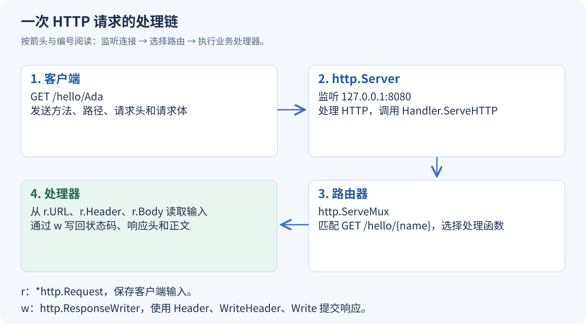

# Gin 基础（01）：从 net/http 看懂一次请求

浏览器请求 `/hello/Ada` 时，Go 程序要解决两个问题：把请求交给哪个函数，以及把什么内容写回连接。Gin 也沿用这条处理链。先把标准库里的几个对象分清楚，后面就不会把路由、处理器和服务器混在一起。

## 请求怎样到达处理函数

`http.Server` 负责监听端口、接受连接和处理 HTTP 协议。它把每个请求交给一个实现了 `http.Handler` 的对象；这个接口只有 `ServeHTTP(http.ResponseWriter, *http.Request)` 方法。

`http.ServeMux` 是标准库的路由器，也是一个 `http.Handler`。它根据请求方法和路径选择处理函数。`http.HandlerFunc` 则把具有相同参数的普通函数适配成处理器。



进入处理函数后，`r` 保存客户端传来的方法、URL、请求头和请求体；`w` 用来设置响应头、状态码和响应体。两者方向不同：读请求用 `r`，写响应用 `w`。

Go 1.22 起，`ServeMux` 可以直接注册 `GET /hello/{name}`，再用 `r.PathValue("name")` 取路径变量。`GET` 模式还匹配 `HEAD`。所以选择 Gin 的理由应该落在绑定、校验、中间件组织等需求上；现代标准库本身已经能按方法和路径变量路由。[Go 官方路由说明](https://go.dev/blog/routing-enhancements)

## 一个有明确输入规则的 HTTP 服务

示例提供两个接口：`GET /hello/{name}` 返回问候语；`POST /echo` 接收一个带 `name` 的 JSON 对象。后者只允许一个 JSON 值，禁止未知字段，并限制请求体最多 1024 字节。

使用 Go 1.25 或更高版本，新建独立目录。以下命令按 PowerShell 7 编写；Linux/macOS 请求示例中的 `curl.exe` 可换成 `curl`。

```powershell
mkdir gin-01-http
Set-Location gin-01-http
go mod init example.com/gin-01-http
```

每个示例单独运行，避免多个 `main` 函数放进同一个包。

保存为 `main.go`：

```go
package main

import (
	"encoding/json"
	"errors"
	"io"
	"log"
	"mime"
	"net/http"
	"strings"
	"time"
)

type Input struct {
	Name string `json:"name"`
}

// 先完成序列化，再提交状态码，避免编码失败后已经发出 200。
func writeJSON(w http.ResponseWriter, status int, value any) {
	data, err := json.Marshal(value)
	if err != nil {
		http.Error(w, "response encoding failed", http.StatusInternalServerError)
		return
	}
	w.Header().Set("Content-Type", "application/json; charset=utf-8")
	w.WriteHeader(status)
	if _, err := w.Write(data); err != nil {
		log.Printf("write response: %v", err)
	}
}

func NewHandler() http.Handler {
	mux := http.NewServeMux()
	mux.HandleFunc("GET /hello/{name}", func(w http.ResponseWriter, r *http.Request) {
		writeJSON(w, http.StatusOK, map[string]string{"message": "你好，" + r.PathValue("name")})
	})
	mux.HandleFunc("POST /echo", func(w http.ResponseWriter, r *http.Request) {
		mediaType, _, err := mime.ParseMediaType(r.Header.Get("Content-Type"))
		if err != nil || mediaType != "application/json" {
			writeJSON(w, http.StatusUnsupportedMediaType, map[string]string{"error": "请使用 application/json"})
			return
		}
		r.Body = http.MaxBytesReader(w, r.Body, 1024)
		decoder := json.NewDecoder(r.Body)
		decoder.DisallowUnknownFields()
		var input Input
		err = decoder.Decode(&input)
		if err == nil {
			// 再读一次应当只遇到 EOF；否则请求中还有另一段 JSON 或其他内容。
			var extra any
			if nextErr := decoder.Decode(&extra); nextErr != io.EOF {
				if nextErr == nil {
					err = errors.New("only one JSON value is allowed")
				} else {
					err = nextErr
				}
			}
		}
		if err != nil {
			status := http.StatusBadRequest
			var tooLarge *http.MaxBytesError
			if errors.As(err, &tooLarge) {
				status = http.StatusRequestEntityTooLarge
			}
			writeJSON(w, status, map[string]string{"error": "请求体过大或 JSON 格式不符合要求"})
			return
		}
		if strings.TrimSpace(input.Name) == "" {
			writeJSON(w, http.StatusBadRequest, map[string]string{"error": "name 不能为空"})
			return
		}
		writeJSON(w, http.StatusOK, input)
	})
	return mux
}

func main() {
	server := &http.Server{
		Addr: "127.0.0.1:8080", Handler: NewHandler(),
		ReadHeaderTimeout: 5 * time.Second,
	}
	log.Fatal(server.ListenAndServe())
}
```

`NewHandler` 返回路由器，`main` 把它装进服务器。把组装路由单独放进函数，是为了让测试直接发送 HTTP 请求，不必先占用固定端口。

`json.NewDecoder(r.Body)` 从请求流中解码。第一次 `Decode` 成功，只能说明读到了一个 JSON 值；它不能证明后面已经没有内容。第二次读取应得到 `io.EOF`，这样才能拒绝 `{"name":"A"} {"name":"B"}` 这样的双 JSON 请求。

`http.MaxBytesReader` 包在原始请求体外面，超过限制后返回 `*http.MaxBytesError`。这里把它映射成 `413`，把普通格式错误映射成 `400`。仅检查 `Content-Length` 不够：请求可以使用分块传输，请求头中的声明也不能代替实际读取上限。[net/http 的 MaxBytesReader](https://pkg.go.dev/net/http#MaxBytesReader)

## 发送请求并核对结果

运行：

```powershell
go run .
```

再打开一个终端：

```powershell
curl.exe -i "http://127.0.0.1:8080/hello/Ada"
'{"name":"小明"}' | Set-Content -Encoding utf8NoBOM request.json
curl.exe -i "http://127.0.0.1:8080/echo" -H "Content-Type: application/json" --data-binary "@request.json"
```

两个响应都是 `200`，正文分别是 `{"message":"你好，Ada"}` 和 `{"name":"小明"}`，响应头包含 `Content-Type: application/json; charset=utf-8`。

把 `request.json` 改成 `{"name":"小明","admin":true}`，得到 `400`；把请求方法改成 `GET /echo`，路由器返回 `405`；把媒体类型改成 `text/plain`，接口返回 `415`。这些结果分别对应字段、方法和媒体类型的不同问题。

## 写响应时，先决定头部再写正文

普通最终响应只能提交一次状态码。没有先调用 `WriteHeader` 时，第一次 `Write` 会隐式提交 `200`；之后再改成 `500` 已经来不及。示例先序列化数据，确认成功后才设置头部和状态码。

`127.0.0.1:8080` 只供本机访问；`:8080` 通常监听所有可用网卡。打印一句 `http://127.0.0.1:8080` 不会改变实际监听地址，真正起作用的是服务器的 `Addr`。

请求结束后不要继续从后台 goroutine 写同一个 `ResponseWriter`。需要后台工作时，应先确定任务的输入、持久化和完成通知方式，响应本身仍由当前 HTTP 处理流程负责。

---

[课程目录](https://blog.woodfish.site/posts/gin-basics) · [JSON 响应与 HTTP 状态码 →](https://blog.woodfish.site/posts/gin-basics-02-responses)
