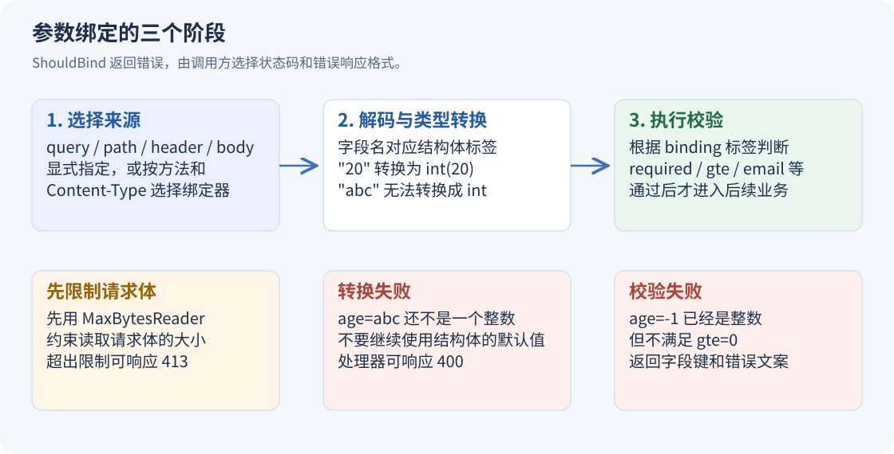

# Gin 基础（06）：参数绑定与请求体复用

参数绑定把字符串、JSON 等请求数据装进 Go 结构体，再触发声明好的校验规则。它解决了重复取值和类型转换的问题，但前提仍然是明确数据来源。



## 每一种来源使用自己的标签

| 来源 | 方法 | 标签示例 |
| --- | --- | --- |
| 查询字符串 | `ShouldBindQuery` | `form:"page"` |
| 路径变量 | `ShouldBindUri` | `uri:"id"` |
| 请求头 | `ShouldBindHeader` | `header:"X-Request-ID"` |
| JSON 请求体 | `ShouldBindJSON` | `json:"name"` |
| 自动选择 JSON 或表单 | `ShouldBind` | 对应的 `json`、`form` 标签 |

`ShouldBind` 会根据方法和 Content-Type 选择绑定器。GET 使用表单/查询绑定；JSON 请求选择 JSON 绑定；`application/x-www-form-urlencoded` 和 `multipart/form-data` 都有相应的表单处理方式。URL 编码表单能够正常绑定，不需要换成 multipart 才能使用结构体。[绑定 query 或表单数据](https://gin-gonic.com/en/docs/binding/bind-query-or-post/)

对外接口最好明确接受哪些媒体类型。下面的 `/profile` 只允许 JSON 和两种表单，其他类型返回 `415`，避免错误类型被静默当成空表单。

## Bind 与 ShouldBind 的失败行为

`Bind`、`BindJSON` 这类方法在绑定失败时会自动中止后续处理链，并提交 HTTP `400`。如果随后试图改成别的状态码，可能已经无法覆盖已发出的头部。

`ShouldBind` 系列只返回错误，响应格式与状态码由处理器决定。需要统一 JSON 错误结构时，用它更容易控制。这里每条路由只有一个业务处理器，失败后 `return` 就能结束当前业务；如果在中间件中校验并拒绝请求，还需要显式中止处理链。[绑定错误的行为差异](https://gin-gonic.com/en/docs/binding/binding-and-validation/)

## 完整示例：绑定五种输入

使用 Go 1.25 或更高版本，新建独立目录。以下命令按 PowerShell 7 编写；Linux/macOS 请求示例中的 `curl.exe` 可换成 `curl`。

```powershell
mkdir gin-06-binding
Set-Location gin-06-binding
go mod init example.com/gin-06-binding
go get github.com/gin-gonic/gin@v1.12.0
```

每个示例单独运行，避免多个 `main` 函数放进同一个包。

保存为 `main.go`：

```go
package main

import (
	"errors"
	"log"
	"net/http"

	"github.com/gin-gonic/gin"
	"github.com/gin-gonic/gin/binding"
)

type Profile struct {
	Name string `json:"name" form:"name" binding:"required"`
	Age  *int   `json:"age" form:"age" binding:"required,gte=0,lte=150"`
}

func bindError(c *gin.Context, err error) {
	status := http.StatusBadRequest
	var tooLarge *http.MaxBytesError
	if errors.As(err, &tooLarge) {
		status = http.StatusRequestEntityTooLarge
	}
	c.JSON(status, gin.H{"error": "参数格式、大小或校验不符合要求"})
}

func NewRouter() *gin.Engine {
	r := gin.New()
	r.Use(gin.Recovery())
	if err := r.SetTrustedProxies(nil); err != nil {
		panic(err)
	}
	r.Use(func(c *gin.Context) {
		c.Request.Body = http.MaxBytesReader(c.Writer, c.Request.Body, 8192)
		c.Next()
	})
	r.GET("/search", func(c *gin.Context) {
		var input struct {
			Page int      `form:"page,default=1" binding:"gte=1"`
			Tags []string `form:"tag"`
		}
		if err := c.ShouldBindQuery(&input); err != nil {
			bindError(c, err)
			return
		}
		c.JSON(http.StatusOK, gin.H{"page": input.Page, "tags": input.Tags})
	})
	r.GET("/users/:id", func(c *gin.Context) {
		var input struct {
			ID uint64 `uri:"id" binding:"gte=1"`
		}
		if err := c.ShouldBindUri(&input); err != nil {
			bindError(c, err)
			return
		}
		c.JSON(http.StatusOK, gin.H{"id": input.ID})
	})
	r.GET("/headers", func(c *gin.Context) {
		var input struct {
			RequestID string `header:"X-Request-ID" binding:"required"`
		}
		if err := c.ShouldBindHeader(&input); err != nil {
			bindError(c, err)
			return
		}
		c.JSON(http.StatusOK, gin.H{"request_id": input.RequestID})
	})
	r.POST("/profile", func(c *gin.Context) {
		switch c.ContentType() {
		case gin.MIMEJSON, gin.MIMEPOSTForm, gin.MIMEMultipartPOSTForm:
		default:
			c.JSON(http.StatusUnsupportedMediaType, gin.H{"error": "请提交 JSON 或表单"})
			return
		}
		var input Profile
		err := c.ShouldBind(&input)
		if c.Request.MultipartForm != nil {
			defer c.Request.MultipartForm.RemoveAll()
		}
		if err != nil {
			bindError(c, err)
			return
		}
		c.JSON(http.StatusOK, input)
	})
	r.POST("/twice", func(c *gin.Context) {
		var first struct {
			Name string `json:"name" binding:"required"`
		}
		var second struct {
			Age int `json:"age"`
		}
		if err := c.ShouldBindBodyWith(&first, binding.JSON); err != nil {
			bindError(c, err)
			return
		}
		if err := c.ShouldBindBodyWith(&second, binding.JSON); err != nil {
			bindError(c, err)
			return
		}
		c.JSON(http.StatusOK, gin.H{"name": first.Name, "age": second.Age})
	})
	return r
}

func main() {
	if err := NewRouter().Run("127.0.0.1:8080"); err != nil {
		log.Fatal(err)
	}
}
```

`Profile` 同时声明 `json` 和 `form` 标签，因此同一个 DTO 可以接受不同编码。DTO 是接口使用的数据结构，不必与数据库模型共用一份类型。

`Age` 使用 `*int`。缺失字段或 JSON `null` 对应 `nil`，明确传入 `0` 则是指向零的指针。这样 `required` 检查“需要一个值”，`gte=0,lte=150` 检查数值范围，两种约束不会互相冲突。

查询参数的 `form:"page,default=1"` 提供绑定时默认值，随后 `gte=1` 检查范围。传 `page=zero` 时，数字转换已经失败；传 `page=0` 时，转换成功但校验失败。两种错误发生在不同阶段。

## 核对 JSON 和表单得到相同结果

运行 `go run .`，在另一个终端执行：

```powershell
curl.exe "http://127.0.0.1:8080/search?page=3&tag=go&tag=web"
curl.exe "http://127.0.0.1:8080/users/12"
curl.exe "http://127.0.0.1:8080/headers" -H "X-Request-ID: request-1"
curl.exe "http://127.0.0.1:8080/profile" --data "name=Lin&age=0"
curl.exe "http://127.0.0.1:8080/profile" -F "name=Lin" -F "age=0"
'{"name":"Lin","age":0}' | Set-Content -Encoding utf8NoBOM request.json
curl.exe "http://127.0.0.1:8080/profile" -H "Content-Type: application/json" --data-binary "@request.json"
```

最后三条都返回 `200` 和 `{"name":"Lin","age":0}`。删除 `age` 则返回 `400`，说明合法的零值与未传参数已经区分开。

普通 URL 编码表单绑定会使用解析后的表单数据；同名 query 与表单正文同时存在时，正文中的值优先。对权限、分页或资源 ID 等重要字段，应固定来源，避免一个值在多个位置重复出现。

## 同一个 JSON 请求体怎样绑定两次

普通请求体是顺序读取的流，连续调用两次消费请求体的绑定方法，后一次可能读到 EOF。`ShouldBindBodyWith` 会缓存原始字节，后续使用同一缓存绑定到另一种结构体。

示例 `/twice` 的第一个结构体只声明 `name`，第二个只声明 `age`：

```powershell
'{"name":"Lin","age":20}' | Set-Content -Encoding utf8NoBOM request.json
curl.exe "http://127.0.0.1:8080/twice" -H "Content-Type: application/json" --data-binary "@request.json"
```

响应是 `{"name":"Lin","age":20}`。缓存需要内存，所以接口先限制了 8 KiB。只有一份 DTO 时，直接绑定一次更简单。[重复绑定请求体](https://gin-gonic.com/en/docs/binding/bind-body-into-different-structs/)

默认 JSON 绑定会忽略未声明字段，也不等于检查整个输入只能包含一个 JSON 值。若契约要求拒绝未知字段，可以在启动阶段配置相应解码选项；若要求严格的单 JSON 文档，需要像原生 HTTP 示例那样额外确认 EOF。不要把字段校验、JSON 语法、媒体类型和整份请求的读取边界当成同一个检查。

---

[← 单文件与多文件上传](https://blog.woodfish.site/posts/gin-basics-05-uploads) · [课程目录](https://blog.woodfish.site/posts/gin-basics) · [校验规则、中文错误与自定义校验 →](https://blog.woodfish.site/posts/gin-basics-07-validation)
