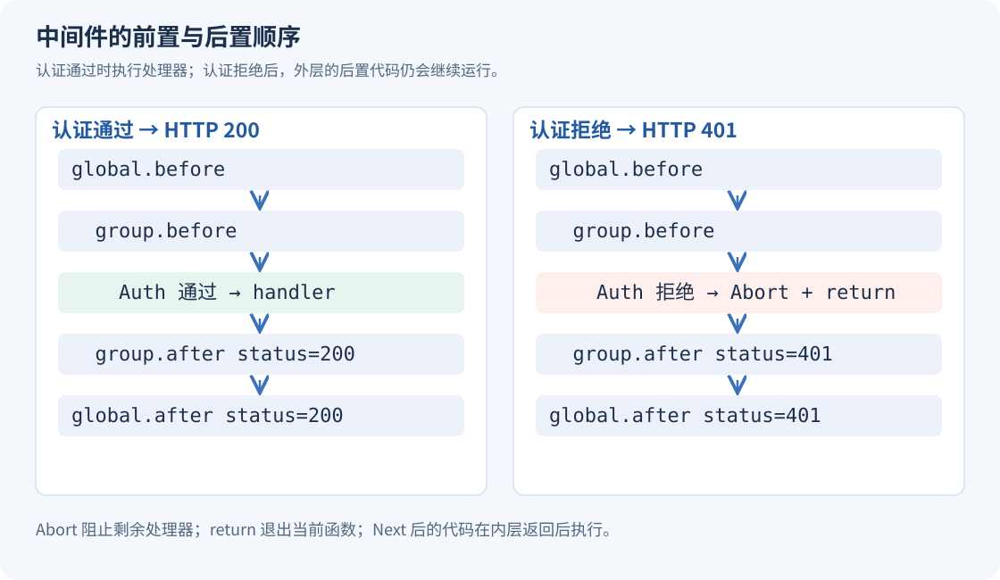

# Gin 基础（08）：路由分组、中间件与服务退出

认证、日志和耗时统计往往要作用于一组接口。中间件把这些公共处理放进请求链，路由分组则决定这条链覆盖哪些路径。看懂执行顺序，才能知道失败后哪些代码仍然会运行。

## 路由由方法和资源路径共同决定

| 请求 | 常见含义 |
| --- | --- |
| `GET /api/users` | 读取用户列表 |
| `POST /api/users` | 创建用户 |
| `GET /api/users/:id` | 读取一个用户 |
| `PUT /api/users/:id` | 按约定替换资源状态 |
| `PATCH /api/users/:id` | 修改部分内容 |
| `DELETE /api/users/:id` | 删除用户 |

复数资源名只是常见命名习惯。设计接口时还需要定义方法语义、状态码和错误契约，不应把 RESTful 简化成“URL 换个名字”，也不必把所有业务强行设计成同一种操作。

幂等指同样的请求重复执行，最终资源状态与执行一次一致。DELETE 第一次可能返回 `204`、第二次返回 `404`，仍然可以保持删除操作的幂等语义；它不要求每次响应完全相同。PATCH 是否幂等取决于具体修改规则。

## Next、Abort、return 各自改变什么

`c.Next()` 执行后面的处理器，等它们返回后，继续执行当前函数中 `Next` 后面的代码。多个中间件嵌套调用，就出现了“前置代码正序、后置代码逆序”的结果。



`c.Abort()` 阻止剩余处理器继续执行，但不会立即返回当前 Go 函数。它之后的普通语句仍然会运行，而且外层中间件已经进入的后置代码也会继续执行。

`return` 只结束当前函数。只在中间件中写 `return`，并不会自动禁止 Gin 调用剩余处理器。因此拒绝请求时，通常是写出错误响应、调用 Abort，再 return：

```go
c.AbortWithStatusJSON(http.StatusUnauthorized, gin.H{"error": "凭证无效"})
return
```

`AbortWithStatusJSON` 已经组合了中止处理链和 JSON 响应，仍然需要后面的 `return` 才能结束当前函数。[Gin Context.Abort](https://pkg.go.dev/github.com/gin-gonic/gin@v1.12.0#Context.Abort)

## 全局、分组和单条路由的中间件

`r.Use(...)` 作用于随后注册在该引擎链上的路由；`group.Use(...)` 或 `r.Group("/api", ...)` 限定到分组；`r.GET("/path", middleware, handler)` 则给单条路由配置链。

注册路由时，Gin 会组合当时的处理器链。不要先注册路由，之后再添加 `Use`，然后期待旧路由也被修改。把公共中间件放在路由定义之前，分组创建也遵守这个顺序。

## 一个包含认证、日志和正常退出的服务

使用 Go 1.25 或更高版本，新建独立目录。以下命令按 PowerShell 7 编写；Linux/macOS 请求示例中的 `curl.exe` 可换成 `curl`。

```powershell
mkdir gin-08-middleware
Set-Location gin-08-middleware
go mod init example.com/gin-08-middleware
go get github.com/gin-gonic/gin@v1.12.0
```

每个示例单独运行，避免多个 `main` 函数放进同一个包。

保存为 `main.go`：

```go
package main

import (
	"context"
	"crypto/subtle"
	"errors"
	"fmt"
	"io"
	"log"
	"net/http"
	"os"
	"os/signal"
	"strings"
	"syscall"
	"time"

	"github.com/gin-gonic/gin"
)

func Trace(name string, output io.Writer) gin.HandlerFunc {
	logger := log.New(output, "", 0)
	return func(c *gin.Context) {
		logger.Printf("%s.before", name)
		c.Next()
		logger.Printf("%s.after status=%d", name, c.Writer.Status())
	}
}

func Auth(token string) gin.HandlerFunc {
	return func(c *gin.Context) {
		want := "Bearer " + token
		if subtle.ConstantTimeCompare([]byte(c.GetHeader("Authorization")), []byte(want)) != 1 {
			c.Header("WWW-Authenticate", `Bearer realm="gin-basics"`)
			c.AbortWithStatusJSON(http.StatusUnauthorized, gin.H{"error": "凭证缺失或无效"})
			return
		}
		// 固定身份只用于演示认证结果如何传给后续处理器。
		c.Set("user_id", "demo-user")
		c.Next()
	}
}

func NewRouter(token string, output io.Writer) (*gin.Engine, error) {
	if strings.TrimSpace(token) == "" {
		return nil, fmt.Errorf("DEMO_API_TOKEN must not be empty")
	}
	r := gin.New()
	r.Use(gin.Recovery(), Trace("global", output))
	if err := r.SetTrustedProxies(nil); err != nil {
		return nil, err
	}
	r.HandleMethodNotAllowed = true
	r.NoMethod(func(c *gin.Context) {
		c.JSON(http.StatusMethodNotAllowed, gin.H{"error": "请求方法不支持"})
	})
	r.GET("/healthz", func(c *gin.Context) {
		c.JSON(http.StatusOK, gin.H{"status": "ok"})
	})
	api := r.Group("/api", Trace("group", output), Auth(token))
	api.GET("/me", func(c *gin.Context) {
		userID, exists := c.Get("user_id")
		if !exists {
			c.AbortWithStatusJSON(http.StatusInternalServerError, gin.H{"error": "身份上下文缺失"})
			return
		}
		log.New(output, "", 0).Print("handler")
		c.JSON(http.StatusOK, gin.H{"user_id": userID, "client_ip": c.ClientIP()})
	})
	return r, nil
}

func main() {
	router, err := NewRouter(os.Getenv("DEMO_API_TOKEN"), os.Stdout)
	if err != nil {
		log.Fatal(err)
	}
	server := &http.Server{
		Addr: "127.0.0.1:8080", Handler: router,
		ReadHeaderTimeout: 5 * time.Second,
		ReadTimeout:       15 * time.Second,
		WriteTimeout:      15 * time.Second,
		IdleTimeout:       60 * time.Second,
	}
	stop, cancel := signal.NotifyContext(context.Background(), os.Interrupt, syscall.SIGTERM)
	defer cancel()
	serveErr := make(chan error, 1)
	go func() { serveErr <- server.ListenAndServe() }()
	select {
	case err := <-serveErr:
		if !errors.Is(err, http.ErrServerClosed) {
			log.Fatal(err)
		}
		return
	case <-stop.Done():
	}
	ctx, finish := context.WithTimeout(context.Background(), 5*time.Second)
	defer finish()
	if err := server.Shutdown(ctx); err != nil {
		log.Printf("graceful shutdown: %v", err)
		_ = server.Close()
	}
	if err := <-serveErr; !errors.Is(err, http.ErrServerClosed) {
		log.Printf("server exit: %v", err)
	}
}
```

`NewRouter` 的 `output` 是日志写入位置，`main` 传入终端输出，测试则传入内存缓冲区。`Trace` 记录前后顺序和最终状态码，不把请求头里的令牌写进日志。

`Auth` 通过 `c.Set("user_id", ...)` 把认证结果放进当前请求的 Gin Context，后续处理器再用 `c.Get` 读取。这是本次请求的临时数据，不是进程级用户缓存，也不是下一次请求会自动携带的会话。

示例令牌从环境变量读取，只演示认证中间件的位置和拒绝流程；成功时使用固定的 `demo-user`。真实身份系统还要验证实际凭证并查询对应身份。跨网络传输凭证应使用 HTTPS，本例绑定 `127.0.0.1` 供本机练习。

## 按日志核对执行顺序

PowerShell 7 中先设置演示令牌：

```powershell
$env:DEMO_API_TOKEN = 'local-demo-token'
go run .
```

在另一个终端：

```powershell
curl.exe -i "http://127.0.0.1:8080/api/me"
curl.exe -i "http://127.0.0.1:8080/api/me" -H "Authorization: Bearer local-demo-token"
```

第一条得到 `401`。第二条得到 `200`，包含 `user_id: "demo-user"`；成功请求的终端日志顺序为：

```text
global.before
group.before
handler
group.after status=200
global.after status=200
```

认证失败时没有 `handler`，但仍有 `group.after status=401` 和 `global.after status=401`。这解释了为什么日志和耗时中间件可以在拒绝请求后继续记录结果。

## Context、代理和服务退出的边界

Gin 会复用 `*gin.Context`。不要把它存进全局变量，也不要在请求结束后继续用它写响应。需要把取消信号传给数据库或另一个 HTTP 请求时，通常传递 `c.Request.Context()`。`c.Copy()` 可用于有明确生命周期的只读访问，但不会把原请求的 ResponseWriter 变成可长期使用的对象。

这里关闭了可信代理，所以客户端随便发送 `X-Forwarded-For` 不会改变 `c.ClientIP()` 的结果。部署在自己的反向代理后面时，应配置实际可信代理地址或网段，再让代理生成或重写转发头。[可信代理配置](https://gin-gonic.com/en/docs/server-config/trusted-proxies/)

`http.Server` 的超时负责限制不同阶段的等待。示例的 15 秒读写超时服务于本地小请求；长时间上传、下载或流式响应要按实际协议调整，不能机械照搬。

收到 Ctrl+C 或终止信号后，`Shutdown` 先停止接收新连接，再给已有请求时间完成。`main` 等待这个过程结束，避免监听函数刚返回就让整个进程退出。超过 5 秒仍未结束时，示例才调用 `Close`。WebSocket 等已经被劫持的连接还需要由应用单独管理。[正常关闭服务](https://gin-gonic.com/en/docs/server-config/graceful-restart-or-stop/)

---

[← 校验规则、中文错误与自定义校验](https://blog.woodfish.site/posts/gin-basics-07-validation) · [课程目录](https://blog.woodfish.site/posts/gin-basics)
