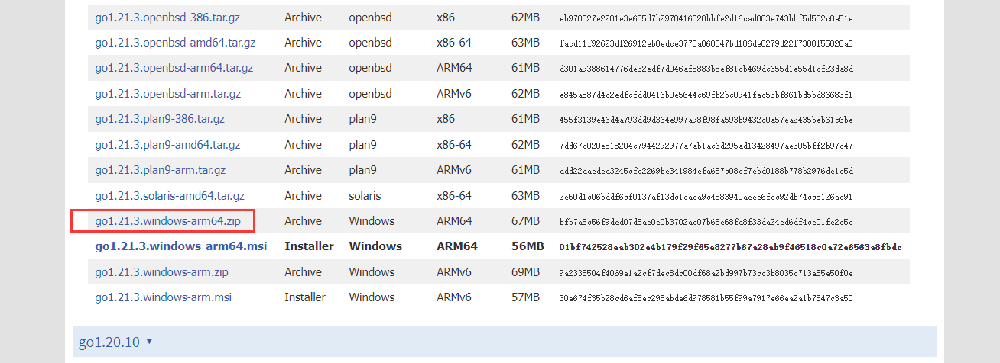
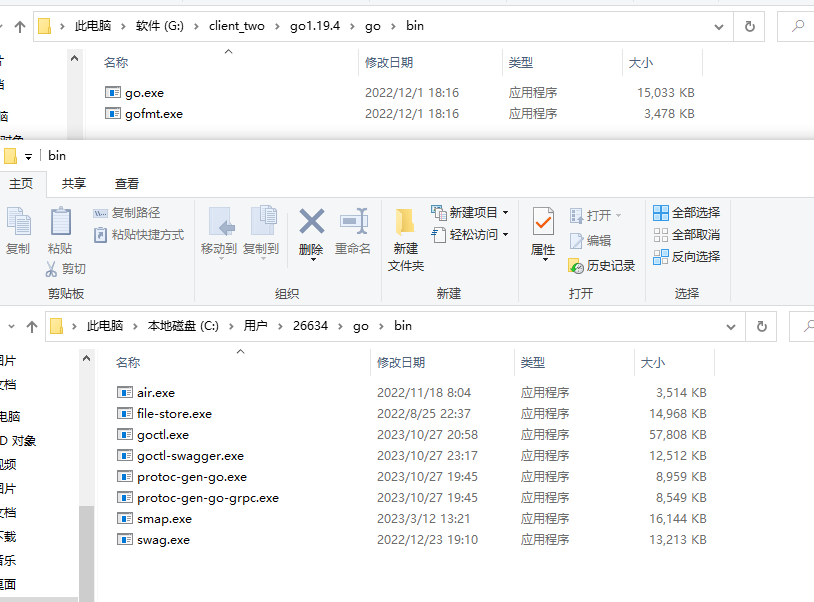
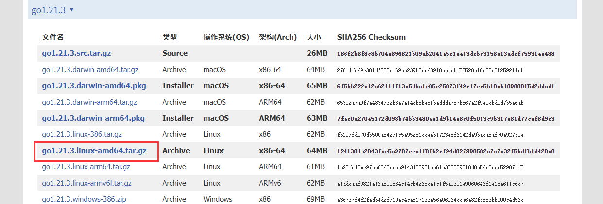

# Go 基础（01）：环境搭建

[返回课程目录](https://blog.woodfish.site/posts/go-basics)

相对于其他语言，go语言的环境搭建及其简单


官网

https://go.dev/dl/


访问不了的就访问中文网就好了


go安装包下载

https://studygolang.com/dl


安装指定版本的安装包就好了

## windows下的安装

windows就选 `windows-arm64.zip`就好了



然后需要将go的对应bin目录设置为环境变量，这一步是方便可以在命令行里面直接使用go命令

还需要将go的第三方bin目录设置为环境变量，一般是在用户目录下，这一步是为了以后使用go install安装的第三方可执行文件可以直接使用





## linux下的安装




```Go
cd /opt
wget https://studygolang.com/dl/golang/go1.21.3.linux-amd64.tar.gz
tar -xvf go1.21.3.linux-amd64.tar.gz

```

编辑环境变量

```Vim script
vim /etc/profile

在文件后追加以下内容
export GOPROXY=https://goproxy.cn
export GOROOT=/opt/go
export PATH=$PATH:$GOROOT/bin
export GOPATH=/opt/go/pkg
export PATH=$PATH:$GOPATH/bin

退出并保存，刷新环境变量
source /etc/profile

```


## 开发工具的选择

理论上来说，用记事本也不是不行

但是有一个趁手的兵器肯定还是更合适的

首选肯定是goland，当然vscode也是可以的

https://www.jetbrains.com/zh-cn/go/download/other.html


2023.2版本之后的UI变成了类似vscode的风格，如果不喜欢的话，可以选2023.1之前的版本


vscode下载

https://code.visualstudio.com/


然后去下载go的插件就好了


## 参考文档

vscode [https://code.visualstudio.com/](https://code.visualstudio.com/)

vscode安装go环境 [https://blog.csdn.net/flurry_rain/article/details/128124573](https://blog.csdn.net/flurry_rain/article/details/128124573)

goland [https://www.jetbrains.com/zh-cn/go/download/other.html](https://www.jetbrains.com/zh-cn/go/download/other.html)

go安装 [https://studygolang.com/dl](https://studygolang.com/dl)

---

[课程目录](https://blog.woodfish.site/posts/go-basics) · [下一节：输入与输出 →](https://blog.woodfish.site/posts/go-basics-02-input-output)
