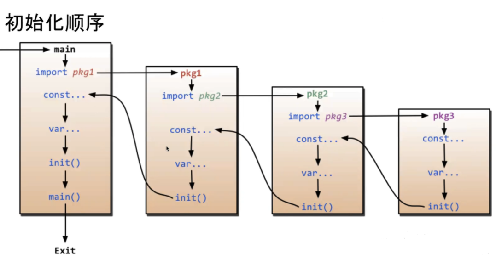

# Go 基础（08）：init和defer函数

[返回课程目录](https://blog.woodfish.site/posts/go-basics)

## init函数


`init()`函数是一个特殊的函数，存在以下特性：

1. 不能被其他函数调用，而是在main函数执行之前，自动被调用
2. init函数不能作为参数传入
3. 不能有传入参数和返回值


一个go文件可以有多个init函数，谁在前面谁就先执行

```Go
package main

import "fmt"

func init() {
  fmt.Println("init1")
}
func init() {
  fmt.Println("init2")
}
func init() {
  fmt.Println("init3")
}

func main() {
  fmt.Println("main")
}

```

执行顺序

```Go
init1
init2
init3
main
```





## defer函数

1. 关键字 defer 用于注册延迟调用
2. 这些调用直到 return 前才被执。因此，可以用来做资源清理
3. 多个defer语句，按先进后出的方式执行，谁离return近谁先执行
4. defer语句中的变量，在defer声明时就决定了


```Go
package main

import "fmt"

func Func() {
  defer fmt.Println("defer2")
  fmt.Println("func")
  defer fmt.Println("defer1")
}

func main() {
  defer fmt.Println("defer4")
  Func()
  defer fmt.Println("defer3")
}

```

执行顺序

```Go
func
defer1
defer2
defer3
defer4
```


## 参考文档

init函数 [https://blog.csdn.net/bestzy6/article/details/122503275](https://blog.csdn.net/bestzy6/article/details/122503275)

defer函数 [https://blog.csdn.net/m0_52896752/article/details/130191669](https://blog.csdn.net/m0_52896752/article/details/130191669)

---

[← 上一节：函数](https://blog.woodfish.site/posts/go-basics-07-functions) · [课程目录](https://blog.woodfish.site/posts/go-basics) · [下一节：结构体 →](https://blog.woodfish.site/posts/go-basics-09-structs)
