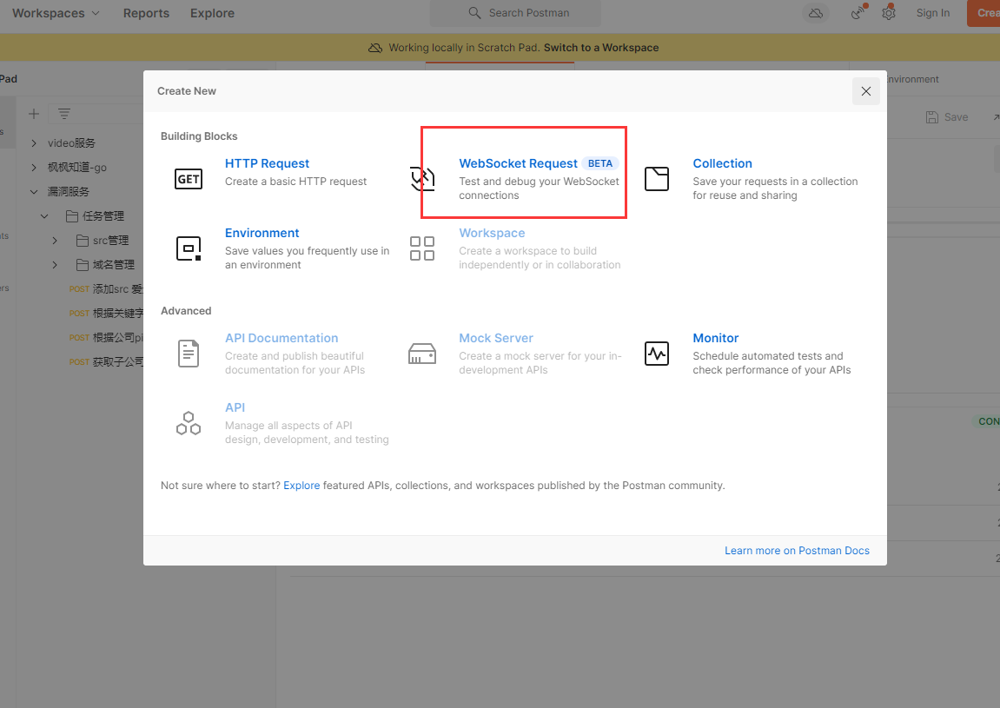
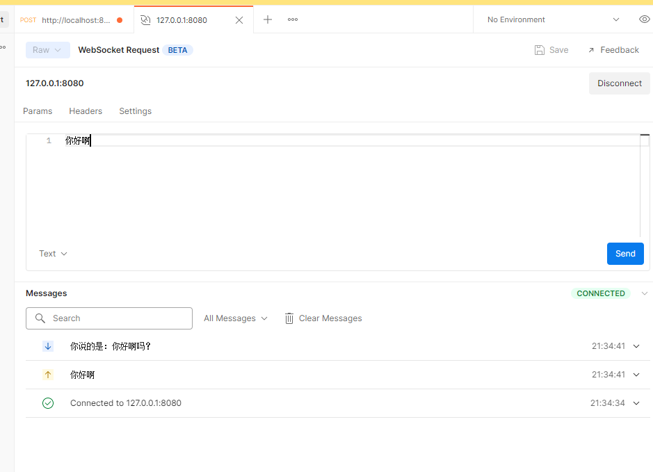

# Go 基础（19）：网络编程

[返回课程目录](https://blog.woodfish.site/posts/go-basics)

# TCP

传输控制协议（*TCP*，Transmission Control Protocol）是一种面向连接的、可靠的、基于字节流的传输层通信协议


如何保证连接可靠呢？（面试常考题）

1. 三次握手
2. 四次挥手


## 服务端

```Go
package main

import (
  "fmt"
  "io"
  "net"
)

func main() {
  // 创建tcp的监听地址
  tcpAddr, _ := net.ResolveTCPAddr("tcp", "127.0.0.1:8080")
  // tcp监听
  listen, _ := net.ListenTCP("tcp", tcpAddr)
  for {
    // 等待连接
    conn, err := listen.AcceptTCP()
    if err != nil {
      fmt.Println(err)
      break
    }
    // 获取客户端的地址
    fmt.Println(conn.RemoteAddr().String() + " 进来了")
    // 读取客户端传来的数据
    for {
      var buf []byte = make([]byte, 1024)
      n, err := conn.Read(buf)
      // 客户端退出
      if err == io.EOF {
        fmt.Println(conn.RemoteAddr().String() + " 出去了")
        break
      }
      fmt.Println(string(buf[0:n]))
    }

  }

}

```


## 客户端

```Go
package main

import (
  "fmt"
  "net"
)

func main() {
  conn, _ := net.DialTCP("tcp", nil,
    &net.TCPAddr{
      IP:   net.ParseIP("127.0.0.1"),
      Port: 8080})
  var s string
  for {
    fmt.Scanln(&s)
    if s == "q" {
      break
    }
    conn.Write([]byte(s))
  }

  conn.Close()
}


```


# HTTP

## 服务端

```Go
package main

import "net/http"

// handler
func handler(res http.ResponseWriter, req *http.Request) {
  res.Write([]byte("hello 小明"))
}

func main() {
  // 回调函数
  http.HandleFunc("/index", handler)
  // 绑定服务
  http.ListenAndServe(":8080", nil)
}

```


```Go
package main

import (
  "encoding/json"
  "fmt"
  "io"
  "net/http"
  "os"
)

func IndexHandler(res http.ResponseWriter, req *http.Request) {
  switch req.Method {
  case "GET":
    data, err := os.ReadFile("goStudy/37.http/server/index.html")
    if err != nil {
      fmt.Println(data)
    }
    res.Write(data)
    //res.Write([]byte("<h1>hello 小明 GET</h1>"))
  case "POST":
    // 获取body数据
    data, err := io.ReadAll(req.Body)
    // 拿请求头
    contentType := req.Header.Get("Content-Type")
    fmt.Println(contentType)
    //switch contentType {
    //case "application/json":
    //
    //}

    if err != nil {
      fmt.Println(data)
    }
    ma := make(map[string]string)
    json.Unmarshal(data, &ma)
    fmt.Println(ma["username"])

    type User struct {
      Username string `json:"username"`
    }
    var user User
    json.Unmarshal(data, &user)
    fmt.Println(user)
    // 设置响应头
    header := res.Header()
    header["token"] = []string{"y1gyf156sdgT%d44hjgj"}
    res.Write([]byte("hello 小明 POST"))
  }
}

func main() {
  // 1. 绑定回调
  http.HandleFunc("/index", IndexHandler)
  // 2. 注册服务
  fmt.Println("listen server on http://localhost:8080")
  http.ListenAndServe(":8080", nil)
}

```


## 客户端

```Go
package main

import (
  "fmt"
  "io"
  "net/http"
)

func main() {
  // 实例化一个http客户端
  client := new(http.Client)
  // 构造请求对象
  req, _ := http.NewRequest("GET", "http://localhost:8080/index", nil)
  // 发请求
  res, _ := client.Do(req)
  // 获取响应
  b, _ := io.ReadAll(res.Body)
  fmt.Println(string(b))

}

```


# RPC

远程过程调用的协议

## 服务端

```Go
package main

import (
  "fmt"
  "net"
  "net/http"
  "net/rpc"
)

type Server struct {
}
type Req struct {
  Num1 int
  Num2 int
}
type Res struct {
  Num int
}

func (s Server) Add(req Req, res *Res) error {
  res.Num = req.Num1 + req.Num2
  return nil
}

func main() {
  // 注册rpc服务
  rpc.Register(new(Server))
  rpc.HandleHTTP()
  listen, err := net.Listen("tcp", ":8080")
  if err != nil {
    fmt.Println(err)
    return
  }
  http.Serve(listen, nil)
}

```

## 客户端

```Go
package main

import (
  "fmt"
  "net/rpc"
)

type Req struct {
  Num1 int
  Num2 int
}
type Res struct {
  Num int
}

func main() {
  req := Req{1, 2}
  client, err := rpc.DialHTTP("tcp", ":8080")
  if err != nil {
    fmt.Println(err)
    return
  }
  var res Res
  client.Call("Server.Add", req, &res)
  fmt.Println(res)
}

```


# websocket

websocket是[socket](https://so.csdn.net/so/search?q=socket&spm=1001.2101.3001.7020)连接和http协议的结合体，可以实现网页和服务端的长连接

```Go
go get github.com/gorilla/websocket

```

## 服务端

```Go
package main

import (
  "fmt"
  "github.com/gorilla/websocket"
  "net/http"
)

var UP = websocket.Upgrader{
  ReadBufferSize:  1024,
  WriteBufferSize: 1024,
}

func handler(res http.ResponseWriter, req *http.Request) {
  // 服务升级
  conn, err := UP.Upgrade(res, req, nil)
  if err != nil {
    fmt.Println(err)
    return
  }
  for {
    // 消息类型，消息，错误
    t, p, err := conn.ReadMessage()
    if err != nil {
      break
    }
    conn.WriteMessage(websocket.TextMessage, []byte(fmt.Sprintf("你说的是：%s吗？", string(p))))
    fmt.Println(t, string(p))
  }
  defer conn.Close()
  fmt.Println("服务关闭")
}

func main() {
  http.HandleFunc("/", handler)
  http.ListenAndServe(":8080", nil)
}


```


服务端给多个客户端发

```Go
package main

import (
  "fmt"
  "github.com/gorilla/websocket"
  "net/http"
)

var UP = websocket.Upgrader{
  ReadBufferSize:  1024,
  WriteBufferSize: 1024,
}

var connLis []*websocket.Conn

func handler(res http.ResponseWriter, req *http.Request) {
  // 服务升级
  conn, err := UP.Upgrade(res, req, nil)
  if err != nil {
    fmt.Println(err)
    return
  }
  connLis = append(connLis, conn)
  for {
    // 消息类型，消息，错误
    t, p, err := conn.ReadMessage()
    if err != nil {
      break
    }
    for index := range connLis {
      connLis[index].WriteMessage(websocket.TextMessage, []byte(fmt.Sprintf("你说的是：%s吗？", string(p))))
    }
    fmt.Println(t, string(p))
  }
  defer conn.Close()
  fmt.Println("服务关闭")
}

func main() {
  http.HandleFunc("/", handler)
  http.ListenAndServe(":8080", nil)
}

```


## 客户端

```Go
package main

import (
  "bufio"
  "fmt"
  "github.com/gorilla/websocket"
  "os"
)

func main() {
  dl := websocket.Dialer{}
  conn, _, err := dl.Dial("ws://127.0.0.1:8080", nil)
  if err != nil {
    fmt.Println(err)
    return
  }
  go send(conn)
  for {
    t, p, err := conn.ReadMessage()
    if err != nil {
      break
    }
    fmt.Println(t, string(p))
  }
}

func send(conn *websocket.Conn) {
  for {
    reader := bufio.NewReader(os.Stdin)
    l, _, _ := reader.ReadLine()
    conn.WriteMessage(websocket.TextMessage, l)
  }
}


```


## Postman作为客户端





---

[← 上一节：反射](https://blog.woodfish.site/posts/go-basics-18-reflection) · [课程目录](https://blog.woodfish.site/posts/go-basics) · [下一节：部署 →](https://blog.woodfish.site/posts/go-basics-20-deployment)
