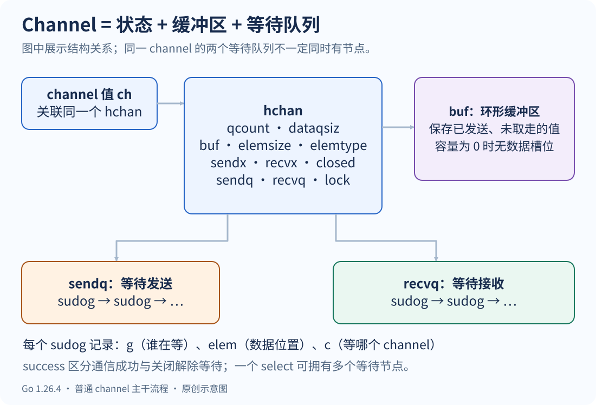
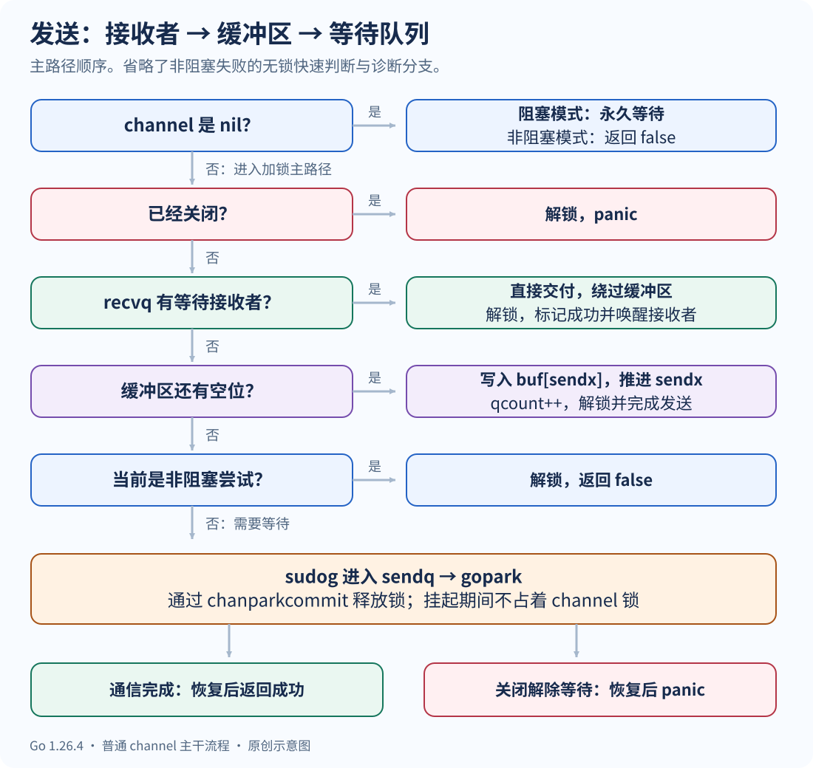
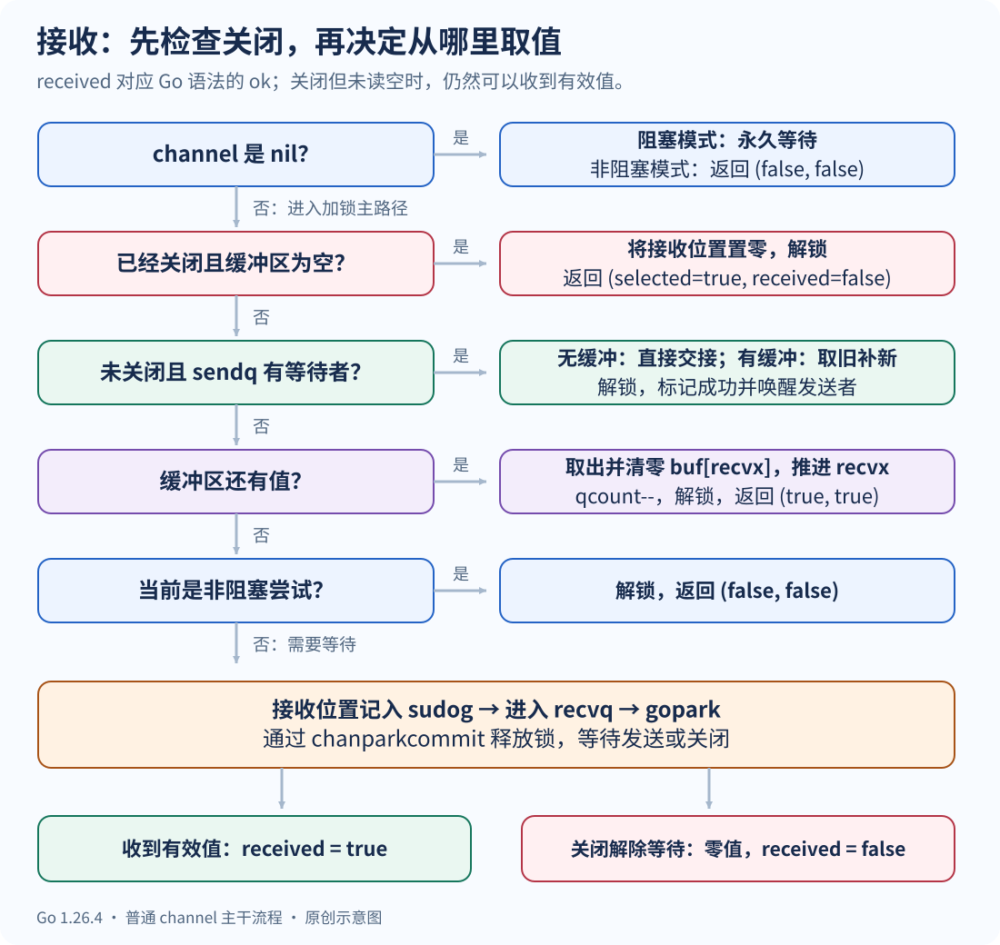
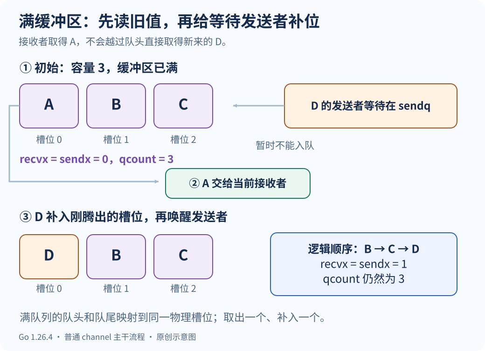
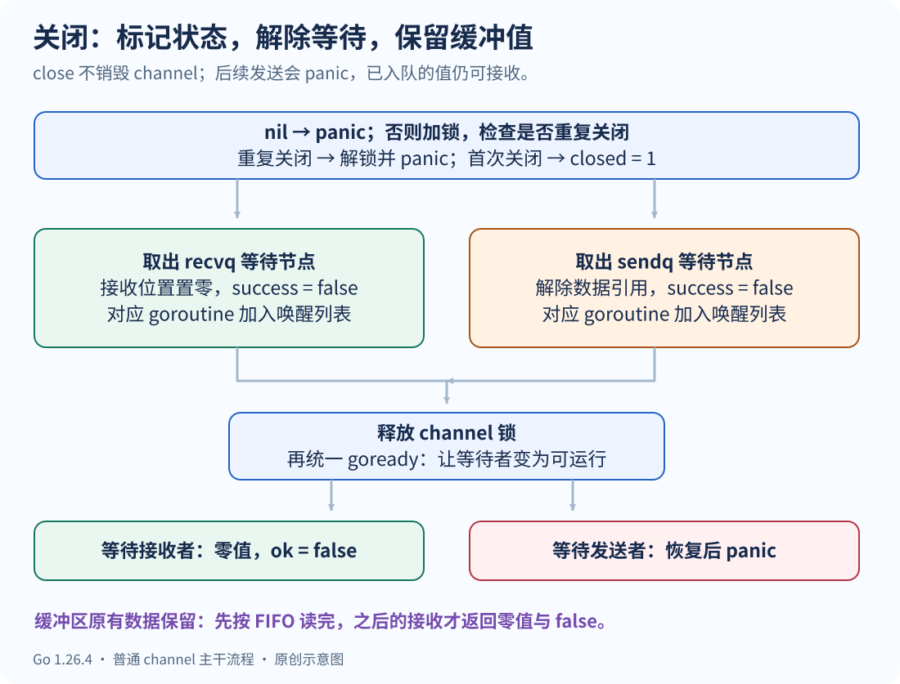

# Go Channel 实现原理：从环形缓冲区到协程唤醒

执行 `ch <- value` 时，数据不一定先进入缓冲区。如果已经有接收者等在那里，runtime 可以把值直接交给它；没有接收者、缓冲区又放不下时，发送者才进入等待队列。

因此，要理解 channel，先抓住三个部分：**保存值的环形缓冲区、记录等待者的队列，以及把 goroutine 挂起和唤醒的调度流程。** `close` 和 `select` 则在这套机制上增加状态变化与多路选择。

本文以 **Go 1.26.4** 的普通 `make(chan T, n)` 为源码基线。结构体只展示相关字段，流程图和伪代码省略 race 检测、性能采样、定时器与 `synctest` 分支；这些内部布局不是 Go 语言的稳定 API。语言层面的行为以 [Go 规范](https://go.dev/ref/spec#Channel_types)为准。

## 1. 先区分 nil、无缓冲、有缓冲和已关闭

```go
var nilCh chan int          // nil：还没有关联到 channel 对象
unbuffered := make(chan int) // 已创建，容量为 0
buffered := make(chan int, 3) // 已创建，容量为 3
signal := make(chan struct{}, 3) // 元素大小为 0，但逻辑容量仍为 3
```

`nilCh` 和 `unbuffered` 都有 `len == 0`、`cap == 0`，但它们的行为不同：无缓冲 channel 可以让发送者与接收者配对，nil channel 永远不能完成收发。

| channel 状态 | 发送 `ch <- v` | 接收 `v, ok := <-ch` | `close(ch)` |
| --- | --- | --- | --- |
| nil | 永久阻塞当前 goroutine | 永久阻塞当前 goroutine | panic |
| 已创建、未关闭、无缓冲 | 等待接收者配对 | 等待发送者配对 | 关闭，并解除等待 |
| 未关闭、有缓冲 | 有等待接收者则直接交付；否则有空位就入队，满了就等待 | 有数据就取队头；没有数据就等待 | 关闭，已入队数据保留 |
| 已关闭、缓冲区还有值 | panic | 继续读出原有值，`ok == true` | panic |
| 已关闭、缓冲区已空 | panic | 立即得到元素类型零值，`ok == false` | panic |

这里的“阻塞”指**当前 goroutine 暂停执行**。只有整个程序失去继续推进的条件时，runtime 才可能报告死锁。某一个 goroutine 等在 nil channel 上，不代表其他 goroutine 都不能运行。

另外，`len(ch)` 是当时缓冲区里尚未取走的元素数，不包含等待发送者手里的值。它不能用来可靠判断下一次发送是否会阻塞：检查结束后，其他 goroutine 可能已经改变 channel 状态。

## 2. hchan、waitq 和 sudog 分别管理什么

普通 channel 的运行时状态集中在 `hchan` 中。channel 值赋给另一个变量时，两个变量仍然指向同一个 channel 对象，不会复制一份独立队列。



### 2.1 hchan：缓冲区与通信状态

下面是与收发相关的字段摘录，省略了 Go 1.26.4 中的 `timer`、`bubble` 等字段：

```go
type hchan struct {
    qcount   uint           // 缓冲区中已有的元素数
    dataqsiz uint           // 缓冲区容量
    buf      unsafe.Pointer // 环形缓冲区的起始地址
    elemsize uint16         // 一个元素占用的字节数
    closed   uint32         // 是否已关闭
    elemtype *_type         // 元素的运行时类型信息

    sendx uint  // 下一次入队使用的下标
    recvx uint  // 下一次出队使用的下标
    recvq waitq // 等待接收的节点队列
    sendq waitq // 等待发送的节点队列

    lock mutex  // 保护 channel 状态及相关等待节点
}
```

| 字段 | 作用 | 容易混淆的地方 |
| --- | --- | --- |
| `qcount` | 记录缓冲区内的元素数 | 不是 goroutine 数，也不是累计发送次数 |
| `dataqsiz` | 记录创建时的容量 | 源码字段名没有结尾的 `e` |
| `buf` | 定位元素存储区域 | 无缓冲 channel 不靠它保存待发送值 |
| `sendx` / `recvx` | 标记入队与出队位置 | 二者相等时可能为空，也可能为满，要结合 `qcount` 判断 |
| `sendq` / `recvq` | 记录尚未完成的通信 | 排队的是等待节点，而不是直接把整个 goroutine 塞进链表 |
| `lock` | 串行保护状态变更 | 非阻塞失败判断存在无锁快速路径，不能说所有路径都先加锁 |

### 2.2 waitq：用双向链表管理等待节点

```go
type waitq struct {
    first *sudog
    last  *sudog
}
```

发送者无法立即交付数据时进入 `sendq`；接收者拿不到数据时进入 `recvq`。入队与出队需要和缓冲区状态在同一把 channel 锁下配合，避免“刚检查完不能通信，对端却已经来了”的竞态。

### 2.3 sudog：一次等待关系的记录

`sudog` 可以理解成“某个 goroutine 正在某个同步操作上等待”的记录。它不是 goroutine 本体，也不是每个 goroutine 唯一拥有一个的对象。

| 相关字段 | 含义 |
| --- | --- |
| `g` | 正在等待的 goroutine |
| `next`、`prev` | 当前等待队列中的前后节点 |
| `elem` | 发送时指向待发送的值；接收时指向接收结果的存放位置 |
| `c` | 这次等待关联的 channel |
| `isSelect` | 是否属于 `select` 的候选通信 |
| `success` | 是否因为成功通信而恢复；因关闭解除等待时为 false |

Go 1.26.4 的 `elem` 与 `c` 使用内部指针包装类型，源码中通过 `.get()`、`.set()` 访问。旧版文章直接写 `unsafe.Pointer` 或 `*hchan`，适合理解关系，但不能当作当前版本的完整声明。

`select` 可能让一个 goroutine 同时等待多个 case，因此它可能对应多个 `sudog`。当某个 case 胜出后，其余等待关系需要撤销。节点还会复用，`acquireSudog` / `releaseSudog` 不等于每次都向系统申请、释放内存。

### 2.4 两条能解释收发分支的不变量

对普通有缓冲 channel，runtime 维护：

- `qcount > 0` 时，`recvq` 为空：缓冲区里已经有值，接收者就不应该继续排队等待。
- `qcount < dataqsiz` 时，`sendq` 为空：缓冲区还有空位，发送者就不应该继续排队等待。

所以，**有缓冲 channel 存在等待发送者时，缓冲区必然是满的；存在等待接收者时，缓冲区必然是空的。**

普通配对场景中，`sendq` 和 `recvq` 不会同时非空；源码特意保留了例外：一个 goroutine 在无缓冲 channel 的同一条 `select` 中同时注册发送和接收 case。这也是不能把等待节点简单等同于不同 goroutine 的原因。

## 3. makechan 怎样分配内存

执行 `make(chan T, n)` 时，runtime 需要先算出缓冲区的字节数：

```text
mem = 元素大小 × 容量
```

随后检查容量为负、乘法溢出、申请大小超限等情况，并初始化元素类型、容量与锁。常量负容量会在编译期报错；运行时计算出的非法容量会在执行时失败。

源码中的三个内存分配分支，可概括为：

| 条件 | 分配方式 | 例子 |
| --- | --- | --- |
| `mem == 0` | 只需要 channel 头部，不需要实际的数据存储字节 | 无缓冲 channel；`chan struct{}` 即使有容量也属于此类 |
| `mem > 0`，元素不含 GC 需要追踪的指针 | 将头部与缓冲区放在同一次分配中 | `chan int`、`chan [8]byte`、`chan struct{ N int }` |
| `mem > 0`，元素含有指针 | 分别分配头部与按元素类型描述的缓冲区 | `chan *User`、`chan string`、`chan []byte`、`chan struct{ P *int }` |

分类依据是**元素是否含指针**，不是“struct 型”和“pointer 型”。结构体也可能含指针，字符串和切片的值内部也有指向底层数据的指针。

`mem == 0` 也不等于无缓冲。例如：

```go
ch := make(chan struct{}, 3)
ch <- struct{}{}
ch <- struct{}{}
ch <- struct{}{}
// 此时 len(ch) == 3。没有接收者时，第四次发送仍然会阻塞。
```

虽然元素本身不占存储字节，但 channel 仍然记录数量、容量与等待关系，通信语义不会消失。

channel 头部大小由 `unsafe.Sizeof(hchan{})` 结合对齐计算而来，会受 Go 版本和平台影响，不能把旧文章中的“固定 96 字节”当成通用结论。[源码位置：`makechan`](https://github.com/golang/go/blob/go1.26.4/src/runtime/chan.go)。

## 4. 环形缓冲区怎样保持 FIFO

缓冲区底层是一段按元素大小划分的连续存储。第 `i` 个槽位的地址可以按下面的方式理解：

```text
槽位地址 = buf + i × elemsize
```

普通入队时，先把值复制到 `sendx` 对应的位置，再推进下标并增加 `qcount`：

```text
buf[sendx] = 待发送值
sendx = (sendx + 1) % dataqsiz
qcount++
```

普通出队时，从 `recvx` 取出值，清理原槽位，再推进下标并减少 `qcount`：

```text
接收结果 = buf[recvx]
清零 buf[recvx]
recvx = (recvx + 1) % dataqsiz
qcount--
```

这些是逻辑等价的伪代码。真实实现用“递增，到容量后归零”完成绕回；无缓冲 channel 不会进入这里做除零取模。清零槽位还有 GC 意义：如果元素含指针，已取走的值不应该继续被缓冲区无意保活。

用容量为 3 的 channel 走一遍：

| 操作后 | 物理槽位 `[0, 1, 2]` | `recvx` | `sendx` | `qcount` | 接下来应读出的顺序 |
| --- | --- | --- | --- | --- | --- |
| 刚创建 | `[空, 空, 空]` | 0 | 0 | 0 | 无 |
| 发送 A、B | `[A, B, 空]` | 0 | 2 | 2 | A、B |
| 接收一次 | `[空, B, 空]` | 1 | 2 | 1 | B |
| 发送 C | `[空, B, C]` | 1 | 0 | 2 | B、C |
| 发送 D | `[D, B, C]` | 1 | 1 | 3 | B、C、D |

下标会绕回，但逻辑 FIFO 顺序不变。最后一行中 `sendx == recvx`，缓冲区却是满的，必须结合 `qcount` 判断。

这里的 FIFO 指值的入队与出队顺序，不意味着多个并发发送者按 goroutine 创建顺序执行，也不保证被唤醒的 goroutine 立刻获得 CPU。

## 5. 发送流程：先找接收者，再看缓冲区

普通发送语句的入口可按下面的调用链阅读：

```text
ch <- value
  → runtime.chansend1
    → runtime.chansend(..., block=true, ...)
```

`ep` 是待发送值的地址，`block` 表示不能立即完成时是否允许挂起当前 goroutine。



### 5.1 nil 与已关闭 channel

nil channel 没有可配对的通信对象。普通发送会永久挂起当前 goroutine；非阻塞尝试则返回未完成。

对非 nil channel，加锁后会先检查关闭状态。已关闭就解锁并触发 `send on closed channel`，不会因为缓冲区还有空位而允许继续发送。

源码还会在适当条件下通过无锁快速路径判断非阻塞操作无法成功，避免不必要地加锁。图里保留的是主干逻辑，不是逐指令展开。

### 5.2 已有接收者等待：直接交付

`recvq.dequeue()` 找到接收者时，`chansend` 调用 `send`。后者大致完成：

1. 将当前发送值复制到接收者 `sudog.elem` 指向的结果位置；如果接收者丢弃结果，可跳过这次数据复制。
2. 解除相关等待节点对数据的引用，释放 channel 锁。
3. 标记本次通信成功，通过 `goready` 让接收者重新变为可运行。

这条路径同样适用于**缓冲区为空且已有接收者等待的有缓冲 channel**。此时可以绕过缓冲区，不需要“先入队、再出队”。

直接交付不等于零拷贝。`sendDirect` 最终仍有值复制，涉及跨 goroutine 栈写入时还要处理写屏障与栈移动边界。若元素是指针或切片，复制的是指针值或切片描述符，不会自动深拷贝底层对象。

### 5.3 没有等待接收者，缓冲区还有空位

满足 `qcount < dataqsiz` 时，将值复制到 `sendx` 槽位，推进 `sendx`、增加 `qcount`，随后解锁并返回。

发送返回只说明值已完成交付或入队。对有缓冲 channel，它**不保证接收者已经取走，更不保证接收者已经处理完这项工作**。需要确认业务处理完成时，应另外设计响应或完成信号。

### 5.4 既不能交付，也不能入队

非阻塞尝试在这里解锁并返回 false。普通阻塞发送则需要：

```text
取得当前 goroutine
  → 取得一个 sudog，关联待发送值、goroutine 和 channel
  → 在持锁状态下把 sudog 放入 sendq
  → gopark，通过 chanparkcommit 释放锁并完成挂起协议
  → 等待接收操作或 close 解除等待
  → 恢复后读取 success，清理并归还 sudog
```

恢复后有两种结果：

- 接收者完成了交接：`success == true`，发送正常返回。对于满缓冲区，值也可能只是被接收者补入缓冲区，并未直接交给该接收者。
- channel 被关闭：`success == false`，发送恢复后 panic。

所以，“被唤醒说明发送值必然已经被读走”不成立。[源码位置：`chansend` 与 `send`](https://github.com/golang/go/blob/go1.26.4/src/runtime/chan.go)。

## 6. 接收流程：等待发送者与缓冲区怎样配合

普通接收有两种入口：

```text
value := <-ch      → chanrecv1 → chanrecv(..., block=true)
value, ok := <-ch  → chanrecv2 → chanrecv(..., block=true)
```

`chanrecv` 内部返回两个布尔值：

- `selected`：这次接收是否已经完成，而非“尝试后发现暂时不可接收”。
- `received`：是否拿到了发送过来的有效元素，对应 Go 语法中的 `ok`。

| 情况 | `selected` | `received` / `ok` |
| --- | --- | --- |
| 非阻塞接收暂时拿不到数据 | false | false |
| 成功接收到一个发送值 | true | true |
| channel 已关闭且缓冲区已空 | true | false |



### 6.1 已关闭：先判断缓冲区是否已经读空

已关闭且 `qcount == 0` 时，runtime 把接收结果置为元素类型的零值，返回 `true, false`。

如果已关闭但缓冲区仍有值，则继续从缓冲区读取，返回 `true, true`。因此，`ok == true` 不能证明 channel 尚未关闭；`ok == false` 才表示**channel 已关闭，并且没有剩余值可读**。

### 6.2 未关闭，sendq 里已有发送者

此时会调用 `recv`。要区分容量是否为 0。

**无缓冲 channel：** 将等待发送者的值直接复制到当前接收位置，再释放锁、标记成功并唤醒发送者。没有“先把值放进容量为 0 的缓冲区”这一步。

**有缓冲 channel：** 根据前面的不变量，此时缓冲区一定是满的。当前接收者必须先拿最早入队的值，不能越过它直接拿等待发送者的新值。



假设容量为 3，缓冲区是 `[A, B, C]`，D 的发送者已经排队：

1. 将 `recvx` 对应的 A 复制给当前接收者。
2. 将等待发送者的 D 复制到 A 刚腾出的同一个物理槽位。
3. 推进 `recvx`，并让 `sendx` 指向同一个新位置。
4. 释放锁，标记发送成功，再唤醒 D 的发送者。

操作结束后，物理槽位是 `[D, B, C]`，逻辑队列是 `B → C → D`。**取走一个、补进一个，`qcount` 不变，缓冲区仍然是满的。**

### 6.3 没有等待发送者，但缓冲区有值

直接从 `recvx` 取值，清零旧槽位，推进 `recvx` 并执行 `qcount--`，解锁返回。

与上一个分支相比，这里没有等待发送者补位，所以缓冲区的元素数确实减少了。

### 6.4 没有发送者，也没有缓冲值

非阻塞接收解锁并返回 `false, false`。阻塞接收则把接收位置记录到 `sudog.elem`，进入 `recvq`，再通过 `gopark` 挂起。

恢复后同样要检查结果：成功通信返回 `ok == true`；由关闭解除等待则得到零值和 `ok == false`。接收者被唤醒，不意味着一定收到了一个业务值。[源码位置：`chanrecv` 与 `recv`](https://github.com/golang/go/blob/go1.26.4/src/runtime/chan.go)。

## 7. 为什么不能简单写成“解锁，然后睡眠”

阻塞流程最关键的地方，是**入队、释放锁和进入等待状态之间的协调**。

假设实现是先把锁释放，再随意执行一个睡眠动作：对端可能在这两步之间找到等待节点、完成通信并尝试唤醒，而本方随后才真正睡下，就可能丢失唤醒。

Go 使用 `gopark` 与 `chanparkcommit` 协调这一过程。等待节点先在持锁状态下登记，调度器在提交挂起过程中调用回调，设置相关栈状态标记，再释放 channel 锁。对端取得锁以后，才能安全地完成交接或关闭处理。

同样，`send`、`recv`、`closechan` 会在释放 channel 锁后将对端 goroutine 设为可运行，避免持有 channel 锁时修改另一个 goroutine 状态造成与栈收缩等机制的锁依赖问题。

这里可以区分三个动作：

| 动作 | 发生了什么 |
| --- | --- |
| `gopark` | 当前 goroutine 进入等待，承载它的线程可以执行其他工作 |
| `goready` | 等待者恢复为可运行状态，等待调度 |
| 真正继续执行 | 调度器安排该 goroutine 获得执行机会 |

因此，源码分析里的“唤醒”通常不表示立即执行，也不能写成“睡眠期间始终持锁，醒来后才解锁”。如果一直持锁，对端就无法进入 channel 完成交接。

## 8. close 做了什么，为什么不会清空缓冲区

`close(ch)` 的入口是 `closechan`。它表达的是“以后不再发送”，不是销毁 channel，也不是立即释放缓冲区内存。



主干流程如下：

1. nil channel 直接 panic。
2. 获取 channel 锁，发现已经关闭则解锁并 panic。
3. 把 `closed` 标记设为 1。
4. 取出接收等待节点，将其接收位置置零，设置 `success = false`，把对应 goroutine 暂存到唤醒列表。
5. 取出发送等待节点，设置 `success = false`，同样放入唤醒列表；这些发送者恢复后会 panic。
6. 释放 channel 锁，再逐个 `goready`。

对普通有缓冲 channel，如果存在阻塞接收者，缓冲区本来就是空的。因此“解除等待的接收者得到零值”与“缓冲区原有数据继续可读”并不冲突。

完整例子：保存为 `close_buffer.go`，运行 `go run close_buffer.go`。

```go
package main

import "fmt"

func main() {
    ch := make(chan int, 2)
    ch <- 10
    ch <- 20
    close(ch)

    for i := 0; i < 4; i++ {
        value, ok := <-ch
        fmt.Println(value, ok)
    }
}
```

输出固定为：

```text
10 true
20 true
0 false
0 false
```

关闭后的 channel 不会“读一次就失效”。读空后每次接收都立即返回零值和 false。`for value := range ch` 会持续读出剩余值，直到 channel 关闭且读空才退出；仅仅暂时为空，不会结束 `range`。

通常由负责结束发送的一方关闭 channel。多个发送者共同写入时，应先等所有发送完成，再由协调者统一关闭。`sync.Once` 只能防止重复关闭，不能让“并发发送与关闭”自动变安全。也不要通过 `len(ch)` 或一次试探接收来判断是否可以安全发送。

## 9. select 不等于“把所有收发都改成非阻塞”

普通 `ch <- value` 和 `<-ch` 在不能立即完成时会阻塞。`select` 是否等待，则取决于有没有 `default`、是否有可执行 case，以及编译器采用哪种路径。

| 写法 | 没有 case 能立即完成时 | Go 1.26.4 中的主要实现路径 |
| --- | --- | --- |
| 只有一个通信 case，没有 default | 阻塞 | 可简化为一次普通收发 |
| 一个通信 case 加 default | 执行 default | `selectnbsend` 或 `selectnbrecv` |
| 多个通信 case，有 default | 执行 default | 通常进入 `selectgo`，不挂起等待 |
| 多个通信 case，没有 default | 等到某个 case 可以执行 | 通常进入 `selectgo`，必要时登记多个等待节点并挂起 |
| `select {}` | 永久阻塞当前 goroutine | 永久等待路径 |

“单个通信 case + default”确实会复用 `chansend(..., block=false)` 或 `chanrecv(..., block=false)`。但一般的多 case `select` 有自己的锁定、候选选择、入队与清理逻辑，不能描述为逐个调用这两个非阻塞包装函数。[编译器分支](https://github.com/golang/go/blob/go1.26.4/src/cmd/compile/internal/walk/select.go)、[runtime 选择流程](https://github.com/golang/go/blob/go1.26.4/src/runtime/select.go)。

### 9.1 default 只负责“暂时没有可执行通信”

保存为 `select_states.go`，运行 `go run select_states.go`：

```go
package main

import "fmt"

func main() {
    var nilCh chan int
    select {
    case <-nilCh:
        fmt.Println("不会执行")
    default:
        fmt.Println("nil: default")
    }

    ch := make(chan int)
    select {
    case ch <- 1:
        fmt.Println("不会执行：此时没有接收者")
    default:
        fmt.Println("open: default")
    }

    close(ch)
    select {
    case value, ok := <-ch:
        fmt.Println("closed:", value, ok)
    default:
        fmt.Println("不会执行：关闭且读空的 channel 可立即接收")
    }
}
```

输出：

```text
nil: default
open: default
closed: 0 false
```

向已关闭 channel 发送仍会 panic。下面即使有 default，也不能“安全跳过”：

```go
ch := make(chan int)
close(ch)
select {
case ch <- 1: // 这个发送操作会 panic
default:
}
```

如果一般 `select` 同时有多个可执行 case，规范规定在它们之间作均匀伪随机选择；写在前面不构成优先级。发送到已关闭 channel 的 case 若被选中，会发生 panic。[Go 规范：Select statements](https://go.dev/ref/spec#Select_statements)。

### 9.2 nil channel 可以用来停用某个 case

关闭且读空的 channel 一直可接收。如果在循环 `select` 中只打印 `ok == false`，却不退出或停用该 case，就可能不断空转。

```go
for left != nil || right != nil {
    select {
    case value, ok := <-left:
        if !ok {
            left = nil // 后续 select 不再选择这一支
            continue
        }
        consume(value)
    case value, ok := <-right:
        if !ok {
            right = nil
            continue
        }
        consume(value)
    }
}
```

这是局部用法片段：`left`、`right` 是同种元素类型的 channel，`consume` 是业务处理函数。循环条件避免了两者都变成 nil 后仍进入一个永远等不到结果的 `select`。让变量变为 nil，也不会改变其他变量所引用的原 channel 对象。

## 10. Channel 还建立了哪些内存顺序

Channel 不只搬运值，还提供 goroutine 之间的同步关系。语言使用 *synchronized before* 描述这些跨 goroutine 的先后约束，再与程序内执行顺序共同建立 *happens before*。

三条与 channel 直接相关的规则是：

1. 一次发送同步先于对应接收操作的完成。因此，发送前已完成的写入，可以通过对应接收建立可见性。
2. 关闭 channel 同步先于某个因关闭而返回零值的接收操作。
3. 容量为 C 的 channel，第 k 次接收同步先于第 k+C 次发送的完成。C 为 0 时，就是无缓冲 channel 的接收与对应发送完成之间的同步关系。

这些规则来自 [Go 内存模型的 Channel communication](https://go.dev/ref/mem#chan)。它们不是任意共享变量都自动安全的保证：接收完成以后双方如果继续并发修改同一份数据，仍需自己的同步方式。

保存为 `publish_result.go`，运行 `go run publish_result.go`：

```go
package main

import "fmt"

func main() {
    done := make(chan struct{})
    var result string

    go func() {
        result = "ready"
        close(done)
    }()

    <-done
    fmt.Println(result)
}
```

输出为 `ready`。写入 `result` 发生在 `close(done)` 之前，而 `<-done` 因关闭而完成，所以主 goroutine 在接收之后读取结果，有明确的同步关系。这里的 `close` 用于发布完成状态，不需要往 channel 中塞一个实际数据元素。

反过来，不能因为一次有缓冲发送已经返回，就推断接收者完成了后续写入：缓冲区有空位时，发送方可能在接收方运行之前就继续执行了。

## 11. 用一个完整程序观察缓冲区的顺序

保存为 `buffer_fifo.go`，运行 `go run buffer_fifo.go`：

```go
package main

import "fmt"

func main() {
    ch := make(chan string, 3)
    ch <- "A"
    ch <- "B"
    ch <- "C"

    entered := make(chan struct{})
    sent := make(chan struct{})
    go func() {
        close(entered)
        ch <- "D"
        close(sent)
    }()

    <-entered
    select {
    case <-sent:
        panic("尚未接收，满缓冲区中的 D 不可能发送完成")
    default:
        fmt.Println("D 尚未完成发送")
    }

    fmt.Println("第一次接收:", <-ch)
    <-sent // 等 D 完成交付，才关闭 channel
    close(ch)

    for value := range ch {
        fmt.Println("后续接收:", value)
    }
}
```

输出固定为：

```text
D 尚未完成发送
第一次接收: A
后续接收: B
后续接收: C
后续接收: D
```

这个程序验证了公开行为：满缓冲区使新发送不能完成、旧值先被接收、关闭后仍能读完已发送的值。它没有使用 `time.Sleep` 猜测调度时机。

需要区分的是，`entered` 只说明发送 goroutine 已经运行到发送之前，不保证它已经进入 `sendq`。因此这个程序不能单凭输出证明某一次执行一定经过了“从等待发送者补位”的内部路径；那条路径由 `recv` 的源码解释，必要时还需要运行时跟踪或专门的调度控制来验证。

## 12. 阅读源码时要避开的几个结论

| 常见说法 | 准确边界 |
| --- | --- |
| nil channel 收发一定导致程序死锁 | 它永久阻塞当前 goroutine；是否全局死锁取决于程序其余部分 |
| `mem == 0` 一定是无缓冲 channel | 零大小元素也会使 `mem == 0`，容量和阻塞规则仍保留 |
| Channel 分成 struct 型和 pointer 型分配 | 分配依据是元素是否含 GC 需要追踪的指针 |
| channel 头部固定 96 字节 | 大小与 Go 版本、架构和对齐有关 |
| 直接交付就是零拷贝 | 绕过缓冲区仍可能复制值；引用类元素也不会自动深拷贝 |
| goroutine 被唤醒就说明收发成功 | 关闭也会解除等待；要看通信结果 |
| 阻塞期间一直持锁，醒来后解锁 | 释放锁是挂起提交协议的一部分，对端必须能取得锁 |
| `ok` 就是 channel 还开着 | 关闭后残留值仍返回 true；关闭且读空才返回 false |
| select 内的通信全部非阻塞 | 没有 default 时可能挂起，多 case 还有专门实现 |
| close 会清空缓冲区、释放 channel | 缓冲值仍可接收，对象生命周期最终由引用和 GC 决定 |

## 参考资料

本文根据《Golang Channel 实现原理》粘贴材料整理。所附材料未保留作者、原文链接和图片文件；本文示意图为重新绘制，并对照以下官方资料修订了版本差异和行为边界。

- [Go 1.26.4：runtime/chan.go](https://github.com/golang/go/blob/go1.26.4/src/runtime/chan.go)：`hchan`、`makechan`、收发、关闭、等待队列。
- [Go 1.26.4：runtime/runtime2.go](https://github.com/golang/go/blob/go1.26.4/src/runtime/runtime2.go)：`sudog` 与 goroutine 相关结构。
- [Go 1.26.4：runtime/select.go](https://github.com/golang/go/blob/go1.26.4/src/runtime/select.go)：一般 `select` 的候选、锁定、等待与清理。
- [Go 1.26.4：编译器 walk/select.go](https://github.com/golang/go/blob/go1.26.4/src/cmd/compile/internal/walk/select.go)：不同 `select` 写法的编译处理。
- [Go 语言规范](https://go.dev/ref/spec)：Channel types、Send statements、Receive operator、Close、Select statements。
- [Go 内存模型](https://go.dev/ref/mem#chan)：channel 通信的同步关系。

文中的四个完整程序在 Go 1.26.4 / Windows amd64 下执行验证；流程片段和结构体摘录用于源码阅读，不是可独立编译的 runtime 替代实现。
