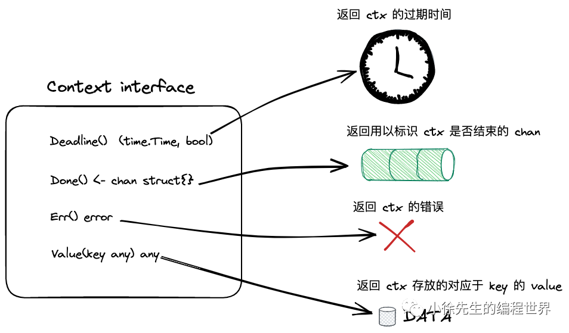
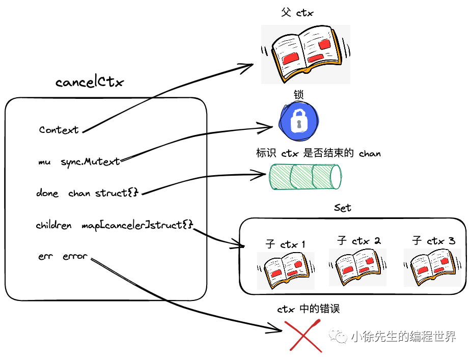
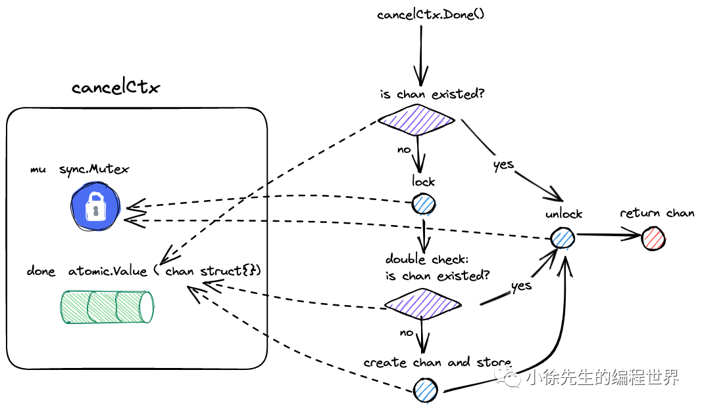
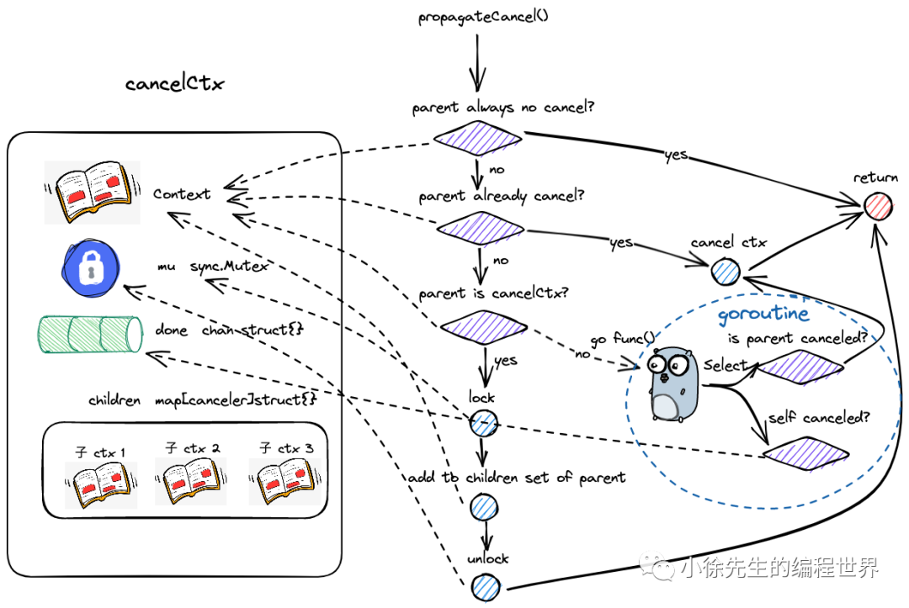
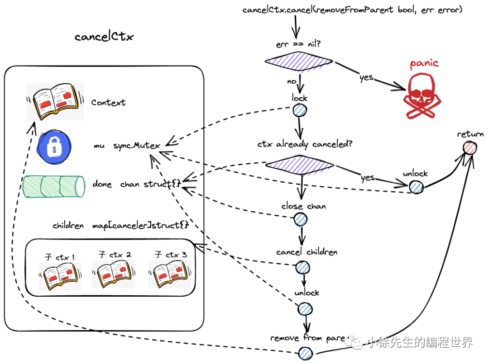
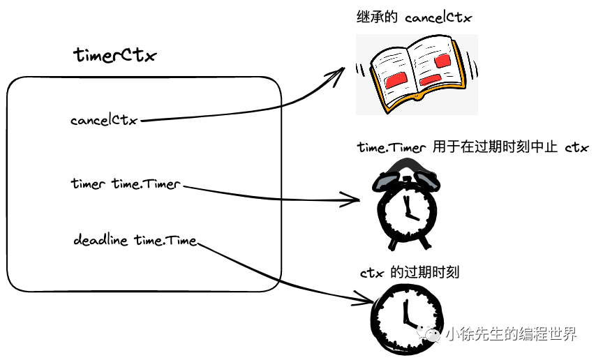
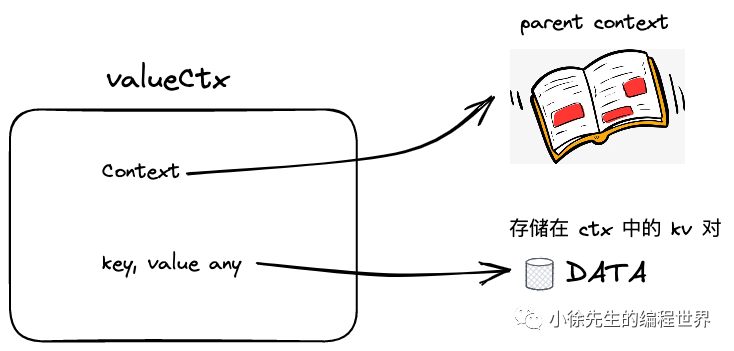
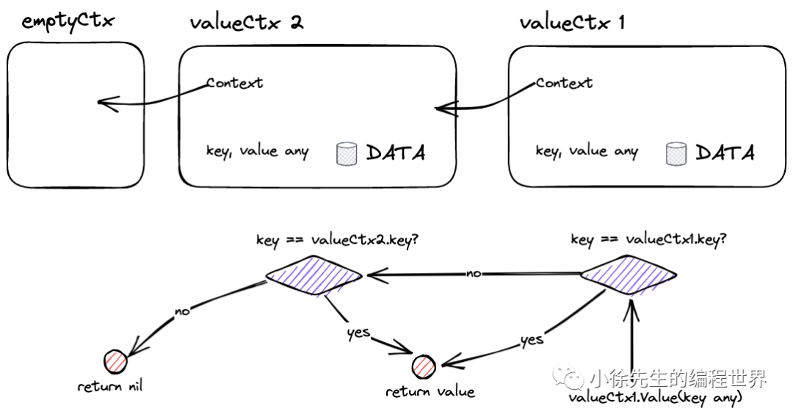

# Go Context 实现原理：取消传播、超时控制与 Value 链

一个请求可能同时启动数据库查询、远程调用和后台计算。请求超时后，这些工作应该尽快停止；调用链还需要共享请求 ID 等少量信息。`context` 把取消信号、截止时间和请求范围内的值放在同一个接口里，沿函数调用传递。

但调用 `cancel()` 不会强行杀掉 goroutine。它改变 Context 的状态，并通过关闭 `Done` channel 通知使用者。使用者检查到取消之后，才决定返回、释放资源或结束循环。

本文以 **Go 1.26.4** 的 `src/context/context.go` 为基线。配图沿用所附材料的原图，其中部分字段和流程属于旧版实现，差异会在对应位置说明。阅读取消通知前，可以先看 [Go Channel 实现原理](https://blog.woodfish.site/posts/golang-channel-internals)：这里依赖的是“关闭 channel 后，所有等待接收者都能被唤醒”的语义。

## 1. 先看 cancel 怎样让一个 goroutine 退出

保存为 `cancel_worker.go`，运行 `go run cancel_worker.go`：

```go
package main

import (
    "context"
    "fmt"
)

func produce(ctx context.Context, out chan<- int) error {
    for n := 0; ; n++ {
        select {
        case <-ctx.Done():
            return ctx.Err()
        case out <- n:
        }
    }
}

func main() {
    ctx, cancel := context.WithCancel(context.Background())
    defer cancel()

    out := make(chan int)
    finished := make(chan error, 1)
    go func() {
        finished <- produce(ctx, out)
    }()

    for i := 0; i < 3; i++ {
        fmt.Println(<-out)
    }
    cancel()
    fmt.Println("worker:", <-finished)
}
```

输出：

```text
0
1
2
worker: context canceled
```

这里有三件不同的事：

1. `cancel()` 发出取消通知，使 `ctx.Done()` 变为可接收。
2. `produce` 自己执行 `return ctx.Err()`，结束这段工作。
3. 主 goroutine 从 `finished` 接收结果，确认工作函数已经返回。

`cancel()` 本身不等待工作完成。例子里，主 goroutine 读完三个数之后不再接收 `out`，所以发送分支不能继续完成，worker 会从取消分支退出。如果实际程序中发送和取消两个分支同时就绪，`select` 不保证优先选择取消分支。

如果把 `produce` 改成一段从不检查 Context 的无限计算，或者调用一个不支持取消的阻塞函数，Context 无法在外部强制中止它。

## 2. Context 的四个方法分别回答什么

```go
type Context interface {
    Deadline() (deadline time.Time, ok bool)
    Done() <-chan struct{}
    Err() error
    Value(key any) any
}
```



| 方法 | 回答的问题 | 返回值的边界 |
| --- | --- | --- |
| `Deadline()` | 这项工作最晚允许持续到什么时候？ | `ok == false` 表示没有设置截止时间，此时不能把零值时间当成“早已过期” |
| `Done()` | 怎样等待取消通知？ | 返回只接收的 channel；关闭表示应停止工作；返回 nil 表示这个 Context 不会被取消 |
| `Err()` | Context 为什么被取消？ | 尚未取消时为 nil；标准实现取消后返回 `Canceled` 或 `DeadlineExceeded` |
| `Value(key)` | 这条请求调用链上有没有这个值？ | 沿 Context 包装链查找，没找到则返回 nil |

`Done()` 不是任务结果队列，不会往里面发送错误或业务数据。它的类型是 `<-chan struct{}`，调用方不能向它发送，也不能直接 `close(ctx.Done())`；通知由创建 Context 时返回的取消函数或内部超时逻辑负责。

### 2.1 Err 是取消状态，不是任意业务错误

标准取消错误有两个：

```go
context.Canceled         // "context canceled"
context.DeadlineExceeded // "context deadline exceeded"
```

一个数据库查询返回“唯一键冲突”，不代表它的 Context 就会自动变成已取消。业务错误由函数返回；Context 的 `Err()` 用来描述取消状态。需要记录“为什么主动取消”时，可以使用后面介绍的 `WithCancelCause` 和 `Cause`。

`DeadlineExceeded` 的具体错误类型还提供 `Timeout() bool` 等方法。一般业务判断直接使用 `errors.Is(err, context.DeadlineExceeded)`，不需要依赖它的内部类型。

### 2.2 Context 可以并发使用，Value 中的对象仍要自己管理

同一个 Context 可以传给多个 goroutine 并发调用。标准实现会协调自身状态的读写，但这不意味着放进 `Value` 的 map、指针或切片就自动变得并发安全。

例如多个 goroutine 从 Context 里拿到同一个 `map` 后同时修改，仍然需要锁或其他同步方式。Context 只保存这个值，不会深拷贝它，也不会替它保护后续访问。

## 3. Background、TODO 与 emptyCtx

Go 1.26.4 中的基础结构是：

```go
type emptyCtx struct{}
type backgroundCtx struct{ emptyCtx }
type todoCtx struct{ emptyCtx }

func Background() Context { return backgroundCtx{} }
func TODO() Context       { return todoCtx{} }
```

`emptyCtx` 的四个方法都返回空结果：

| 方法 | 结果 |
| --- | --- |
| `Deadline()` | `time.Time{}` 与 false |
| `Done()` | nil |
| `Err()` | nil |
| `Value(key)` | nil |

旧材料中的 `type emptyCtx int`、`new(emptyCtx)` 和全局 `background` / `todo` 指针，描述的是旧版布局。现在二者以不同的结构体值实现，基础行为仍相同，主要区别在表达的意图：

- `Background()` 用作明确的根 Context，例如程序入口、初始化、测试，或确实没有上游请求的任务。
- `TODO()` 表示这里应该有一个 Context，但目前还没确定从哪里获得，或者调用链尚未改造完成。

`TODO()` 不会自动获得超时或取消能力。已有请求 Context 的函数，也不应该随手换成 `Background()`，否则会截断上游的取消、截止时间和请求值。

### 3.1 Done 返回 nil，为什么仍能用于 select

直接执行 `<-context.Background().Done()` 会永久阻塞当前 goroutine。但 nil channel 放在 `select` 中，只会使那一个通信分支永远不可选择：

```go
select {
case <-ctx.Done():
    return ctx.Err()
case item := <-jobs:
    return handle(item)
}
```

这是局部用法片段，`jobs` 是业务任务 channel，`handle` 是处理函数。如果 `ctx.Done()` 为 nil，仍然可以通过 `jobs` 接收任务；并不是整个 `select` 因为包含 nil channel 就必然阻塞。

## 4. 派生 Context：取消向下，查询向上

每次调用 `WithCancel`、`WithTimeout` 或 `WithValue`，通常都会在已有 Context 外再包一层：

```text
Background
  └─ WithCancel：requestCtx
       └─ WithValue：带上 requestID
            └─ WithTimeout：dbCtx
```

把这张关系图分成两种方向看：

| 操作 | 主要方向 | 行为 |
| --- | --- | --- |
| 父 Context 取消 | 父 → 子 | 普通派生链中的子 Context 随之取消 |
| 子 Context 主动取消 | 只作用于该子树 | 不会反过来取消父 Context，也不会取消兄弟节点 |
| `Value(key)` 查找 | 子 → 父 | 当前层找不到，就继续向父层查询 |
| 没有自己实现的方法 | 委托给嵌入的父 Context | 例如 `valueCtx` 直接沿用父层的取消与截止时间能力 |

这里说的是普通派生链；`WithoutCancel` 会有意切断取消与截止时间，后文单独说明。

### 4.1 嵌入接口为什么仍然可以调用 Deadline

`cancelCtx` 嵌入了一个 `Context` 字段。Go 的嵌入字段会提升方法，因此即使 `cancelCtx` 没有自己声明 `Deadline()`，也可以调用父 Context 的 `Deadline()`。

`WithCancel` 会设置这个父字段，并拒绝 nil parent，所以正常创建出来的 `cancelCtx` 不会因为“没有单独实现 Deadline”而报错。

如果父 Context 有截止时间，`WithCancel(parent)` 创建的子 Context 同样能返回这个截止时间。`WithValue(parent, key, value)` 也一样。因此，不能说“只有 timerCtx 的 Deadline 才有效”。

## 5. cancelCtx 怎样保存取消状态

Go 1.26.4 中，取消相关字段如下：

```go
type cancelCtx struct {
    Context

    mu       sync.Mutex
    done     atomic.Value
    children map[canceler]struct{}
    err      atomic.Value
    cause    error
}
```

| 字段 | 保存什么 |
| --- | --- |
| `Context` | 指向父 Context，供方法委托和向上查询使用 |
| `mu` | 协调取消状态变化、子节点集合等操作 |
| `done` | 保存 `chan struct{}`，按需创建，首次取消时关闭 |
| `children` | 注册到当前取消节点上的子取消节点集合 |
| `err` | 保存首次取消时的标准错误；当前版本使用原子读写 |
| `cause` | 保存首次取消的具体原因 |

下面原图可以帮助理解字段之间的关系，但图里的 `done chan struct{}`、`err error` 是简化或旧版表示；当前类型以表格和代码为准，另有 `cause` 字段。



`children` 的 key 是内部接口 `canceler`，并不是任意 `context.Context`：

```go
type canceler interface {
    cancel(removeFromParent bool, err, cause error)
    Done() <-chan struct{}
}
```

`cancelCtx`、`timerCtx` 以及取消回调使用的内部节点可以参与这套取消流程。一个普通 `valueCtx` 没有独立的取消状态，也不会仅仅因为调用了 `WithValue` 就在父节点的 `children` 中多占一个取消节点。

## 6. Done 与 Err：懒加载和取消状态的发布

### 6.1 Done 不必一开始就分配 channel

`Done()` 的核心逻辑可以保留为下面这个源码片段：

```go
func (c *cancelCtx) Done() <-chan struct{} {
    d := c.done.Load()
    if d != nil {
        return d.(chan struct{})
    }

    c.mu.Lock()
    defer c.mu.Unlock()
    d = c.done.Load()
    if d == nil {
        d = make(chan struct{})
        c.done.Store(d)
    }
    return d.(chan struct{})
}
```

第一次读取已经拿到 channel 时，直接返回，不需要加锁。没有拿到时，才进入加锁路径，并在锁内再次检查；这样即使两个 goroutine 同时首次调用 `Done()`，也不会各自创建一条互不相干的通知通道。

**读下面的原图时要修正一个箭头：第一次检查发现 channel 已存在，应直接返回；这一分支没有加锁，所以也不会执行 unlock。只有进入了加锁路径，返回时才需要解锁。**



如果 Context 在第一次调用 `Done()` 之前就已经被取消，实现会让 `done` 保存一条共享的、已经关闭的 `closedchan`。之后调用 `Done()` 仍能立即观察到取消，同时省去为这个已结束的 Context 再分配一条独立 channel。

### 6.2 Err 已不再是每次加锁读字段

Go 1.26.4 的实现是：

```go
func (c *cancelCtx) Err() error {
    if err := c.err.Load(); err != nil {
        <-c.Done()
        return err.(error)
    }
    return nil
}
```

尚未取消时，一次原子读取就可以返回 nil。已经读到取消错误时，还要确认 `Done` 已经关闭，才向调用方返回非 nil 错误。

为什么这里还要接收一次？取消过程中，`err` 的写入在关闭 `done` 之前。另一个 goroutine 可能恰好在两者之间观察到非 nil 的 `err`，所以这次接收用来保证：**调用方拿到非 nil 的 Err 时，取消通知也已经可观察。** 通常 channel 已关闭，接收立即完成；不能笼统说这个方法在所有并发瞬间都绝不等待。

`Err()` 读到 nil 也只代表那次观察尚未发现取消。返回之后，其他 goroutine 仍然可能马上调用 `cancel()`。

## 7. WithCancel 怎样把父子 Context 连起来

当前版本的主调用链是：

```text
WithCancel(parent)
  → withCancel(parent)
    → 创建 cancelCtx
    → c.propagateCancel(parent, c)
  → 返回 c 与 cancel 闭包

调用 cancel()
  → c.cancel(true, context.Canceled, nil)
```

闭包捕获的是新建的子 Context。调用这个闭包会取消子树，不会去关闭 `parent.Done()`。

### 7.1 propagateCancel 有五种处理结果

`propagateCancel` 先设置父 Context，再按顺序处理：

| 情况 | 如何建立或处理取消关系 |
| --- | --- |
| `parent.Done() == nil` | 父 Context 不会取消，不需要监听，直接返回 |
| 父 `Done` 已关闭 | 立即取消子节点，并传递父的 `Err()` 和 `Cause()` |
| 能定位到父链中的标准 `cancelCtx` | 在锁内把子取消节点登记到它的 `children`，取消时直接沿集合传播 |
| 不能使用上述集合，但父实现了 `AfterFunc` 方法 | 注册取消回调，并保存用于撤销回调的 stop 函数 |
| 其余可取消的自定义父 Context | 启动一个桥接 goroutine，等待父取消或子节点自己结束 |

因此，`WithCancel` 并不是每次都启动一个“守护协程”。常见的标准 Context 链通过子节点集合传播，只有后备路径才需要额外的等待 goroutine。

下面是旧版传播图。它可以说明“登记子节点”和“启动桥接协程”两条路径，但**没有画出当前版本的 AfterFunc 分支**；图中的“parent is cancelCtx”也应理解为“可以安全找到底层的标准取消节点”，不只是对 parent 做一次直接类型断言。



### 7.2 为什么 parentCancelCtx 要同时检查内部节点和 Done

父 Context 可能是这样的包装链：

```text
*valueCtx → *valueCtx → *cancelCtx → Background
```

虽然最外层不是 `*cancelCtx`，取消关系仍可以登记到里面的标准节点。实现会通过一个私有 key `&cancelCtxKey` 沿 `Value` 链找到它，然后比较两条 channel：

```text
parent.Done() == 找到的 cancelCtx 保存的 done
```

只有这两者相同，才能确认最外层暴露的取消信号确实由这个节点负责。自定义包装器如果改写了 `Done()`，就不能只因为还能查到内部 `cancelCtx` 而绕过包装器的语义。

`parentCancelCtx` 中的 `done == closedchan` 是在比较是否为那一条共享 channel，不是对“所有已关闭的 channel”作通用判断。父节点是否已经取消，在传播流程前面的接收检查中另有处理。

### 7.3 检查完父状态后，为什么登记前还要再检查

第一次查看 `parent.Done()` 和真正取得父锁之间，父节点可能已经被另一个 goroutine 取消。如果拿到锁后不再检查，子节点就可能被登记到一个已经完成取消、不会再次遍历集合的父节点里。

所以加锁后的逻辑是：父节点已经有取消错误，就直接取消子节点；否则才插入 `children`。这个锁内复查保证子节点不会错过父取消。

### 7.4 桥接 goroutine 为什么也等待 child.Done

后备路径的结构是：

```go
go func() {
    select {
    case <-parent.Done():
        child.cancel(false, parent.Err(), Cause(parent))
    case <-child.Done():
    }
}()
```

这是 `context` 包内部的源码片段，`child.cancel` 和 `Cause` 不是业务代码里另建的一套接口。第二个分支负责让桥接协程在子节点先结束时退出。如果只监听父节点，子工作早已结束、父节点却长期不取消时，这个等待者就可能一直留着。

`AfterFunc` 分支保存的 stop 函数承担类似的清理职责：子节点主动结束时，可以解除不再需要的回调关联。

## 8. cancel 怎样关闭通知、取消子树并解除关联

Go 1.26.4 的内部方法签名多了 `cause` 参数：

```go
func (c *cancelCtx) cancel(removeFromParent bool, err, cause error)
```

| 参数 | 含义 |
| --- | --- |
| `removeFromParent` | 结束后是否还需要把当前取消节点从父节点中移除 |
| `err` | 标准取消状态，例如 `Canceled` 或 `DeadlineExceeded` |
| `cause` | 具体取消原因；没有单独提供时使用 `err` |

第一次取消按下面的顺序完成：

1. 检查内部参数 `err` 不为 nil；如果 `cause` 为 nil，则令它等于 `err`。
2. 加锁，检查是否已经取消。已经取消就解锁返回，不覆盖第一次的结果。
3. 保存 `err` 和 `cause`。
4. 已经分配 `done` 就关闭它；尚未分配则存入共享的 `closedchan`。
5. 遍历 `children`，调用每个子取消节点的 `cancel(false, err, cause)`。
6. 将当前 `children` 置为 nil，释放锁。
7. 如果 `removeFromParent` 为 true，再解除父节点对当前节点的关联。

下面原图展示了主要顺序，但方法签名和字段采用旧版表示；当前实现还会保存并向下传递 `cause`。



图中的“err 不能为 nil”是**内部方法**的检查，不是说公共 API `WithCancelCause` 返回的取消函数不能接收 nil。调用 `cancelCause(nil)` 是合法的，此时标准状态和原因都会使用 `context.Canceled`。

### 8.1 为什么通知用 close，而不是往 channel 发一个值

一次发送通常只与一个接收者配对。Context 取消可能需要同时通知许多个正在等待的 goroutine，所以使用关闭 channel 的广播语义：已经等着的接收者可以恢复，之后再接收也会立即完成。

重复 `cancel()` 是安全的。锁和“是否已经取消”的检查保证底层只会完成一次关闭，后续调用不会再次 `close` 同一条 channel。

但“通知已经发出”和“所有 goroutine 已退出”仍然是两回事。等待工作结束需要单独的结果 channel、`sync.WaitGroup` 或其他协调机制。

### 8.2 removeFromParent 为什么有 true 和 false

自己主动调用取消函数时，通常传 true：父 Context 可能还活很久，需要尽早从父集合中解除当前节点，避免它继续被引用。

父节点正在遍历自己的 `children` 时，向下调用则传 false：父已经负责清理这份集合，子节点不必再反向取得父锁。源码中的父取消在持有父锁时调用子取消，如果子取消这时又试图获取同一把父锁，就会形成锁等待问题。

主动取消的路径会先释放自己的锁，再尝试取得父锁执行 `removeChild`。这使向下取消与向上解除关联的锁操作能够配合。

在当前版本中，`removeChild` 还会检查父包装是否为 `stopCtx`。如果是，就调用保存的 stop 函数，解除之前登记的取消回调；否则再尝试从标准父节点的 `children` 中删除。

### 8.3 验证子取消不会向上或横向传播

保存为 `cancel_tree.go`，运行 `go run cancel_tree.go`：

```go
package main

import (
    "context"
    "fmt"
)

func main() {
    parent, cancelParent := context.WithCancel(context.Background())
    defer cancelParent()
    child, cancelChild := context.WithCancel(parent)
    defer cancelChild()
    grandchild, cancelGrandchild := context.WithCancel(child)
    defer cancelGrandchild()
    sibling, cancelSibling := context.WithCancel(parent)
    defer cancelSibling()

    cancelChild()
    fmt.Println("child:", child.Err())
    fmt.Println("grandchild:", grandchild.Err())
    fmt.Println("parent:", parent.Err())
    fmt.Println("sibling:", sibling.Err())

    cancelParent()
    fmt.Println("sibling after parent:", sibling.Err())
}
```

输出：

```text
child: context canceled
grandchild: context canceled
parent: <nil>
sibling: <nil>
sibling after parent: context canceled
```

子节点取消时，其后代一起取消，父节点与兄弟节点保持原状态。父节点随后取消时，尚未取消的兄弟节点才收到通知。

## 9. timerCtx 怎样把截止时间接入取消流程

`timerCtx` 嵌入 `cancelCtx`，再增加定时器和截止时间：

```go
type timerCtx struct {
    cancelCtx
    timer    *time.Timer
    deadline time.Time
}

func (c *timerCtx) Deadline() (time.Time, bool) {
    return c.deadline, true
}
```



图中“继承”可以按能力复用理解，Go 代码使用的是**结构体嵌入**；实际定时器字段为 `*time.Timer`。`timerCtx` 的 `Done`、`Err` 等能力来自嵌入的取消节点，它自己提供具体的 `Deadline`。

### 9.1 WithTimeout 最终把相对时长换成绝对时刻

```text
WithTimeout(parent, duration)
  → WithDeadline(parent, time.Now().Add(duration))
    → WithDeadlineCause(parent, deadline, nil)
```

`WithDeadlineCause` 是当前实现的主要入口，处理顺序如下：

1. parent 不能为 nil。
2. 如果父截止时间比新指定的时间更早，直接使用 `WithCancel(parent)`，沿用父截止时间。
3. 否则创建 `timerCtx`，记录自己的截止时间，并建立父取消传播关系。
4. 如果截止时间已经到达，立即用 `DeadlineExceeded` 取消自己。
5. 如果尚未取消，则用 `time.AfterFunc` 安排到期回调；回调调用自己的取消方法。
6. 返回 Context 及用于主动取消和清理的 `CancelFunc`。

子 Context 的有效截止时间不会晚于父 Context。给子节点设置更长的超时时间，不能延长整条请求链原有的预算。

有父节点的更早截止时间时，不需要再创建一个更晚的定时器。也正因为这个优化，`WithTimeout` 的结果不一定总是一个 `*timerCtx`；业务代码只应依赖接口行为。

定时器到期也不意味着工作一定在那一纳秒停止：回调、goroutine 调度，以及业务代码检查取消的时机都会影响实际退出时间。

### 9.2 timerCtx 取消时还要处理定时器

当前 `timerCtx.cancel` 的函数体先复用 `cancelCtx.cancel(false, err, cause)`，再按需从父节点中移除自己，最后在锁内停止定时器并清空字段。

这里解除关联时，要移除的是完整的 `timerCtx` 节点；父集合登记的是这个对象，而不是里面的 `&cancelCtx` 字段。

无论是主动取消、父节点取消，还是自身超时，第一次到达的取消结果会被保留。定时器回调已经开始运行时，`Stop` 并不负责等待它结束；重复取消的幂等检查保证结果不会被后来一次取消覆盖。

### 9.3 有超时也仍然要调用 cancel

```go
func query(ctx context.Context) error {
    queryCtx, cancel := context.WithTimeout(ctx, 2*time.Second)
    defer cancel()
    return doQuery(queryCtx)
}
```

这是局部用法片段，`doQuery` 代表接受 Context 的实际操作。如果查询只花了 10 毫秒，函数返回时的 `cancel()` 可以及时停止定时器并解除父子关联，无需继续等到两秒之后。

如果在长循环中为每个任务创建 Context，不要把所有 `defer cancel()` 都堆在整个循环所在函数返回时才执行。可以把单次任务放入独立函数，让每次调用结束时清理；或者在每个迭代结束前显式调用对应的 cancel。

### 9.4 验证父截止时间与已经过期的 Context

保存为 `deadline_chain.go`，运行 `go run deadline_chain.go`：

```go
package main

import (
    "context"
    "fmt"
    "time"
)

func main() {
    parent, cancelParent := context.WithTimeout(context.Background(), 30*time.Millisecond)
    defer cancelParent()
    child, cancelChild := context.WithTimeout(parent, time.Hour)
    defer cancelChild()

    parentDeadline, _ := parent.Deadline()
    childDeadline, _ := child.Deadline()
    fmt.Println("same deadline:", parentDeadline.Equal(childDeadline))

    <-child.Done()
    fmt.Println("child:", child.Err())
    fmt.Println("parent:", parent.Err())

    expired, cancelExpired := context.WithDeadline(context.Background(), time.Unix(1, 0))
    defer cancelExpired()
    fmt.Println("expired:", expired.Err())
}
```

输出：

```text
same deadline: true
child: context deadline exceeded
parent: context deadline exceeded
expired: context deadline exceeded
```

例子等待的是 `child.Done()`，没有通过 `time.Sleep` 猜测何时完成。这里只验证取消结果，不断言定时器一定精确地在 30 毫秒执行回调。

## 10. valueCtx 怎样沿包装链查询

`WithValue` 创建的节点只保存一个键值对：

```go
type valueCtx struct {
    Context
    key, val any
}
```



这个节点只重新实现 `Value`。其他方法通过嵌入字段委托给父 Context，所以包装一层 Value 不会凭空生成一份独立的取消状态或截止时间。

### 10.1 当前层先匹配，找不到再向父层走

```go
func (c *valueCtx) Value(key any) any {
    if c.key == key {
        return c.val
    }
    return value(c.Context, key)
}
```

这里的 `value` 是包内部的辅助函数。它会循环识别标准节点并逐层向上走：

- 遇到 `valueCtx`，比较 key，命中就返回当前值。
- 遇到 `cancelCtx`、`timerCtx`，处理私有的取消节点查询 key，普通 key 则继续沿父链查找。
- 遇到 `backgroundCtx`、`todoCtx`，说明标准链已经到头，返回 nil。
- 遇到其他自定义 Context，调用它自己的 `Value` 方法。
- 遇到 `withoutCancelCtx`，普通请求值仍向父层查找，但取消原因相关的内部查询被隔断。



图里的 `emptyCtx` 表示空根节点；当前版本对外由 `backgroundCtx` 或 `todoCtx` 承担这个角色。

假设先建立 `ctx1 = WithValue(root, key, "A")`，再建立 `ctx2 = WithValue(ctx1, key, "B")`：

```text
ctx2.Value(key) → B
ctx1.Value(key) → A
root.Value(key) → nil
```

第二次调用没有修改第一层的数据，而是在外面新增一层，遮蔽了从 `ctx2` 开始查询时看到的旧值。父节点也不会反向搜索子节点中保存的数据。

### 10.2 key 必须可比较，最好使用自己的非导出类型

`WithValue` 会拒绝 nil parent、nil key 和不可比较类型的 key，例如 slice、map、function。字符串作为 key 在语法上可以工作，但多个包都使用 `"userID"` 时可能意外覆盖彼此的含义，所以通常定义包私有的 key 类型，并提供有类型的访问函数。

保存为 `value_chain.go`，运行 `go run value_chain.go`：

```go
package main

import (
    "context"
    "fmt"
)

type requestIDKey struct{}

func withRequestID(ctx context.Context, id string) context.Context {
    return context.WithValue(ctx, requestIDKey{}, id)
}

func requestID(ctx context.Context) (string, bool) {
    id, ok := ctx.Value(requestIDKey{}).(string)
    return id, ok
}

func main() {
    root := context.Background()
    first := withRequestID(root, "req-A")
    second := withRequestID(first, "req-B")

    firstID, _ := requestID(first)
    secondID, _ := requestID(second)
    _, found := requestID(root)
    fmt.Println("first:", firstID)
    fmt.Println("second:", secondID)
    fmt.Println("root has value:", found)
    fmt.Println("same Done:", second.Done() == first.Done())
}
```

输出：

```text
first: req-A
second: req-B
root has value: false
same Done: true
```

这里两层 Context 的 `Done` 都沿用根节点，所以均为 nil。换成可取消的父节点，两层 Value 包装同样会沿用那条取消信号。

同一种空结构体类型的值相等，因此 `requestIDKey{}` 可用于这一个 key；如果需要另一种含义，应使用另一个 key 类型，或者在自定义 key 类型里使用不同的常量值。

### 10.3 为什么不把 Context 当作通用 map

每个 `WithValue` 节点只放一个键值对，查询可能沿着很多层向上扫描，最坏情况与经过的包装层数线性相关。用它储存大量业务数据，会增加对象和查找成本，也会让函数真正依赖哪些输入变得不清楚。

适合放进去的是请求 ID、追踪信息等需要跨 API 传递的少量请求元数据。必填业务参数应明确写在函数签名中，函数可选项通常应使用普通参数或 options 类型。Value 的范围是这条 Context 链，不是整个进程的全局变量空间。

## 11. Err 与 Cause：保留具体的取消原因

`Err()` 需要稳定地区分主动取消与截止时间到期；`Cause()` 则可以提供更具体的原因。二者不要混用。

| 创建方式与取消来源 | `ctx.Err()` | `context.Cause(ctx)` |
| --- | --- | --- |
| 普通 `WithCancel`，主动取消 | `Canceled` | `Canceled` |
| `WithCancelCause`，调用 `cancel(customErr)` | `Canceled` | `customErr` |
| 普通超时 Context 自己到期 | `DeadlineExceeded` | `DeadlineExceeded` |
| `WithTimeoutCause` 自己到期 | `DeadlineExceeded` | 创建时指定的 cause |

`WithCancelCause` 返回接收一个 error 参数的 `CancelCauseFunc`。`WithTimeoutCause` 和 `WithDeadlineCause` 返回的仍是无参数 `CancelFunc`；创建时提供的自定义 cause 用于自身截止时间触发的取消，提前手动取消不会把这个超时原因强行当成原因。

保存为 `cancel_cause.go`，运行 `go run cancel_cause.go`：

```go
package main

import (
    "context"
    "errors"
    "fmt"
)

func main() {
    parent, cancelParent := context.WithCancelCause(context.Background())
    defer cancelParent(nil)
    child, cancelChild := context.WithCancelCause(parent)
    defer cancelChild(nil)

    cancelChild(errors.New("child rejected input"))
    cancelParent(errors.New("request disconnected"))

    fmt.Println("parent Err:", parent.Err())
    fmt.Println("parent Cause:", context.Cause(parent))
    fmt.Println("child Err:", child.Err())
    fmt.Println("child Cause:", context.Cause(child))
}
```

输出：

```text
parent Err: context canceled
parent Cause: request disconnected
child Err: context canceled
child Cause: child rejected input
```

每个节点保留自己的第一次取消结果。这个例子里子节点先取消，后来的父取消不会覆盖子原因。如果顺序反过来，父取消会先传到仍然活跃的子节点，子节点再主动取消时就不能改写已经记录的原因。

## 12. WithoutCancel 与 AfterFunc 补上了哪些能力

### 12.1 WithoutCancel 保留请求值，切断原取消关系

`context.WithoutCancel(parent)` 返回的 Context 仍能沿父链读取 Value，但它的 `Done()` 为 nil，`Err()` 和 `Cause()` 为 nil，`Deadline()` 的 `ok` 为 false。父节点取消或超时，不会取消这个包装结果。

它不是“暂停父超时、以后继续计时”。原有截止时间已经不再向外提供。如果这项独立工作仍然应该有结束边界，需要给它重新加一个自己的超时：

```go
detached := context.WithoutCancel(requestCtx)
taskCtx, cancel := context.WithTimeout(detached, 3*time.Second)
defer cancel()
return runTask(taskCtx)
```

这段片段中的 `requestCtx` 是原请求 Context，`runTask` 是仍然接受并检查 Context 的任务函数。仅调用 `WithoutCancel` 不会启动 goroutine，也不会让任务自动转入后台。

### 12.2 AfterFunc 在取消后执行回调，但不替你等待回调结束

```go
callbackDone := make(chan struct{})
stop := context.AfterFunc(ctx, func() {
    cleanup()
    close(callbackDone)
})
```

这是局部片段，`cleanup` 是需要在取消后执行的操作。Context 取消时，回调会在自己的 goroutine 中运行；注册时已经取消，也会安排回调运行。

返回的 `stop()` 用于解除尚未开始的回调关联：返回 true 表示成功阻止它开始；返回 false 可能表示回调已经开始，也可能表示此前已经停止。**false 不能直接理解成“回调已经执行完”。** 需要确认完成时，仍要通过类似 `callbackDone` 的机制协调；成功停止的分支不能再等待一个永远不会执行的回调去关闭 channel。

`AfterFunc` 不属于 `Context` 的四方法接口。标准库的包级函数 `context.AfterFunc`，与 `propagateCancel` 中探测某个自定义父对象的同名方法，是两个层面的入口。

## 13. 从源码落实到调用链的用法

通常将 Context 作为第一个参数，调用者传入，处理过程中继续向下传递：

```go
func loadProfile(ctx context.Context, userID int64) error {
    queryCtx, cancel := context.WithTimeout(ctx, 500*time.Millisecond)
    defer cancel()
    return queryProfile(queryCtx, userID)
}
```

这是调用链片段，`queryProfile` 代表真正发起查询的函数。如果它调用的数据库或网络 API 支持 Context，就应该继续传入 `queryCtx`；如果它丢掉这个参数，前面的超时包装就只能改变 Context 状态，无法取消那次不配合的操作。

检查 Context 使用时，重点看下面这些具体问题：

| 检查点 | 需要避免的情况 |
| --- | --- |
| 上游 Context 有没有继续传递 | 在中间层随手换成 Background，丢掉上游取消和请求信息 |
| 是否检查了取消 | 创建 Context 后从不使用 Done、Err，也不传给支持取消的 API |
| cancel 是否执行 | 提前返回路径漏掉清理，定时器或父子引用继续存在 |
| 是否需要等待工作结束 | 把 cancel 返回误认为所有 goroutine 已经退出 |
| Context 放在哪里 | 在长期存活的业务对象中保留某一次请求的 Context，造成生命周期混淆 |
| Value 保存什么 | 隐藏必填业务参数，或者并发修改未加保护的共享对象 |
| 截止时间怎样组合 | 以为子 Context 的更长 timeout 可以覆盖父请求的更短 deadline |
| 取消后是否复用 | 把已经取消的 Context 用于一次本应重新开始的请求；Context 不能恢复为未取消 |

阅读源码时，先沿 `WithCancel → propagateCancel → cancel → removeChild` 看清取消树，再看 `WithDeadline` 怎样接入定时器，最后看 `WithValue` 怎样包装查询链，就能把接口行为与实际数据结构对应起来。

## 参考资料与版本说明

本文根据所附《Golang context 实现原理》文本整理，并对照 Go 1.26.4 修订。八张原图保留了原有内容与水印，水印标注为“小徐先生的编程世界”；材料未附原文链接。图中的旧版字段、遗漏分支和错误箭头已在附近注明。

- [Go 1.26.4：context/context.go](https://github.com/golang/go/blob/go1.26.4/src/context/context.go)：本文所用的完整源码基线。
- [Go 1.26.4：Context 包文档](https://pkg.go.dev/context@go1.26.4)：接口、取消函数、Cause、AfterFunc 和 WithoutCancel 的公开契约。
- [Go 源码许可证](https://github.com/golang/go/blob/go1.26.4/LICENSE)：源码片段版权归 The Go Authors，采用 BSD 许可。
- [上一篇：Go Channel 实现原理](https://blog.woodfish.site/posts/golang-channel-internals)：关闭 channel、广播通知与 goroutine 唤醒。

源码片段依赖 `context` 包内部类型，不能独立复制成业务包使用。文中五个标明文件名的完整程序用于验证公开行为；它们不把 goroutine 数量、内部指针或某次调度时序作为断言。
