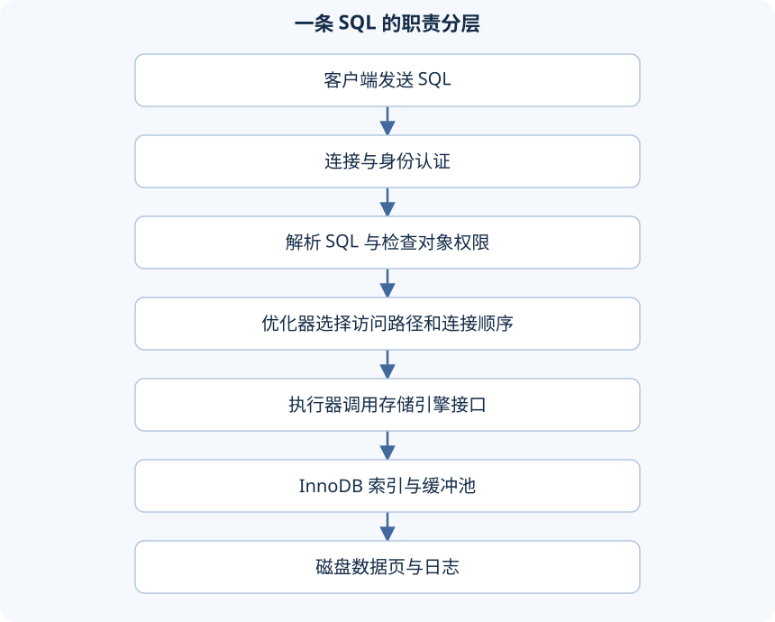

一条 SELECT 从连接进入 MySQL，先经过 SQL 层的解析和优化，再调用存储引擎读取记录。理解这条路径，才能分清“SQL 写错”“执行计划不好”“存储读取慢”是不同层面的问题。

## 一条查询经过哪些层



连接管理负责通信和会话，SQL 层理解语句含义、选择计划、执行跨引擎功能。引擎负责表数据的组织、索引访问和与其相关的锁、事务等能力。最后才是承载数据与日志的文件系统。

这是一种职责划分，不是每次查询都必须依次访问磁盘。页已经在缓冲池时，可以从内存读取。旧架构图常画有“查询缓存”，MySQL 8.0 已移除旧的 Query Cache；它与 InnoDB 缓冲池不是同一个东西。

以 `SELECT name FROM emp WHERE id=1` 为例，解析阶段先识别这是一条查询，检查关键字和表达式能否组成合法语句；表和列需要能够解析到实际对象。优化阶段再考虑怎样取得 id=1，例如是否有主键、使用主键定位的代价怎样。执行器按选定的计划请求 InnoDB 访问记录，得到这一行后返回 name。

如果写成一个不存在的列名，失败发生在能够解释并执行计划之前；如果 SQL 合法却扫描大量记录，问题更可能在访问方式与数据规模；如果计划只定位一行，响应仍然很久，则还要调查锁、存储或网络等等待。体系结构的作用，就是把这些不同故障放回各自负责的层次。

SQL 层的“优化”也不是自动把错误业务变正确。`WHERE id=1` 与 `WHERE id>=1` 的含义不同，优化器只能在保留语义的前提下选择执行方法，不会因为等值查找快就把范围查询改成等值。

## 引擎属于表，不属于整个数据库

```sql
SHOW ENGINES;
SHOW CREATE TABLE mysql_notes.emp;
SELECT @@default_storage_engine;
```

SHOW ENGINES 的 Support 列说明当前实例支持哪些引擎，DEFAULT 标识默认引擎。SHOW CREATE TABLE 的 ENGINE 才说明具体表使用哪个引擎。同一数据库中的不同表可以采用不同引擎。

```sql
CREATE TABLE engine_innodb (id INT PRIMARY KEY,name VARCHAR(20)) ENGINE=InnoDB;
CREATE TABLE engine_myisam (id INT PRIMARY KEY,name VARCHAR(20)) ENGINE=MyISAM;
CREATE TABLE engine_memory (id INT PRIMARY KEY,name VARCHAR(20)) ENGINE=MEMORY;
```

以上语句仅用于支持相应引擎的练习实例。省略 ENGINE 会使用实例默认值，不应仅凭“我没有写 ENGINE”断定所有环境都一定是 InnoDB。

| 能力 | InnoDB | MyISAM | MEMORY |
| --- | --- | --- | --- |
| 事务 | 支持 | 不支持 | 不支持 |
| 行级锁 | 支持，另有其他锁 | 主要使用表级锁 | 表级锁 |
| 外键约束 | 支持 | 不支持执行外键约束 | 不支持执行外键约束 |
| 主要数据位置 | 持久化文件与内存缓冲 | 持久化文件 | 内存，重启丢失表中数据 |
| 常见索引 | B+ 树 | B+ 树等 | HASH 或 BTREE |

业务需要事务时，不能把某张参与事务的表换成非事务引擎后，仍期待 ROLLBACK 撤销全部操作。也不能按“读多”就直接认定 MyISAM 更合适；恢复能力、并发写入、锁等待与运维成本都要一起考虑。对本课程的普通业务实验，采用 InnoDB 即可。

## 文件与逻辑结构不是同一个层次

```sql
SHOW VARIABLES LIKE 'datadir';
SHOW VARIABLES LIKE 'innodb_file_per_table';
SHOW VARIABLES LIKE 'innodb_page_size';
```

datadir 是数据目录。启用独立表空间时，普通 InnoDB 表通常有对应 `.ibd` 文件，里面保存表与索引页面，并包含序列化字典信息等元数据。InnoDB 也支持其他表空间形式，因此不能说“每一张表永远只有一个独立 ibd 文件”。

MyISAM 通常分别有 `.MYD` 数据、`.MYI` 索引和 MySQL 8.0 的 `.sdi` 元数据文件。MEMORY 的持久化元数据不等于其行数据持久化。不要用记事本改这些文件，也不能靠运行中直接复制一份 ibd 就认为完成了可恢复备份。

InnoDB 的逻辑组织可按“表空间 → 段 → 区 → 页 → 行”理解。段服务于某类数据结构，例如索引叶子页；区批量管理页面；页是主要的存储和缓冲管理单位，行记录存在页中。

默认页大小通常为 16 KiB，在这个配置下一个 1 MiB 区包含 64 页。实例可以选择其他支持的页大小，所以看到 16 KiB 时应知道它是默认配置，不是任何实例不可变的数学常数。

`ibd2sdi` 可以提取表空间中的序列化字典信息，适合检查表元数据，不会把整张表直接转换成可读业务数据。普通学习查看表结构优先用 SHOW CREATE TABLE。

假设一页里有多个员工，查询其中一人的记录时，存储读取往往以页为单位，而不是只从磁盘取出姓名那几个字节。同一页其他记录后来被访问，就有机会复用已经读入的页面。这解释了为什么数据局部性重要，也解释了“返回一行”并不代表只读取一行大小的字节。

页内还要保存管理信息，索引也会占页面，所以不能用“表文件大小除以每行字段字节数”直接算出精确行数。段、区等上层结构负责组织和分配这些页，SQL 查询中的一行与磁盘上的一块文件空间不是一一对应关系。

## Linux 环境要把安装与连接分开排查

课程后续演示采用 Linux 上的 MySQL 8.0.26，安装过程使用旧 CentOS/RPM 环境。理解顺序即可：准备匹配操作系统和架构的安装包，处理依赖，安装服务端与客户端，初始化数据目录，启动服务，设置管理员密码，再配置受限的远程账户。

在已经安装 MySQL、服务名为 mysqld 的 Linux 实验机中：

```bash
systemctl status mysqld
sudo systemctl start mysqld
mysql -u root -p
```

有些发行版服务名是 mysql，应以实际安装包为准。旧 RPM 包的依赖名称和安装顺序不适合作为所有现代发行版的通用命令；优先采用对应发行版受支持的安装方式，而不是强制忽略依赖。

首次初始化可能生成临时密码，也可能采用其他本地认证流程，取决于安装方式。临时密码应在本机私下查看并及时修改。若密码策略拒绝简单密码，使用符合策略的密码即可，无需为跟随示例降低全局策略。

远程 DataGrip 连接失败时，按顺序确认：服务是否运行、监听地址和端口是否正确、网络与防火墙是否允许该客户端、账户 Host 是否匹配、该账户是否获得所需权限。不要把关闭防火墙、开放 root@'%'、授予 `*.*` 当作安装的固定步骤。这里的后续 SQL 机制不依赖把数据库暴露到公网。

如果手中已有与课程相同的 RPM bundle，整个安装流程可以进一步拆开。先在独立 CentOS 实验机上核对系统和包的架构，把 bundle 解压到新目录，查看其中各 RPM 的名字，再依照包的依赖安装通用组件、库、客户端和服务器。下面的命令用于检查，不会替你猜测包版本：

```bash
cat /etc/os-release
uname -m
tar -tf /path/to/mysql-rpm-bundle.tar
rpm -qa | grep -Ei 'mysql|mariadb'
rpm -qp --requires /path/to/mysql-community-server.rpm
```

`/path/to/...` 需要替换为已经下载的真实文件；上述短文件名只是位置占位，不是可直接下载的包名。`tar -tf` 先列目录，`rpm -qp --requires` 查看尚未安装的这个包依赖什么。若已有其他数据库包，先确认现有用途，不能为了照着顺序运行而直接卸载。

RPM bundle 中分成多个包，是因为客户端、共享库和服务器有依赖关系。缺少某个依赖时报错，应读取具体库名和版本要求，通过匹配的系统软件源解决，然后再安装原包。强制忽略依赖可能使安装记录显示成功，却在启动时找不到动态库。

服务启动后，这类 RPM 安装通常会生成临时管理员密码，可在实验机本地检查 `/var/log/mysqld.log` 中的对应记录。用它第一次登录后执行 `ALTER USER 'root'@'localhost' IDENTIFIED BY '自己的新密码';`，再退出并用新密码登录一次。首次能够登录证明临时凭据有效，重新登录才验证新密码生效。

最后才处理远程访问：在服务器上确认监听端口，为明确的客户端来源创建账户，授予练习库所需权限，再在 DataGrip 中填写服务器地址、端口和这个账户。操作系统可以连上与数据库账户可以访问，是两层独立条件。原课配套 RPM 清单未取得，因此这里保留安装依赖和验证过程，不编造一组无法确认匹配的完整包文件名。


---

[课程目录](/posts/mysql-heima) · [上一篇](/posts/mysql-heima-10) · [下一篇](/posts/mysql-heima-12)
