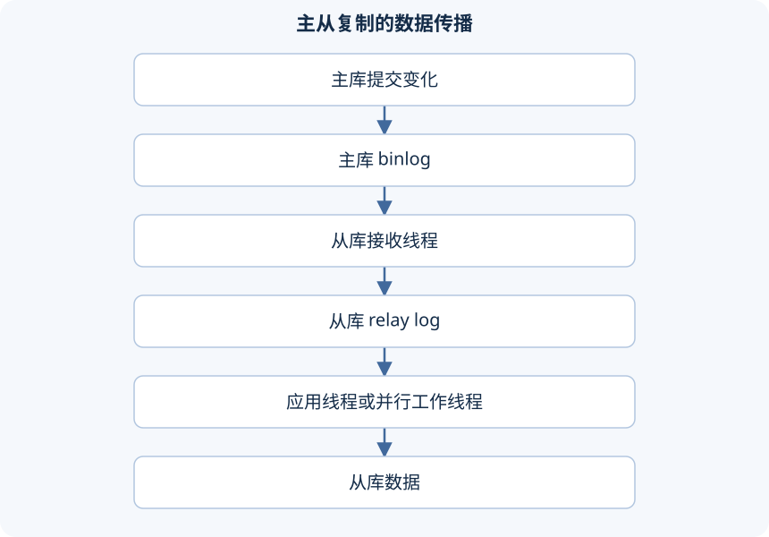

主从复制就是一台 MySQL 接收另一台的变化事件，在本地重放。主库负责主要的写入，从库可以分担一部分查询或者做备份。普通异步复制有延迟，所以"复制建好了"不等于两边随时完全一样，更不等于有了自动故障切换。

## 日志怎样从主库到从库



接收线程把主库的事件写进中继日志，应用线程再把事件应用到数据上。这两步可以分别落后：事件还没收到，或者收到了还没应用。监控时两个都要看。

旧资料叫 master/slave，新语法叫 source/replica。下面以课程的 MySQL 8.0.26 语法为准。示例地址沿用课程：主库 `192.168.200.200`、从库 `192.168.200.201`，端口 3306；自己做的时候换成独立的实验实例。

一次写入的接力过程：主库提交后，事件进 binlog；从库接收线程通过复制连接读事件，落到本地 relay log；应用线程再读 relay log，执行对应的变化。主库 COMMIT 返回时，这些步骤并没有在所有机器上同时完成，延迟就出在这里。

两种常见情况：

- 主从之间网络断了：从库可能继续应用已经收到的中继日志，但后面的事件收不到。
- 网络正常，但应用线程因为重复键报错：事件还能继续收到本地，业务数据停在出错的地方。

看起来都是"从库数据旧"，但要查的环节不一样。中继日志的作用就是把"从网络收到了什么"和"本地应用到了哪"分开，所以复制状态里才会有多个文件和位置字段。

## 先保证服务器身份与初始数据正确

两台实例的 server_id 要不同，克隆出来的实例还要检查 server_uuid 是不是独立的。别因为两台虚拟机 IP 不同，就默认数据库身份也不同。

```ini
# 主库的 mysqld 配置片段
[mysqld]
server_id=1
log_bin=binlog
binlog_format=ROW
read_only=OFF
```

```ini
# 从库的 mysqld 配置片段
[mysqld]
server_id=2
relay_log=relay-bin
read_only=ON
super_read_only=ON
```

配置写进各自实例实际在用的配置文件，重启后查变量确认生效。read_only 挡不住管理员写入；super_read_only 进一步限制客户端写入，但复制应用线程还是要能更新数据。防火墙只放行必要的来源和端口，不用为了复制把整台机器的防火墙关掉。

复制是从某个位置开始的，不会自动补齐之前已有的数据。课程是从空业务库建复制，再新建库表；已经有数据的环境，要先拿到一致的备份和对应的日志坐标，把备份还原到从库，再从这个坐标接着同步。

先导出、隔很久才随手执行 SHOW MASTER STATUS，中间的变化就漏掉了。快照和坐标必须成对拿到；也可以用设计好的 GTID 基线流程。日志位置不要写死成一个可以反复用的值。

课程版本的 InnoDB 实验库，可以在 PowerShell 里这样配套导出（先确认输出目录存在）。这里假设专用的实验来源只复制 mysql_notes，其他库的初始数据不在这个例子里：

```powershell
mysqldump -h SOURCE_HOST -u BACKUP_USER -p --single-transaction --source-data=2 --set-gtid-purged=OFF --routines --events --triggers --databases mysql_notes --result-file=D:/mysql-lab/replication-baseline.sql
Select-String -LiteralPath D:/mysql-lab/replication-baseline.sql -Pattern 'CHANGE (MASTER|REPLICATION SOURCE) TO'
```

`--source-data=2` 把配套的日志坐标写成注释，这是 MySQL 8.0.26 起的参数名，旧名叫 `--master-data=2`。配合 single-transaction，工具在建立一致性起点时会短暂协调全局读锁，而不是事后另外猜一个坐标。备份账户要有导出和查看日志状态的权限，导出期间别对目标表做 DDL。[mysqldump 参数说明](https://dev.mysql.com/doc/refman/8.0/en/mysqldump.html)

这里用的是文件 + 位置的复制方式，所以不在目标上设 GTID_PURGED，别和 GTID 自动定位方案混着用。把备份传到独立从库的管理机器上，检查脚本的目标后恢复，再用脚本注释里的坐标配置复制。

前面的从库配置开了 super_read_only。初始化恢复时，要在隔离的窗口里由管理员临时关掉 `super_read_only` 和 `read_only`，SOURCE 导入并核对完再打开。这期间不许应用连接写入，从库也还没开始接收这段新的复制，别一边导入一边让业务改目标库。先记下原来的设置，导入出错就停止后续接入，排查后重新做一个干净的基线。

## 创建复制账户并连接正确起点

在主库上由管理员创建只给这个从库用的账户，执行前把密码占位符换掉：

```sql
CREATE USER 'repl'@'192.168.200.201'
IDENTIFIED BY 'REPLACE_WITH_STRONG_PASSWORD';
GRANT REPLICATION SLAVE ON *.* TO 'repl'@'192.168.200.201';
SHOW MASTER STATUS;
```

File 和 Position 是当前的日志坐标；已经有数据的话，用备份流程里记下的配套坐标。空库实验里，记下坐标后先别再写业务数据，把从库配好。

在从库上配置来源。下面的文件名和位置要换成实际的配套值，示例里的占位文字不能直接执行：

```sql
CHANGE REPLICATION SOURCE TO
  SOURCE_HOST='192.168.200.200',
  SOURCE_PORT=3306,
  SOURCE_USER='repl',
  SOURCE_PASSWORD='REPLACE_WITH_STRONG_PASSWORD',
  SOURCE_LOG_FILE='REPLACE_WITH_BASELINE_LOG_FILE',
  SOURCE_LOG_POS=123,
  GET_SOURCE_PUBLIC_KEY=1;
```

这里的 123 只是数字占位，要换成基线实际的 Position。GET_SOURCE_PUBLIC_KEY 用于 caching_sha2_password 非 TLS 认证时获取公钥，不提供整个复制通道的身份验证和传输加密。有证书的部署要配置并验证 TLS，别把这个选项当成 TLS。认证方式还要和客户端、服务器版本兼容，别把旧的 mysql_native_password 配置照抄到所有新版本上。

```sql
START REPLICA;
SHOW REPLICA STATUS\G
```

老版本用 CHANGE MASTER TO、START SLAVE、SHOW SLAVE STATUS。课程版本支持新语法，后续版本的状态命令可能还会变，以实际版本的手册为准。

SOURCE_LOG_FILE 和 SOURCE_LOG_POS 描述的是来源端日志的位置。文件名只是某个实例生成的名字，两台独立主库都有 `binlog.000002`，不代表内容一样，position=123 也不指向同一段业务历史。

从库的初始数据必须和这个位置配套：

- 基线已经包含某次 INSERT，却从更早的位置开始回放，可能撞主键。
- 基线还没包含它，却从更晚的位置开始，就永久漏掉了。

重复和遗漏都是因为"数据状态和续传坐标不是同一个起点"。

## 两个 Yes 之后仍要验证数据

Replica_IO_Running 和 Replica_SQL_Running 表示接收线程和应用线程的状态。两个都是 Yes 只是必要条件，还要看 Last_IO_Error、Last_SQL_Error、复制过滤、日志位置和延迟。Seconds_Behind_Source 为 0 也不能单独证明所有业务读都追上了。

接收线程失败：先查连接、账户、网络，以及日志是不是还在。应用线程失败：看具体的事件错误，比如主键冲突、表结构不一致。别把"跳过出错事件"当成默认修法，那样复制表面上恢复了，数据却留下了分歧。

主库挂了要提升从库，得判断已接收和已执行的进度、防止旧主继续写、切换客户端连接。普通复制本身不做这些协调，读写分离和故障切换还要额外的路由和管理机制。

验证用一张单独隔离的探针表。在主库上已经在复制范围里的 `mysql_notes` 库执行：

```sql
CREATE TABLE replication_probe (
  id INT PRIMARY KEY,
  marker VARCHAR(40) NOT NULL
) ENGINE=InnoDB;
INSERT INTO replication_probe VALUES(1,'insert-observed');
SELECT id,marker FROM replication_probe WHERE id=1;
```

在从库查同一张表、同一个主键，应该先看到 `insert-observed`；然后回主库执行 `UPDATE replication_probe SET marker='update-observed' WHERE id=1`，再去从库核对更新。复制是异步的，第一次马上查可能还没同步过来，记录从提交到看到变化的过程就行，别一查不到就认定配置失败。从库的普通业务账户也要确认写不进去。

- 表结构没出现：查 DDL 有没有进复制范围、应用有没有报错。
- 有表没数据：查接收和应用的进度。
- 插入同步了、更新没动：看最近的错误和过滤规则。

这样分阶段验证，比只看两个 Yes 更容易定位卡在哪一步。


---

[课程目录](/posts/mysql-heima) · [上一篇](/posts/mysql-heima-27) · [下一篇](/posts/mysql-heima-29)
