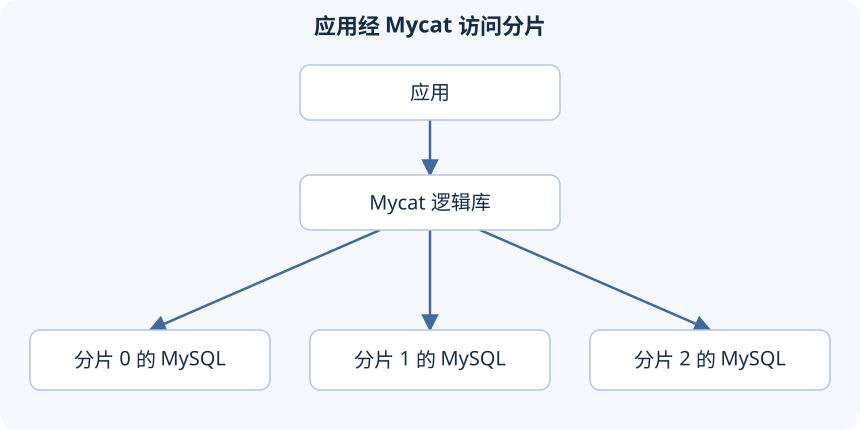

分库分表解决的是单个数据库扛不住的数据量或访问压力。先查清瓶颈：如果慢只是因为缺索引，把同一条低效查询分到三台机器上，得到的可能是三个慢查询，还多了网络和合并结果的开销。

课程从磁盘容量、热点数据、I/O 和 CPU 压力讲到拆分。这些是排查方向，换算不出"超过多少万行就必须分库"的固定门槛。行宽、索引数量、查询方式、活跃数据比例都会影响单库能扛多少。

## 垂直拆分改变放在一起的数据

商品、订单、用户是不同的业务。商品表进商品库、订单表进订单库、用户表进用户库，这就是垂直分库。每个库放不同的表，可以分别安排容量和权限。代价是原来一个库里就能做完的关联查询和事务，现在可能要跨库。

垂直分表拆的是同一行的字段。比如把常用的商品编号、名称、价格，和很少读的大段详情分开，用同一个商品 ID 关联。查列表时不用读详情，能少读数据；要看完整信息时，就得多查一次或者关联。值不值得拆，看两组字段是不是真的访问模式不同。

垂直拆分没有减少热点订单表里的订单数量。订单库独立出来了，单表增长的问题还在，这才需要水平拆分。

## 水平拆分决定每一行去哪里

水平拆分保持表结构不变，把不同的行分开存。按订单 ID 范围分三片，三个节点上都有 `tb_order`，但各自只存一部分订单，合起来才是完整的逻辑表。

| 拆分方式 | 改变什么 | 能直接分散什么 | 需要补上的能力 |
| --- | --- | --- | --- |
| 垂直分库 | 不同业务表的位置 | 不同业务的数据库负载 | 跨库查询、跨业务事务 |
| 垂直分表 | 一行字段的组织 | 不常用大字段带来的读取成本 | 按主键重组完整记录 |
| 水平分库 | 同结构记录所在的实例 | 容量、连接和计算压力 | 路由、跨片查询、迁移 |
| 水平分表 | 同结构记录所在的表 | 单表规模 | 表名路由、跨表查询 |

在同一个实例里多建几张表，并没有给这台机器加 CPU、内存或磁盘带宽，所以水平分表和水平分库不是一回事。

分片字段不能只看分得均不均。按订单 ID 分片，可主要接口总是按用户 ID 查订单，那这个接口很可能要查遍所有分片。反过来按用户 ID 分片，同一个用户的订单聚在一起，但大客户可能变成热点。选的时候要把最常用的过滤条件、关联关系、事务范围一起考虑。

拿几个业务动作检验方案：

- 改商品价格：只访问商品库，一般容易在本地完成。
- 查某个用户的全部订单：订单按用户 ID 分片的话，一次就能定位。
- 统计所有订单总额：可能要访问全部订单分片。
- 同时改订单和库存：两者分开后，得想清楚跨库操作怎么协调。

"每个节点结构相同"不等于"每个节点数据相同"。水平分片的完整数据是各片记录的并集，同一个业务主键一般只属于确定的一片；主从复制才是让多个节点存数据副本。把分片当副本用，主节点一挂就去读另一片，会漏掉故障片上的数据；把副本当分片加起来统计，又会重复计数。

垂直拆分还会影响关联在哪里做。用户表和省市区字典在同一个节点，展示地址可以本地关联；订单表在别的节点，要地区名称就得跨节点。后面引入小型全局表，就是为了让常用字典能在多个业务节点本地用，不是说所有表都适合复制到所有节点。

## Mycat 放在应用与数据库之间

课程用 Mycat 1.x 演示代理式分片：应用连 Mycat，Mycat 解析 SQL，按配置选后端节点，再收集结果。另一类方案把路由逻辑放在应用进程里的数据库访问层。两种都要处理分片规则，只是放的位置不同。

Mycat 本身不存业务表的数据，它存配置、维护连接、处理请求。应用还是用 MySQL 协议发 SQL，但不代表所有单机 SQL、事务和数据库工具都能原样照搬。

比如三片各自返回局部排好序的结果，代理层还得合并成全局顺序。跨片求平均值也不能直接平均三个平均值：一片 1 条记录、一片 100 条记录，权重明显不同，要用总和和数量算。分片减轻了单个后端的工作，也让代理多了协调的活。

代理把数据库地址藏在一个入口后面，但还是要根据 SQL 判断路由：逻辑表对应哪些节点、分片字段是哪一列、这次的条件够不够确定节点。查 id=5000001 和查"姓名包含张"，都发到同一个 Mycat 地址，后端的访问范围可能完全不一样。

所以"对应用来说还像是连一个库"，说的只是连接入口，分布式数据的限制并没有消失。全局唯一 ID、跨节点一致性、分片迁移，都要按实际布局去设计。单一入口本身也可能成为新的性能或可用性问题，要和后端分片一起测。

## 扩容会改变数据的归属

用 `id % 3` 决定分片，直接把配置改成 `id % 4`，很多 ID 的计算结果就变了。旧数据还在旧节点，新查询却可能被送到新节点，于是"数据还在，但查不到"。改配置代替不了数据迁移。

拿 ID 4 看：三片时 `4%3=1`，写在下标 1；改成四片后 `4%4=0`，同样的条件会算到下标 0。只改配置不搬数据，按主键查可能返回空，可原节点上明明还有这条记录。新写入再按新规则落到另一片，还可能出现同一个业务主键的多份记录。

拆分之前至少要能回答：

- 记录的唯一标识由谁生成
- 跨片事务怎么处理
- 旧数据怎么迁移
- 怎么验证没丢、没重复
- 失败了怎么切回原来的路由

这些问题是拆分本身带来的，不会因为用了中间件就消失。迁移至少包括：旧规则到新规则的对应关系、搬数据、迁移期间的写入怎么处理、切换前的一致性核对、失败后恢复路由。讲这些是为了说明"加一台服务器"还不算扩容完成；具体的在线迁移实现超出了课程实验，不能靠改 count 参数糊弄过去。

这套笔记继续按课程的历史环境讲 Mycat 1.x。课程用的是 1.6.7.3，P165 提到了 1.6.7.4；补充核对用的是固定的 1.6.7.4 源码。这些旧版本示例不当作现在生产选型的结论。

原课：[P163–166](https://www.bilibili.com/video/BV1Kr4y1i7ru?p=163)，回顾见 P187、P195。下一篇把逻辑库、规则和物理实例串成一条能检查的配置链。

---

[课程目录](/posts/mysql-heima) · [上一篇](/posts/mysql-heima-28) · [下一篇](/posts/mysql-heima-30)
