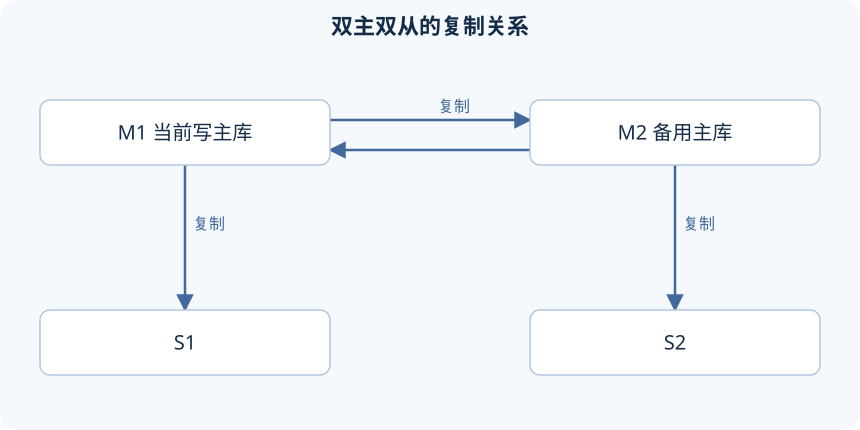

课程用两个可写的主节点、每个主节点各带一个从节点，演示主库挂了以后由谁接替写入。平时还是一个主节点负责写，另一个备用；两个主库互相复制，不代表应该同时接受互相冲突的业务写入。

这套结构能演示自动改选写节点，但异步复制加一次心跳切换不等于零数据丢失，也解决不了网络分区导致的双写。

## 四个节点的关系

| 节点 | 课程地址 | server_id | 复制来源 |
| --- | --- | --- | --- |
| M1 | 192.168.200.211 | 1 | M2 |
| S1 | 192.168.200.212 | 2 | M1 |
| M2 | 192.168.200.213 | 3 | M1 |
| S2 | 192.168.200.214 | 4 | M2 |



M1 的业务变更要经过 M2 才能到 S2，所以 M2 要把自己应用的复制事件继续写进 binlog。旧参数名是 `log_slave_updates`，MySQL 8.0.26 里叫 `log_replica_updates`。两个主节点都要开启转发需要的二进制日志，所有实例的身份也必须独立。

```ini
# M1 的实验配置片段；M2 使用不同的 server_id
[mysqld]
server_id=1
log_bin=binlog
binlog_format=ROW
log_replica_updates=ON
```

课程还配了数据库过滤。过滤会改变哪些事件进复制链，特别要区分语句格式、行格式和跨库操作。第一次搭这个实验可以先不加过滤，复制关系更好验证；加了过滤，就要单独测过滤范围，别因为某个 CREATE DATABASE 成功了，就以为相关写入都会同步。

## 从一致的数据起点建立四条复制关系

先准备四个隔离的实例，确认数据基线一致，记下这个基线对应的来源日志位置。已经有业务数据的话，不能拿当前日志位置去接一台空从库，那样只会复制之后的事件，历史数据不会凭空补上。基线和坐标怎么取见第 28 篇。

然后按上表逐条配置，每次都确认"现在在哪台上执行、它要从谁接收"。下面以 S1 从 M1 接收为例，另外三条换成各自的来源和对应坐标：

```sql
-- 在 S1 执行。以下字符串和数字全部需要换成实际来源凭据与一致性起点。
CHANGE REPLICATION SOURCE TO
  SOURCE_HOST='M1_HOST',
  SOURCE_USER='repl',
  SOURCE_PASSWORD='REPLACE_REPLICATION_PASSWORD',
  SOURCE_LOG_FILE='REPLACE_WITH_M1_BINLOG_FILE',
  SOURCE_LOG_POS=123;
START REPLICA;
SHOW REPLICA STATUS\G
```

123 只是语法占位，不能照抄。复制账户要提前在对应的来源上建好并授予复制权限；认证的安全连接或公钥要求沿用第 28 篇的说明。别以为两个来源刚好文件名和位置一样，就能共用坐标。

四条关系按"在哪执行命令"再列一遍，免得只记住图里的箭头却在错的机器上操作：

| 执行 CHANGE REPLICATION SOURCE 的节点 | SOURCE_HOST 指向 | 应使用谁的基线坐标 |
| --- | --- | --- |
| S1 | M1 | M1 对应基线 |
| S2 | M2 | M2 对应基线 |
| M2 | M1 | M1 对应基线 |
| M1 | M2 | M2 对应基线 |

每个接收方都要有自己唯一的身份：server_id 用来区分复制参与者，克隆出来的 server_uuid 也要独立，IP 不同代替不了这项检查。两个来源上的复制账户允许哪些接收方连接，也要按上表分别建，不是一个 `%` 账户就把所有环境都准备好了。

从空的专用业务库开始实验的话，可以在配置关系期间停掉额外的写入，分别记下两个来源当前的坐标，再逐条建立接收关系。已经有数据的话，要先让各节点的业务基线一致，并拿到和各来源匹配的续传位置；两个原本各有不同业务数据的主库，不会因为互相 CHANGE SOURCE 就自动"合并成同一份"。

建好 S1←M1、S2←M2、M2←M1、M1←M2 后，分别检查接收线程、应用线程和错误信息。循环复制靠事件来源身份等机制避免正常事件无限绕圈，但它不解决跨主库的并发冲突：两个节点同时插入相同的主键，照样可能复制出错。

在隔离实验里依次从 M1、M2 写入不同主键的测试记录，等其他节点出现对应记录，验证两个方向都通。正常业务恢复后，要重新收敛到一个活动的写入口。

M1 写入一条记录后：S1 直接从 M1 收到；M2 也从 M1 收到，并把需要继续传播的复制事件写进自己的 binlog；S2 再从 M2 收到。如果 M2 没保留这类复制更新的日志，M2 自己可能已经有这条记录了，S2 却拿不到。这就是 log_replica_updates 在链式传播里的作用。

## Mycat 中的活动写节点与备用写节点

逻辑库和 dataNode 还是只要一组；对应的 dataHost 里配两组 writeHost/readHost。下面是 dataHost 内部的布局，地址、账户和数据库 URL 按实验环境替换：

```xml
<dataHost name="host_ha" maxCon="100" minCon="1" balance="1"
          writeType="0" dbType="mysql" dbDriver="jdbc" switchType="1">
  <heartbeat>SELECT 1</heartbeat>
  <writeHost host="m1" url="jdbc:mysql://M1_HOST:3306/db01"
             user="mycat_backend" password="REPLACE_BACKEND_PASSWORD">
    <readHost host="s1" url="jdbc:mysql://S1_HOST:3306/db01"
              user="mycat_backend" password="REPLACE_BACKEND_PASSWORD" />
  </writeHost>
  <writeHost host="m2" url="jdbc:mysql://M2_HOST:3306/db01"
             user="mycat_backend" password="REPLACE_BACKEND_PASSWORD">
    <readHost host="s2" url="jdbc:mysql://S2_HOST:3306/db01"
              user="mycat_backend" password="REPLACE_BACKEND_PASSWORD" />
  </writeHost>
</dataHost>
```

- `balance=1`：让可用的读节点和备用写节点参与普通读的均衡。
- `writeType=0`：用当前活动的写节点，初始一般是第一项；故障切换后活动项可能变了，别一直把"第一个 XML 标签"当成当前的写主库。`writeType=1` 会在多个写节点之间选，不适合本篇要演示的单主写入。
- `switchType=1`：允许按这个版本的健康检测机制自动切换；`-1` 禁止自动切换。

字幕讲 writeType 时有一句"配置为一，让另一台备用"，接着实际配的是 0。这里按实际意图和源码里活动写源的选择来，用 0。

`SELECT 1` 只能说明实例能回应查询，证明不了它已经追上了所有复制事件。所以允许切换，不等于候选节点的数据已经完整。

逻辑库和 dataNode 也要接到 host_ha，才是完整的配置链。比如在 schema.xml 根元素里，把下面两项和前面的 dataHost 配合起来：

```xml
<schema name="ITCAST_RW2" checkSQLschema="true" sqlMaxLimit="100" dataNode="dn_ha" />
<dataNode name="dn_ha" dataHost="host_ha" database="db01" />
```

server.xml 里对应客户端用户的 schemas 要包含 ITCAST_RW2。客户端连的是逻辑库名，四个 MySQL 节点存的是物理库 db01。逻辑库改名后只改了一份文件，身份授权和实际定义就对不上；物理库名写错了，可能登录成功却查不到想要的表。

正常状态下，活动写源 M1 负责写入，balance=1 让 S1、M2、S2 参与符合条件的读取。切换之后，M2 不再是"备用读候选"，而是新的活动写源；解释请求流向时要按当前的角色来，别一直按最初的标签顺序想。

## 故障实验需要证明哪些事

只在已经保存好配置、有恢复办法的隔离实验环境里模拟故障。先记下 M1、M2 的复制位置和现有的测试数据，确认正常写入经过当前的活动主库，再停掉这台实验主库。

看 Mycat 的日志和数据源状态，等它识别到故障，然后用独立的测试主键再写一次。记下切换期间有没有报错、报错持续到什么时候、成功的写入最后落到哪个节点，并检查这个节点对应的从库有没有收到变化。应用还要处理切换期间失败或者结果不确定的请求，非幂等的写入不能无条件重试。

原课停掉 M1 后成功写入了 M2，证明了那次演示里写入能被接替。但它没证明故障前所有已确认的写入都复制到了 M2，也没验证网络分区、旧主恢复、多个代理同时选写主库这些情况。

这个结构还要特别注意旧从库 S1。M1 停了之后，S1 虽然还能回应 SELECT，但可能拿不到 M2 上的新写入，因为它的直接复制来源还是 M1。代理要是继续把它当成健康的读节点，用户就可能读到停在故障前的数据。TCP 能连上、心跳能回应、复制已经追平，是三个不同的条件。

切换的验收记录可以按三个时间段来：

1. 故障前：确认写入确实到了 M1，并且已经传播到候选节点。
2. 故障中：记下哪些请求失败或结果不确定，以及代理什么时候改选了写源。
3. 故障后：确认新写入落到 M2、S2 跟上了，并处理那些数据已经不够新的读候选。

这样才知道除了"写入恢复了"，读路径是不是也符合预期。

旧主恢复时，先限制它接受业务写入，核对双方的数据和复制进度，再决定怎么重新接入。它可能落后于 M2，甚至带着故障前没传播出去、和新主冲突的数据。两个主库已经有冲突数据的话，单纯重启服务解决不了。别一看到进程起来了就宣布整个集群已经恢复一致。Mycat 本身的单点、故障隔离和客户端连接恢复，在生产方案里也要另外处理。

原课：[P191–195](https://www.bilibili.com/video/BV1Kr4y1i7ru?p=191)。本篇整理的是课程的拓扑、配置含义和验收方法，没有实际做节点停机或生产切换。

参数命名与转发作用见 [复制与二进制日志参数](https://dev.mysql.com/doc/refman/8.0/en/replication-options-binary-log.html)。


---

[课程目录](/posts/mysql-heima) · [上一篇](/posts/mysql-heima-35)
