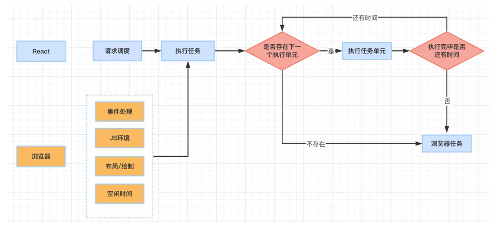

## 一、先定位多余渲染从哪里来
父组件更新时，React 默认会接着渲染它的子组件。子组件就算没用到这次变化的数据，也可能重新跑一遍渲染逻辑。组件树一大，这种重复工作的成本就慢慢显出来了。

---
## 二、源码层优化
### 1. 时间切片（Time Slicing）
- 可以理解成：把能调度的渲染工作拆开执行，需要时把主线程还给浏览器。笔记里用"单帧执行不超过 16ms"来描述一帧的时间预算；工作接近或超过 16ms 时，要留意主线程是不是被长任务占住了。这个数字只是方便理解，不是 React 对每个任务的硬性承诺。
- 这么做是为了减少长任务一直占着主线程，不是让所有渲染都变快。
- 

### 2. Fiber 架构
1. 每个组件对应一类 Fiber 任务单元。
2. Fiber 节点通过 `child / sibling / return` 指针连起来，React 靠这个记录工作进度，中断和恢复渲染就有了基础。

下面的公式是对执行过程的简化记忆：
$$
\text{Fiber 任务} \xrightarrow{\text{16ms 切片}} \text{浏览器渲染} \xrightarrow{\text{恢复}} \text{下一个 Fiber 任务}
$$

---
## 三、代码层优化
### 1. 避免 state 相同值触发更新
- 类组件可以继承 `PureComponent`，让 React 对 props 和 state 做浅比较。
- 函数组件更新 state 时会判断新旧值是否相同，但对象和数组还是要留意引用有没有变。

### 2. 阻止 props 引发的无效更新
#### （1）基础方案
- 类组件用 `PureComponent` 做浅比较。
- 函数组件可以用 `React.memo` 包一层，同样是浅比较 props。

#### （2）引用类型陷阱
父组件每次渲染都重新创建函数、对象或数组的话，就算内容没变，引用也已经变了。这时 `memo` 的浅比较还是会判定 props 变了。

#### （3）Hook 缓存方案
函数引用要保持稳定时，可以用 `useCallback`：
```js
const fn = useCallback(() => {}, [])
```
对象、数组或计算结果要缓存时，可以用 `useMemo`：
```js
const obj = useMemo(() => ({ a: 1 }), [])
```
这里的依赖都是空数组，所以只在第一次渲染时创建。真实业务里，函数或计算要是依赖外部的值，要把对应的依赖补全，不然会读到旧值。

---
## 四、怎么判断该不该优化
1. 先确认父组件更新时，子组件是不是真的出现了能观察到的重复渲染。
2. 组件边界清楚了，再用 `memo / PureComponent` 跳过一部分重复工作。
3. 传引用类型的 props 时，检查是不是引用变化让浅比较失效了。
4. 确实需要稳定的引用时，再用 `useCallback / useMemo`，别一上来就给所有函数和对象都套上缓存。

下面这个式子别当成通用的性能公式，它更像是这一节几个工具的索引：
$$
\text{有效渲染} = \text{memo} + \text{useCallback} + \text{useMemo}
$$
