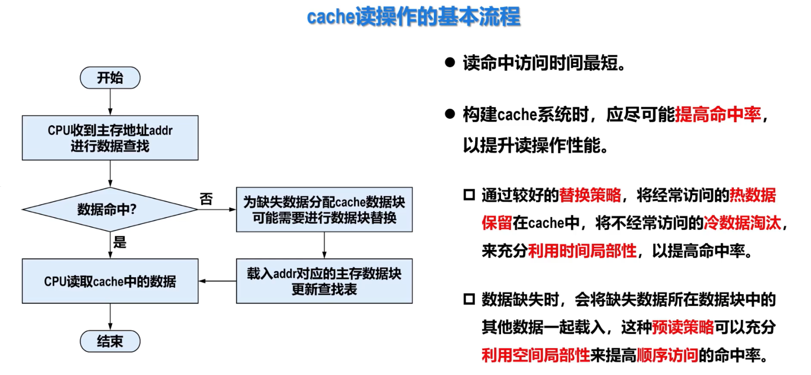
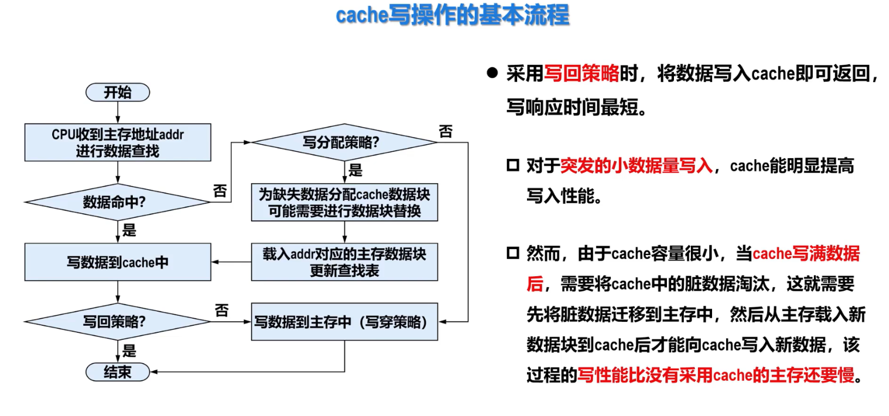
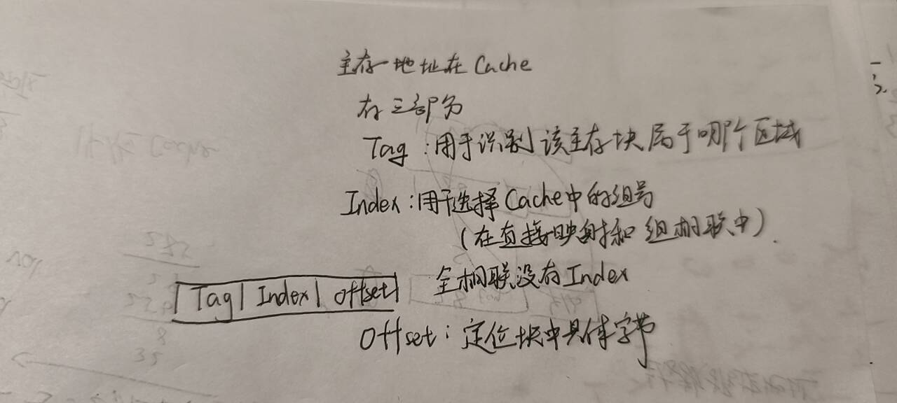
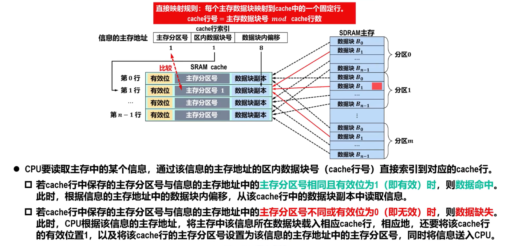
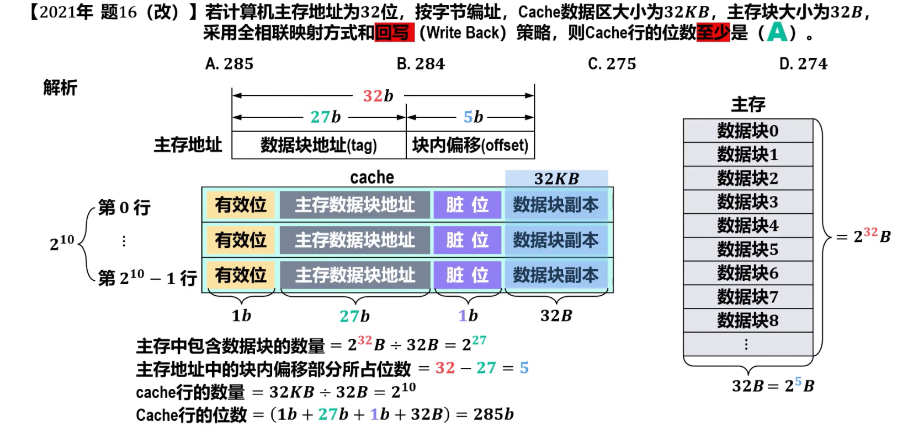
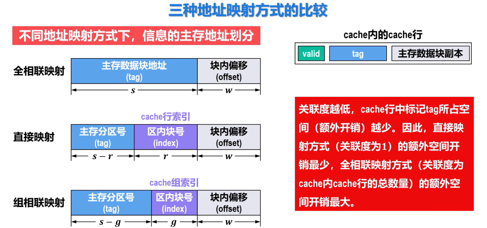
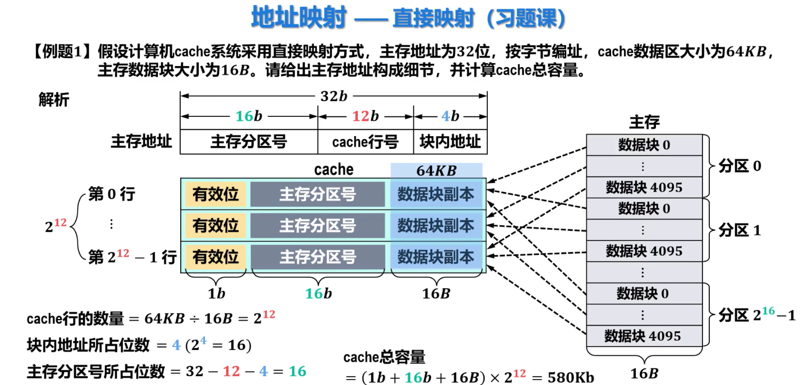

CPU 运算速度远高于基于 DRAM 的主存，如果在两者之间直接互连，处理器大部分时间都会耗在等待取指和取数上。高速缓冲存储器（Cache）利用访问速度比 SDRAM 快 5–10 倍的 SRAM，并依托程序的时间与空间局部性原理，把热数据提前留在 CPU 身边。本文系统梳理 Cache 性能指标、读写一致性策略、三种地址映射的计算拆解，以及四大经典替换算法。

## Cache 存在的依据与性能指标

**Cache 生效的底层前提是程序局部性原理（时间局部性 + 空间局部性）；计算平均访问时间 $T_A$ 时务必看清题意是“命中后同时访 Cache 与主存”还是“先查 Cache 缺失后再访主存”。**

- **时间局部性**：某个存储单元被访问后，不久的将来还会被重复访问（如循环计数器、高频函数调用）。
- **空间局部性**：某个存储单元被访问后，与它地址相邻的单元大概率随后也会被访问（如顺序遍历数组、连续执行指令）。因此 Cache 与主存按固定大小的**数据块（Block / Line）**（如 16 B、32 B、64 B）整体调入。

### 核心性能公式

设命中次数为 $N_C$，缺失次数为 $N_M$，Cache 单次访问时间为 $T_C$，主存访问时间为 $T_M$：

1. **命中率（$H$）与缺失率（$1 - H$）**：

$$H = \frac{N_C}{N_C + N_M}$$

2. **平均访问时间（$T_A$）**（先查 Cache，未命中再访问主存）：

$$T_A = H \times T_C + (1 - H) \times T_M$$

（注：部分体系结构题目中，未命中时总耗时写成 $T_C + T_M$，即串行先查 Cache 再访主存；若同时并发访问 Cache 与主存，则未命中耗时为 $T_M$，解题时注意审题。）

3. **访问效率（$E$）**（令 $R = \frac{T_M}{T_C}$，通常 $R = 5 \sim 10$）：

$$E = \frac{T_C}{T_A} = \frac{1}{H + (1 - H) \cdot R}$$

## Cache 读、写流程与一致性策略

**写操作的核心难点是保持 Cache 与主存数据一致：写直达（Write-Through）每次写都同步更新主存，简单可靠但写延迟高；写回（Write-Back）只先改 Cache 并置“脏位”，等该块被替换淘汰时才写回主存，配合写分配（Write-Allocate）广泛用于现代桌面与服务器 CPU。**

### Cache 读流程

1. CPU 发出主存地址，硬件拆分为块地址与块内偏移（Offset）。
2. 用块地址索引 Cache 行，检查**有效位（Valid）**是否为 `1` 且**标记位（Tag）**是否匹配。
3. **命中**：直接按块内偏移从 Cache 数据区取出目标字返回给 CPU。
4. **缺失**：向主存发出读块请求，按替换算法选出要覆盖的 Cache 行（若采用写回策略且旧行脏位为 `1`，需先写回主存），装入新主存块、置有效位为 `1` 并更新 Tag，随后把数据送给 CPU。

### Cache 写流程与四种组合策略

1. **写命中时的两种处理**：
   - **写直达（Write-Through / 全写法）**：写命中时**同时写入 Cache 和主存**。优点是数据始终严格一致、掉电不丢脏数据；缺点是每次写都要承受主存慢速写入延迟。
   - **写回（Write-Back / 回写法）**：写命中时**只修改 Cache**，并将该 Cache 行的**脏位（Dirty Bit）置为 `1`**；直到该行日后被替换淘汰时，若脏位为 `1` 才整块写回主存。优点是大幅减少主存写次数（同一块多次写合并为一次回写），缺点是存在片上数据未落盘的不一致窗口。
2. **写缺失时的两种配合策略**：
   - **写分配（Write-Allocate）**：写缺失时先把对应主存块调入 Cache，再在 Cache 中修改（利用空间局部性，**写回法必须搭配写分配**）。
   - **非写分配（No-Write-Allocate）**：写缺失时直接把数据写入主存，不调入 Cache（常搭配写直达使用，避免偶发写污染 Cache）。

## 三种地址映射方式与容量计算

**直接映射硬件最简单但容易冲突抖动；全相联命中率最高但需要昂贵的全局相联比较器；组相联折中了两者，主流 CPU 的 L1/L2 Cache 几乎都采用 2/4/8 路组相联映射。**

无论哪种映射，主存地址都先按块大小切成高位“主存块号”和低位“块内偏移（Offset）”，且 **Offset 只在块内定位字节，绝不参与 Cache 行的查找与 Tag 匹配**；一个按块对齐的主存块起始地址，其低 Offset 位全为 `0`。

### 1. 直接映射（Direct Mapping）

- **映射规则**：主存第 $i$ 块固定映射到 Cache 第 $j = i \bmod C$ 行（$C$ 为 Cache 总行数），即主存按每 $C$ 个块分一区，各区第 $j$ 块争抢同一个 Cache 第 $j$ 行。
- **地址结构（三级）**：$\text{Tag（主存分区号）} + \text{Index（Cache 行号）} + \text{Offset（块内偏移）}$。
  - $\text{Offset 位数} = \log_2(\text{块大小})$
  - $\text{Index 位数} = \log_2(\text{Cache 行数})$
  - $\text{Tag 位数} = \text{主存地址总位数} - \text{Index 位数} - \text{Offset 位数}$
- **示例**：主存 $1\text{ MB}$（$2^{20}\text{ B}$）、Cache $32\text{ KB}$（$2^{15}\text{ B}$）、块大小 $16\text{ B}$（$2^4\text{ B}$）。主存块数 $= 2^{16}$，Cache 行数 $= 2^{11}$，因此地址划分为 **Tag 5 位 + Index 11 位 + Offset 4 位**。若 32 位地址 `0x12345678` 按 `16 | 12 | 4` 划分，则高 16 位 `0x1234` 为 Tag，中间 12 位 `0x567` 为行号 Index，低 4 位 `0x8` 为 Offset。
- **优缺点**：仅需比较单个行的 Tag，硬件简单速度极快；但不同主存块若映射到同一行就会反复冲突替换（Conflict Miss）。

### 2. 全相联映射（Fully Associative Mapping）

- **映射规则**：主存任意块可放入 Cache 任意空闲行，无“主存分区号”概念。
- **地址结构（二级）**：

$$\text{主存地址} = \underbrace{\text{主存数据块地址（Tag）}}_{S\ \text{位}} + \underbrace{\text{块内偏移}}_{W\ \text{位}}$$

- **容量与行结构计算**：
  - 主存数据块数量为 $2^S$ 个，单个数据块大小为 $2^W$ 字节，主存总容量 $= 2^S \times 2^W = 2^{S+W}$ 字节；
  - 每个 Cache 行包含：$\text{有效位（1 位）} + \text{主存数据块地址（}S\text{ 位）} + \text{数据块副本（}2^W \times 8\text{ 位）}$；
  - 若 Cache 共有 $N$ 行（不含脏位时），总位容量为：

$$\text{Cache 总容量} = N \times \left[1 + S + (2^W \times 8)\right]\ \text{位}$$

- **优缺点与场景**：彻底消除冲突缺失，命中率最高；但查询时需用相联比较器同时比对所有 $N$ 行的 Tag，硬件成本高，仅适合几十到几百项的超小缓冲（如页表快表 **TLB**）。

### 3. 组相联映射（Set-Associative Mapping）

- **映射规则**：把 Cache 等分为 $G$ 组，每组含 $K$ 行（称 **$K$ 路组相联**）；主存第 $i$ 块先按直接映射规则锁死进第 $g = i \bmod G$ 组，组内可任意放入该组 $K$ 个槽位之一（相当于“组间直接映射 + 组内全相联”）。
- **地址结构（三级）**：$\text{Tag} + \text{Set Index（组号）} + \text{Offset}$，其中 $\text{组号位数} = \log_2 G$，$\text{Tag 位数} = \text{主存块地址位数} - \log_2 G$。
- **例题**：Cache 容量 $64\text{ KB}$、块大小 $32\text{ B}$、4 路组相联（$K=4$），则总行数 $= 2^{16} / 2^5 = 2^{11} = 2048$ 行，组数 $G = 2048 / 4 = 512 = 2^9$ 组，故组地址占 **9 位**、Offset 占 **5 位**；若主存地址 32 位，则 Tag 占 $32 - 9 - 5 = 18$ 位。

### 三种映射方式核心对比

| 维度 | 直接映射 | 组相联映射（$K$ 路） | 全相联映射 |
| --- | --- | --- | --- |
| **命中率** | 较低（冲突缺失多） | 居中偏高（随 $K$ 增大而提高） | 最高（无冲突缺失） |
| **硬件比较器数** | 1 个 | $K$ 个 | $N$ 个（等于总行数） |
| **是否需要替换算法** | 否（位置唯一，直接覆盖） | 是（组满时组内淘汰） | 是（全局满时淘汰） |
| **典型应用** | 对硬件极简要求场景 | 主流 CPU L1/L2/L3 Cache | 快表 TLB |

考试时常同时出现三种含义不同的“地址 / 存储表内容”，注意区分：

| 名称 | 归属方 | 构成字段 |
| --- | --- | --- |
| **主存地址** | CPU 发出的访存地址 | `Tag + 行号/组号 + 块内偏移` |
| **Cache 内部地址** | Cache 内部定位 | `行号/组号 + 块内偏移` |
| **块表（目录表）内容** | 每行 Cache 的控制信息 | `Valid（+ Dirty）+ Tag` |

## Cache 替换算法（RR / FIFO / LRU / LFU）

**只有全相联与组相联映射在对应空间填满时才需要替换算法；实际 CPU 命中率最高、最贴合时间局部性的是最近最少使用算法（LRU），而 FIFO 会出现“容量增大、命中率反而下降”的 Belady 异常。**

1. **随机替换（RR）**：随机挑一块淘汰，硬件最简单（只需随机数发生器），无访问历史开销，但可能把刚要用的热块踢出去。
2. **先进先出（FIFO）**：淘汰最早进入 Cache 的块（记录入队时间戳）。实现简单，但完全忽略块装入后是否又被频繁访问过，因此存在 **Belady 异常**（例如访问序列 `1→2→3→4→1→2→5→1→2→3→4→5` 在容量 3 时比容量 4 缺页/缺失更少）。
3. **最近最少使用（LRU）**：淘汰最久未被访问的块，完美利用时间局部性，平均命中率最高。硬件可用**访问栈**（命中即移至栈顶，淘汰栈底）或**年龄计数器**（命中行计数器清 `0`，其余行加 `1`，淘汰计数器值最大者）实现；在 408 计算中，一个 $K$ 路组相联组内每行至少需要 $\lceil \log_2 K \rceil$ 位 LRU 替换控制位。
4. **最不经常使用（LFU）**：淘汰一段时间内累计访问次数最少的块（每行配访问计数器，命中加 `1`，淘汰最小值）。缺点是早期某热点块攒出极大计数后哪怕之后再不用也长期赖着不走（需定期衰减或清零计数器）。

| 算法 | 淘汰依据 | 命中率 | 硬件复杂度 | 典型缺点 |
| --- | --- | --- | --- | --- |
| **RR** | 随机选取 | 最低 | 最低 | 易误杀热块 |
| **FIFO** | 最早进入时间 | 较低 | 低 | 存在 Belady 异常 |
| **LRU** | 最久未被访问 | **最高** | 中（随 $K$ 升高） | 高相联度时维护计数器/矩阵开销大 |
| **LFU** | 累计访问次数最少 | 较高 | 中 | 历史高计数“滞留”影响新热点进入 |

### 替换算法对比推演例题

设某 4 路组相联 Cache 的一个组初始为空，依次访问主存块序列：`块 A → 块 B → 块 C → 块 D → 块 A → 块 E`（访问 `E` 时组内已满 `[A, B, C, D]`），四种算法分别淘汰谁？

- **RR**：从 `A/B/C/D` 中随机淘汰 1 块。
- **FIFO**：按进入顺序 `A, B, C, D`（第二次访问 `A` 命中不改入队顺序），淘汰最早进入的 **块 A**。
- **LRU**：最近访问顺序从新到旧为 `A → D → C → B`，最久未访问的是 **块 B**，故淘汰 **块 B**。
- **LFU**：此时累计访问次数为 `A:2, B:1, C:1, D:1`，`B/C/D` 访问次数最少（均为 1），淘汰其中之一（若按同频结合 FIFO，则淘汰最早进入的 **块 B**）。
