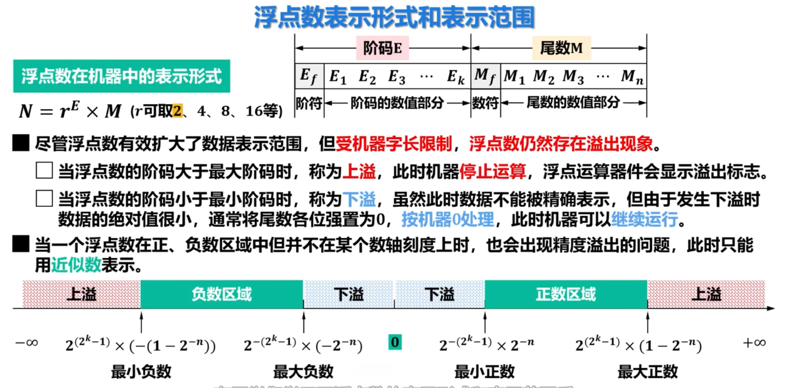
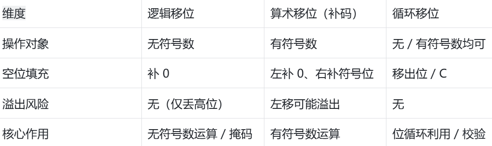
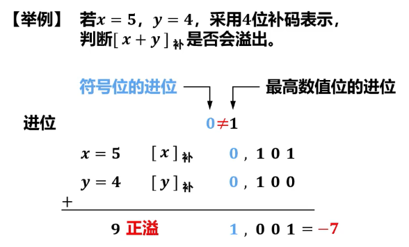
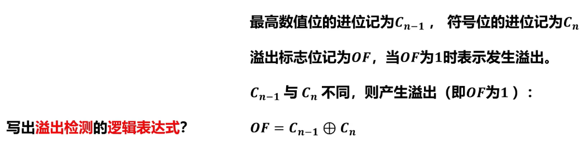
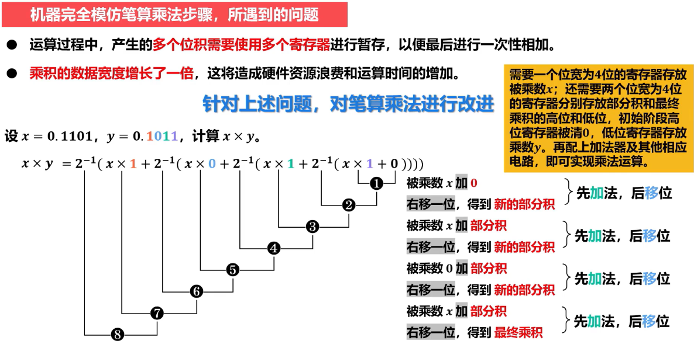
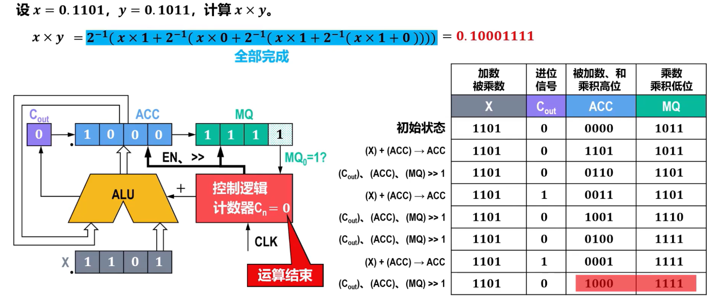
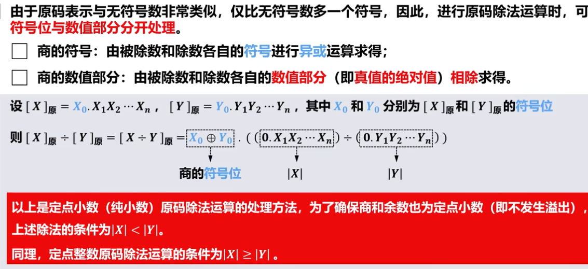
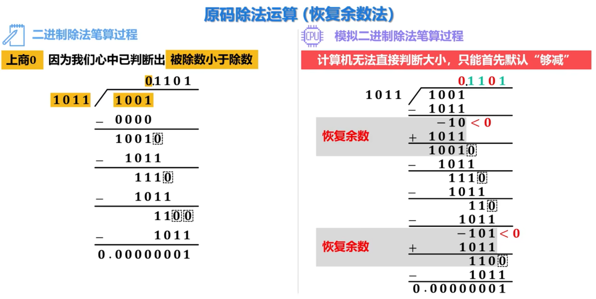
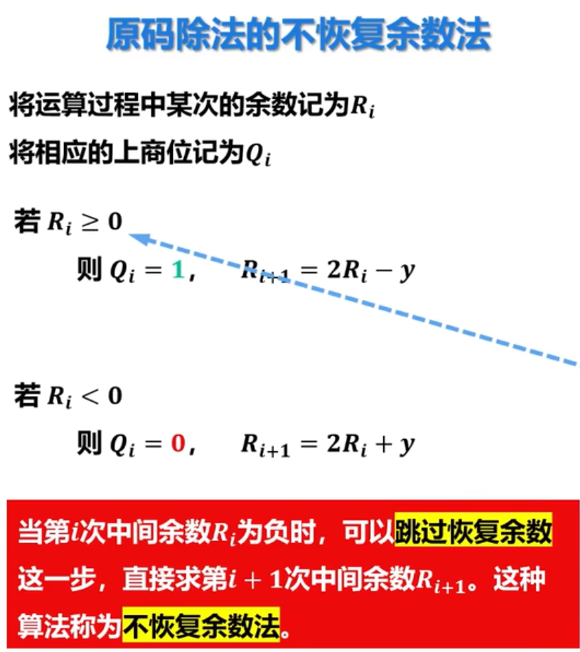

计算机内部只认二进制电信号 `0` 和 `1`，如何把日常十进制正负数、小数和超大/超小实数压进有限宽度的寄存器里，又如何只靠加法器完成减法、乘法和除法？本文合并梳理机器码（原码、反码、补码、移码）、IEEE 754 浮点数表示与溢出边界，以及移位、补码加减溢出检测、原码乘除与浮点加减的完整运算规则。

## 数值表示基础与进位计数制

**无符号数全部比特都代表数值位（常用作内存地址），有符号数则分为小数点隐含固定的定点数和小数点可按阶码浮动的浮点数；进制互转时以二进制为桥梁，8 进制每 3 位一组、16 进制每 4 位一组。**

| 分类维度 | 具体类型 | 核心特征 |
| --- | --- | --- |
| 有无符号 | 无符号数 | 无正负号，全位表数值；$N$ 位范围 $0 \sim 2^N - 1$ |
| | 有符号数 | 最高位为符号位（`0` 正 `1` 负），分定点数与浮点数 |
| 小数点位置 | 定点数 | 小数点隐含固定，无需额外存储位（定点整数在最右侧，定点小数在符号位与数值位之间） |
| | 浮点数 | 小数点可随阶码移动；单精度 32 位（1 符 + 8 阶 + 23 尾）、双精度 64 位（1 符 + 11 阶 + 52 尾） |
| 编码层 | 机器码 vs 真值 | 机器码是内部二进制编码（原码/反码/补码/移码），真值是日常带正负号的数值 |

### 常用进制书写与转换规则

1. **书写后缀与前缀**：括号下标如 $(123)_{10}$、$(101)_2$；字母后缀 `D/B/O/H`（十/二/八/十六进制）；C 语言写法二进制 `0b`、八进制 `0`、十六进制 `0x`。
2. **非十进制 → 十进制**：按权展开求和。例如 $(1011.101)_2 = 1\times 2^3 + 0\times 2^2 + 1\times 2^1 + 1\times 2^0 + 1\times 2^{-1} + 0\times 2^{-2} + 1\times 2^{-3} = 11.625$。
3. **二进制 ↔ 八/十六进制**：以小数点为界，整数部分**从低位向高位**每 3/4 位一组（高位不足补 0），小数部分**从高位向低位**每 3/4 位一组（低位不足补 0）。
4. **十进制 → 二进制**：整数部分**除 2 取余**（余数从下到上排列），小数部分**乘 2 取整**（整数从上到下排列；十进制小数如 `0.1` 转二进制往往无限循环导致精度截断）。如 $123_{10} = 1111011_2$，$0.6875_{10} = 0.1011_2$；心算整数也可用 $128, 64, 32, 16, 8, 4, 2, 1$ 凑值法（$166 = 128 + 32 + 4 + 2 \to 10100110_2$）。

## 原码、反码、补码与移码

**补码让零的表示唯一（`00000000`）且能把减法变成加法运算；8 位有符号数中，原码和反码范围是 `-127 ~ +127`，而补码和移码能多表示一个最小负数 `-128`（补码 `10000000`，移码 `00000000`）。**

以 8 位定点数（1 位符号位 + 7 位数值位）为例：

| 机器码 | 正数规则（例 `+5`） | 负数规则（例 `-5`） | `0` 的表示 | 核心用途 |
| --- | --- | --- | --- | --- |
| **原码** | 符号 `0` + 绝对值（`00000101`） | 符号 `1` + 绝对值（`10000101`） | `+0` 与 `-0` 不唯一 | 直观，用于浮点尾数 |
| **反码** | 同原码（`00000101`） | 符号不变，数值位按位取反（`11111010`） | `+0` 与 `-0` 不唯一 | 原码与补码转换桥梁 |
| **补码** | 同原码（`00000101`） | 反码末位加 1（`11111011`） | **唯一**：`00000000` | 整数加减运算主流编码 |
| **移码** | 真值 + 偏移量 $2^{n-1}$（`10000101`） | 真值 + 偏移量 $2^{n-1}$（`01111011`） | **唯一**：`10000000` | **符号位与补码相反**，专用于浮点阶码比较大小 |

- **正数**：原码 = 反码 = 补码。
- **负数转换规律**：原码 $\xrightarrow{\text{数值位取反}+1}$ 补码，补码 $\xrightarrow{\text{数值位取反}+1}$ 原码（二者互转规则完全对称；也可以从右往左扫描到第一个 `1`，它左边的数值位全部取反）。

## IEEE 754 浮点数存储与溢出边界

**阶码位数决定浮点数的表示范围，尾数位数决定表示精度；单精度 IEEE 754（32 位）用 8 位偏移量 `127` 存储阶码，并把规格化尾数 `1.xxxx` 隐去最前面的 `1.` 只存 `23` 位小数部分。**



### 1. IEEE 754 单精度（32 位）格式与编码实例

| 字段 | 位数 | 编码规则 |
| --- | --- | --- |
| **符号位 `S`** | 1 位 | `0` 正、`1` 负 |
| **阶码 `E`** | 8 位 | 移码存储，**固定偏移量 `127`**（存储值 $= \text{真实阶码} + 127$） |
| **尾数 `M`** | 23 位 | 原码存储规格化尾数 `1.xxxx` 小数点后的 `xxxx`（隐含前导 `1`，不足右补 `0`） |

**实例：把十进制 `6.5` 编码成 32 位 IEEE 754 浮点数**：

1. 转二进制并规格化：$6.5_{10} = 110.1_2 = 1.101_2 \times 2^2$。
2. 符号位 `S`：正数 → `0`。
3. 阶码 `E`：真实阶码 `2` + 偏移量 `127` = `129` = `10000001`（8 位）。
4. 尾数 `M`：截取小数点后 `101`，右补 20 个 `0` 凑满 23 位 → `10100000000000000000000`。
5. 拼接结果：`0 10000001 10100000000000000000000` = **`0x40D00000`**。

### 2. 表示范围与三类溢出

以“3 位阶码（1 阶符 + 2 数值位）+ 3 位尾数（1 数符 + 2 数值位）、均用原码”的小型模型为例：阶码范围 `-2 ~ +2`，尾数范围 `-0.75 ~ +0.75`。则最大正数为 $2^2 \times 0.75 = 3.0$，最小正数为 $2^{-2} \times 0.25 = 0.0625$，对称负数区间为 `-3.0 ~ -0.0625`。

- **上溢**：阶码超出最大正阶（如 $+3$），数值绝对值太大，机器停机并报溢出异常。
- **下溢**：阶码低于最小负阶（如 $-3$），数值极度趋近 0，机器通常按**机器零**继续运行。
- **精度溢出**：数值落在表示范围内，但受有限尾数位截断（如 $0.1_{10} = 0.000110011\dots_2$），只能取近似值。

## 移位运算与补码加减溢出检测

**算术右移在补码上保持符号位不动、高位补符号位；检测单符号位补码溢出看“符号位进位 $C_n$ 与最高数值位进位 $C_{n-1}$ 是否不同”（$OF = C_{n-1} \oplus C_n$），双符号位（变形补码）则直接看结果双符号位是不是 `01`（正溢）或 `10`（负溢）。**



### 三类移位规则

- **逻辑移位（无符号数）**：左移低位补 `0`（无溢出时等价乘 $2^n$），右移高位补 `0`（等价除以 $2^n$ 向下取整）。
- **算术移位（有符号数）**：符号位固定不动，只移动数值位——左移低位补 `0`，右移高位补**符号位**（负数补码右移高位补 `1`）。
- **循环移位**：移出位回填另一端（不带进位 `CF` 时直接回填；带 `CF` 时把 `CF` 串进大环一起转），常用于字节拼接与校验。

### 补码加减与三种溢出判定法

补码核心公式：$[A+B]_\text{补} = [A]_\text{补} + [B]_\text{补}$，$[A-B]_\text{补} = [A]_\text{补} + [-B]_\text{补}$（$[-B]_\text{补}$ 由 $[B]_\text{补}$ **连同符号位全部按位取反再末位加 1** 求得）。定点整数模数为 $2^{N+1}$，定点小数模数为 $2$。

1. **方法一（两输入与结果符号对比）**：只有“正 + 正 = 负”或“负 + 负 = 正”时才溢出（异号两数相加绝不可能溢出）。
2. **方法二（进位异或，硬件最常用）**：记符号位向更高位的进位为 $C_n$，最高数值位向符号位的进位为 $C_{n-1}$，则溢出标志位：

$$OF = C_{n-1} \oplus C_n$$

当 $C_{n-1} \ne C_n$ 时产生溢出（如下图 4 位补码计算 $5 + 4 = 0101 + 0100 = 1001 = -7$，$C_n = 0 \ne C_{n-1} = 1$，发生正溢）。





3. **方法三（变形补码 / 模 4 双符号位补码）**：正数前缀 `00`（如 `+0.11011 → 00.11011`），负数前缀 `11`（如 `-0.10101 → 11.01011`），参与加法时丢弃最高位进位，结果双符号位含义一目了然：
   - `00`：正数，无溢出；
   - `11`：负数，无溢出；
   - `01`：**正溢出**（结果大于最大正数）；
   - `10`：**负溢出**（结果小于最小负数）。

## 定点数乘法与除法运算

**硬件乘法把“一次性把所有部分积全加起来”拆成循环的“先加法、后右移 1 位”；硬件除法分为“不够减就加回来的恢复余数法”和“先直接左移、按上一轮余数正负决定下一轮减还是加的不恢复余数法（加减交替法）”。**

### 无符号数与原码乘法





- **硬件思路**：使用累加寄存器 `ACC`（初始清 0，存部分积与最终乘积高位）、乘数寄存器 `MQ`（存乘数并逐步装入乘积低位）和 `X`（存被乘数）。每轮检查 `MQ` 最低位：为 `1` 则执行 `(ACC) + (X) → ACC`，为 `0` 则加 `0`；随后 `C_out`、`ACC`、`MQ` 整体逻辑右移 1 位，共循环 $n$ 轮。
- **原码定点小数乘法**：符号位单独异或（$P_s = X_s \oplus Y_s$），数值位按无符号绝对值相乘（定点整数做法完全相同，仅将小数点改为逗号）。

**手工例子**：$X = +0.1101$（原码 `0.1101`）、$Y = -0.1011$（原码 `1.1011`）：
- 符号位：$0 \oplus 1 = 1$（负）。
- 绝对值相乘：

```text
      0.1101
    × 0.1011
    ----------
      0.1101     (×1)
     0.1101      (×1，左移 1 位)
    0.0000       (×0，左移 2 位)
   0.1101        (×1，左移 3 位)
   ----------------
   0.10001111
```

最终原码结果：`1.10001111`（即 `-0.10001111`）。

### 原码除法：恢复余数法 vs 不恢复余数法



原码除法要求除数非零，且为防止商溢出，**定点小数须满足 $|被除数| < |除数|$，定点整数须满足 $|被除数| \ge |除数|$**。商的符号仍由被除数与除数符号异或求得。



1. **恢复余数法**：计算机不能凭肉眼先比大小，只能每次先默认“够减”而减去 $|y|$：
   - 若余数 $\ge 0$：商 `1`，余数左移 1 位进入下一轮；
   - 若余数 $< 0$：说明不够减，商 `0`，必须**先加上 $|y|$ 恢复原余数**，再左移 1 位进入下一轮。
2. **不恢复余数法（加减交替法）**：省掉多余的“加回恢复”步骤。假设当前余数 $R_i < 0$，原本要先 $+y$ 恢复再 $\times 2$ 左移再 $-y$，合并后等价于 $2(R_i + y) - y = 2R_i + y$！因此只需记住一条对称口诀：
   - 若 $R_i \ge 0$ → 上商 $Q_i = 1$，下一步左移减除数：$R_{i+1} = 2R_i - |y|$；
   - 若 $R_i < 0$ → 上商 $Q_i = 0$，下一步左移加除数：$R_{i+1} = 2R_i + |y|$。
   （若最后一步余数为负，需再加一次 $|y|$ 才得到正确余数。）



## 浮点加减法五步流程

**浮点加减法统一遵循“对阶 → 尾数加减 → 规格化 → 舍入 → 溢出判断”五步；对阶永远“小阶向大阶看齐”（尾数算术右移），因为大阶向小阶看齐需要左移尾数，极易直接把最高有效位挤丢。**

1. **对阶**：求阶差 $\Delta E = E_x - E_y$，把阶码较小一方的尾数**算术右移** $|\Delta E|$ 位（移出位暂时存进保护/附加位参与中间计算以减少精度损失），使两数阶码相等。
2. **尾数加减**：按双符号位补码规则对对齐后的尾数做加减。
3. **规格化**：使补码尾数满足规格化形式（正数 `00.1bbb...`，负数 `11.0bbb...`）：
   - **左规**：出现 `00.0bbb...` 或 `11.1bbb...`（最高数值位与符号位相同），尾数每次左移 1 位、阶码减 `1`，直至符号位与最高数值位不同。若阶码双符号位变为 `10`，发生**阶码下溢**，整机按 `0` 处理。
   - **右规**：尾数相加溢出变成 `01.bbb...` 或 `10.bbb...`（双符号位不同），尾数右移 1 位、阶码加 `1`（**尾数溢出不算最终溢出，右规一次即可修复**）。若阶码双符号位变为 `01`，发生**阶码上溢**，报无穷大/溢出异常。
4. **舍入**：截断丢失低位时的处理策略包括直接截断法、恒置 `1` 法和误差最小的 **0 舍 1 入法**（类似四舍五入；若 0 舍 1 入后产生进位破坏了规格化，需再执行一次右规）。
5. **溢出判断**：最终是否真正溢出仅取决于**阶码**（双符号位 `01` 上溢、`10` 下溢）。
