指令系统（ISA）是硬件与软件之间的契约：软件编译器把高级语言翻译成一条条机器指令，CPU 控制器则依据操作码和地址码把指令译码成微操作序列去取数、计算和跳转。本文梳理定长/变长指令格式、扩展操作码编码分配计算、程序计数器 PC 顺序/跳跃寻址，以及十大操作数寻址方式的有效地址与访存次数对比。

## 指令基本结构与定长、变长格式

**每条指令必须显式或隐式给出四要素——操作类型、操作数来源、结果去向和下一条指令地址（通常隐含在 PC 中）；RISC 倾向定长指令字简化流水线译码，CISC 倾向变长指令字节省主存占用。**

| 比较维度 | 定长指令系统（如 MIPS / ARM64） | 变长指令系统（如 x86） |
| --- | --- | --- |
| **结构与译码** | 长度固定，取指和译码极其规整，利于流水线 | 长度可变，可能需多次访存才能取完一条指令 |
| **空间利用率** | 存在一定冗余，平均代码体积偏大 | 常用短指令紧凑，冗余状态少 |
| **硬件与扩展** | 硬件译码简单，但新增指令受限于固定字长 | 硬件实现复杂，指令集可扩展性极强 |

按指令字长与机器字长之比，指令分为半字长指令（1 次访存取 2 条）、单字长指令（1 次访存取 1 条）和多字长指令（需多次访存）；为兼顾速度与代码密度，高频指令通常设计为较短格式。

## 地址码数量分类（三/二/一/零地址指令）

**减少显式地址码个数能缩短指令字长，代价是把结果直接覆盖回原操作数地址或依赖隐含寄存器（如累加器 ACC、堆栈指针 SP）。**

```text
三地址指令：[ OP | A1 (源1) | A2 (源2) | A3 (目的) ]          -> (A1) op (A2) -> A3
二地址指令：[ OP | A1 (源1/目的) | A2 (源2) ]                 -> (A1) op (A2) -> A1
一地址指令：[ OP | A1 ]                                       -> op(A1) -> A1 或 (ACC) op (A1) -> ACC
零地址指令：[ OP ]                                            -> 无操作数或隐含栈顶操作数 (SP)
```

| 分类 | 地址码结构 | 运算与长度优化特征 | 典型实例 |
| --- | --- | --- | --- |
| **三地址指令** | 2 源 + 1 目的（共 3 个） | 多用寄存器编号缩短位宽（如 8 位 OP + 3×8 位地址 = 32 位，单字段寻址范围 $2^8 = 256$） | MIPS 算术指令 |
| **二地址指令** | 源 1 兼作目的（共 2 个） | 结果覆盖 A1；按存储位置分 `R-R`、`R-M`、`M-M` 三型，执行速度 $R\text{-}R > R\text{-}M > M\text{-}M$ | x86 寄存器-存储器型 |
| **一地址指令** | 仅 1 个地址码 | ① 单目运算直接写回 A1；② 双目运算另一源操作数和结果隐含在累加器等寄存器中 | x86 求反、单操作数乘除（隐含 AL/AX） |
| **零地址指令** | 仅操作码 `OP` | 指令最短，用于系统控制或栈式机器栈顶运算 | `NOP`、`WAIT`、`DAA`、栈运算 |

## 操作码字段：定长操作码与扩展操作码

**定长操作码要表示 $x$ 条指令至少需 $\lceil \log_2 x \rceil$ 位；变长扩展操作码遵循“前缀码”原则——短操作码绝不能成为长操作码的前缀，每向下扩展一层都必须从上一层保留至少一个编码当“扩展前缀标志”。**

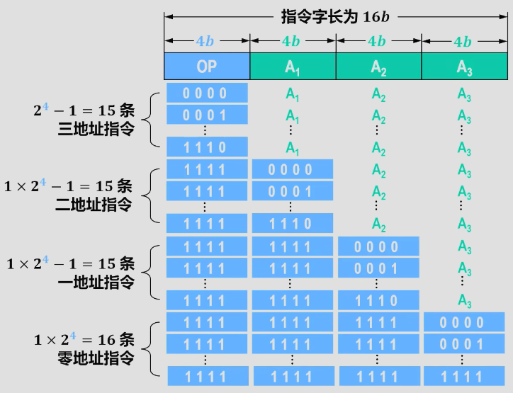

### 扩展操作码编码分配例题

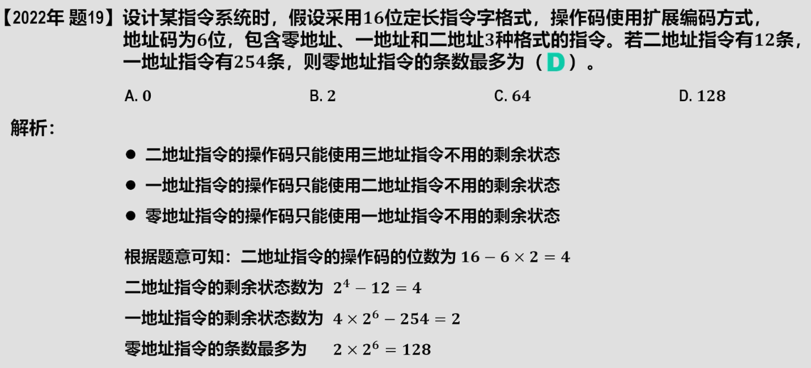

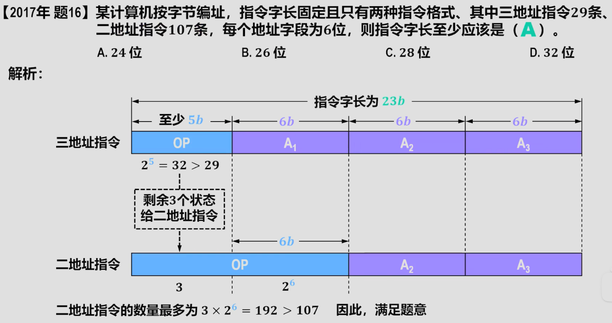

- **解题口诀**：若指令总长 16 位、每个地址码占 4 位，则最高 4 位为基本 `OP`（共 16 种编码）。若三地址指令占用了 $k$ 个编码，则还剩 $(16 - k)$ 个前缀可用来向下扩展成二地址指令（共有 $(16 - k) \times 2^4$ 种二地址编码）；依此类推，**欲让短地址指令数达到最多，应给上层长地址指令只留最少编码，其余全作前缀下放；反之亦然**。

## 指令寻址：顺序寻址与跳跃寻址

**“每取一条指令 PC 自动加 1”里的“1”代表“1 个指令字长”；若主存按字节编址且指令字长 16 位（2 字节），顺序取指后 PC 实际加 `2`。**

- **顺序寻址**：指令在主存顺序排列时，PC 指向当前指令首字节，取指后自动执行 `(PC) + 指令字长 → PC`（如 8 位机指令占 1B 则 `+1`，16 位机占 2B 则 `+2`）。

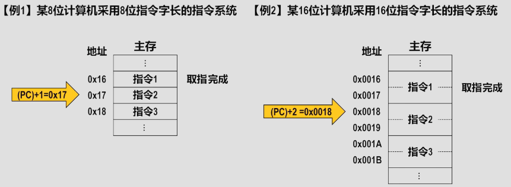

- **跳跃寻址**：遇到无条件跳转或条件分支指令时，下一条指令地址由当前指令内容与测试条件共同计算后装入 PC，打断顺序执行流。

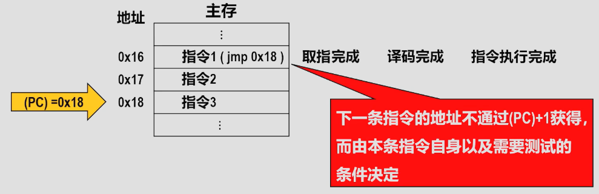

## 十大操作数寻址方式详解

**理解所有操作数寻址只抓两个问题：① 有效地址 $EA$ 怎么算？② 执行阶段（不算取指令本身）还要再访问几次主存？**

通常把指令中的地址字段进一步拆成**寻址特征字段 `M`**（例如支持 8 种寻址需 3 位）和**形式地址 `D`**（或记作 `A`）：

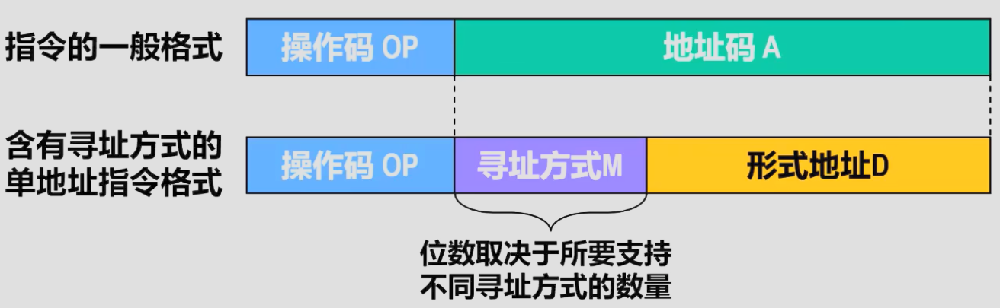

### 1. 立即寻址（Immediate）

形式地址 `D` 本身就是操作数真值（如 `M=000`）。取指令时操作数已随指令一起读入指令寄存器 IR，执行阶段 **0 次访存**，速度最快；缺点是 `D` 位宽有限，操作数范围受限，常用于赋初值。

### 2. 直接寻址（Direct）

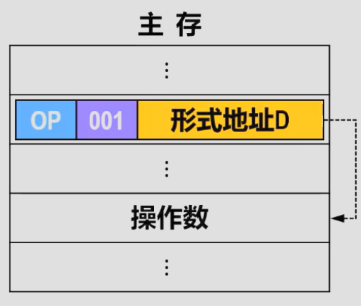

形式地址 `D` 直接给出操作数在主存中的有效地址：$EA = D$。执行阶段需 **1 次访存**；直观无需算地址，但寻址范围被 `D` 的位数锁死且硬编码地址不易修改。

### 3. 寄存器寻址（Register）

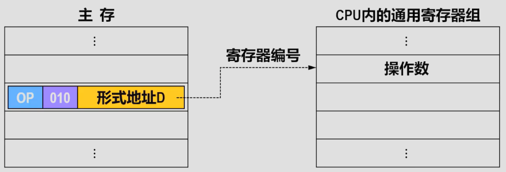

`D` 给出通用寄存器编号 $R$（如 8 个寄存器仅需 3 位），操作数就在寄存器中：$EA = R$。执行阶段 **0 次访存**，仅访问高速寄存器且能大幅缩短指令字长；受限于 CPU 寄存器总数，适合存放频繁使用的临时变量与循环计数器。

### 4. 间接寻址（Indirect）

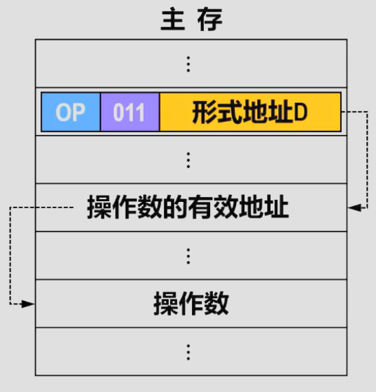

`D` 给出的是存放“操作数真实地址”的存储单元地址：$EA = (D)$。执行阶段需 **2 次访存**（第一次按 `D` 读出真实地址 $EA$，第二次按 $EA$ 读操作数）。优势是用短短的 16 位 `D` 就能指向整个 32 位/64 位主存空间，改指针只需改内存单元不用改指令代码；缺点是访存次数翻倍。

### 5. 寄存器间接寻址（Register Indirect）

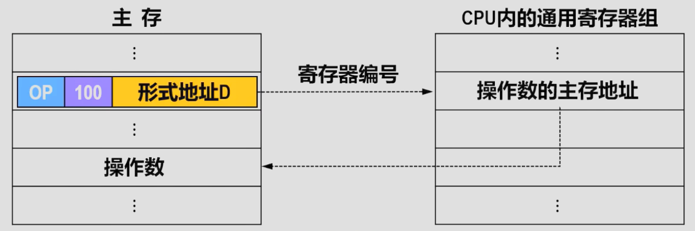

`D` 指向寄存器 $R$，寄存器里存的是操作数的主存有效地址：$EA = (R)$。执行阶段 **1 次访存**（从寄存器读 $EA$ 后只访主存 1 次取数），兼顾大寻址范围与较快速度，适合数组基址指针访问。

### 6. 相对寻址（Relative）—— 偏移寻址之一

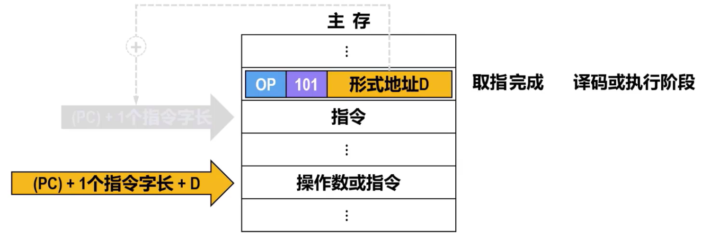

形式地址 `D` 是相对于当前 `PC` 值的**有符号补码偏移量**（可正可负）：

$$EA = (PC) + D$$

**核心易错点**：计算 $EA$ 时用的 `(PC)` 必须是**取完当前指令并自动加上当前指令字长之后**的下一条指令地址！执行阶段取操作数需 **1 次访存**（若用于转移指令则直接把 $EA$ 送入 PC，无需再访存取数）。因为不写死绝对地址，代码加载到主存任意位置都能照常运行（地址无关/浮动代码），广泛用于条件分支与循环跳转。

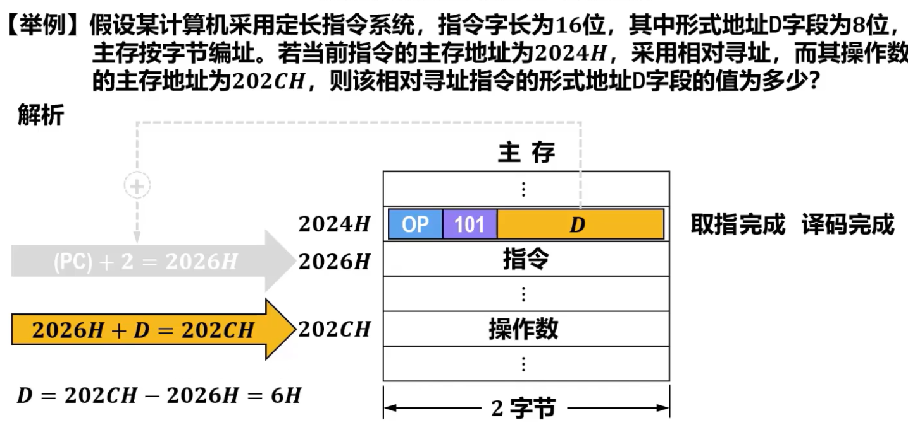

### 7. 变址寻址（Indexed）—— 偏移寻址之二


指令给出固定偏移量 `D` 与变址寄存器编号 $IX$：$EA = (IX) + D$，执行阶段 **1 次访存**。**变址寻址面向用户程序**——指令里的 `D` 固定不变（常作数组首地址），用户代码在循环里不断修改变址寄存器 `(IX)` 的值（作下标），即可轻松遍历连续数组（如 x86 的 `MOV EAX, [ESI + 32]`）。

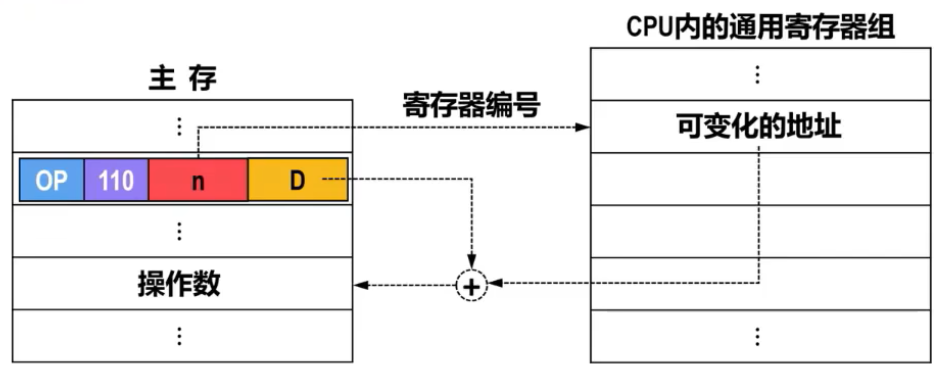

### 8. 基址寻址（Base）—— 偏移寻址之三


指令给出形式地址 `D` 与基址寄存器编号 $BR$：$EA = (BR) + D$，执行阶段 **1 次访存**。表面公式与变址寻址几乎一模一样，但**角色完全相反**：

| 对比项 | 变址寻址 | 基址寻址 |
| --- | --- | --- |
| **面向对象** | **用户**（应用编程可见可改） | **操作系统**（对用户透明，仅特权指令可改） |
| **核心用途** | 数组元素循环、字符串步进 | **多道程序内存重定位**（虚拟/逻辑地址转物理地址） |
| **哪个值变化** | 变址寄存器 `(IX)` 动态变，形式地址 `D` 不变 | 基址寄存器 `(BR)` 装入后固定不变，形式地址 `D` 随指令变 |

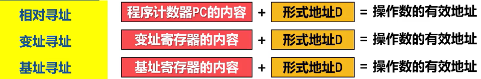

### 9. 堆栈寻址（Stack）

针对按后进先出（LIFO）管理的存储区，由专用**堆栈指针 `SP`** 隐含指示栈顶地址，常见存储器软堆栈在主存划分栈区，执行 `PUSH` / `POP` 需访问 **1 次主存**（注意堆栈是向上增长还是向下增长，以及先移动 `SP` 还是先读写数据），大量用于函数调用保存返回地址、传参、中断现场保护以及逆波兰表达式求值。

### 10. 复合寻址（Compound）

将基础寻址与间接寻址串联（如 x86 复杂寻址）：

- **相对寻址 + 间接寻址**：$EA = ((PC) + D)$，访存 `2` 次，用于动态跳转表；
- **变址寻址 + 间接寻址**：先算 $A = (IX) + D$，再访存读 $(A)$ 得 $EA$，再访存读操作数，共 **2 次访存**。

## 寻址方式总览与访存次数速查

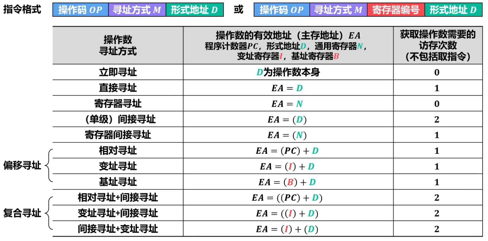

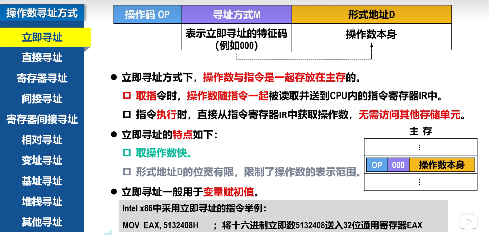

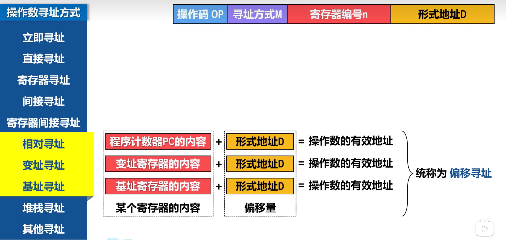

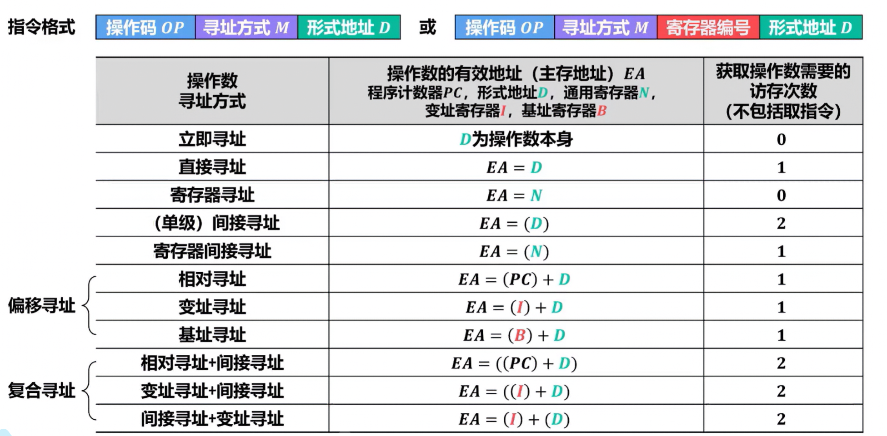

设形式地址为 $A$、有效地址为 $EA$，各基础寻址方式执行阶段**获取操作数所需访存次数（不含取指令）**速查如下：

| 寻址方式 | 有效地址计算 | 特点与应用 | 获取操作数访存次数 |
| --- | --- | --- | --- |
| **立即寻址** | 无（$A$ 即操作数） | 速度最快；操作数范围受限 | **0** |
| **直接寻址** | $EA = A$ | 直观；寻址范围受地址码位宽限制 | **1** |
| **间接寻址** | $EA = (A)$ | 扩大寻址范围；速度慢 | **2** |
| **寄存器寻址** | $EA = R$（寄存器编号） | 速度极快、指令短；寄存器数量有限 | **0** |
| **寄存器间接寻址** | $EA = (R)$ | 兼顾大寻址范围与较少访存 | **1** |
| **变址寻址** | $EA = (IX) + A$ | $(IX)$ 用户可变，适合数组/字符串遍历 | **1** |
| **基址寻址** | $EA = (BR) + A$ | $(BR)$ 由 OS 设置，适合程序重定位 | **1** |
| **相对寻址** | $EA = (PC) + A$ | 浮动代码与条件转移；取数访存 1 次（转移指令 0 次） | **1**（取数） |
| **堆栈寻址** | $EA = (SP)$ | 零地址指令，软堆栈用于函数调用与中断现场保护 | **1**（软堆栈） |
