主存是 CPU 指令直接寻址随机读写的内存子系统。芯片内部靠二维矩阵译码与 SRAM/DRAM 存储元存下海量比特，芯片外部靠字扩展、位扩展或字位同时扩展拼出匹配总线宽度与总容量的内存条，而为了跟上 CPU 频率，主存系统还要靠双端口、单体多字与低位多体交叉把带宽榨出来。本文把这两部分主存核心知识合并梳理，并附上 408 真题实战。

## 主存硬件组成与核心性能指标

**MAR 位数决定存储单元总数（$2^{\text{MAR 位数}}$），MDR 位数等于存储字长；存取周期恒大于存取时间，因为操作完成后电路还需要恢复稳定时间。**

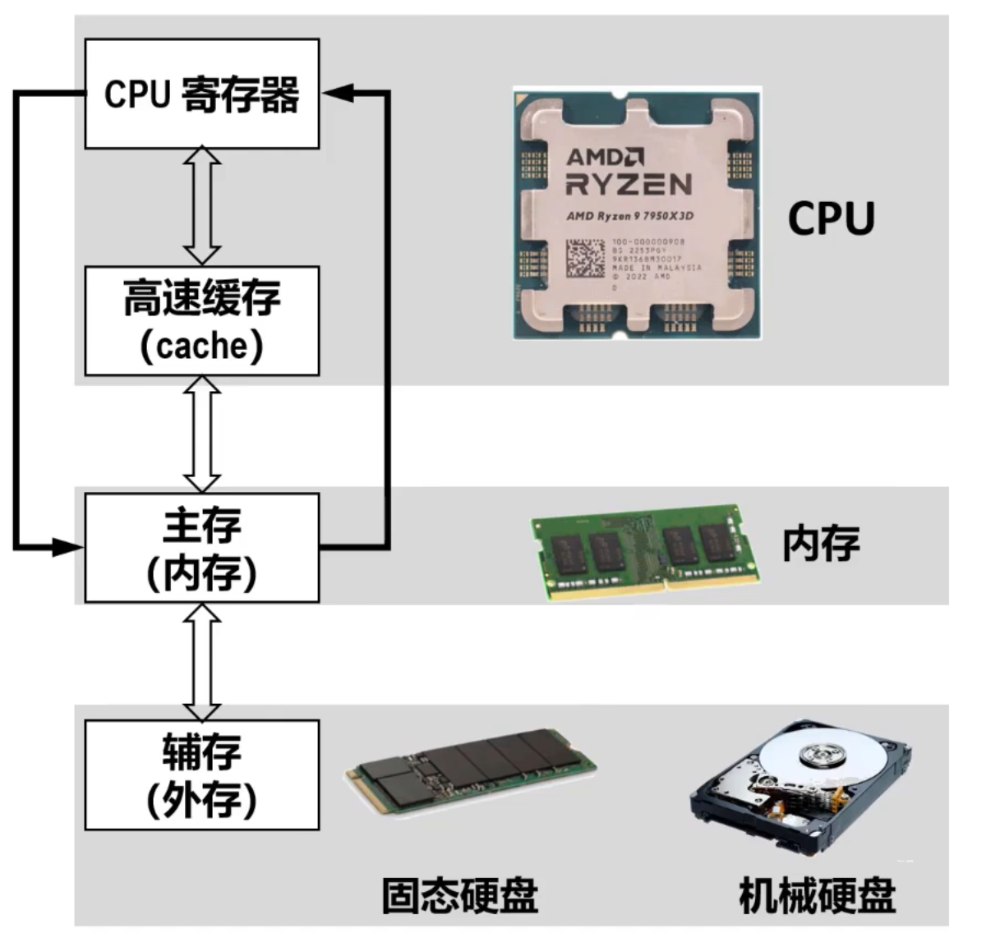

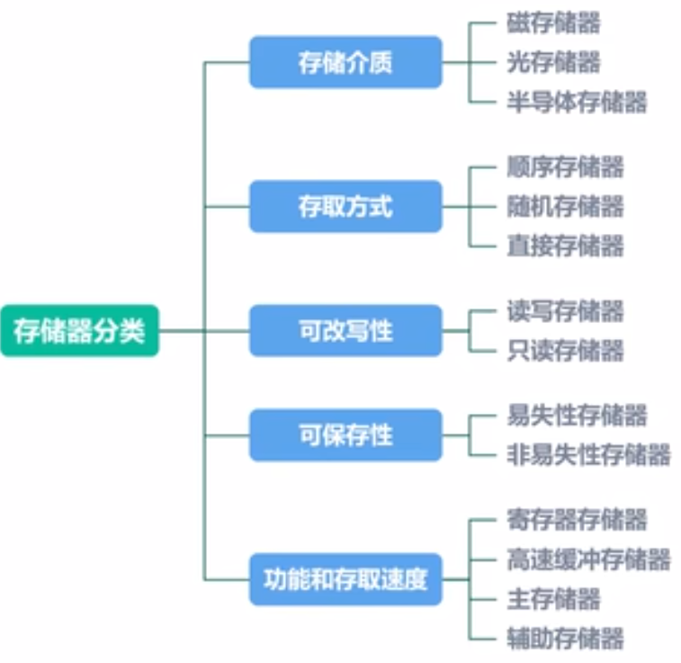

### 主存层级与三大硬件部件

| 术语 | 定义 | 关键约束 / 示例 |
| --- | --- | --- |
| **存储元件** | 主存最小存储单位，存 `1 bit`（0 或 1） | 1 个电容或交叉耦合反相器 |
| **存储单元** | 若干存储元件构成，存一串二进制信息 | 按字或字节编址的基本单元 |
| **存储字与字长** | 单元中存放的二进制串及其位数 | 常见 8、16、32、64 位 |
| **存储体** | 存放全部存储单元的二维阵列主体 | 整体数据的物理载体 |
| **MAR** | 存储器地址寄存器，存放欲访问单元地址 | 位数 $n$ 决定可寻址单元数 $2^n$ |
| **MDR** | 存储器数据寄存器，暂存读出或待写入的数据 | **MDR 位数必须等于存储字长** |

$$\text{主存容量} = \text{存储字长（bit）} \times \text{存储单元数量} = \text{存储字长} \times 2^{\text{MAR 位数}}$$

**例题**：若 MAR 为 16 位、MDR 为 16 位，则存储单元数 $= 2^{16} = 65536$，主存容量 $= 16\text{ bit} \times 65536 = 128\text{ KB}$。

### 存取时间、存取周期与带宽

1. **存取时间（Access Time）**：发出读/写命令到操作完成的时间（读出时间与写入时间可能不等，写入常略长）。
2. **存取周期（Memory Cycle Time）**：连续两次独立访存操作的最短时间间隔。$\text{存取周期} = \text{存取时间} + \text{恢复时间}$，因此**存取周期总是略大于存取时间**。
3. **存储器带宽（Bandwidth）**：单位时间内存储器传输的二进制信息总量：

$$\text{存储器带宽} = \frac{\text{单次传输数据量（bit 或 Byte）}}{\text{存取周期（s）}}$$

**例题**：某 SRAM 存取时间 $8\text{ ns}$，恢复时间 $2\text{ ns}$，则存取周期 $= 8 + 2 = 10\text{ ns}$，最大操作频率 $= \frac{1}{10\text{ ns}} = 100\text{ MHz}$。

### 机器字长 vs 存储字长，以及单/双译码结构

- **机器字长**是 CPU 一次能处理的二进制位数，**存储字长**是主存一个存储单元的位数，两者无强制相等关系（通常存储字长是字节的 $2^k$ 倍）。若 CPU 为 64 位而主存存储字长为 32 位，取一次 64 位数据需访问主存 `64 ÷ 32 = 2` 次；存储字长匹配为 64 位时只需 1 次。
- **单译码 vs 双译码**：单译码把 $N$ 位地址直接译成 $2^N$ 条字选线，只适合 $N \le 10$ 的小容量存储芯片；双译码（二维译码）将存储单元排成行 × 列矩阵，把 $N$ 位地址拆成行地址和列地址分别译码，输出线总数从 $2^N$ 骤降至 $2^{\lceil N/2 \rceil} + 2^{\lfloor N/2 \rfloor}$（如 $N=20$ 时仅需 $2^{10} + 2^{10} = 2048$ 条线，远少于 $1{,}048{,}576$ 条）。


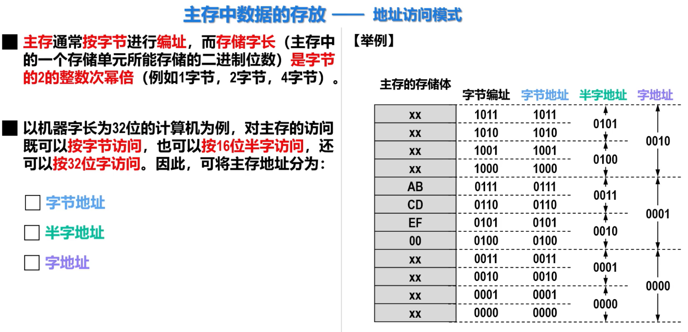

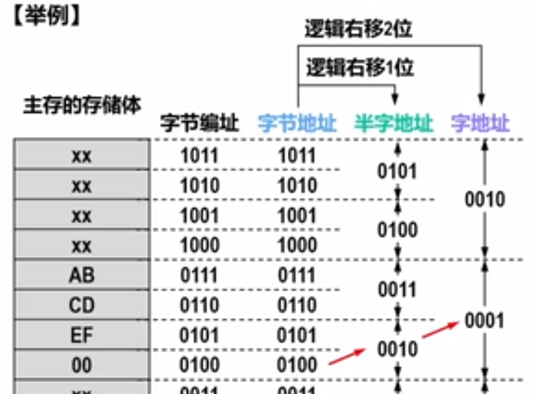

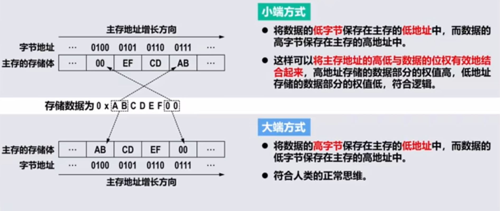

## 字节编址、大小端字节序与边界对齐

**大小端决定的是多字节整数在连续内存字节之间的排列顺序，与单个字节内部的比特顺序无关；小端把低位字节放在低地址，大端把高位字节放在低地址。**

### 多粒度访问与字节地址右移

主存按字节编址时，访问半字（2B）、字（4B）、双字（8B）的地址对齐要求与地址转换如下：

| 访问类型 | 字节数 | 对齐起始地址特征（最低位要求） | 字节地址 → 单元地址转换 |
| --- | --- | --- | --- |
| 字节（`char`） | 1 B | 任意地址 | — |
| 半字（`short`） | 2 B | 最低 1 位为 `0`（2 的倍数） | 逻辑右移 1 位（`÷ 2`） |
| 字（`int`） | 4 B | 最低 2 位为 `00`（4 的倍数） | 逻辑右移 2 位（`÷ 4`） |
| 双字（`double`） | 8 B | 最低 3 位为 `000`（8 的倍数） | 逻辑右移 3 位（`÷ 8`） |

### 大端方式 vs 小端方式

以 32 位数据 `0x12345678` 存放在地址 `0x0000`–`0x0003` 为例：

| 内存地址 | 小端（Little-Endian，x86 等常用） | 大端（Big-Endian，网络字节序等常用） |
| --- | --- | --- |
| `0x0000`（低地址） | `0x78`（低字节） | `0x12`（高字节） |
| `0x0001` | `0x56` | `0x34` |
| `0x0002` | `0x34` | `0x56` |
| `0x0003`（高地址） | `0x12`（高字节） | `0x78`（低字节） |

**例题**：采用小端方式的主存中，`0x0002`–`0x0005` 字节依次为 `0x88`、`0x77`、`0x66`、`0x55`。按 32 位字读取 `0x0002` 时，`0x0002` 为低字节、`0x0005` 为高字节，拼接结果为 **`0x55667788`**。

### 边界对齐与结构体空间计算

硬件按“存储字”对齐读取可避免一次跨界访问拆成两次总线周期，代价是成员间可能插入填充字节（内存空洞）。

```c
struct Data {
    char a;   // 1 字节，占 0x0000
    int b;    // 4 字节，需 4 字节对齐 -> 跳过 0x0001~0x0003（空洞 3B），占 0x0004~0x0007
    short c;  // 2 字节，需 2 字节对齐 -> 占 0x0008~0x0009
};
```

按上述布局共占 `10` 字节（若计入结构体总大小需对齐最大成员 `int` 的整数倍，则末尾再补 2B 对齐到 `12` 字节；若调整成员顺序为 `char a; short c; int b;`，`a` 占 `0`、`c` 占 `2~3`、`b` 占 `4~7`，总大小可直接压缩至 `8` 字节）。

### 408 真题实战

1. **（2012 年 408 真题）** 主存按字节编址，Cache 直接映射，块大小 `4 B`，主存块号为 `3` 的块对应的主存字节地址范围是：
   - 块大小 4B → 块内偏移 2 位（`00`~`11`）；主存地址范围 $= [3 \times 4,\ 3 \times 4 + 3] = 12 \sim 15$，即 **`0x0C` ~ `0x0F`**。
2. **（2018 年 408 真题）** 主存按字节编址且采用小端方式，读取 `0x100` 处 16 位补码整数 `0x8000`（小端下 `0x100` 存 `0x00`、`0x101` 存 `0x80`，还原为 `0x8000` = `1000 0000 0000 0000`），其十进制值为 **`-32768`**。

## SRAM 与 DRAM 存储原理及对比

**SRAM 靠双稳态触发器（6/8 管）保持数据，读操作非破坏性、无需刷新且极快，用作 CPU Cache；DRAM 靠 1 个 MOS 管 + 1 个电容电荷存数据，读出即破坏、电容漏电需每 `64ms` 定期刷新且行列地址线复用，用作大容量主存。**

### SRAM（静态随机存取存储器）

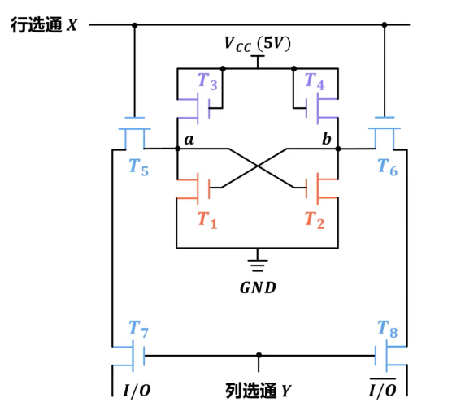

- **易失性与保持机制**：只要不断电数据即可稳态保持，无需刷新；断电后与 DRAM 一样均会丢失数据（ROM 才是非易失性）。
- **MOS 管构成与读写**：`T1/T2` 组成交叉耦合反相器保存比特、`T3/T4` 提供上拉偏置、`T5~T8` 作受行/列选通线控制的门控开关。读操作时由差分放大器感应位线 `IO` 与 $\overline{IO}$ 电流差，**不破坏原稳态**；写操作时向位线强加高低电平翻转双稳态。

**SRAM 芯片引脚计算经典习题**：

- 某 SRAM 存储单元为 8 位 → 存储字长为 8 位，需 **8 根数据线**（地址线数由单元总量决定，机器字长由 CPU 决定，均不能由此推出）。
- 某 SRAM 容量 `8K × 8 位` → $8K = 2^{13}$，需 **13 根地址线、8 根数据线**。
- 某 SRAM 容量 `256K × 16 位` → $256K = 2^{18}$，除电源与接地外最小引脚数 $= 18(\text{地址}) + 16(\text{数据}) + 1(\text{片选 }\overline{CS}) + 1(\text{读写控制 }R/\overline{W}) = \mathbf{36}$ 根（最小配置下可复用 $R/\overline{W}$ 与 $\overline{CS}$ 省略独立 $\overline{OE}$）。

### DRAM（动态随机存取存储器）

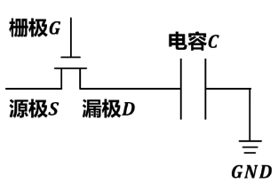

- **物理存储原理**：1 个增强型 MOS 管 + 1 个飞法级（fF）存储电容 `C`；电容充满电荷表示 `1`，放空表示 `0`。
- **破坏性读与五步读写流程**：读取 `1` 时电容电荷向位线泄放，导致自身电平流失。因此 DRAM 读操作必须走 **① 预充电至 $V_{CC}/2$ → ② 行选导通、电容微弱放电改变位线电压 $\pm\Delta V$ → ③ 灵敏放大器放大判决 → ④ 放大器反向给电容充电恢复原值（写操作前四步同此，第五步强写新电平）→ ⑤ 列选输出**。

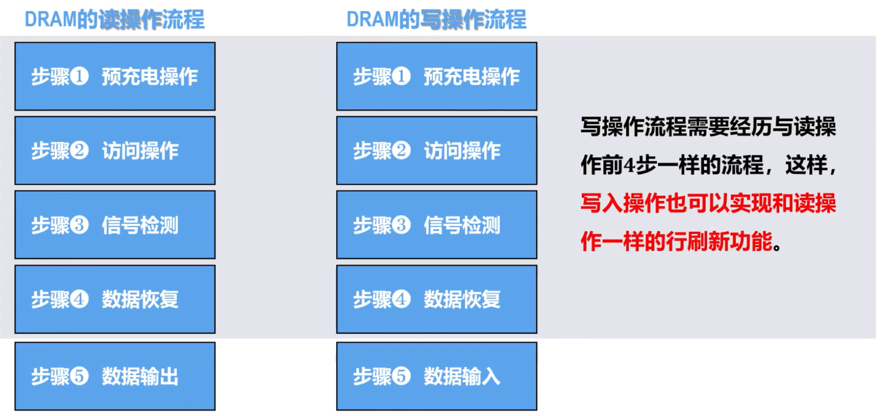

- **动态刷新**：电容会经 MOS 管漏电，通常电荷只能维持约 `64ms`，因此控制器每隔 `64ms` 必须按**行**做一次伪读刷新（集中刷新、分散刷新或异步刷新）。
- **地址复用技术（RAS / CAS）**：为压低大容量 DRAM 封装引脚数，行地址与列地址分时复用同一组地址引脚，先后由行地址选通信号 $\overline{RAS}$ 和列地址选通信号 $\overline{CAS}$ 锁存（因此引脚数直接减半，且经常省略独立 $\overline{CS}$ 由 $\overline{RAS}/\overline{CAS}$ 兼作片选）。

**（2018 年 408 真题）** 规格 `2K × 1 位` DRAM 采用地址复用技术（$2K = 2^{11}$，共需 11 位行列地址），为减少刷新开销应如何划分行、列地址线？
- 刷新按行进行，**行数越少刷新开销越小**。对比“行 6 列 5（$2^6 = 64$ 行）”与“行 5 列 6（$2^5 = 32$ 行）”，最优方案为 **行 5 位、列 6 位（32 行 × 64 列）**。

### SRAM vs DRAM 综合对照

| 对比维度 | SRAM | DRAM |
| --- | --- | --- |
| **存储元** | 6/8 MOS 管双稳态电路 | 1 MOS 管 + 1 电容 |
| **读操作特性** | 非破坏性读 | 破坏性读（须立即写回恢复） |
| **刷新需求** | 无需刷新 | 须定期按行刷新（约 64ms/次） |
| **地址引脚** | 独立（不复用） | 行/列地址分时复用（$\overline{RAS}/\overline{CAS}$） |
| **速度 / 功耗 / 集成度** | 极快（1–10ns）、功耗高、集成度低 | 较慢（10–100ns）、功耗低、集成度高（约 SRAM 4 倍） |
| **典型应用** | CPU Cache（L1/L2/L3） | 计算机主存（DDR4/DDR5） |

## 存储器扩展：字扩展、位扩展与字位同时扩展

**面对单颗存储芯片容量或数据位宽不够用的情况：位扩展拼数据线（所有地址、片选、控制线并联）；字扩展拼容量（片选线经地址译码器分片使能）；字位同时扩展则是“先位扩展凑够单组位宽，再用译码器对各组做字扩展”。**

| 扩展方式 | 变化效果 | 芯片总数公式 | 硬件连线要点 |
| --- | --- | --- | --- |
| **位扩展** | 容量不变，位宽加倍 | $\text{位扩展数} = \frac{\text{目标位宽}}{\text{单芯片位宽}}$ | 地址线、$\overline{CS}$、$\overline{OE}/\overline{WE}$ 全部并联；各芯片数据线按段拼接 |
| **字扩展** | 位宽不变，容量扩大 | $\text{字扩展数} = \frac{\text{目标容量}}{\text{单芯片容量}}$ | 低位片内地址、数据线、读写控制线并联；高位地址接译码器产生各芯片独立 $\overline{CS}$ |
| **字位同时扩展** | 容量 + 位宽同步扩大 | $\text{总片数} = \text{字扩展数} \times \text{位扩展数}$ | 每组先做位扩展，再把多组模块当成“整字单元”用译码器做字扩展 |

### 典型扩展计算三连例

1. **字扩展例题**：CPU 数据线 8 位、地址线 21 位，用 `256K × 8 位` SRAM 构建 `2M × 8 位` 主存。
   - 芯片数 $= 2M \div 256K = \mathbf{8}$ 片。
   - 地址分配：单片容量 $256K = 2^{18}$，用 $A_0 \sim A_{17}$ 并联作片内地址；高 3 位 $A_{18} \sim A_{20}$ 送入 **3-8 译码器**，输出 $\overline{Y_0} \sim \overline{Y_7}$ 分别接 8 片芯片的 $\overline{CS}$。
2. **位扩展例题**：用 `1K × 4 位` 芯片构建 `1K × 8 位` 存储器。
   - 芯片数 $= 8 \div 4 = \mathbf{2}$ 片；两片地址线 $A_0 \sim A_9$、$\overline{CS}$、$\overline{OE}$、$\overline{WE}$ 全部并联，片 1 输出 $D_0 \sim D_3$、片 2 输出 $D_4 \sim D_7$ 拼成 8 位数据线。
3. **字位同时扩展例题**：用 `1K × 4 位` 芯片构建 `4K × 8 位` 存储器。
   - 位扩展数 $= 8 \div 4 = 2$ 片/组，字扩展数 $= 4K \div 1K = 4$ 组，总片数 $= 4 \times 2 = \mathbf{8}$ 片。
   - 先每 2 片位扩展为 1 组 `1K × 8 位` 模块（共 4 组）；再用 **2-4 译码器** 将 2 根高位片选地址译成 4 个组选信号控制 4 组模块。

## 主存系统带宽优化：双端口、单体多字与多体交叉

**要成倍提升主存给 CPU 喂数据的带宽，单靠缩短芯片内部周期物理受限，架构上主流走两条路：靠“单体多字”一次读一串连续字，或靠“低位多体交叉”让多个独立存储体在存取周期内流水线重叠工作。**

### 1. 双端口存储器

在**单个存储体**上配两套完全独立的地址寄存器（AR）、数据寄存器（DR）和控制逻辑（Port A、Port B），适合 CPU 与 DMA 控制器或双核同时并发读写不同地址。当两个端口同时访问同一地址且至少一方为写操作时，硬件优先级仲裁让高优先级端口先执行，并向另一端口拉高 `Busy`（忙）信号使其延迟一个周期。

### 2. 单体多字存储器

单个存储体按块存储，数据总线宽度扩大到单字长的 $N$ 倍（如 4 字/块，总线宽 `4 × 32 bit`），一次存取周期同时读出连续的 $N$ 个字送进 CPU 缓冲寄存器，理想吞吐量提升为 $N$ 倍。缺点是高度依赖**空间局部性**（离散随机读时会白读无用字浪费带宽），且仍只有 1 个存储体，无法并行响应多个独立离散请求。

### 3. 高位多体交叉 vs 低位多体交叉

多体交叉存储器把主存拆成 $N$ 个容量与速度相同的独立存储模块 $M_0 \sim M_{N-1}$，各自拥有独立 MAR/MDR 与控制电路：

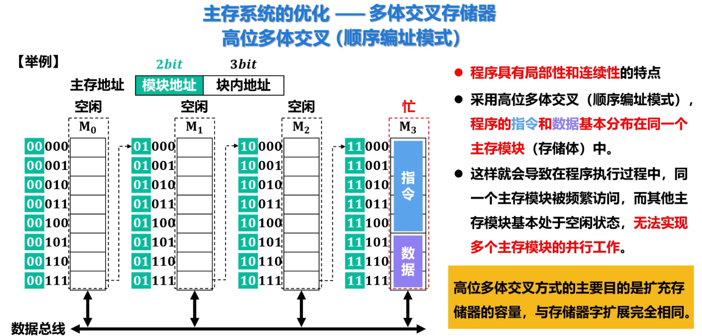

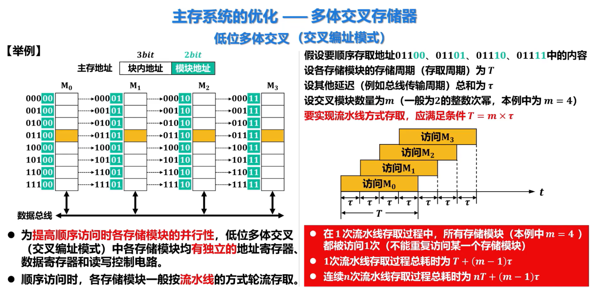

以 4 个模块 $M_0 \sim M_3$、每模块 8 个单元（总 32 单元，5 位地址）为例：

- **高位多体交叉（顺序编址）**：**高位 2 位**作模块号、**低位 3 位**作块内地址。地址 `0~7` 全塞在 $M_0$、`8~15` 全在 $M_1$……因为程序指令和数组地址连续，CPU 访问局部数据时总是在反复排队敲同一个模块，其它模块干瞪眼闲着，**本质只扩了容量、无法并行加速**。
- **低位多体交叉（交叉编址）**：**低位 2 位**作模块号（第 $k$ 个地址落在 $M_{k \bmod N}$）、**高位 3 位**作块内地址。连续地址 `0, 1, 2, 3` 分别落在 $M_0, M_1, M_2, M_3$。若每个模块存取周期为 $T$、总线传输延时 $\Delta t$（常见取总线周期 $r = \Delta t$，满足交叉模数 $m \ge \frac{T}{r}$）：
  - $t_0$ 启动 $M_0$ 读地址 0，$t_0 + \Delta t$ 启动 $M_1$ 读地址 1，$t_0 + 2\Delta t$ 启动 $M_2$，$t_0 + 3\Delta t$ 启动 $M_3$；
  - 从 $t_0 + T$ 起，每隔 $\Delta t$ 就有一个模块完成读取输出数据，连续读取 4 个字总耗时仅 **$T + 3\Delta t$**（而非串行的 $4T$），吞吐量逼近 $N$ 倍流水线加速。不过若遇到步长恰好为 $N$ 的离散访问（如连读 `0, 4, 8, 12` 全撞到 $M_0$），仍会发生体冲突退化为串行。

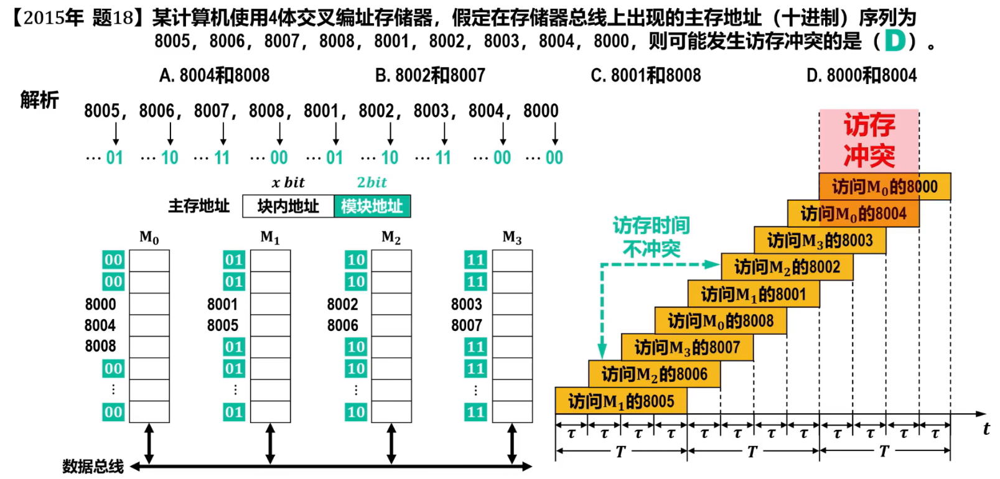

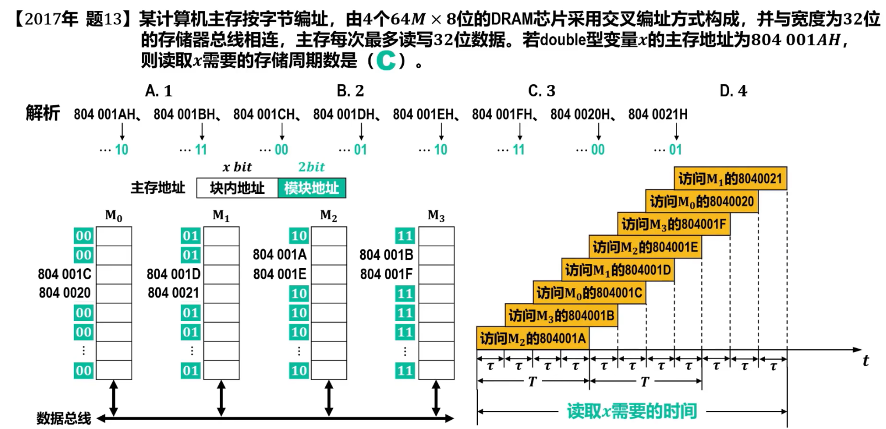

### 四种主存优化方案总结对比

| 优化方法 | 硬件核心结构 | 主要优势 | 核心局限性 |
| --- | --- | --- | --- |
| **双端口存储器** | 1 个存储体 + 2 套独立端口 | 允许两台设备同时访问不同单元 | 只有 1 个体，同单元写冲突需等 Busy |
| **单体多字存储器** | 1 个存储体 + $N$ 倍宽总线 | 顺序访问吞吐量提升 $N$ 倍 | 依赖连续地址，离散访问浪费带宽 |
| **高位多体交叉** | $N$ 个独立体 + 高位选体 | 等效字扩展扩充容量 | 连续访问全落入同一体，无并行加速 |
| **低位多体交叉** | $N$ 个独立体 + 低位选体 | 连续访问流水线重叠，$N$ 倍吞吐 | 步长为 $N$ 的离散访问会发生体冲突 |
