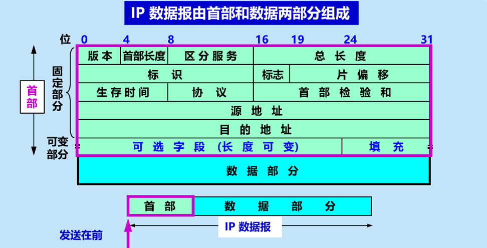

网络层负责把分组从源主机跨越多段异构网络和路由器送达目的主机。本文围绕 TCP/IP 网际层的核心机制展开：从分组转发与无连接数据报服务出发，串起 IPv4 首部结构、ARP/NAT/VPN、RIP/OSPF/BGP 路由选择协议、ICMP 诊断工具、IP 多播与移动 IP、IPv6 过渡策略，以及将控制层面与数据层面拆分的软件定义网络（SDN）。

## 网络层定位与两种服务模型

**TCP/IP 网际层选择无连接、尽最大努力交付的数据报服务，把复杂的差错恢复和顺序保障推到边缘主机的运输层，换来核心路由器结构简单、可大规模扩展。**

| 核心职责 | 说明 |
| --- | --- |
| **分组转发** | 路由器按分组首部标识查询自身转发表，把分组从对应接口发往下一跳（数据层面动作） |
| **路由选择** | 通过集中式、分布式协议或人工静态配置确定源到目的路径，构建并更新路由表（控制层面动作） |
| **向上层提供服务** | 分为面向连接的虚电路服务（网络自身保可靠，如 ATM/X.25）与无连接的数据报服务（因特网采用） |

路由选择生成的**路由表**侧重拓扑变化计算（记录目的网络到下一跳的映射），**转发表**则由路由表派生并针对高速查找做结构优化；在分析路由算法原理时二者常统称为路由表。

## IPv4 地址、编址演进与首部格式

**分组跨网传输时，IP 首部里的源 IP 和目的 IP 始终保持不变，而数据链路层帧首部的源 MAC 和目的 MAC 在每一段物理链路上都会逐跳替换。**

### 异构网络互连与 IPv4 编址演进

因特网把拓扑、速率和链路协议各异的网络通过路由器连成一体，只要各网络在网络层统一运行 IP 协议，上层看到的就像一张逻辑统一的 IP 网。32 比特 IPv4 地址采用点分十进制表示（每 8 位一组转十进制，如 `00001010 11110000 00001111 10101010` → `10.240.15.170`），经历了三代编址演进：

1. **分类编址（1981 年）**：把 32 位划分为固定长度的网络号与主机号（主机号全 `0` 为网络地址、全 `1` 为广播地址，均不可分配给接口）：

| 类别 | 首比特 | 网络号长度 | 主机号长度 | 地址范围 | 默认子网掩码 |
| --- | --- | --- | --- | --- | --- |
| A 类 | `0` | 8 比特 | 24 比特 | `1.0.0.0` ~ `127.255.255.255` | `255.0.0.0` |
| B 类 | `10` | 16 比特 | 16 比特 | `128.0.0.0` ~ `191.255.255.255` | `255.255.0.0` |
| C 类 | `110` | 24 比特 | 8 比特 | `192.0.0.0` ~ `223.255.255.255` | `255.255.255.0` |
| D 类 | `1110` | —（多播） | — | `224.0.0.0` ~ `239.255.255.255` | — |
| E 类 | `1111` | —（保留） | — | `240.0.0.0` ~ `255.255.255.255` | — |

2. **划分子网（1985 年，RFC 950）**：从主机号借位充当子网号，变为“网络号 + 子网号 + 主机号”三级结构，并用 32 位子网掩码按位与运算提取子网网络地址。
3. **无分类编址 CIDR（1993 年）**：取消分类边界，回归“网络前缀 + 主机号”两级结构，用斜线记法（如 `218.75.230.0/24`）表示不定长前缀，配合变长子网掩码（VLSM）按需分配与路由聚合（构造超网）。详细计算与查表示例见 [IPv4 划分子网与最长前缀匹配实战](/posts/net-ipv4-subnetting-and-lpm)。

### ARP 地址解析与 IP 转发流程

如果路由器只靠 MAC 地址转发，全球路由表将不得不记录海量扁平硬件地址而彻底失控；因此网际层按分层的 IP 前缀路由，到最后每一跳局域网内再用 **ARP 协议**把下一跳 IP 解析成 MAC 地址：

- **ARP 工作流**：主机先查本地 ARP 高速缓存（动态表项默认寿命约 2 分钟）。未命中时在本局域网**广播** ARP 请求（含自身 IP/MAC 与目标 IP）；目标主机收到后将发送方 IP/MAC 记入自己缓存并**单播**返回 ARP 响应。ARP 仅在单段局域网内有效，且协议本身无安全校验，存在 ARP 欺骗风险。早期的 RARP 已被 DHCP 取代。
- **直接交付与间接交付**：发送主机把自身与目的 IP 分别与掩码按位与，若网络前缀相同则直接发往目的 MAC（直接交付），否则发往默认网关的 MAC（间接交付）。
- **路由器转发**：检查分组首部检验和无误且 `TTL > 0` 后，按**最长前缀匹配**查路由表转发（不转发目的地址为广播地址的 IP 分组，避免广播风暴）；查不到匹配项时丢弃并回送 ICMP 差错报文。

### IPv4 数据报首部格式

IPv4 首部由 **20 字节固定部分**与最多 **40 字节可选/填充部分**构成：

| 字段 | 位数 | 关键作用 |
| --- | --- | --- |
| 版本 | 4 bit | IPv4 固定填 `4` |
| 首部长度 | 4 bit | 以 **4 字节**为单位，最小 `5`（20B），最大 `15`（60B） |
| 区分服务 | 8 bit | 区分 QoS 优先级，常规网络一般不用 |
| 总长度 | 16 bit | 首部 + 数据载荷总字节数，最大 `65535` 字节 |
| 标识 / 标志 / 片偏移 | 16 / 3 / 13 bit | 分片控制：同报分片标识相同；标志 `DF=1` 禁止分片、`MF=1` 后续仍有分片；片偏移以 **8 字节**为单位 |
| 生存时间（TTL） | 8 bit | 每经一台路由器减 1，归 0 丢弃，防止路由环路兜圈 |
| 协议 | 8 bit | 指示上层负载类型（`6` = TCP，`17` = UDP，`1` = ICMP，`2` = IGMP，`89` = OSPF） |
| 首部检验和 | 16 bit | 仅校验首部（不含数据），使用 16 位反码求和；因每跳修改 TTL，**每台路由器转发时必须重算** |
| 源 / 目的 IP 地址 | 各 32 bit | 标识端到端通信双方接口 |

## 静态路由与分层次路由选择协议

**因特网把全网划分为多个自治系统（AS）：AS 内部用距离向量协议 RIP 或链路状态协议 OSPF 追求收敛与最优代价；AS 之间用基于路径向量和商业策略的 BGP，寻找无环路的可达路径而非单纯最短跳数。**

### 静态路由与特殊路由条目

- **直连与非直连路由**：接口配好 IP 与掩码后自动生成直连路由；非直连网段需人工配置静态路由或靠动态路由协议学习。
- **默认路由（`0.0.0.0/0`）与特定主机路由（`IP/32`）**：按最长前缀匹配原则，`0.0.0.0/0` 优先级最低，作兜底出口；`/32` 优先级最高，常用于安全控制与排错测试。

### 内部网关协议（IGP）：RIP vs OSPF

| 对比维度 | RIP（路由信息协议） | OSPF（开放最短路径优先） |
| --- | --- | --- |
| **底层算法** | 距离向量算法（Bellman-Ford 思想） | 链路状态算法（Dijkstra 最短路径优先） |
| **度量指标** | 跳数（直连为 1，最大有效 15，16 即不可达） | 链路代价（如思科默认按 $100\text{ Mb/s} \div \text{带宽}$ 计算） |
| **信息交换范围** | 仅与**相邻路由器**周期交换（每 30s）完整路由表 | 向**本区域所有路由器**洪泛自身链路状态通告（LSA），同步 LSDB |
| **传输封装** | UDP 端口 `520`（应用层报文，功能属网际层） | 直接封装在 IP 数据报中（协议号 `89`，组播地址 `224.0.0.5`） |
| **核心缺点/约束** | **“坏消息传播得慢”**，易形成持续数分钟的路由环路（水平分割/触发更新仅能缓解）；受限于 15 跳，仅适合小型网 | 实现与配置较复杂，需维护 LSDB、Hello 保活（10s 发/40s 超时）与区域划分（Area 0 为主干区） |
| **大型网络优化** | 等价负载均衡 | 选举 DR/BDR 减少多点接入广播邻接数；ABR/ASBR 隔离区域洪泛范围 |

**RIP 距离向量更新核心规则**：收到邻居发来的路由条目后先把距离 `+1`、下一跳改为该邻居，再更新本地表——同下一跳无条件更新；发现新网络直接写入；不同下一跳时，距离更小则替换、距离相同则新增（等价负载均衡）、距离更大则忽略。若 `180s` 未收到某路由更新则标为无效，再过 `120s` 删除。

**OSPF 五种分组**：问候（Hello）、数据库描述（DD，交换 LSDB 摘要）、链路状态请求（LSR）、链路状态更新（LSU，洪泛 LSA）、链路状态确认（LSAck）。

### 外部网关协议（EGP）：BGP-4

- **为什么跨 AS 不用代价做唯一标准**：不同 AS 的链路代价口径不统一，且自治系统间要优先服从政治、经济和商业结算策略（如避免帮竞争对手无偿中转流量）。因此 BGP 只负责挑一条**无环路的较好可达路径**。
- **BGP 发言人与会话**：每个 AS 选出边界路由器作为 BGP 发言人，彼此建立 **TCP 连接（端口 `179`）** 交换由 AS 序列组成的网络可达性信息，从而在视图上天然杜绝 AS 级环路。
- **BGP-4 报文类型**：`OPEN`（建立会话）、`UPDATE`（通告新路由或撤销旧路由）、`KEEPALIVE`（约 30s 发一次 19B 保活）、`NOTIFICATION`（报告差错）；RFC 2918 新增 `ROUTE-REFRESH`。

### 路由器硬件组成与交换结构

路由器内部拆为**路由选择部分**（路由选择处理机运行协议并维护路由表）和**分组转发部分**（输入端口、交换结构、输出端口及收发缓冲区）。分组若为路由协议报文则上交处理机；若为普通数据分组则查转发表、更新 TTL 与检验和，穿过交换结构（通过存储器、共享总线或互连网络，速率依次递增）从输出端口发出。

## ICMP 网际控制报文协议与网络诊断

**`ping` 直接用 ICMP 回送请求/回答测试可达性与 RTT；Windows `tracert` 靠把 ICMP 回送请求的 TTL 从 1 逐跳递增触发沿途路由器回送“时间超过”差错报文来绘出路径（UNIX `traceroute` 原理相同，但发的是高端口 UDP 包）。**

ICMP 报文封装在 IP 数据报中（协议号 `1`），分为差错报告报文和询问报文两类：

1. **五种差错报告报文**：
   - **终点不可达**：无法交付时返回（细分为网络/主机/协议/端口不可达等 13 种代码）。
   - **源点抑制**：路由器或主机因拥塞丢包时通知源端降速（现代网络已较少使用）。
   - **时间超过**：路由器转发使 `TTL` 减为 0 时丢弃并返回；或接收端重组超时未收齐所有分片时返回。
   - **参数问题**：IP 首部检验和出错或参数异常时返回。
   - **改变路由（重定向）**：网关通知主机存在更短的下一跳路由器，引导其更新路由缓存。
2. **明确不发送 ICMP 差错报文的情形**：对 ICMP 差错报文自身不再发差错；对分片数据报的**非首片**不发；对多播地址不发；对 `127.0.0.0` 或 `0.0.0.0` 等特殊地址不发。
3. **询问报文**：回送请求和回答（`ping` 使用）、时间戳请求和回答（时钟同步与单向时延估算）。

## VPN 虚拟专用网与 NAT 网络地址转换

**RFC 1918 专用地址不能出现在公共因特网路由中；VPN 用 IP 隧道加密封装让异地内网逻辑直连，而 NAPT 靠同时改写内网分组的 IP 和运输层端口号，让整个局域网共用 1 个公网 IP 出网。**

- **三段常用内网专用地址（RFC 1918）**：`10.0.0.0/8`、`172.16.0.0/12`（`172.16.0.0` ~ `172.31.255.255`）、`192.168.0.0/16`。
- **VPN 隧道原理**：内部主机发出的内网 IP 分组到达本端 VPN 路由器后，经加密整体作为载荷封装进新的外网 IP 数据报（源/目的为两端路由器公网 IP），穿过因特网到达对端 VPN 路由器解封解密后送入对端内网。按部署形态可分为内联网 VPN、外联网 VPN 与远程接入 VPN。
- **基本 NAT vs NAPT**：基本 NAT 仅做静态或动态公私网 IP 一对一映射，有 $n$ 个公网 IP 最多同时供 $n$ 台主机出网；**NAPT（网络地址与端口转换）**同时记录并改写 `内部 IP:端口 ↔ 公网 IP:端口` 映射表，使成百上千台内网设备共享单个公网 IP。代价是外网无法主动直连内网主机充当服务器，P2P 通信需依赖 NAT 穿透技术。

## IP 多播与移动 IP

### IP 多播（一对多通信）

- **D 类多播地址与硬件 MAC 映射**：IPv4 多播使用 D 类地址（`224.0.0.0` ~ `239.255.255.255`，仅作目的地址）。局域网硬件多播将 D 类地址的低 **23 比特**填入 IANA 分配的多播 MAC 前缀 `01-00-5E-` 后（范围 `01-00-5E-00-00-00` ~ `01-00-5E-7F-FF-FF`）。由于丢掉了 5 位网络信息（$32$ 个多播 IP 共用 1 个多播 MAC），网卡放行后必须由主机网际层再比对完整 IP 过滤。
- **IGMP 与多播路由选择**：
  - **IGMP（网际组管理协议）**运行在主机与本地多播路由器之间（协议号 `2`、`TTL=1`），维护“本地局域网是否有成员加入/退出某多播组”（通过成员报告、每 `125s` 成员查询发往 `224.0.0.1`、IGMPv2 离开组发往 `224.0.0.2`）。
  - **多播路由选择协议**负责构建跨路由器多播转发树，主要有基于源树的反向路径多播（RPM = RPB 反向路径广播 + 剪枝/嫁接）和基于核心路由器构建的组共享树（代表协议如 PIM-SM/PIM-DM、DVMRP、MOSPF）。

### 移动 IP

移动 IP（RFC 3344）让漫游设备切换网络时对通信对端保持**归属地址（永久地址）**不变：移动主机到外地网络后向**外地代理**申请**转交地址**并向**归属代理**注册；固定主机发往归属地址的报文由归属代理通过 ARP 代理代收，走 IP-in-IP 隧道转发至外地代理再交付移动主机；移动主机回包则直接发给固定主机，无需绕回归属代理（因此存在绕路低效的“三角形路由问题”）。实际移动互联网多由蜂窝网在链路/核心网下层解决移动性，传统移动 IP 很少直接用于公网终端。

## 下一代网际协议 IPv6 与过渡策略

**IPv6 把地址扩到 128 位并把固定首部简化成 40 字节（取消首部检验和与中途分片），路由器沿途不用每跳重算检验和，转发效率明显高于 IPv4。**

### IPv6 核心变化与首部精简

- **40 字节固定基本首部**：保留版本（`6`）、通信量类（8 bit）、流标号（20 bit，标识实时流做资源预留）、有效载荷长度（16 bit）、下一个首部（8 bit，链式指向扩展首部或上层协议）、跳数限制（8 bit，即原 TTL）以及 128 bit 源/目的地址。
- **取消字段与扩展首部**：砍掉了 IPv4 的首部长度、总长度、标识/标志/片偏移（分片仅由源端按路径 MTU 完成，中途路由器不再分片）、首部检验和。可选控制信息统一挂进链式扩展首部，且沿途路由器只检查“逐跳选项”，其余全由目的主机处理。
- **冒号十六进制记法与压缩规则**：128 位分 8 组每组 4 位十六进制（如 `FF00::/8` 多播、`FE80::/10` 链路本地、`::1` 环回、`::` 未指明地址）。每组前导 `0` 可省略，全 `0` 连续组可压缩为 `::`（整个地址中 `::` **最多只能出现一次**）。
- **ICMPv6**：把原 ICMPv4、ARP 邻站发现以及 IGMP 多播管理合并进唯一配套协议 ICMPv6（下一个首部字段值为 `58`）。

### IPv4 向 IPv6 过渡

1. **双协议栈（Dual Stack）**：设备同时运行 IPv4 与 IPv6 两套协议栈，由 DNS 解析记录决定走哪种栈；边界双栈路由器转换协议首部时可能丢失部分 IPv6 扩展信息。
2. **隧道技术（Tunneling）**：IPv6 数据报穿过纯 IPv4 网络时，直接作为载荷整包塞进 IPv4 数据报中（外层 IPv4 首部**协议字段置 `41`**），到达对端隧道出口后再剥去 IPv4 外壳恢复 IPv6 数据报。

## 软件定义网络（SDN）与 OpenFlow

**SDN 的本质是把传统路由器里耦合在一起的“控制层面（算路由）”和“数据层面（查表转发）”拆开：交换机只管拿硬件流表高速做“匹配 + 动作”，全局路由由逻辑集中的远程控制器统一算好下发。**

1. **数据层面与控制层面分离**：传统网络中每台路由器独立交换路由信息并计算路由表（秒级控制），再硬件查表转发（纳秒级数据）。SDN 把路由计算抽离到远程控制器集群，底层交换机变得轻量且可跨厂商统一控制。
2. **OpenFlow 广义转发与流表**：传统转发只比对目的 IP 前缀；OpenFlow 交换机用**流表（Flow Table）**支持针对多协议层首部字段的“匹配 + 计数器 + 动作（转发、丢弃、改写首部、负载均衡等）”广义转发。
3. **SDN 控制器三层架构与南北向接口**：
   - **南向接口（Southbound API）**：控制器与底层数据层面交换机之间通过 OpenFlow 等协议建立安全信道，下发流表并接收链路事件。
   - **状态管理层**：控制器内部维护全网主机、链路、交换机与流表的实时视图。
   - **北向接口（Northbound API）**：通常以 REST API 形式暴露给上层网络控制程序（路由、防火墙、流量工程），让网络具备软件可编程能力（代表开源实现如 OpenDaylight、ONOS）。
