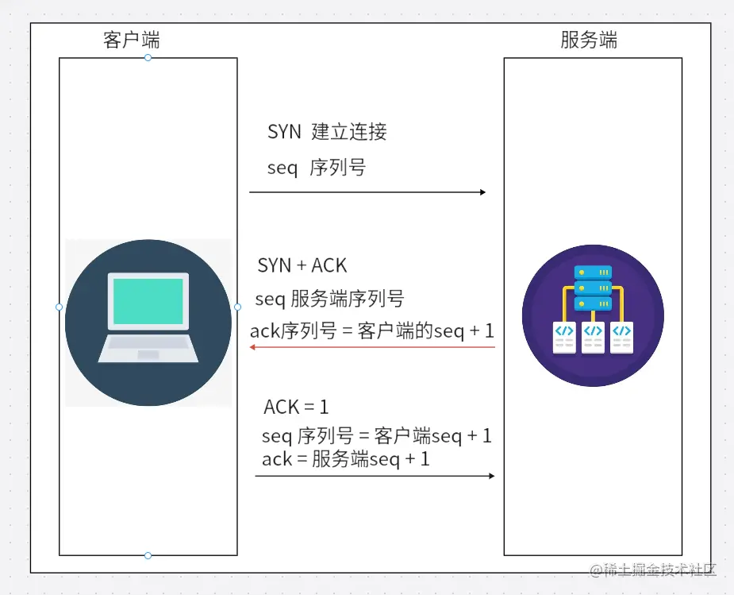
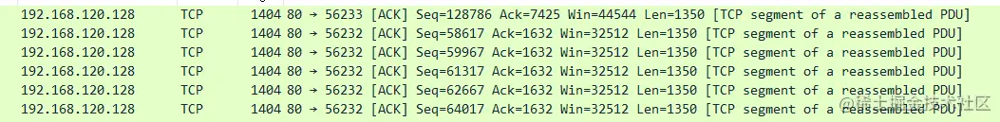
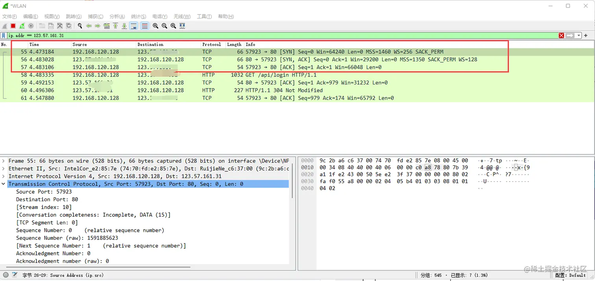
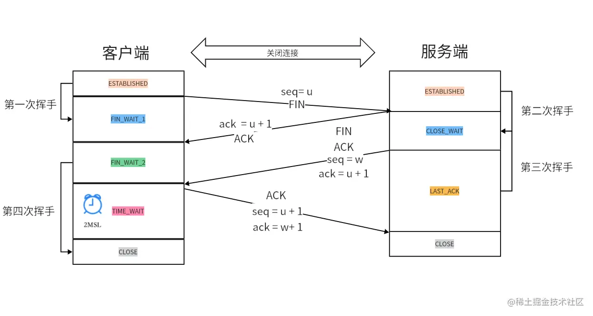

在浏览器地址栏敲下回车后，请求要依次穿过 URL 解析、DNS 寻址、传输层建连、HTTP 缓存判定、同源跨域检查和身份鉴权，才能最终把数据安全送到页面手里。任何一环出现阻塞或策略配置失误——例如预检请求没放行、强缓存没设对指纹、JWT 存错了位置——都会直接反映为页面白屏、接口报错或账号凭证泄漏。

## URL 解析与 DNS 域名寻址

浏览器首先拆解 URL 的六个组成部分：`协议://域名:端口/路径?查询参数#hash`。协议、域名和端口共同唯一确定一个“源（Origin）”以及请求打向哪台服务器；路径和查询参数发往服务端定位资源，`#hash` 仅在浏览器本地消费，**不会随 HTTP 请求发给服务器**。

拿到域名后，浏览器按“由近及远”的顺序查出目标 IP（DNS 解析）：

1. **本地查找链**：依次检查浏览器自身 DNS 缓存 → 操作系统缓存 → 本地 `hosts` 文件。
2. **远程递归与迭代查询**：本地未命中时请求本地配置的递归 DNS 解析器（如运营商或公共 DNS），由它逐级向根域名服务器、顶级域（TLD）服务器与权威域名服务器查询，最终返回 IP 并按 TTL 缓存。

## TCP 建连、四次挥手与 HTTP 协议演进

在 HTTP/1.1 与 HTTP/2 下，浏览器通过 TCP 建立可靠字节流连接（HTTPS 则在 TCP 之上叠加 TLS 握手，通过非对称加密协商对称密钥并验证数字证书，同时防窃听、防篡改、防冒充）。

### 三次握手与四次挥手

TCP 建连需要三次握手，核心目的是**让客户端与服务端双向确认彼此的发送能力与接收能力，并同步初始序列号（`seq` / `ack`）**：

1. 客户端发送 `SYN` 报文，进入 `SYN_SENT`。
2. 服务端回复 `SYN + ACK`，确认收到并同步自己的初始序列号。
3. 客户端回复 `ACK`，连接正式进入 `ESTABLISHED`（之所以不能省去第三次，是为了防止失效的历史 `SYN` 滞留网络后突然到达服务端导致单向空建连浪费资源）。





断开连接比建连多一次挥手（四次挥手），是因为 TCP 连接是全双工的：**主动关闭方发 `FIN` 表示自己不再发送数据，但此时仍能接收对方尚未传完的剩余报文**；被动关闭方先回 `ACK` 确认，等自己本地数据也发送完毕后再单独发送 `FIN`，最后由主动关闭方回 `ACK` 并等待 `2MSL` 后彻底关闭。





### HTTP/1.1 → HTTP/2 → HTTP/3 核心演进

| 协议版本 | 传输层基础 | 核心瓶颈或解决的关键问题 |
| --- | --- | --- |
| HTTP/1.0 | TCP（短连接） | 默认每次请求新建 TCP，连接复用能力极弱 |
| HTTP/1.1 | TCP（长连接 `keep-alive`） | 同一连接内请求必须按序排队等待响应，存在**应用层队头阻塞（HOL Blocking）**，浏览器被迫同域名并发 6 条连接 |
| HTTP/2 | TCP（单连接多路复用） | 引入**二进制分帧与多路复用**（同一 TCP 连接并行交错收发多路请求）与 **HPACK 头部压缩**，消除 HTTP 层队头阻塞 |
| HTTP/3 | **QUIC（基于 UDP）** | 在传输层用独立流彻底消除 TCP 丢包导致的整条连接阻塞，结合 0-RTT/1-RTT 快速握手，大幅优化弱网和移动切换体验 |

## HTTP 状态码、浏览器缓存与跨域边界

### 常见 HTTP 状态码分组

排查网络请求先看第一位数字锁定责任域：

- **`2xx` 成功**：`200 OK`、`201 Created`（资源创建成功）、`204 No Content`（如 `OPTIONS` 预检或删除成功无响应体）、`206 Partial Content`（分片断点续传）。
- **`3xx` 重定向与缓存**：`301` 永久重定向与 `302` 临时重定向历史上允许浏览器把 `POST` 改成 `GET`；需要严格保留原请求方法和请求体时必须用 **`307 Temporary Redirect`** 或 **`308 Permanent Redirect`**；**`304 Not Modified`** 表示协商缓存命中，直接复用本地副本。
- **`4xx` 客户端错误**：`400` 参数格式错、`401` 未认证/凭证失效、`403` 已认证但无权限、`404` 资源不存在。
- **`5xx` 服务端错误**：`500` 服务内部崩溃、`502` 网关收到上游无效响应、`503` 服务过载维护、`504` 上游网关超时。

### 浏览器缓存：强缓存优先，过期走协商缓存

浏览器缓存把请求拦截在本地还是放往后端校验，严格按两级顺序决策：

1. **强缓存（不发网络请求，DevTools 显示 `from memory cache` 或 `from disk cache`）**：优先读取 `Cache-Control`（如 `max-age=31536000` 或 `no-cache`/`no-store`），优先级高于旧式的 `Expires` 绝对时间。**注意：`Cache-Control: no-cache` 仍会缓存资源，只是每次使用前必须先发请求做协商校验；彻底禁止缓存应写 `no-store`。**
2. **协商缓存（强缓存过期后携带验证头询问服务器）**：优先比对高精度内容指纹 **`ETag` / `If-None-Match`**，其次比对修改时间 **`Last-Modified` / `If-Modified-Since`**。资源未变服务器返回 **`304`** 沿用本地缓存；资源已变则返回 **`200` + 新内容**。

**线上静态部署的标准缓存组合是：HTML 入口文件设 `Cache-Control: no-cache` 每次走协商验证，带哈希指纹的 JS/CSS/图片设 `Cache-Control: max-age=31536000, immutable` 永久走强缓存。**

### 跨域（CORS）预检与解决方案

只要请求的**协议、域名、端口**任意一项与当前页面不同，即触发浏览器同源策略限制（注意：这是浏览器的安全读响应限制，服务端其实往往已经收到了请求，但浏览器拒绝把响应交给前端脚本）。

当跨域请求不满足“简单请求”条件（例如使用了 `PUT`/`DELETE`、带有 `Authorization` 等自定义请求头，或 `Content-Type` 为 `application/json`）时，浏览器会在正式请求前自动先发一次 **`OPTIONS` 预检请求**，向服务器确认允许的源、方法和头字段。

| 解决手段 | 适用环境 | 核心机制与边界 |
| --- | --- | --- |
| **开发代理（Vite/Webpack Proxy）** | 本地开发 | 请求先发给同源本地 Dev Server，由 Node 进程转发到后端，绕开浏览器限制 |
| **CORS 响应头** | 生产直连 API | 后端返回 `Access-Control-Allow-Origin`、`Allow-Methods`、`Allow-Headers` 等；若带 Cookie 凭证，Origin 不能写通配符 `*`，必须精确指定域名并设 `Allow-Credentials: true` |
| **Nginx 反向代理** | 生产同域聚合 | 把前端静态资源与多组后端接口统一挂载在同一域名网关下，对外完全同源 |
| JSONP（历史遗留） | 仅兼容老系统 | 利用 `<script>` 标签无视同源策略，仅支持 `GET` 且存在注入风险，新项目已淘汰 |

**CORS 授权和 HTTP 缓存是两层独立校验：即便命中了 `304` 协商缓存，响应依然必须带有合法的 CORS 响应头，否则浏览器照样拦截报错。**

## 实时通信选型：SSE 与 WebSocket

实时数据推送不必无脑上双向全双工通道，按通信方向选型最省资源：

- **SSE（Server-Sent Events）**：基于标准 HTTP 的**服务端到客户端单向持续推送**。服务端只需返回以下核心响应头，浏览器原生 `EventSource` 即可通过 `onmessage` 持续收包并在断线时自动重连（需自定义 POST 参数与请求头时也可用 `fetch` 流式读取）：

```http
Content-Type: text/event-stream
Cache-Control: no-cache
Connection: keep-alive
```

- **WebSocket**：基于 `ws://`/`wss://` 协议的**全双工双向实时通信**，适合聊天室、协同文档编辑、实时多人对战等需要客户端与服务端高频互发消息的场景；而 AI 流式输出、日志尾随、站内通知流用 SSE 更轻量。

## JWT 鉴权流程与存储安全边界

JSON Web Token（JWT）由 `Header.Payload.Signature` 三段 Base64URL 字符串拼接而成，服务器验证签名即可确认身份，无需在内存或 Redis 中强绑定中心化 Session。

**JWT 的 Payload 只是 Base64URL 编码，任何人拿到都能直接解码明文内容；绝对不要把密码、密钥或敏感个人隐私放进 Payload。**

设计前端 JWT 方案必须守住两条安全与失效边界：

1. **存储与防攻击权衡**：放在 `localStorage` 中容易被页面上的 XSS 攻击脚本直接盗取；放进 **`HttpOnly; Secure; SameSite=Lax` 的 Cookie** 里可以彻底隔离 JS 读取（防 XSS 盗取），但要同时配合 `SameSite` 属性或 CSRF Token 防御跨站请求伪造。
2. **短有效期 + 主动吊销机制**：JWT 一旦签发在过期前默认无法单方面作废。生产级方案通常使用**短生命周期 Access Token（如 15 分钟）+ 持久化 Refresh Token（可入库随时吊销/踢下线）**，或者在登出/封禁时将 Token `jti` 写入 Redis 黑名单校验。
