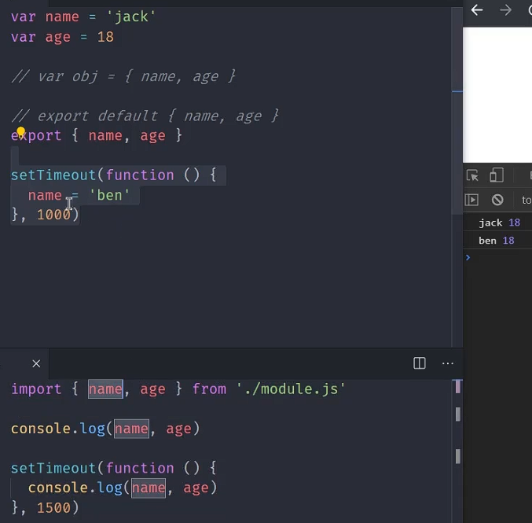
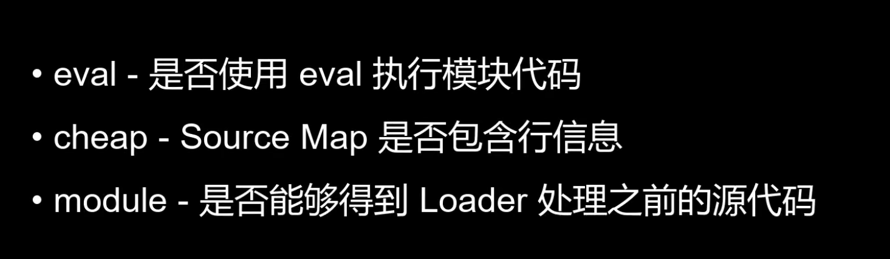
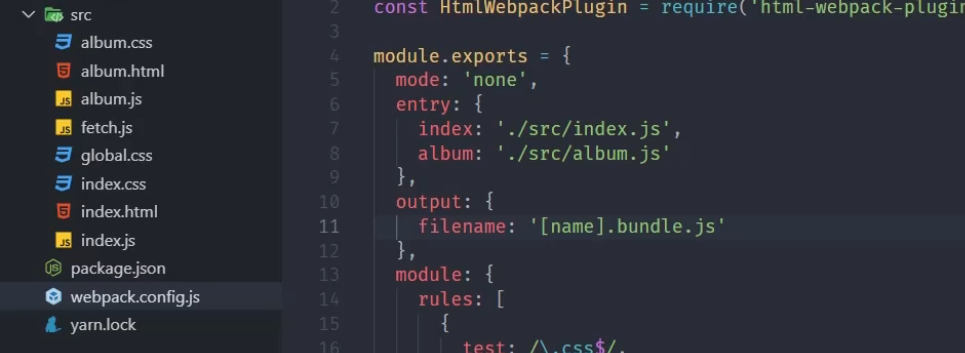
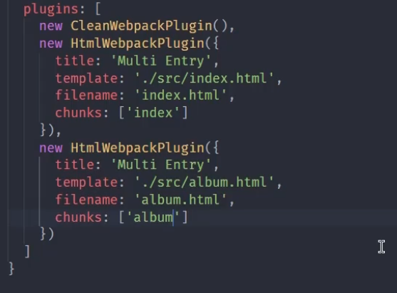

把应用拆成几十个脚本文件直接用 `<script>` 往页面里堆，很快就会碰上三个硬伤：全局变量同名覆盖、脚本加载顺序靠人工死记、旧浏览器跑不动新语法和 CSS/图片无法纳入同一套依赖管理。现代前端工程化把这套问题拆成了两层：**ES Module 负责在语言层声明清晰的模块边界，Babel 与 Webpack/Parcel/Vite 负责把源码编译、转换并打包成浏览器可缓存、可执行的产物**。

## 模块化演进：从 IIFE 到 ES Module 与 CommonJS

早期的浏览器没有原生模块系统，开发者只能靠 IIFE（立即执行函数）包出私有作用域并暴露单一全局对象；随着 Node.js 推出 CommonJS 和浏览器标准确立 ES Module（ESM），模块化才拥有了完整的依赖解析机制。

### 浏览器中的 `<script type="module">`

启用原生 ES Module 只需要在入口脚本加上 `type="module"`，它与普通 `<script>` 的执行行为有四项关键差异：

| 特性维度 | 原生模块 `<script type="module">` | 普通脚本 `<script>` |
| --- | --- | --- |
| 作用域与严格模式 | 独立模块私有作用域，默认开启严格模式（`"use strict"`），顶层 `this` 为 `undefined` | 共享全局作用域，`this` 指向 `window` |
| 下载与执行时机 | **默认等价于 `defer`**：异步并行下载，等 HTML 解析完按顺序执行 | 立即阻塞 HTML 解析并同步执行 |
| 跨域资源策略 | 严格遵循 CORS，跨域脚本必须带合法 CORS 响应头 | 允许宽松跨站加载执行 |
| 兼容旧浏览器降级 | 可配合 `<script nomodule src="./legacy.bundle.js">` 做向后兼容 | 全版本浏览器通用 |

在原生 ESM 中，本地相对路径导入必须显式以 `./` 或 `../` 开头并带上文件后缀（如 `import { sum } from "./math.js"`），裸模块名（如 `"lodash"`）留给打包工具或 Import Maps 解析。需要延迟按需加载时使用动态 `import("./chunk.js")`（返回 Promise）；如果要在模块初始化阶段直接等待异步配置，ES2022 支持顶层 `await`，但**顶层 `await` 会阻塞所有导入该模块的下游模块启动**，核心基础模块应谨慎使用。

### `live binding` 与 ESM vs CommonJS 核心差异

**ES Module 导出的是对原始绑定的只读实时引用（Live Binding），而 CommonJS（`require`）导出的是运行时的值拷贝。**

看下面这段 ESM 代码，当 `counter.js` 内部更新 `count` 时，`main.js` 再次读取到的会是最新值（导入方只能读取，不能直接给导入的变量重新赋值）：

```javascript
// counter.js
export let count = 0;
export function inc() {
  count++;
}

// main.js
import { count, inc } from "./counter.js";
console.log(count); // 0
inc();
console.log(count); // 1（实时看到导出方内部状态变化）
```



将 ESM 与传统 Node.js 的 CommonJS（`module.exports` / `require()`）横向对比，差异直接决定了 Tree Shaking 能否生效：

| 对比维度 | ES Module (ESM) | CommonJS (CJS) |
| --- | --- | --- |
| 依赖分析时机 | **静态分析**（编译期即可确定依赖图，`import` 必须在顶层） | **动态加载**（运行时执行到 `require()` 才加载，可放在 `if` 里） |
| 值传递语义 | 实时活绑定（Live Binding） | 导出值拷贝 + 模块实例首次执行后缓存 |
| 导出形式 | 命名导出 `export { a }` + 唯一默认导出 `export default` | `module.exports = ...` 或 `exports.a = ...`（注意直接重赋值 `exports = ...` 会断开引用） |
| Tree Shaking | **原生友好**，静态图可直接剪除未引用导出 | 困难，运行时动态属性访问无法在打包前安全裁剪 |

## Babel 语法降级与 `core-js` Polyfill 分工

打包上线前，源码还必须跨过浏览器兼容性这道关。很多人把 Babel 和 Polyfill 混为一谈，其实两者处理的是完全不同的两个层面：

**Babel 插件负责把 ES6+ 新“语法”（如箭头函数、`class` 私有字段、可选链）降级改写成 ES5 语法结构；`core-js` 等 Polyfill（垫片）负责为旧环境补齐运行时缺失的“内置 API”（如 `Promise`、`Array.prototype.includes`、`structuredClone`）。**

单靠 `@babel/preset-env` 转换语法，旧浏览器遇到 `arr.includes(2)` 照样报错；必须结合 `core-js@3` 按目标浏览器按需注入垫片。推荐在 `babel.config.json` 中使用 `"useBuiltIns": "usage"`，让 Babel 只扫描代码里实际用到且目标环境缺失的 API 自动引入对应垫片，压低产物体积：

```json
{
  "presets": [
    [
      "@babel/preset-env",
      {
        "targets": {
          "chrome": "70",
          "firefox": "68"
        },
        "useBuiltIns": "usage",
        "corejs": 3
      }
    ]
  ]
}
```

如果把 `useBuiltIns` 设为 `"entry"`，则需要在入口文件手动写 `import "core-js/stable"` 并由 Babel 展开；设为 `false` 则完全不注入垫片，仅做纯语法转译。

## Webpack 构建生命周期与运行时产物

当项目包含 JS、CSS、Less、图片、字体和单文件组件时，原生浏览器无法直接串联这些异构资源。打包工具（如 Webpack、Parcel、Vite）从入口出发，递归追踪依赖并统一产出带内容指纹的静态资源。

### 从入口到 Bundle 的构建流程

Webpack 的一次完整构建包含五个核心阶段：

1. **读取配置与初始化 Compiler**：合并配置文件与 CLI 参数，注册所有配置好的 Plugin 钩子。
2. **从 `entry` 出发解析依赖**：读取入口模块源码，通过 AST 分析找出所有 `import` / `require` 依赖。
3. **调用 Loader 链转换非 JS 资源**：碰到 `.css`、`.ts`、`.vue` 或图片时，交由匹配的 Loader 转换成 Webpack 可识别的标准 JS 模块，再继续收集其内部依赖（例如 CSS 里的 `url()` 与 `@import`）。
4. **构建模块依赖图与 Chunk 分组**：形成完整的 Module Graph，并根据入口与动态 `import()` 拆分成不同的 Chunk。
5. **生成产物并输出**：注入模块加载运行时，执行代码压缩与 Tree Shaking，将最终 Bundle 写入 `dist/` 目录。

### 打包产物里面到底有什么

一个由 Webpack 输出的 Bundle 文件在没有拆包优化前，本质上是一个自执行的调度壳，核心包含四个部分：模块映射表（`__webpack_modules__`）、模块加载函数（`__webpack_require__`）、模块执行结果缓存（避免重复初始化同一模块），以及启动整个应用的入口执行逻辑。



## Loader、Plugin 与 Tree Shaking 机制

在阅读任何 Webpack 配置时，最容易混淆的边界是 Loader 与 Plugin 的职责划分：

| 扩展机制 | 工作粒度与时机 | 核心定位 | 常见代表 |
| --- | --- | --- | --- |
| **Loader** | **单个文件/模块**在加载转换阶段运行 | 文件翻译器：把非 JS 或新语法文件转为标准模块 | `css-loader`、`style-loader`、`babel-loader`、`sass-loader` |
| **Plugin** | **整个构建生命周期**，通过 Tapable 事件钩子介入各个阶段 | 构建流程增强器：生成 HTML、提取 CSS、注入环境变量、压缩产物 | `HtmlWebpackPlugin`、`MiniCssExtractPlugin` |

### Loader 的执行顺序与 CSS 处理链

**Webpack 中同一条规则的 Loader 数组按“从右到左、从下到上”的管道顺序逆序执行。**

例如处理 CSS 的经典配置 `use: ["style-loader", "css-loader"]`：源码先经过右侧的 `css-loader` 解析 `@import` 和 `url()` 依赖并输出 CSS 字符串模块，再交给左侧的 `style-loader` 生成运行时注入 `<style>` 标签的 JS 代码（生产环境则常替换为 `MiniCssExtractPlugin.loader` 抽离独立 CSS 文件以支持并行缓存）。





### Tree Shaking 生效的前提

Tree Shaking 用于在生产构建时剔除模块里“导出但从未被任何地方导入”的死代码（Dead Code）。它依赖两条硬条件：

1. **必须使用 ES Module 静态语法**：如果工具库以 CommonJS 导出或被 Babel 提前转成了 `commonjs`（需在 `@babel/preset-env` 中保持 `modules: false`），静态依赖分析就会失效。
2. **标注无副作用（`sideEffects`）**：在 `package.json` 中合理声明 `"sideEffects": false`（或 `["*.css"]` 保留样式导入），打包器才能放心地把只导入了部分成员、其余成员有副作用嫌疑的整块代码安全裁剪掉。

## 静态资源交付、NPM 语义化版本与代码质量护栏

现代前端工程的交付链路还包括包版本锁定与上线缓存控制：

1. **NPM 依赖与 SemVer 语义化版本**：`package.json` 的版本号格式为 `MAJOR.MINOR.PATCH`（主版本不兼容变更、次版本向下兼容新增、补丁版本向后兼容修复）。`^1.4.0` 允许更新次版本与补丁，`~1.4.0` 仅允许补丁更新；生产与 CI 必须提交锁文件（`pnpm-lock.yaml` / `package-lock.json`），并用 `--frozen-lockfile`（或 `npm ci`）确保全环境依赖树一致。
2. **资源处理与长效缓存**：小图标可按体积阈值内联为 Data URL 减少请求，首屏大图走压缩、WebP 转换与 CDN 分发；所有打包后的 JS/CSS 产物统一带内容哈希指纹（如 `main.[contenthash].js`），配合 HTML 禁用强缓存、静态哈希资源设置长期 `Cache-Control: max-age=31536000, immutable`，做到更新上线即时生效且旧版本可快速回滚。
3. **静态质量检查**：在构建与提交前接入 TypeScript 类型检查和 ESLint 规则（拦截未用变量、隐式全局变量和风格不一致问题），把低级缺陷拦在打包之前。
