页面“慢”只是一个笼统现象。首屏白屏很久出不来、加载中途图片把文字往下顶得乱跳、按钮点下去半秒才有反应——三种症状对应的瓶颈完全不同，优化动作也不能混着乱改。排查前端性能遵循一条固定顺序：**先确定用户慢在哪个阶段，再通过瀑布图与 Web Vitals 定位具体请求或主线程瓶颈，最后用 Performance API 建立量化前后对比**。

## 先看瀑布图，再看 Lighthouse 评分

排查加载问题时，Lighthouse 的总分只适合做健康度体检入口，真正暴露根因的是浏览器 DevTools 的 **Network 瀑布图（Waterfall）**。瀑布图把每个资源的生命周期按时间轴摊开：

- DNS 解析、TCP 建连、TLS 握手各自占了多少毫秒
- 请求在排队（Queueing）阶段是否被浏览器同域名并发限制卡住
- 关键 CSS 和脚本是否被发现得太晚，或者阻塞了后续解析

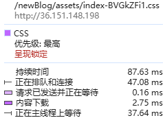

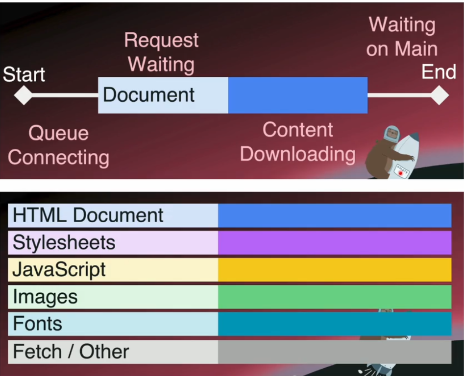

**Lighthouse 只告诉你结果分数，瀑布图展示的是资源何时被发现、卡在哪一段以及被谁阻塞；定位首屏瓶颈必须先看瀑布图再对症下药。**

传统性能分析只盯 `DOMContentLoaded` 和 `load` 两个节点，但在现代单页应用（SPA）里这两个事件已经严重失真：HTML 骨架秒开、`DOMContentLoaded` 早就触发了，但异步 JS 拉完数据并渲染出主体内容可能还在两秒之后；资源全部加载完毕后，如果主线程被长计算占满，用户点按钮依然卡死。因此需要用 **Core Web Vitals** 直接对齐用户的真实体感。

## Core Web Vitals 三大核心指标与辅助指标

Google 定义的 Core Web Vitals 把页面体验拆成“加载可见速度（LCP）”、“视觉稳定性（CLS）”和“交互响应延迟（INP）”三个维度，配合 TTFB 与 FCP 组成完整的排查坐标系。

### LCP（Largest Contentful Paint，最大内容绘制）

LCP 衡量**视口内最大可见内容元素真正渲染到屏幕上的时间点**，直接对应用户认为“主内容已经出来”的时刻。常见计入 LCP 的元素包括首屏主图、CSS 背景大图、视频封面图（`poster`）以及大块正文文本段落。

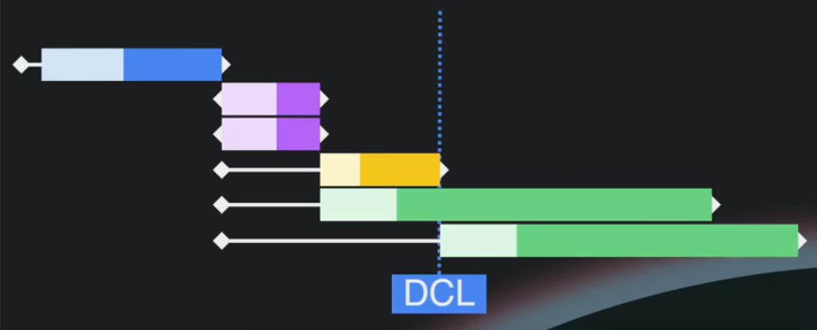

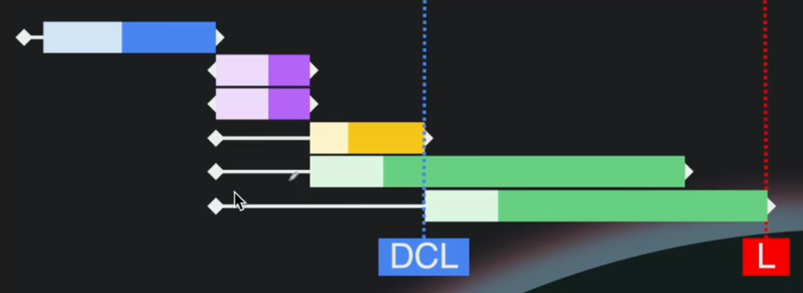

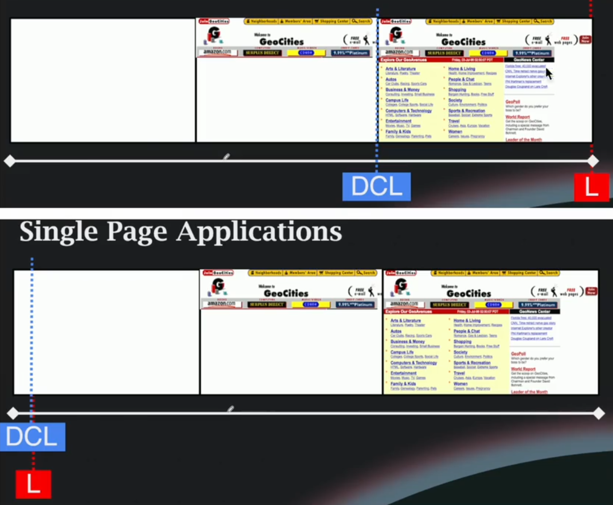

- **达标阈值**：优秀 `<= 2.5s`；需改进 `2.5s ~ 4.0s`；较差 `> 4.0s`。
- **常见恶化根因**：服务端 TTFB 过高；LCP 首屏大图靠 JS 运行后才动态拼接路径（发现太晚）；未加 `<link rel="preload">` 或 `fetchpriority="high"`；渲染阻塞的 CSS/JS 过重或主线程长期占用。

### CLS（Cumulative Layout Shift，累计布局偏移）

CLS 衡量页面加载和交互期间**可见元素意外发生位置跳变的程度**，按受影响区域比例与偏移距离乘积计算：

`CLS = Impact Fraction × Distance Fraction`

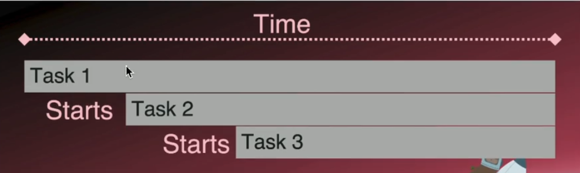

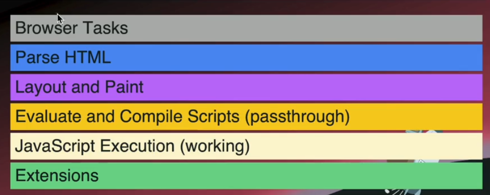

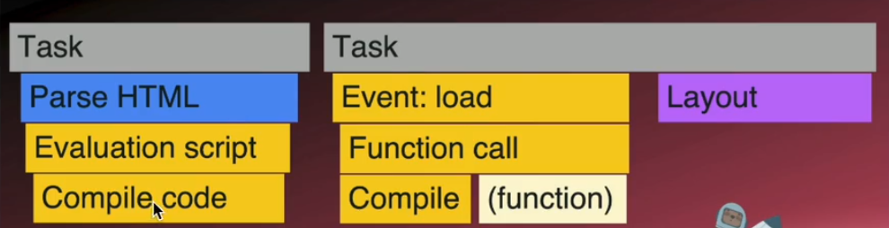

- **达标阈值**：优秀 `<= 0.1`；需改进 `0.1 ~ 0.25`；较差 `> 0.25`。
- **常见恶化根因**：``、广告位或异步骨架没有通过 `width`/`height` 或 `aspect-ratio` 预留尺寸；Web 字体切换（FOUT/FOIT）引起行高突变；在已有可视内容上方动态插入横幅；动画直接修改 `top`/`margin` 等几何属性而非 `transform`。

### INP、FCP 与 TTFB 的协作关系

除 LCP 和 CLS 外，另外三个指标补齐了请求起点、首次反馈和全生命周期交互延迟：

| 指标 | 全称 | 衡量阶段与核心关注点 |
| --- | --- | --- |
| **TTFB** | Time to First Byte | 从发起请求到收到响应首个字节的耗时（反映网络链路、CDN 与后端处理速度） |
| **FCP** | First Contentful Paint | 用户首次看到任何文本、图片或非空白 Canvas 绘制的时间点 |
| **INP** | Interaction to Next Paint | 页面全生命周期内，从用户点击/按键等交互开始到下一帧可见像素绘出的延迟（已取代只测首次交互的 FID） |

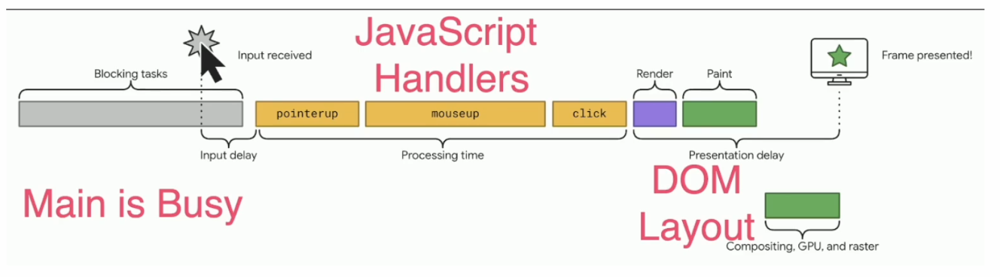

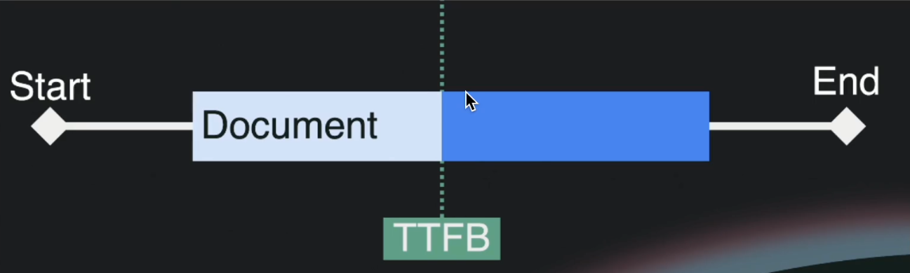

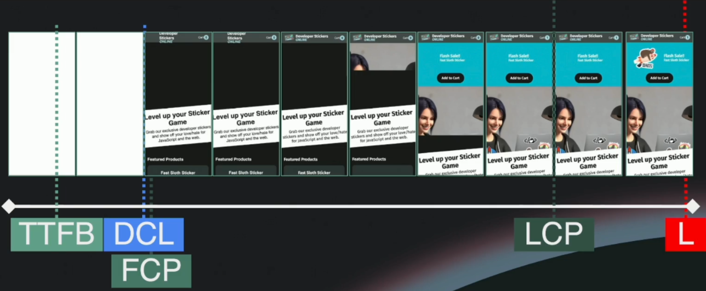

**这组指标分别对应网络传输、首屏渲染、视觉稳定与主线程响应四个独立环节，优化前必须先确定异常落在哪一环。**

## 用 Performance API 与 `PerformanceObserver` 采集数据

线上真实用户的性能监控不能靠手动打开 DevTools 看面板，必须依赖浏览器内置的高精度 **Performance API**。

### `timeOrigin`、`performance.now()` 与自定义打点

`performance.timeOrigin` 标记当前文档生命周期的单调计时起点。`performance.now()` 返回相对 `timeOrigin` 的微秒级高精度相对时间（单调递增，不受系统修改本地时钟影响），适合测量函数或片段耗时：

```javascript
const start = performance.now();
heavyCompute();
const duration = performance.now() - start;
console.log(`计算耗时：${duration.toFixed(2)}ms`);
```

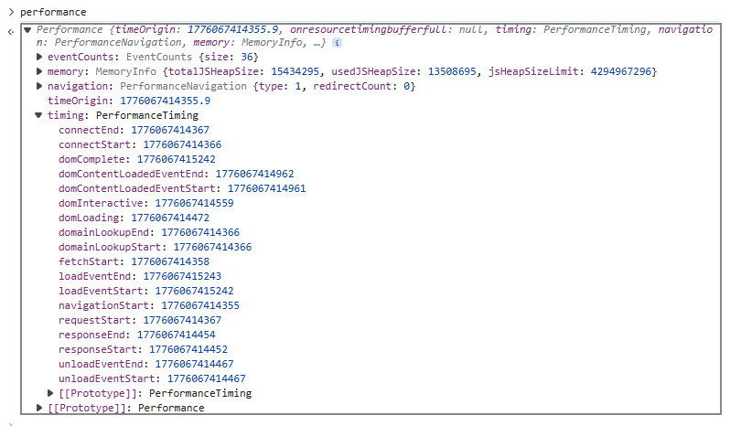

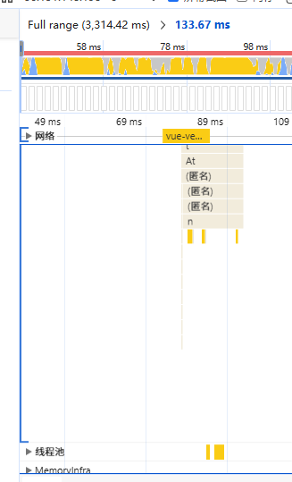

对于业务关键路径（如长列表渲染或首屏接口到达后的解析过程），使用 `mark()` 与 `measure()` 打点，这些自定义测量条目也会同步出现在 DevTools Performance 面板的时间轴上：

```javascript
performance.mark("list-render-start");
renderProductList(items);
performance.mark("list-render-end");
performance.measure("list-render", "list-render-start", "list-render-end");
```

### 用 `PerformanceObserver` 持续采集 Web Vitals

主动轮询 `performance.getEntries()` 既笨重又容易漏掉早期或晚到达的指标（LCP 和 CLS 都会随用户交互或后续大图加载动态刷新）。生产 RUM（Real User Monitoring）采集一律使用 **`PerformanceObserver`** 订阅性能条目，并务必传入 **`buffered: true`**。

**注册 `PerformanceObserver` 时必须开启 `buffered: true`，否则脚本初始化前已经产生的早期导航和绘制条目会全部丢失。**

```javascript
const lcpObserver = new PerformanceObserver((entryList) => {
  const entries = entryList.getEntries();
  const latestLcp = entries[entries.length - 1];
  console.log("当前 LCP:", latestLcp.startTime, "目标元素:", latestLcp.element);
});

lcpObserver.observe({
  type: "largest-contentful-paint",
  buffered: true,
});
```

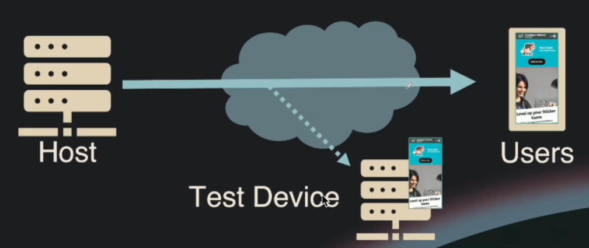

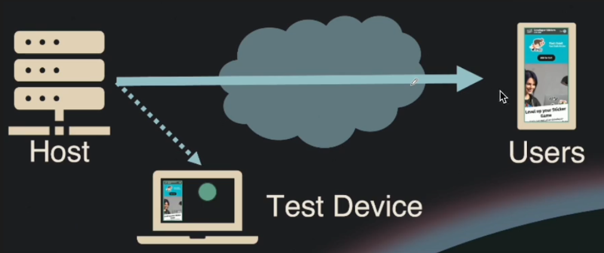

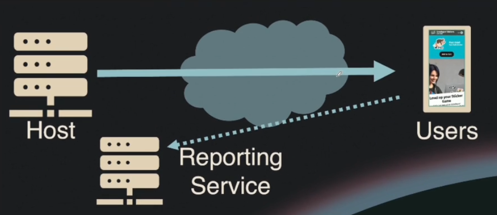

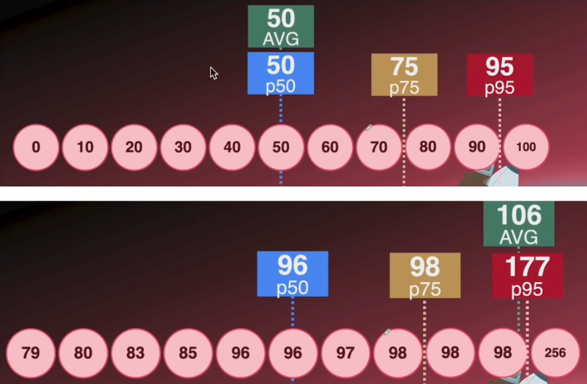

## Lab Data vs Field Data 与工具搭配

一次本地可控测试的漂亮分数代表不了弱网低端机用户的真实体验，而线上埋点聚合数据又缺乏细粒度调用栈用于复现。两类数据必须配套使用：

| 数据维度 | 代表工具与来源 | 核心用途 |
| --- | --- | --- |
| **Lab Data（实验室数据）** | Lighthouse、Chrome DevTools Performance、WebPageTest | 可复现、可逐帧拆解调用栈与网络瀑布，用来**定位瓶颈与本地验证改动** |
| **Field Data（现场真实数据）** | CrUX（Chrome User Experience Report）、自建 RUM 监控 | 反映真实设备、地域和弱网分布（通常看 P75 分位），用来**判断线上真实影响** |

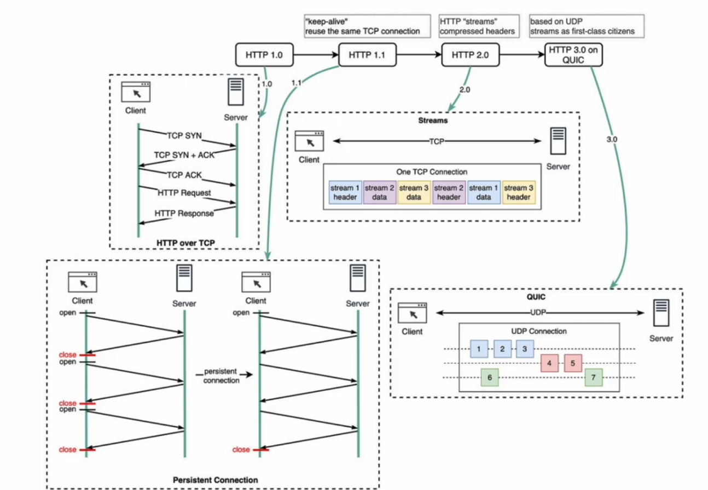

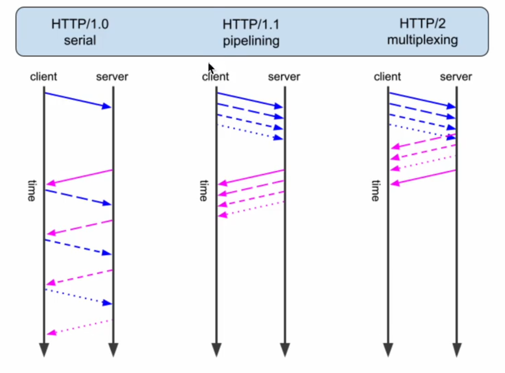

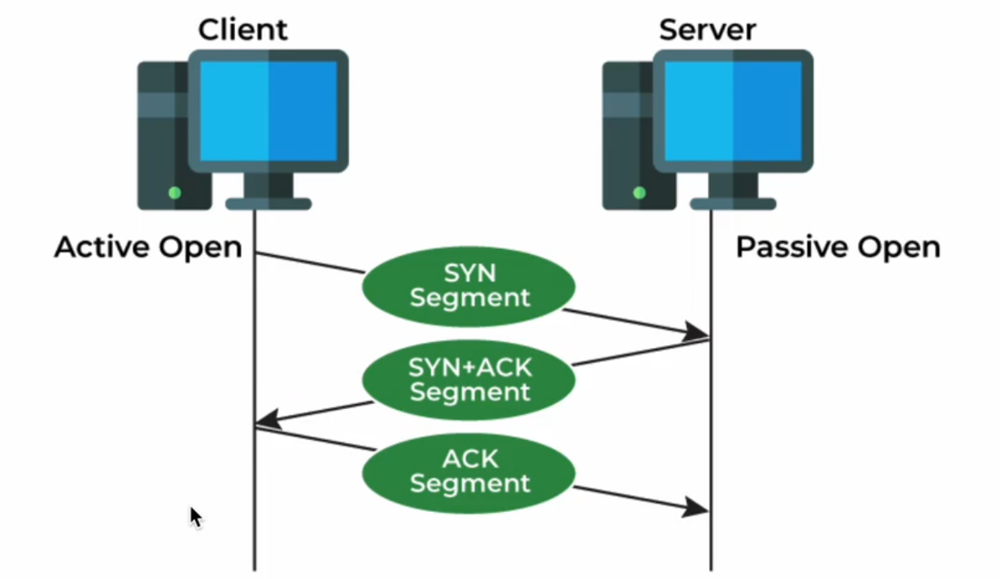

Chrome DevTools Performance 面板重点盯住四类信息：超过 50ms 的红色角标 **Long Tasks（长任务）**、主线程在 `Scripting`/`Layout`/`Paint` 的占比分布、FPS 帧率掉帧区间，以及是否存在频繁读写布局属性触发的 **Forced Reflow（强制同步回流）**。

## 指标驱动的针对性优化与长列表边界

每一项优化动作都必须精准锚定要改善的指标，避免盲改配置：

| 目标指标 | 针对性优化手段 |
| --- | --- |
| **降低 TTFB** | 静态资源与可缓存页面上 CDN、开启 Brotli/Gzip 压缩、优化服务端查询与协议复用（HTTP/2、HTTP/3） |
| **压低 FCP** | 缩短关键渲染路径依赖链（消灭 CSS `@import`）、内联首屏关键 CSS、非关键 JS 加 `defer` 或异步拆包 |
| **优化 LCP** | 首屏主图避免懒加载并加 `fetchpriority="high"` 与 `<link rel="preload">`、升级 WebP/AVIF 并配好缓存头 |
| **消除 CLS** | 图片与异步模块显式声明 `width`/`height` 或 `aspect-ratio` 占位、使用 `font-display: swap` 并匹配回退字体度量 |
| **改善 INP** | 拆分超 50ms 长任务（`scheduler.yield()` / `requestIdleCallback` / Web Worker）、防抖节流高频输入与滚动事件 |

### 虚拟列表只解决一类问题

面对列表滚动卡顿，按以下顺序排查并做对照实验：

1. 检查同时挂载的 DOM 节点数量是否过大（如超过数千个节点）。
2. 检查单个列表项内部组件是否过于沉重或包含大量复杂样式计算。
3. 检查滚动监听回调中是否频繁交替读写几何属性，诱发了同步回流重绘。
4. 先将测试数据缩减到 20 条并开启/关闭虚拟列表做对照，确认帧率与长任务确实明显下降。

**虚拟列表只解决“同时渲染的 DOM 数量过多”这一类瓶颈；如果开闭虚拟列表后长任务耗时毫无变化，瓶颈就在单项组件渲染逻辑、状态频繁重算或主线程同步计算上。**

（关于虚拟列表动态高度处理与 SSE 增量渲染容错的具体实现，可参阅 [前端工程问题复盘：SSE 流式输出、Markdown 容错与虚拟列表](/posts/frontend-streaming-markdown-virtual-list)。）

## 汇报与复盘性能排查时的标准记录

记录一次性能优化结论时，至少明确写出四项信息，避免只贴一张“Lighthouse 98 分”截图：

1. **指标含义与采集现场**：测的是 Lab Data 还是 Field Data P75，在什么网络节流、设备档位与路由页面下采集。
2. **监控注入时机**：`PerformanceObserver` 注册位置及是否开启 `buffered: true`，确保数据无漏采偏差。
3. **因果链路定位**：结合瀑布图或 Performance 长任务调用栈，指明阻塞发生在网络排队、资源解析还是主线程布局/脚本执行。
4. **单变量前后对照**：只修改最可疑的一处瓶颈，附带优化前后的真实指标差值与剩余边界风险。
