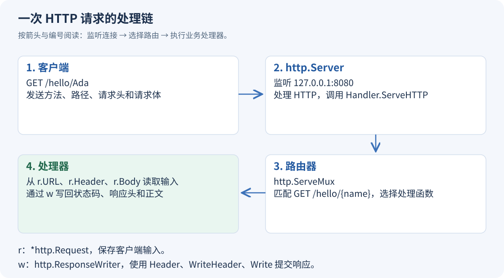

Web 请求到达后端程序时，无论用原生标准库还是 Gin 框架，都要经过“端口监听 → 路由匹配 → 请求解码 → 响应写回”这条处理链。先把 `net/http` 的核心接口和头部提交时机摸清楚，再用 Gin 组织路由与统一 JSON 响应契约，排查 `404`、`405`、`413`、`415` 或响应体序列化异常时才能一眼定位。

## 从 net/http 看清请求处理链

Go 标准库把 HTTP 服务端职责拆成了三个紧密协作的对象：

- `http.Server`：负责监听端口、管理 TCP 连接超时并解析 HTTP 协议帧，把每次请求交给一个实现了 `http.Handler`（仅有 `ServeHTTP(http.ResponseWriter, *http.Request)` 一个方法）的对象处理。
- `http.ServeMux`：标准库路由器，本身也实现了 `http.Handler`，按请求方法和路径模式分发到具体的处理函数。
- `http.HandlerFunc`：将符合签名的普通函数适配器化为 `http.Handler`。



从 Go 1.22 起，`http.ServeMux` 已经原生支持带方法前缀和路径变量的模式（例如 `GET /hello/{name}` 配合 `r.PathValue("name")`），日常选择 Gin（本文示例基于 Gin `v1.12.0` 与 Go `1.25+`）主要是为了省去重复编写结构体绑定、规则校验、路由分组和中间件洋葱链的样板代码。

**标准的 HTTP 响应只能提交一次状态码：一旦首次调用 `w.Write(...)` 写出正文，标准库会自动隐式提交 `200 OK`，后续再想改写 `400` 或 `500` 为时已晚。**

下面这个原生 `net/http` 示例演示了如何先把响应序列化成字节切片再提交状态码，以及如何同时校验 `Content-Type`、限制请求体字节上限（`http.MaxBytesReader`）并拦截多段拼接 JSON：

```go
package main

import (
	"encoding/json"
	"errors"
	"io"
	"log"
	"mime"
	"net/http"
	"strings"
	"time"
)

type Input struct {
	Name string `json:"name"`
}

// 先完成 JSON 序列化，确认无误后再设置状态码并写回连接。
func writeJSON(w http.ResponseWriter, status int, value any) {
	data, err := json.Marshal(value)
	if err != nil {
		http.Error(w, "response encoding failed", http.StatusInternalServerError)
		return
	}
	w.Header().Set("Content-Type", "application/json; charset=utf-8")
	w.WriteHeader(status)
	if _, err := w.Write(data); err != nil {
		log.Printf("write response: %v", err)
	}
}

func NewHandler() http.Handler {
	mux := http.NewServeMux()
	mux.HandleFunc("GET /hello/{name}", func(w http.ResponseWriter, r *http.Request) {
		writeJSON(w, http.StatusOK, map[string]string{"message": "你好，" + r.PathValue("name")})
	})
	mux.HandleFunc("POST /echo", func(w http.ResponseWriter, r *http.Request) {
		mediaType, _, err := mime.ParseMediaType(r.Header.Get("Content-Type"))
		if err != nil || mediaType != "application/json" {
			writeJSON(w, http.StatusUnsupportedMediaType, map[string]string{"error": "请使用 application/json"})
			return
		}
		r.Body = http.MaxBytesReader(w, r.Body, 1024)
		decoder := json.NewDecoder(r.Body)
		decoder.DisallowUnknownFields()

		var input Input
		err = decoder.Decode(&input)
		if err == nil {
			// 再读一次应当只遇到 EOF，否则说明请求体末尾夹带了第二段 JSON 或冗余数据。
			var extra any
			if nextErr := decoder.Decode(&extra); nextErr != io.EOF {
				if nextErr == nil {
					err = errors.New("only one JSON value is allowed")
				} else {
					err = nextErr
				}
			}
		}
		if err != nil {
			status := http.StatusBadRequest
			var tooLarge *http.MaxBytesError
			if errors.As(err, &tooLarge) {
				status = http.StatusRequestEntityTooLarge
			}
			writeJSON(w, status, map[string]string{"error": "请求体过大或 JSON 格式不符合要求"})
			return
		}
		if strings.TrimSpace(input.Name) == "" {
			writeJSON(w, http.StatusBadRequest, map[string]string{"error": "name 不能为空"})
			return
		}
		writeJSON(w, http.StatusOK, input)
	})
	return mux
}

func main() {
	server := &http.Server{
		Addr:              "127.0.0.1:8080",
		Handler:           NewHandler(),
		ReadHeaderTimeout: 5 * time.Second,
	}
	log.Fatal(server.ListenAndServe())
}
```

把路由组装抽进独立的 `NewHandler()` 函数有一个很大的工程好处：集成测试可以直接用 `httptest.NewRequest` 或 `httptest.NewServer` 驱动路由，不需要在 CI 里抢占固定端口。同时注意两点限制：`http.MaxBytesReader` 能防住分块传输（chunked）或伪造 `Content-Length` 绕过大小检测；请求结束后绝不能在后台 goroutine 里继续读写同一个 `ResponseWriter`。

## Gin Engine 初始化与请求生命周期

`gin.Engine` 本身实现了 `http.Handler`，所以既能直接用 `r.Run(":8080")` 启动，也可以作为 `Handler` 塞进自定义的 `http.Server` 来配置读写超时与优雅停机。

初始化引擎时常用两个工厂函数：

- `gin.Default()`：自动挂载 `Logger` 和 `Recovery` 两个默认中间件。
- `gin.New()`：返回干净的空白引擎，需要什么中间件显式用 `r.Use(...)` 挂载。

生产服务通常优先用 `gin.New()` 显式装配自己的结构化日志和 `gin.Recovery()`，同时按需调用 `r.SetTrustedProxies(nil)` 关掉默认的代理头信任，避免客户端伪造 `X-Forwarded-For` 欺骗 `c.ClientIP()`。注意 `gin.Recovery()` 只兜住请求链里的 `panic`，常规业务错误仍要靠显式返回处理。

## HTTP 状态码与业务码分工

写 JSON 接口时最忌讳“所有报错一律返回 HTTP `200`，只在 JSON 里塞一个 `code: 500`”。HTTP 状态码表达协议层和网关层的传输结果，JSON 里的业务码承载应用内部的细分错误，两者各司其职，Nginx 日志、浏览器网络面板和前端拦截器才能准确协同。

| 场景 | HTTP 状态码 | 业务码示例 | 处理建议 |
| --- | --- | --- | --- |
| 查询或更新成功 | `200` | `0` | 返回标准契约结构；新建资源可用 `201` 并附带 `Location` |
| 成功且无响应正文 | `204` | — | 禁止在 `204` 下强塞 JSON 正文或要求前端解析 |
| 异步任务已接收 | `202` | `0` | 返回任务 ID 供轮询 |
| 参数格式或校验不通过 | `400` | `1001` | 携带具体字段错误定位 |
| 未携带有效身份凭证 | `401` | 按应用定义 | 明确区分未登录与无权限 |
| 凭证有效但无操作权限 | `403` | 按应用定义 | — |
| 路由或目标资源不存在 | `404` | `1002` | 区分“记录不存在”与“数据库故障（`500`）” |
| 路径命中但 HTTP 方法不对 | `405` | `1003` | Gin 需开启 `HandleMethodNotAllowed = true` |
| `Content-Type` 不受支持 | `415` | — | 防止非 JSON 请求被悄悄当空表单处理 |

**HTTP 状态码和业务错误码各自独立传递语义：`401` 与 `403` 不能混用，接口报错也不应全部藏在 `200` 里让监控与浏览器失效。**

## 统一 JSON 响应契约完整示例

新建独立目录运行下面示例（Gin `v1.12.0`）：

```bash
mkdir gin-response-demo && cd gin-response-demo
go mod init example.com/gin-response-demo
go get github.com/gin-gonic/gin@v1.12.0
```

```go
package main

import (
	"log"
	"net/http"
	"strconv"

	"github.com/gin-gonic/gin"
)

type Response struct {
	Code int    `json:"code"`
	Data any    `json:"data"`
	Msg  string `json:"msg"`
}

func reply(c *gin.Context, status, code int, data any, message string) {
	c.JSON(status, Response{Code: code, Data: data, Msg: message})
}

func NewRouter() *gin.Engine {
	r := gin.New()
	r.Use(gin.Recovery())
	if err := r.SetTrustedProxies(nil); err != nil {
		panic(err)
	}

	// 开启方法不匹配检测，并统一 404 / 405 的 JSON 输出契约
	r.HandleMethodNotAllowed = true
	r.NoRoute(func(c *gin.Context) {
		reply(c, http.StatusNotFound, 1002, nil, "资源不存在")
	})
	r.NoMethod(func(c *gin.Context) {
		reply(c, http.StatusMethodNotAllowed, 1003, nil, "请求方法不支持")
	})

	r.GET("/healthz", func(c *gin.Context) {
		c.JSON(http.StatusOK, gin.H{"status": "ok"})
	})

	r.GET("/users/:id", func(c *gin.Context) {
		id, err := strconv.Atoi(c.Param("id"))
		if err != nil || id < 1 {
			reply(c, http.StatusBadRequest, 1001, nil, "id 必须是正整数")
			return
		}
		if id != 1 {
			reply(c, http.StatusNotFound, 1002, nil, "用户不存在")
			return
		}
		reply(c, http.StatusOK, 0, gin.H{"id": id, "name": "小明"}, "成功")
	})
	return r
}

func main() {
	if err := NewRouter().Run("127.0.0.1:8080"); err != nil {
		log.Fatal(err)
	}
}
```

启动服务后依次请求四个路径，可以观察到契约完整生效：

```bash
curl -i "http://127.0.0.1:8080/users/1"          # 200 {"code":0,"data":{"id":1,"name":"小明"},"msg":"成功"}
curl -i "http://127.0.0.1:8080/users/nope"       # 400 {"code":1001,"data":null,"msg":"id 必须是正整数"}
curl -i "http://127.0.0.1:8080/users/2"          # 404 {"code":1002,"data":null,"msg":"用户不存在"}
curl -i -X POST "http://127.0.0.1:8080/users/1"  # 405 {"code":1003,"data":null,"msg":"请求方法不支持"}
```

**响应结构体必须使用专门的 DTO（数据传输对象），绝不能把数据库 ORM 模型直接丢给 `c.JSON`，否则密码哈希、内部状态位等未打算公开的导出字段会顺着序列化一并泄露出去。**

另外注意 `data` 传 `nil` 时会序列化成 JSON `null`，如果前端契约要求空对象 `{}` 或空数组 `[]`，应显式传入初始化好的空结构体或空切片。写完错误响应后别忘了立刻 `return`，防止继续向下执行又写出一份成功响应。
