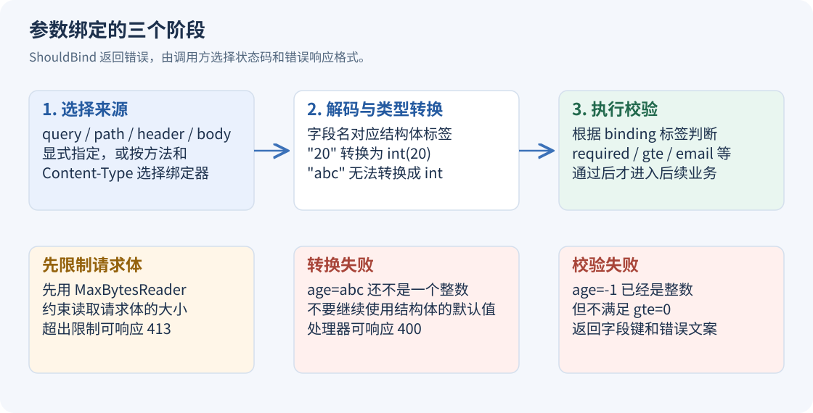

一次 HTTP 请求可以同时携带路径变量、查询字符串、请求头和请求体。手动取值前先分清数据源头，结构体绑定时再配对正确的 tag 和绑定器，才能避免前端发的是 JSON、后端却去读 `PostForm` 拿到空字符串的尴尬误判。



## 四个请求位置与手动读取入口

在 Gin 处理器里，不同位置的原始字符串各自对应明确的读取方法：

| 请求位置 | 示例 | Gin 入口 | 细节与陷阱 |
| --- | --- | --- | --- |
| 路径参数 | `/users/3` | `c.Param("id")` | 返回原始字符串，需手动 `strconv` 或靠绑定转换 |
| 查询字符串 | `?page=2&tag=go&tag=web` | `Query` / `GetQuery` / `DefaultQuery` / `QueryArray` | POST 请求同样可以带 query；`page=` 会覆盖默认值 |
| 请求头 | `X-Request-ID: req-1` | `c.GetHeader("X-Request-ID")` | 键名大小写不敏感 |
| 请求体 | Form / Multipart / JSON / 二进制 | `PostForm`、`ShouldBind*`、`c.Request.Body` | 流式读取，默认消费一次即到 EOF |

`c.Query("name")` 在“没传参数”和“传了 `?name=` 空值”两种情况下都返回 `""`。需要区分这两者时改用 `val, exists := c.GetQuery("name")`。同理，`DefaultQuery("page", "1")` 只在键完全缺失时生效，一旦请求写了 `?page=`，拿到的依然是空字符串。

请求体格式主要有三种：

- `application/x-www-form-urlencoded`：键值对编码成 `name=Lin&age=20` 放在请求体。
- `multipart/form-data`：用客户端生成的 `boundary` 分隔多个 part，可混传文本字段与二进制文件（手写请求头时一旦漏掉 `boundary`，服务端就无法拆包）。
- `application/json`：结构化 JSON 文档，**绝不会进 `PostForm`**。

**重要字段（如分页、租户 ID、权限标识）必须固定单一读取来源，不要既从 query 读又从表单正文读，防止同名参数在转发链路里互相覆盖。**

## Bind 与 ShouldBind 系列的失败行为差异

手动写一堆 `strconv.Atoi` 和判空十分繁琐，Gin 的参数绑定可以把不同来源的数据直接反序列化进 Go 结构体并顺带触发规则校验：

| 数据源 | 绑定方法 | 结构体标签 |
| --- | --- | --- |
| 查询字符串 | `c.ShouldBindQuery(&dto)` | `form:"page,default=1"` |
| 路径变量 | `c.ShouldBindUri(&dto)` | `uri:"id"` |
| 请求头 | `c.ShouldBindHeader(&dto)` | `header:"X-Request-ID"` |
| JSON 请求体 | `c.ShouldBindJSON(&dto)` | `json:"name"` |
| 按方法与 Content-Type 自动选择 | `c.ShouldBind(&dto)` | 同时声明 `json` / `form` 标签 |

**生产代码优先使用 `ShouldBind*` 系列而非 `Bind*` 系列：`Bind*` 失败会自动调用 `c.AbortWithError(400, err)` 写出状态码，后续处理器再想返回自定义的 `413` 或统一 JSON 错误信封已经覆盖不掉。**

`ShouldBind*` 只负责把错误作为返回值交还给调用方，状态码与 JSON 格式完全由当前处理器自己控制。要注意如果在中间件里调 `ShouldBind*` 拒绝请求，写完响应后还要记得调用 `c.Abort()` + `return`，否则后续路由处理器还会继续执行。

## 请求体流式消费与 ShouldBindBodyWith 多次绑定

原生 HTTP 的 `c.Request.Body` 是一个只能顺序往后读的 `io.ReadCloser`。第一次读完到达 `io.EOF` 后，底层字节流已经耗尽，再调一次 `ShouldBindJSON` 就会直接报 EOF 错误。

如果业务中间件（例如签名验签、审计摘要）需要先读一次请求体，后面的控制器又要绑定成另一种结构体，有两种标准解法：

1. **手动读取并重置 `Body`**：先用 `http.MaxBytesReader` 限制体积，再 `io.ReadAll` 读出字节切片，随后通过 `c.Request.Body = io.NopCloser(bytes.NewReader(data))` 挂回一个新的只读流。
2. **使用 `c.ShouldBindBodyWith(&dto, binding.JSON)`**：Gin 会在首次读取时把原始字节缓存到 `*gin.Context` 内部字典里，后续再对不同结构体调用 `ShouldBindBodyWith` 时直接复用这份内存缓存。

**`ShouldBindBodyWith` 会把整份请求体缓存在内存中，必须提前在全局或路由中间件里挂上 `http.MaxBytesReader` 限制请求体上限，防止恶意大包把服务内存打爆。**

## 综合示例：五种参数来源与请求体复用

下面一个完整的 Gin 示例整合了 query 默认值、URI 绑定、Header 绑定、JSON/表单双协议自动绑定以及 `ShouldBindBodyWith` 二次绑定，同时对请求体做了 8 KiB 上限拦截：

```go
package main

import (
	"errors"
	"log"
	"net/http"

	"github.com/gin-gonic/gin"
	"github.com/gin-gonic/gin/binding"
)

type Profile struct {
	Name string `json:"name" form:"name" binding:"required"`
	Age  *int   `json:"age" form:"age" binding:"required,gte=0,lte=150"`
}

func bindError(c *gin.Context, err error) {
	status := http.StatusBadRequest
	var tooLarge *http.MaxBytesError
	if errors.As(err, &tooLarge) {
		status = http.StatusRequestEntityTooLarge
	}
	c.JSON(status, gin.H{"error": "参数格式、大小或校验不符合要求"})
}

func NewRouter() *gin.Engine {
	r := gin.New()
	r.Use(gin.Recovery())
	if err := r.SetTrustedProxies(nil); err != nil {
		panic(err)
	}

	// 全局限制请求体最大 8 KiB，保护后续绑定与缓存复用
	r.Use(func(c *gin.Context) {
		c.Request.Body = http.MaxBytesReader(c.Writer, c.Request.Body, 8192)
		c.Next()
	})

	r.GET("/search", func(c *gin.Context) {
		var input struct {
			Page int      `form:"page,default=1" binding:"gte=1"`
			Tags []string `form:"tag"`
		}
		if err := c.ShouldBindQuery(&input); err != nil {
			bindError(c, err)
			return
		}
		c.JSON(http.StatusOK, gin.H{"page": input.Page, "tags": input.Tags})
	})

	r.GET("/users/:id", func(c *gin.Context) {
		var input struct {
			ID uint64 `uri:"id" binding:"gte=1"`
		}
		if err := c.ShouldBindUri(&input); err != nil {
			bindError(c, err)
			return
		}
		c.JSON(http.StatusOK, gin.H{"id": input.ID})
	})

	r.GET("/headers", func(c *gin.Context) {
		var input struct {
			RequestID string `header:"X-Request-ID" binding:"required"`
		}
		if err := c.ShouldBindHeader(&input); err != nil {
			bindError(c, err)
			return
		}
		c.JSON(http.StatusOK, gin.H{"request_id": input.RequestID})
	})

	r.POST("/profile", func(c *gin.Context) {
		switch c.ContentType() {
		case gin.MIMEJSON, gin.MIMEPOSTForm, gin.MIMEMultipartPOSTForm:
		default:
			c.JSON(http.StatusUnsupportedMediaType, gin.H{"error": "请提交 JSON 或表单"})
			return
		}
		var input Profile
		err := c.ShouldBind(&input)
		if c.Request.MultipartForm != nil {
			defer c.Request.MultipartForm.RemoveAll()
		}
		if err != nil {
			bindError(c, err)
			return
		}
		c.JSON(http.StatusOK, input)
	})

	r.POST("/twice", func(c *gin.Context) {
		var first struct {
			Name string `json:"name" binding:"required"`
		}
		var second struct {
			Age int `json:"age"`
		}
		if err := c.ShouldBindBodyWith(&first, binding.JSON); err != nil {
			bindError(c, err)
			return
		}
		if err := c.ShouldBindBodyWith(&second, binding.JSON); err != nil {
			bindError(c, err)
			return
		}
		c.JSON(http.StatusOK, gin.H{"name": first.Name, "age": second.Age})
	})

	return r
}

func main() {
	if err := NewRouter().Run("127.0.0.1:8080"); err != nil {
		log.Fatal(err)
	}
}
```

用命令依次验证表单、Multipart 与 JSON 三种提交格式：

```bash
curl "http://127.0.0.1:8080/search?page=3&tag=go&tag=web"
curl "http://127.0.0.1:8080/profile" --data "name=Lin&age=0"
curl "http://127.0.0.1:8080/profile" -F "name=Lin" -F "age=0"
curl "http://127.0.0.1:8080/twice" -H "Content-Type: application/json" -d '{"name":"Lin","age":20}'
```

**注意 `Profile.Age` 特意声明为 `*int` 指针：当业务上允许传入合法的 `0` 或 `false` 时，只有指针才能区分“客户端明确传了 `0`”和“根本没传这个字段”，具体零值校验坑见 [Gin 参数校验：零值陷阱、自定义规则与中文错误映射](/posts/gin-validation-and-i18n-errors)。**

调试阶段还要留意一个浏览器差异：命令行 `curl` 可以强行给 `GET`/`HEAD` 带请求体，而浏览器原生 Fetch API 会直接拒绝这么做；同时工具里 `POST` 成功也不等于浏览器的跨域 `OPTIONS` 预检配置已经通过。
