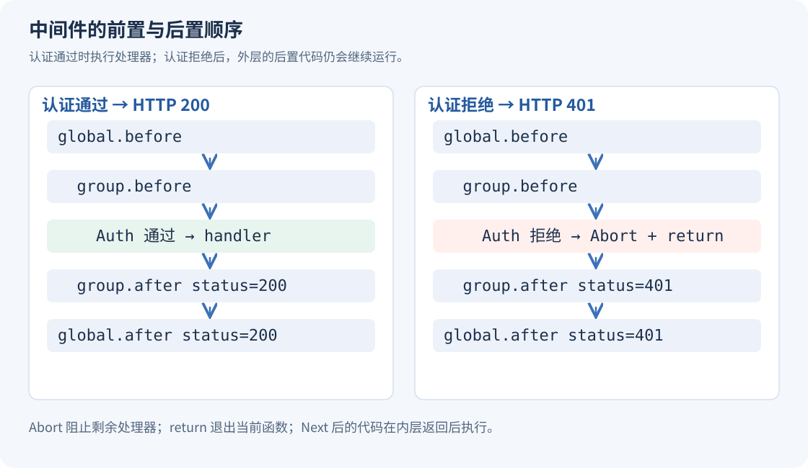

认证鉴权、结构化日志、耗时统计和 panic 兜底通常会横跨一整组接口。Gin 通过路由分组和中间件洋葱模型把这些横切逻辑串进同一条处理器链，而在服务发布重启时，还要配合信号监听与 `http.Server.Shutdown` 确保在途请求处理完毕再退出进程。

## 路由分组、RESTful 语义与幂等边界

工程里常用 `r.Group("/api")` 把公共前缀与专属中间件打包绑定到一组路由上：

| 请求 | 常见资源语义 | 幂等性特征 |
| --- | --- | --- |
| `GET /api/users` | 获取用户列表 | 幂等，只读不改状态 |
| `POST /api/users` | 创建用户 | 非幂等，重复提交会新建多条 |
| `GET /api/users/:id` | 获取单个用户 | 幂等 |
| `PUT /api/users/:id` | 整体替换资源状态 | 幂等，最终状态一致 |
| `PATCH /api/users/:id` | 局部修改字段 | 视修改操作而定（赋值幂等，自增非幂等） |
| `DELETE /api/users/:id` | 删除资源 | 幂等（首次 `204`、再次 `404` 仍属幂等） |

Gin 注册路由的瞬间就会把当时已经挂载的中间件链快照固化到路由节点里。**先写路由再调用 `r.Use(...)` 不会对之前已经注册好的路由生效，公共中间件必须写在路由和分组定义之前。**

## 中间件洋葱模型：c.Next()、c.Abort() 与 return 的区别

Gin 中间件本质上是一个围绕 `c.Next()` 展开的调用栈：`c.Next()` 之前的前置逻辑按挂载顺序正序执行，等内层业务处理器返回后，再按逆序回到各层中间件执行 `c.Next()` 之后的收尾逻辑（例如记录响应状态码和耗时）。



实际编码时，最容易混淆的是 `c.Abort()` 和 Go 的 `return`：

- `c.Next()`：把索引推进到链条里的下一个处理器并执行，返回后继续跑当前函数余下语句。
- `c.Abort()`：把内部索引直接跳到末尾，阻止**尚未执行的后续处理器**被调用，但它不会打断当前 Go 函数的执行，也不会跳过外层已经进入过的中间件后置逻辑。
- `return`：只退出当前这一个中间件函数；如果没先调用 `c.Abort()`，Gin 回到调度循环后照样会继续调用下一层处理器。

**在中间件里拒绝请求的标准动作必须三步连用：写错误响应、调用 `c.Abort()`、再写 `return`（等价写法是 `c.AbortWithStatusJSON(...)` 紧跟 `return`）。**

```go
if !authorized {
	c.AbortWithStatusJSON(http.StatusUnauthorized, gin.H{"error": "凭证无效"})
	return
}
```

## 完整示例：认证链路、可观测日志与优雅停机

如果直接调用 `r.Run()` 启动服务，收到 `SIGINT` 或 `SIGTERM` 进程会被粗暴中止，正在写的数据库事务或半截 HTTP 响应会直接断开。生产环境应把 `gin.Engine` 交给显式配置了超时的 `http.Server`，再结合 `signal.NotifyContext` 与 `srv.Shutdown` 实现优雅停机。

下面完整示例演示了全局 Trace 中间件、分组 Bearer Token 鉴权中间件、`c.Set/c.Get` 上下文传值以及 5 秒宽限期的优雅退出流程：

```go
package main

import (
	"context"
	"crypto/subtle"
	"errors"
	"fmt"
	"io"
	"log"
	"net/http"
	"os"
	"os/signal"
	"strings"
	"syscall"
	"time"

	"github.com/gin-gonic/gin"
)

func Trace(name string, output io.Writer) gin.HandlerFunc {
	logger := log.New(output, "", 0)
	return func(c *gin.Context) {
		logger.Printf("%s.before", name)
		c.Next()
		logger.Printf("%s.after status=%d", name, c.Writer.Status())
	}
}

func Auth(token string) gin.HandlerFunc {
	return func(c *gin.Context) {
		want := "Bearer " + token
		// 使用恒定时间比较防时序侧信道探测
		if subtle.ConstantTimeCompare([]byte(c.GetHeader("Authorization")), []byte(want)) != 1 {
			c.Header("WWW-Authenticate", `Bearer realm="gin-basics"`)
			c.AbortWithStatusJSON(http.StatusUnauthorized, gin.H{"error": "凭证缺失或无效"})
			return
		}
		c.Set("user_id", "demo-user")
		c.Next()
	}
}

func NewRouter(token string, output io.Writer) (*gin.Engine, error) {
	if strings.TrimSpace(token) == "" {
		return nil, fmt.Errorf("DEMO_API_TOKEN must not be empty")
	}
	r := gin.New()
	r.Use(gin.Recovery(), Trace("global", output))
	if err := r.SetTrustedProxies(nil); err != nil {
		return nil, err
	}

	r.HandleMethodNotAllowed = true
	r.NoMethod(func(c *gin.Context) {
		c.JSON(http.StatusMethodNotAllowed, gin.H{"error": "请求方法不支持"})
	})
	r.GET("/healthz", func(c *gin.Context) {
		c.JSON(http.StatusOK, gin.H{"status": "ok"})
	})

	api := r.Group("/api", Trace("group", output), Auth(token))
	api.GET("/me", func(c *gin.Context) {
		userID, exists := c.Get("user_id")
		if !exists {
			c.AbortWithStatusJSON(http.StatusInternalServerError, gin.H{"error": "身份上下文缺失"})
			return
		}
		log.New(output, "", 0).Print("handler")
		c.JSON(http.StatusOK, gin.H{"user_id": userID, "client_ip": c.ClientIP()})
	})
	return r, nil
}

func main() {
	router, err := NewRouter(os.Getenv("DEMO_API_TOKEN"), os.Stdout)
	if err != nil {
		log.Fatal(err)
	}

	server := &http.Server{
		Addr:              "127.0.0.1:8080",
		Handler:           router,
		ReadHeaderTimeout: 5 * time.Second,
		ReadTimeout:       15 * time.Second,
		WriteTimeout:      15 * time.Second,
		IdleTimeout:       60 * time.Second,
	}

	stop, cancel := signal.NotifyContext(context.Background(), os.Interrupt, syscall.SIGTERM)
	defer cancel()

	serveErr := make(chan error, 1)
	go func() {
		serveErr <- server.ListenAndServe()
	}()

	select {
	case err := <-serveErr:
		if !errors.Is(err, http.ErrServerClosed) {
			log.Fatal(err)
		}
		return
	case <-stop.Done():
	}

	ctx, finish := context.WithTimeout(context.Background(), 5*time.Second)
	defer finish()
	if err := server.Shutdown(ctx); err != nil {
		log.Printf("graceful shutdown: %v", err)
		_ = server.Close()
	}
	if err := <-serveErr; !errors.Is(err, http.ErrServerClosed) {
		log.Printf("server exit: %v", err)
	}
}
```

设置环境变量并启动服务验证日志执行顺序：

```bash
export DEMO_API_TOKEN="local-demo-token"
go run .
```

带有效凭证请求 `/api/me` 时，日志输出完整展示洋葱模型的进出顺序：

```text
global.before
group.before
handler
group.after status=200
global.after status=200
```

而当 Token 错误被 `Auth` 中间件 `AbortWithStatusJSON` 拦截时，`handler` 不会执行，但已经进入过的 `group.after status=401` 和 `global.after status=401` 依然会按逆序跑完，保证审计日志和耗时监控不会漏掉被拒绝的请求。

## gin.Context 复用与线上超时边界

1. **绝不能把 `*gin.Context` 存进全局变量或直接丢给后台 goroutine 长期持有**：Gin 为了减少内存分配会对 `*gin.Context` 对象池化复用，当前请求一旦结束，里面的切片和 Writer 就会被重置给下一个请求。要开启异步协程时，只传递需要的业务值或使用 `c.Copy()` 获取只读快照；要向下游数据库和 RPC 传递超时取消信号，始终传 `c.Request.Context()`。
2. **反向代理与 `ClientIP`**：服务跑在 Nginx/ALB 后面时，需要把网关网段填入 `SetTrustedProxies`，否则要么拿到代理内网 IP，要么放任外网伪造转发头。
3. **优雅停机与长连接**：`server.Shutdown` 会停止监听新连接并等待活跃请求完成（监听协程返回 `http.ErrServerClosed` 属于正常现象），但像 WebSocket 这类被 `Hijack` 接管的长连接不在 `Shutdown` 管理范围内，需要通过应用自己的关闭信号通道主动通知断开。
