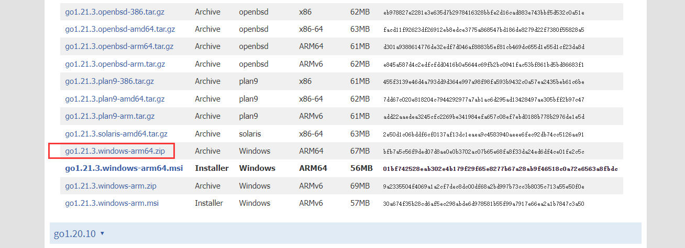
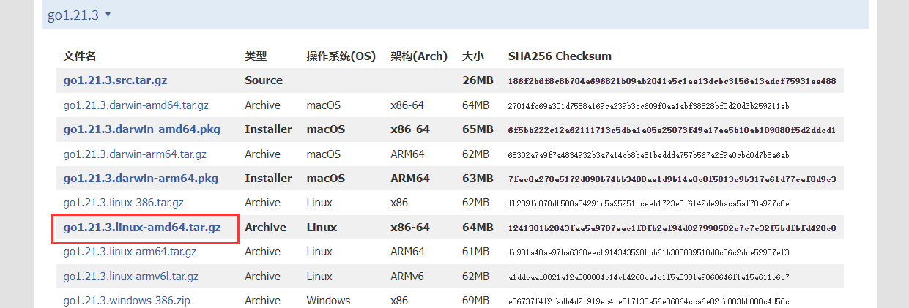

Go 的工程工具链开箱即用，编译器、格式化工具、依赖管理和测试框架都在同一个 `go` 命令里。把环境变量、模块初始化、零值规则和基础控制流一次理顺，后面写业务和并发代码就不会被编译报错反复卡住。

## 工具链安装与 Go Modules 起步

Go 编译产物的运行不依赖外部虚拟机，装好官方二进制包并把可执行目录放进系统路径就能开始开发。

Windows 环境可从 [Go 官方下载页](https://go.dev/dl/) 或中文镜像站获取安装包，按芯片架构选择 `windows-amd64` 或 `windows-arm64` 压缩包或安装程序。解压后需要把安装目录下的 `bin` 和存放第三方命令的 `GOPATH/bin` 都加入系统环境变量 `PATH`，这样在任意终端都能直接调用 `go` 以及通过 `go install` 安装的工具。




Linux 服务器或 WSL 环境直接解压官方压缩包到 `/opt` 并配置环境变量即可：



```bash
cd /opt
wget https://go.dev/dl/go1.26.4.linux-amd64.tar.gz
tar -C /opt -xzf go1.26.4.linux-amd64.tar.gz

# 写入 ~/.bashrc 或 /etc/profile
export GOROOT=/opt/go
export GOPATH=$HOME/go
export PATH=$PATH:$GOROOT/bin:$GOPATH/bin
```

国内网络环境下，建议配置模块代理避免 `go get` 超时，并初始化一个带 `go.mod` 的工程目录：

```bash
go env -w GOPROXY=https://goproxy.cn,direct
mkdir hello-go && cd hello-go
go mod init example.com/hello-go
go run .
```

**现代 Go 开发统一使用 Go Modules 管理依赖，源码放在磁盘任意目录都可以，不再要求把项目放进 `$GOPATH/src`。**

编辑器优先选择 GoLand 或 VS Code（安装官方 Go 扩展）。两者都会后台调用 `gopls` 提供补全和静态检查，保存文件时自动跑 `gofmt` 统一格式。

## 变量声明、常量与输入输出

Go 是静态强类型语言，变量声明后即使不显式赋值，也会被初始化为对应类型的零值，不会出现未初始化内存的随机垃圾值。

常见的声明方式分为四种：

```go
package main

import "fmt"

// 包级变量可以声明后暂不使用，也可以用分组写法集中声明
var globalApp = "muyu"

var (
	defaultPort = 8080
	enableDebug bool // 零值为 false
)

const MaxRetry = 3 // 常量必须在编译期确定值，后续不可修改

func main() {
	var explicit string = "alpha" // 显式指定类型
	var inferred = 42             // 编译器根据字面量推断为 int
	short := "beta"               // 简短声明（:=），只能在函数内部使用

	var zeroInt int       // 0
	var zeroStr string    // ""
	fmt.Println(explicit, inferred, short, zeroInt, zeroStr)
}
```

**函数体内的局部变量声明后必须被读取或使用，否则编译器直接拒绝编译；包级变量没有这个限制。**

跨包可见性完全由标识符首字母大小写决定：首字母大写（如 `MaxRetry`、`fmt.Println`）对外部包公开导出，首字母小写仅在当前包内可见。这种约定省去了 `public` / `private` 修饰符，从命名就能一眼看出 API 边界。

格式化输出与标准输入主要依赖 `fmt` 包：

```go
package main

import "fmt"

func main() {
	name := "woodfish"
	score := 98.5

	// Printf 格式化打印，%#v 会按 Go 语法字面量输出（排查空字符串 "" 时很直观）
	fmt.Printf("user=%s score=%.1f type=%T raw=%#v\n", name, score, score, "")

	// Sprintf 返回格式化后的字符串，不直接写标准输出
	summary := fmt.Sprintf("%s: %.1f", name, score)
	fmt.Println(summary)

	var input string
	fmt.Print("请输入昵称: ")
	if _, err := fmt.Scan(&input); err == nil {
		fmt.Println("收到输入:", input)
	}
}
```

`fmt.Scan` 必须传入变量地址 `&input`，因为 Go 函数参数默认按值传递，只有传指针才能把读取到的结果写回原变量。

## 基本数据类型与零值边界

Go 的基础类型在字长、编码和类型转换上非常严格，不同宽度或符号的数值之间不会自动隐式转换。

| 分类 | 常见类型 | 默认推断类型 | 零值 | 关键约束 |
| --- | --- | --- | --- | --- |
| 有符号整数 | `int8`、`int16`、`int32`、`int64`、`int` | `int` | `0` | `int` 随 32/64 位平台变化 |
| 无符号整数 | `uint8`、`uint16`、`uint32`、`uint64`、`uint` | — | `0` | `byte` 是 `uint8` 的别名 |
| 浮点数 | `float32`、`float64` | `float64` | `0` | `float64` 精度更高，工程默认优先使用 |
| 字符码点 | `byte`、`rune` | `rune`（单引号字面量） | `0` | `rune` 是 `int32` 别名，表示一个 Unicode 码点 |
| 字符串 | `string` | `string` | `""` | 不可变 UTF-8 字节序列 |
| 布尔值 | `bool` | `bool` | `false` | 严禁与整数互转，也不参与算术运算 |

字符和字符串在 Go 里有明确的区分。单引号 `'中'` 表示一个整数型的 Unicode 码点（`rune`），双引号 `"中"` 表示只读的字符串字节序列，反引号 `` `...` `` 则用于原样保留换行和反斜杠的原始字符串（常用于正则或 SQL 模板）：

```go
package main

import "fmt"

func main() {
	var b byte = 'a'
	var r rune = '中'
	fmt.Printf("byte=%d (%c), rune=%U (%c)\n", b, b, r, r)

	s := "Go语言"
	// len(s) 返回底层 UTF-8 字节数（2 + 3*2 = 8），而非字符数 4
	fmt.Println("byte len:", len(s), "rune len:", len([]rune(s)))

	raw := `C:\work\go\main.go` // 反斜杠不会触发转义
	fmt.Println(raw)
}
```

**`len(string)` 统计的是 UTF-8 编码后的字节数，一个中文字符通常占 3 个字节；需要按字符计数或截断文本时，必须先转为 `[]rune` 或用 `utf8.RuneCountInString`。**

布尔类型在 Go 里保持极简设计：`if 1` 或 `bool(1)` 都会直接报错，条件判断只能接收真正的布尔表达式。

## 条件判断：if 卫语句与 switch

`if` 条件不需要圆括号，但必须保留花括号，且支持在条件前写一条短初始化语句来收窄临时变量的作用域：

```go
package main

import (
	"fmt"
	"strconv"
)

func classifyAge(raw string) string {
	age, err := strconv.Atoi(raw)
	if err != nil {
		return "格式非法"
	}
	if age <= 0 {
		return "未出生"
	}
	if age < 18 {
		return "未成年"
	}
	if age < 35 {
		return "青年"
	}
	return "中年及以上"
}

func main() {
	fmt.Println(classifyAge("24"))
}
```

多分支区间判断优先采用卫语句提前 `return`，能把深层 `if-else` 嵌套拉平。

如果分支逻辑主要是值匹配或条件枚举，`switch` 写起来更清晰。**Go 的 `switch` 每个 `case` 执行完默认自动退出，不会像 C 或 Java 那样继续向下穿透；确实需要穿透时才显式写 `fallthrough`。**

```go
package main

import "fmt"

func checkDay(day int) {
	switch day {
	case 1, 2, 3, 4, 5:
		fmt.Println("工作日")
	case 6, 7:
		fmt.Println("周末")
	default:
		fmt.Println("无效星期")
	}

	// 无表达式 switch 可替代长串 if-else if
	score := 86
	switch {
	case score >= 90:
		fmt.Println("A")
	case score >= 80:
		fmt.Println("B")
	default:
		fmt.Println("C")
	}
}

func main() {
	checkDay(6)
}
```

## 循环控制：for 的四种写法与 range 遍历

Go 只有一个循环关键字 `for`，没有单独的 `while` 或 `do-while`，所有循环形态都通过 `for` 子句的省略组合来表达：

```go
package main

import "fmt"

func main() {
	// 1. 经典三段式
	sum := 0
	for i := 1; i <= 100; i++ {
		sum += i
	}
	fmt.Println("1..100:", sum)

	// 2. 条件循环（等价于 while）
	n := 1
	for n < 8 {
		n *= 2
	}
	fmt.Println("pow2:", n)

	// 3. 无限循环配合 break（等价于 do-while 或事件轮询）
	attempts := 0
	for {
		attempts++
		if attempts >= 3 {
			break
		}
	}

	// 4. for-range 遍历切片与 map
	items := []string{"go", "gin"}
	for idx, val := range items {
		fmt.Println(idx, val)
	}

	// Go 1.22 起支持直接 range 整数：for i := range 3
	for i := range 3 {
		if i == 1 {
			continue
		}
		fmt.Println("step:", i)
	}
}
```

**从 Go 1.22 开始，每次 `for` 循环迭代都会为循环变量创建独立实例，闭包里直接引用循环变量不再串用最后一轮的值；需要精确控制索引跳跃或提前终止时，用 `break` 和 `continue` 配合标签即可。**

```go
outer:
	for i := 1; i <= 9; i++ {
		for j := 1; j <= 9; j++ {
			if j > i {
				fmt.Println()
				continue outer
			}
			fmt.Printf("%d*%d=%d\t", j, i, i*j)
		}
	}
```

掌握了工具链、零值语义和基础控制流后，下一步就可以直接进入 Go 最常用的复合容器：理解切片为什么能动态增长又容易在共享底层数组时踩坑，以及为什么声明了 `nil` map 直接写入会触发 `panic`，详见 [Go 复合数据结构：数组、切片扩容陷阱与 Map](/posts/go-collections-arrays-slices-maps)。
