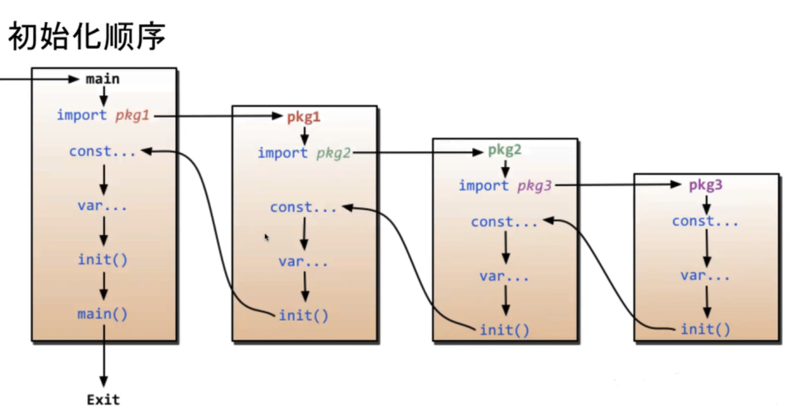

Go 的函数不仅支持多返回值和一等公民传递，还围绕生命周期提供了包级的 `init()` 和函数级的 `defer`。写业务时最容易出错的地方集中在两点：一是值传递和指针传递边界没搞清导致修改失效，二是没看懂 `defer` 的参数求值时机和与命名返回值的交互顺序。

## 函数签名、多返回值与闭包捕获

Go 函数可以同时返回多个结果，工程上最常见的模式是 `(结果, error)`。命名返回值允许在函数签名里先给结果起好名字（等同于函数开头声明了对应零值变量），不过在超过十几行的函数里裸写 `return` 会降低可读性，短函数或配合 `defer` 改写返回值时才适合用命名返回值。

函数本身在 Go 里是一等值，既可以作为参数和返回值传递，也可以存进映射表做策略分发：

```go
package main

import (
	"errors"
	"fmt"
)

func divide(a, b int) (int, error) {
	if b == 0 {
		return 0, errors.New("divisor cannot be zero")
	}
	return a / b, nil
}

// 可变参数本质上在函数内部变成 []int 切片
func sumAll(nums ...int) int {
	total := 0
	for _, n := range nums {
		total += n
	}
	return total
}

// 闭包捕获外层局部变量 count 的引用
func makeCounter(start int) func() int {
	count := start
	return func() int {
		count++
		return count
	}
}

func main() {
	if q, err := divide(10, 2); err == nil {
		fmt.Println("10/2 =", q)
	}
	nums := []int{1, 2, 3}
	fmt.Println("sum =", sumAll(nums...)) // 切片展开传入可变参数

	next := makeCounter(10)
	fmt.Println(next(), next()) // 11 12
}
```

**闭包捕获的是外层变量的引用，即使外层函数已经返回，只要闭包还存活，被捕获的变量就会逃逸到堆上继续保持状态。**

## 参数传递只有值传递，修改外部状态靠指针

严格来说，Go 里所有函数参数传递都是**按值传递（Pass by Value）**。调用函数时，实参会被复制一份放进被调函数的栈帧里：

- 传入 `int`、结构体或数组时，复制的是整个数据，函数内的改动对调用方不可见。
- 传入 `&x`（`*T` 指针）时，复制的同样是地址值本身；因为新旧两个指针指向同一块内存，通过 `*p = ...` 解引用就能改写调用方的原变量。

```go
package main

import "fmt"

func resetByValue(x int) {
	x = 0
}

func resetByPointer(x *int) {
	if x == nil {
		return
	}
	*x = 0
}

func main() {
	n := 42
	resetByValue(n)
	fmt.Println("after resetByValue:", n) // 42

	resetByPointer(&n)
	fmt.Println("after resetByPointer:", n) // 0
}
```

**解引用任意指针前先确认不为 `nil`，否则会立刻触发空指针 `panic`；切片、map 和 channel 在形参里能直接修改内部元素，也是因为复制的描述符里带着指向同一份底层数据的指针。**

## 包初始化与 init 函数的执行顺序

`init()` 是 Go 保留的包初始化函数，不能接收参数、没有返回值，也不能被业务代码显式调用。单个 `.go` 文件里允许出现多个 `init()`，按源码从上到下的顺序执行；同一包下的多个文件则按编译传入的文件名字典序依次初始化。

整个程序的启动初始化严格遵循下面这条依赖链：



```go
package main

import "fmt"

var config = loadConfig()

func loadConfig() string {
	fmt.Println("1. package-level var init")
	return "prod"
}

func init() {
	fmt.Println("2. first init, config =", config)
}

func init() {
	fmt.Println("3. second init")
}

func main() {
	fmt.Println("4. main starts")
}
```

**包级变量初始化始终先于本包的 `init()`，而所有被导入包的初始化又先于当前包；一旦两个包互相 `import` 形成环路，编译器会直接报 import cycle 错误。**

工程实践中只在确实需要向全局注册表登记驱动（如数据库驱动 `import _ "github.com/go-sql-driver/mysql"`）或校验静态配置时才写 `init()`，普通初始化逻辑优先写成显式函数由 `main` 调用，方便单元测试控制生命周期。

## defer 的压栈顺序、求值时机与返回值交互

`defer` 用于把一条清理调用登记到当前函数返回前的延迟栈上，即使函数中间提前 `return` 或发生 `panic`，已登记的 `defer` 依然会被执行。多个 `defer` 按**后进先出（LIFO）**顺序执行：

```go
package main

import "fmt"

func trace() {
	defer fmt.Println("defer-1")
	defer fmt.Println("defer-2")
	fmt.Println("body")
}

func main() {
	trace()
	// 输出顺序: body -> defer-2 -> defer-1
}
```

写 `defer` 最容易踩的两个坑，都和“什么时候求值”有关：

1. **参数在 `defer` 声明那一刻就完成求值并拷贝保存**，之后原变量再怎么变也不会影响已经入栈的参数值。
2. **闭包的变量捕获在 `defer` 真正执行时才读取**，配合命名返回值还能改写最终返回给调用方的结果。

```go
package main

import "fmt"

func argEvalVsClosure() {
	x := 1
	// 注册瞬间 x 的值 1 就已经拷贝锁定
	defer fmt.Println("direct arg:", x)
	// 闭包捕获变量引用，return 前执行时读到的是最新值 2
	defer func() {
		fmt.Println("closure var:", x)
	}()
	x = 2
}

// 命名返回值执行顺序：先给 result 赋值 -> 执行 defer -> 正式返回
func wrapWithNamedReturn() (result int) {
	defer func() {
		result += 10
	}()
	return 5 // 实际返回 15
}

func main() {
	argEvalVsClosure()
	fmt.Println("named return:", wrapWithNamedReturn())
}
```

**记住 `return expr` 在 Go 里分成两步：先把 `expr` 写入返回值槽位，再逐个执行 `defer`，最后函数才真正跳回调用方；因此带命名返回值的 `defer` 闭包能修改最终返回值，例如在统一收口错误或 `recover` 时改写返回的 `err`。**

另外要注意别在循环体里随手写 `defer file.Close()`，因为 `defer` 绑定在函数作用域上，要等到整个外层函数结束才会集中释放，循环次数多时会瞬间耗尽文件描述符。正确做法是把单次文件处理拆进独立子函数，让每次迭代结束立即触发 `defer` 释放资源。
