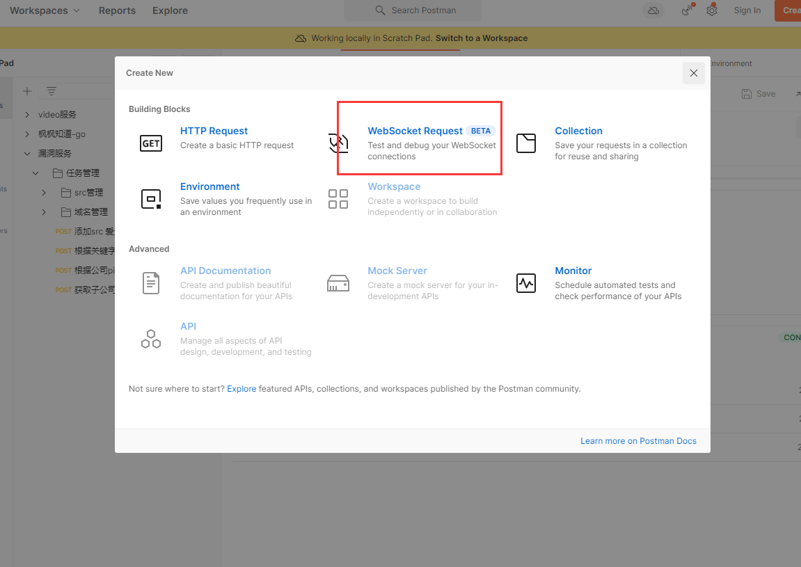
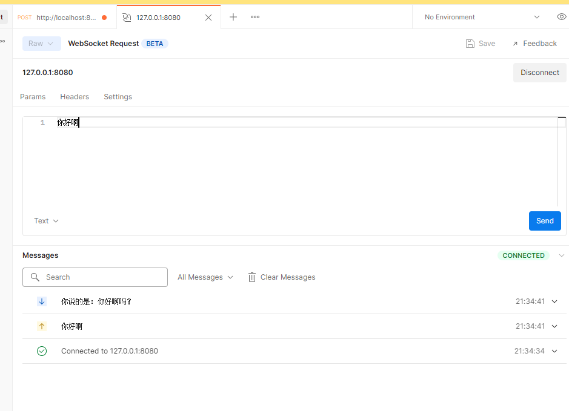

写完语法和并发逻辑后，一个能上线的 Go 服务还需要把文件读写、自动化测试、网络协议通信和跨平台构建打包串起来。这几块内容标准库基本全部覆盖，工程上只需把资源关闭、测试组织、并发安全连接和构建参数这几个关键细节守住。

## 文件 I/O、缓冲扫描与目录权限

读写小文件直接用标准库 `os.ReadFile` 和 `os.WriteFile` 最省事，内部会自动打开并关闭文件描述符。遇到几十 MB 以上的大文件或日志文件，则需要流式读取避免内存暴涨：

```go
package main

import (
	"bufio"
	"fmt"
	"io"
	"os"
)

func copyAndScan(srcPath, dstPath string) error {
	src, err := os.Open(srcPath)
	if err != nil {
		return err
	}
	defer src.Close()

	dst, err := os.OpenFile(dstPath, os.O_CREATE|os.O_WRONLY|os.O_TRUNC, 0o644)
	if err != nil {
		return err
	}
	defer dst.Close()

	if _, err := io.Copy(dst, src); err != nil {
		return err
	}
	return nil
}

func readLines(path string) error {
	f, err := os.Open(path)
	if err != nil {
		return err
	}
	defer f.Close()

	scanner := bufio.NewScanner(f)
	for scanner.Scan() {
		fmt.Println(scanner.Text())
	}
	return scanner.Err() // 必须检查 Err()，否则 I/O 报错或单行超长会静默截断
}
```

**用 `bufio.NewScanner` 按行读取时，循环结束一定要检查 `scanner.Err()`；若单行可能超过默认的 64 KiB 缓冲上限，提前调用 `scanner.Buffer` 扩充容量或改用 `bufio.NewReader`。**

Linux 下创建文件涉及八进制权限位（`4` 读、`2` 写、`1` 执行，依次对应 Owner/Group/Other），配置文件和普通数据文件常用 `0o644`，可执行脚本或目录常用 `0o755`。遍历目录直接用 `os.ReadDir`，比老的 `filepath.Walk` 少分配 `FileInfo` 开销。

## 单元测试：表驱动、Subtest、TestMain 与基准测试

Go 测试文件固定以 `_test.go` 结尾，和被测源码放在同一包下，测试函数以 `Test` 开头并接收 `*testing.T`。多组边界用例推荐写成表驱动测试（Table-Driven Tests），配合 `t.Run` 拆成独立子测试：

```go
// calc.go
package calc

func Add(a, b int) int { return a + b }
```

```go
// calc_test.go
package calc

import (
	"os"
	"testing"
)

func TestMain(m *testing.M) {
	// 整个测试包的前置初始化与后置清理
	code := m.Run()
	os.Exit(code)
}

func TestAdd(t *testing.T) {
	cases := []struct {
		name string
		a, b int
		want int
	}{
		{"positive", 2, 3, 5},
		{"negative", -10, -20, -30},
		{"zero", 0, 7, 7},
	}

	for _, tc := range cases {
		t.Run(tc.name, func(t *testing.T) {
			if got := Add(tc.a, tc.b); got != tc.want {
				t.Fatalf("Add(%d, %d) = %d, want %d", tc.a, tc.b, got, tc.want)
			}
		})
	}
}

func BenchmarkAdd(b *testing.B) {
	for b.Loop() {
		_ = Add(123, 456)
	}
}
```

表驱动测试里，`t.Error`/`t.Errorf` 标记当前用例失败但继续跑后面的断言，适合一次暴露多个字段问题；`t.Fatal`/`t.Fatalf` 则立即终止当前子测试（不会影响同级其他 `t.Run`）。常用测试命令：

```bash
go test -v -run TestAdd ./...      # 只跑指定测试并打印子测试详情
go test -race ./...                # 开启竞态检测
go test -bench=. -benchmem ./...   # 运行性能基准测试并输出每次分配字节数
```

**测试里优先用表驱动结构 + `t.Run` 管理多组输入，既能单独跑某一条失败子用例（`-run TestAdd/negative`），也方便后续补边界条件。**

## 网络编程：TCP、HTTP、RPC 与 WebSocket

标准库 `net`、`net/http` 和 `net/rpc` 覆盖了从传输层到应用层的大多数场景，长连接 WebSocket 则常配合 `github.com/gorilla/websocket` 使用。

### TCP 服务端与客户端

TCP 面向字节流，服务端循环 `Accept` 连接后应为每条连接启动独立 goroutine 处理读写，避免阻塞后续客户端接入：

```go
// tcp_echo.go
package main

import (
	"fmt"
	"io"
	"log"
	"net"
)

func handleConn(conn net.Conn) {
	defer conn.Close()
	buf := make([]byte, 1024)
	for {
		n, err := conn.Read(buf)
		if err == io.EOF {
			return
		}
		if err != nil {
			log.Println("read err:", err)
			return
		}
		fmt.Printf("recv from %s: %s\n", conn.RemoteAddr(), buf[:n])
	}
}

func startTCPServer() {
	ln, err := net.Listen("tcp", "127.0.0.1:8080")
	if err != nil {
		log.Fatal(err)
	}
	defer ln.Close()
	for {
		conn, err := ln.Accept()
		if err != nil {
			log.Println("accept err:", err)
			continue
		}
		go handleConn(conn)
	}
}
```

客户端使用 `net.DialTimeout("tcp", "127.0.0.1:8080", 3*time.Second)` 即可建立连接并发送字节流。

### HTTP 服务端与客户端

标准库 `net/http` 自带并发路由，写客户端时要记得给 `http.Client` 配 `Timeout` 并用 `defer res.Body.Close()` 归还底层 TCP 连接：

```go
package main

import (
	"fmt"
	"io"
	"net/http"
	"time"
)

func serveHTTP() {
	mux := http.NewServeMux()
	mux.HandleFunc("GET /ping", func(w http.ResponseWriter, r *http.Request) {
		_, _ = w.Write([]byte("pong"))
	})
	_ = http.ListenAndServe("127.0.0.1:8080", mux)
}

func callHTTP() error {
	client := &http.Client{Timeout: 5 * time.Second}
	res, err := client.Get("http://127.0.0.1:8080/ping")
	if err != nil {
		return err
	}
	defer res.Body.Close()
	body, err := io.ReadAll(res.Body)
	if err != nil {
		return err
	}
	fmt.Println(string(body))
	return nil
}
```

### net/rpc 远程调用

Go 标准库内建了基于 `gob` 编码的 `net/rpc`（适合纯 Go 内部服务通信；跨语言场景通常选用 gRPC 或 HTTP/JSON）。注册的方法必须满足固定签名 `func (t *T) Method(req ReqType, res *ResType) error`：

```go
type MathService struct{}
type Args struct{ A, B int }

func (MathService) Add(req Args, res *int) error {
	*res = req.A + req.B
	return nil
}
```

服务端调用 `rpc.Register(new(MathService))` 与 `rpc.HandleHTTP()` 暴露接口，客户端用 `rpc.DialHTTP("tcp", "127.0.0.1:8080")` 即可发起同步调用 `client.Call("MathService.Add", Args{1, 2}, &reply)`。

### WebSocket 全双工通信

WebSocket 先走一次 HTTP Upgrade 握手，再切成长连接双向收发帧。多客户端广播场景下，保存连接集合的容器必须加锁保护：

```go
package main

import (
	"fmt"
	"net/http"
	"sync"

	"github.com/gorilla/websocket"
)

var (
	upgrader = websocket.Upgrader{ReadBufferSize: 1024, WriteBufferSize: 1024}
	mu       sync.Mutex
	conns    = make(map[*websocket.Conn]struct{})
)

func wsHandler(w http.ResponseWriter, r *http.Request) {
	conn, err := upgrader.Upgrade(w, r, nil)
	if err != nil {
		return
	}
	defer func() {
		mu.Lock()
		delete(conns, conn)
		mu.Unlock()
		_ = conn.Close()
	}()

	mu.Lock()
	conns[conn] = struct{}{}
	mu.Unlock()

	for {
		msgType, payload, err := conn.ReadMessage()
		if err != nil {
			return
		}
		reply := fmt.Sprintf("echo: %s", payload)
		_ = conn.WriteMessage(msgType, []byte(reply))
	}
}
```

**注意 `defer conn.Close()` 必须紧跟在 `upgrader.Upgrade` 成功之后注册，千万不要写在 `for` 循环后面——一旦读循环因断线提前 `return`，循环后面的 `defer` 根本不会执行。**

本地调试 WebSocket 接口时，可以直接在 Postman 里新建 WebSocket Request 连到 `ws://127.0.0.1:8080` 验证双向消息收发：





## 打包构建、交叉编译与部署注意项

Go 编译器内置交叉编译能力，只需切换 `GOOS`、`GOARCH` 并关闭 CGO，就能在 Windows 或 macOS 本机直接打出 Linux 生产环境可运行的单文件二进制产物：

```bash
# Linux / macOS Bash
CGO_ENABLED=0 GOOS=linux GOARCH=amd64 go build -trimpath -ldflags="-s -w" -o bin/app ./cmd/server
```

```powershell
# Windows PowerShell（设置临时环境变量，再执行 build）
$env:CGO_ENABLED = "0"
$env:GOOS = "linux"
$env:GOARCH = "amd64"
go build -trimpath -ldflags="-s -w" -o bin/app ./cmd/server
```

常用构建参数说明：

- `CGO_ENABLED=0`：禁用 C 语言动态库链接，产出静态二进制，放到 Alpine/Debian 极简容器里也不会报 `libc` 缺失。
- `GOOS` / `GOARCH`：常见目标组合为 `linux/amd64`、`linux/arm64`、`darwin/arm64`、`windows/amd64`。
- `-ldflags="-s -w"`：裁剪符号表和 DWARF 调试信息，显著减小可执行文件体积。

二进制上传到 Linux 服务器后赋予执行权限即可启动（`chmod +x app && ./app`）。**编译产物只打包 Go 源码和 `//go:embed` 显式嵌入的资源，外部 YAML 配置、TLS 证书和静态模板目录在部署时必须随二进制一并发布到目标服务器。**
