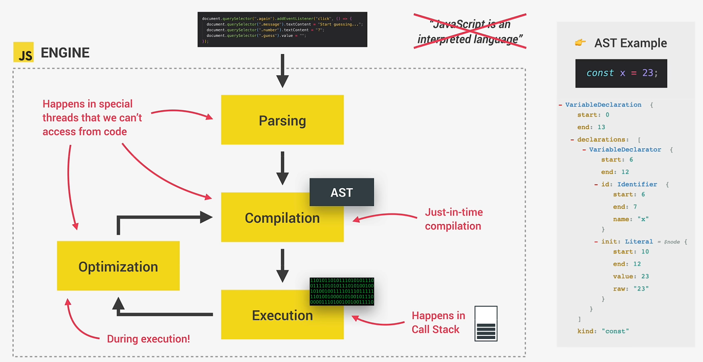

从 C++ 算法竞赛转到 JavaScript 写业务代码或前端刷题时，最不习惯的是标准库里找不到 `std::vector`、`std::priority_queue` 这类现成容器。这篇速查把常用的 C++ STL 容器与算法直接映射到 JS 原生结构，并补齐 JS 缺失的最小堆实现，顺带梳理几个在前端交互里高频踩坑的语法差异。

## C++ STL 与 JavaScript 容器对照

**JavaScript 没有独立的类型化集合体系，绝大多数线性结构直接由 `Array` 承担，哈希与去重交给 `Map` / `Set`，唯独优先队列需要手写堆。**

| C++ STL | JavaScript 对应方案 | 关键差异与性能提示 |
| --- | --- | --- |
| `std::vector<T>` | `Array` | 动态扩容，算法题建议保持元素同类型以利于引擎优化 |
| `std::stack<T>` | `Array`（`push` / `pop`） | 尾部压栈出栈均摊 $O(1)$ |
| `std::queue<T>` | `Array`（`push` / `shift`） | `shift()` 会整体搬移元素，复杂度为 $O(n)$，大数据量改用索引指针或双栈 |
| `std::deque<T>` | `Array`（`unshift`/`shift` + `push`/`pop`） | 头部增删同样是 $O(n)$，仅适合小规模数据 |
| `std::map` / `std::unordered_map` | `Map` | 按插入顺序迭代（类似 LinkedHashMap），增删查平均 $O(1)$ |
| `std::set` / `std::unordered_set` | `Set` | 按插入顺序迭代，自动去重，增删查平均 $O(1)$ |
| `std::pair` / `std::tuple` | `Array` 解构或 `Object` | `[first, second] = pair` 即可拆包 |
| `std::priority_queue` | 无内置，手写 `MinHeap` | JS 标准库缺失堆结构，竞赛和调度逻辑需自己封装 |

### 线性容器与映射、集合写法

```js
// 1. std::vector -> Array
const vector = [];
vector.push(1);
vector.push(2);
vector.pop();

// 2. std::stack -> Array (push / pop)
const stack = [];
stack.push(1);
stack.push(2);
const top = stack.pop(); // 2

// 3. std::queue -> Array (push / shift，注意 shift 为 O(n))
const queue = [];
queue.push(1);
queue.push(2);
const front = queue.shift(); // 1

// 4. std::deque -> Array
const deque = [];
deque.unshift(0); // push_front
deque.push(1);    // push_back
deque.shift();    // pop_front
deque.pop();      // pop_back

// 5. std::unordered_map -> Map (Key 可为任意类型；Object 仅支持 String / Symbol)
const map = new Map();
map.set("key", 1);
map.set("key2", 2);
console.log(map.has("key"), map.get("key"));
for (const [k, v] of map) {
  console.log(`${k} -> ${v}`);
}

// 6. std::unordered_set -> Set
const set = new Set();
set.add(1);
set.add(2);
set.add(1); // 重复元素被忽略
console.log(set.has(1));

// 7. std::pair -> 数组解构
const pair = [1, "a"];
const [first, second] = pair;
```

## 常用 STL 算法对应的 Array 方法

**`Array.prototype.sort()` 默认按字符串的 UTF-16 码点排序，数字排序必须显式传入 `(a, b) => a - b`，否则 `[10, 2]` 会排在前面。**

```js
const arr = [3, 1, 4, 1, 5, 9];

// std::sort（原地排序，默认字典序，数字务必传比较器）
arr.sort((a, b) => a - b); // [1, 1, 3, 4, 5, 9]

// std::find（返回元素）/ findIndex（返回下标）
const found = arr.find((x) => x > 3); // 4

// std::transform（返回新数组）
const doubled = arr.map((x) => x * 2);

// std::for_each
arr.forEach((x) => {
  // 遍历执行副作用，无法通过 break 中断
});

// std::accumulate（归约求和）
const sum = arr.reduce((acc, cur) => acc + cur, 0);
```

## 手写最小堆 `MinHeap`（替代 `std::priority_queue`）

在用 JS 写 Dijkstra、多路归并或任务调度时，可以用数组模拟完全二叉树实现最小堆：父节点下标为 `Math.floor((index - 1) / 2)`，左右孩子分别为 `2 * index + 1` 和 `2 * index + 2`，插入和弹出堆顶的时间复杂度均为 $O(\log n)$。

```js
class MinHeap {
  constructor() {
    this.heap = [];
  }

  push(val) {
    this.heap.push(val);
    this.bubbleUp(this.heap.length - 1);
  }

  pop() {
    if (this.heap.length === 0) return null;
    const min = this.heap[0];
    const last = this.heap.pop();
    if (this.heap.length > 0) {
      this.heap[0] = last;
      this.bubbleDown(0);
    }
    return min;
  }

  peek() {
    return this.heap[0];
  }

  size() {
    return this.heap.length;
  }

  bubbleUp(index) {
    while (index > 0) {
      const parentIndex = Math.floor((index - 1) / 2);
      if (this.heap[parentIndex] <= this.heap[index]) break;
      [this.heap[parentIndex], this.heap[index]] = [
        this.heap[index],
        this.heap[parentIndex],
      ];
      index = parentIndex;
    }
  }

  bubbleDown(index) {
    while (true) {
      const leftChild = 2 * index + 1;
      const rightChild = 2 * index + 2;
      let smallest = index;

      if (
        leftChild < this.heap.length &&
        this.heap[leftChild] < this.heap[smallest]
      ) {
        smallest = leftChild;
      }
      if (
        rightChild < this.heap.length &&
        this.heap[rightChild] < this.heap[smallest]
      ) {
        smallest = rightChild;
      }
      if (smallest === index) break;
      [this.heap[index], this.heap[smallest]] = [
        this.heap[smallest],
        this.heap[index],
      ];
      index = smallest;
    }
  }
}

const pq = new MinHeap();
pq.push(10);
pq.push(5);
pq.push(20);
console.log("Priority Queue Pop:", pq.pop()); // 5
```

## Array 切片、修改与拷贝陷阱

**JavaScript 数组是引用类型，直接赋值只会复制引用；不改原数组用 `slice` / 展开语法 `[...arr]`，原地增删才用 `splice`。**

```js
let alphas = ["a", "b", "c"];
const holes = new Array(3); // 产生稀疏空槽 [empty × 3]，避免用单参数构造

// 读取与尾部增删
console.log(alphas[0]); // "a"
console.log(alphas.at(-1)); // 取倒数第一个元素
alphas[1] = "B";
alphas.push("d");
const last = alphas.pop(); // "d"

// 查找
console.log(alphas.includes("a"));
console.log(alphas.indexOf("c"));

// 非破坏性截取 vs 原地修改
const part = alphas.slice(1, 3); // 半开区间 [1, 3)，不改原数组
const removed = alphas.splice(1, 1, "X"); // 从下标 1 删除 1 个并插入 "X"

// 合并与浅拷贝（仅第一层）
const more = ["f", "g"];
const merged = [...alphas, ...more];
const copy = [...alphas];

// 遍历方式选择：需要 break/continue 用 for 或 for...of
for (const ch of alphas) {
  if (ch === "X") break;
}

// 常见高阶方法（均返回新数组或新值）
const upper = alphas.map((ch) => ch.toUpperCase());
const filtered = alphas.filter((ch) => ch !== "X");
const joined = alphas.reduce((acc, ch) => acc + ch, "");
```

## 函数定义方式与 `this` 绑定

**函数声明会变量提升（hoisting）可在定义前调用；箭头函数没有独立的 `this` 与 `arguments`，不能用作构造函数。**

```js
// 1. 函数声明：存在提升，拥有独立 this / arguments
function calAge1(year) {
  return Number(year) - 2006;
}

// 2. 函数表达式：执行到赋值行后才可调用，也有独立 this / arguments
const calAge2 = function (year) {
  return Number(year) - 2006;
};

// 3. 箭头函数：继承外层词法作用域的 this，不能用 new 调用
const calAge3 = (year) => Number(year) - 2006;
```

## 事件监听与 `classList` 类操作

**切换元素显示状态时优先使用 `classList` 增删类名，避免在 JS 里零散修改内联 `style`；多处事件复用同一个命名处理器，便于后续 `removeEventListener` 解绑。**

```js
function hideBody() {
  document.body.classList.add("hidden");
}
function showBody() {
  document.body.classList.remove("hidden");
}

document.addEventListener("visibilitychange", () => {
  if (document.hidden) hideBody();
  else showBody();
});
document.querySelector("#btn-hide")?.addEventListener("click", hideBody);
document.querySelector("#btn-show")?.addEventListener("click", showBody);

// 类状态增删改查
const panel = document.querySelector(".panel");
panel?.classList.add("active");
panel?.classList.remove("hidden");
panel?.classList.toggle("collapsed");
if (panel?.classList.contains("active")) {
  // 根据激活状态执行后续交互逻辑
}

// 键盘事件优先按语义化 e.key 判断
document.addEventListener("keydown", (e) => {
  if (e.key === "Enter") {
    showBody();
  } else if (e.key === "Escape") {
    hideBody();
  } else if (e.key === "ArrowLeft") {
    panel?.classList.add("move-left");
  }
});
```

## JavaScript 引擎执行模型：JIT 编译而非逐行解释

很多人从 C++ 刚切到 JS 时会把它当成“纯解释型语言”，但现代 JS 引擎（如 V8）实际在后台跑的是**解析（Parsing → AST）→ 即时编译（JIT Compilation）→ 执行（Call Stack）→ 运行时热点优化（Optimization）**的编译执行流水线：



写算法或业务代码时保持数组与对象属性类型稳定（例如避免同一数组混存数字与字符串），能让 JIT 优化线程少触发去优化（Deoptimization），执行速度更接近静态类型语言。
