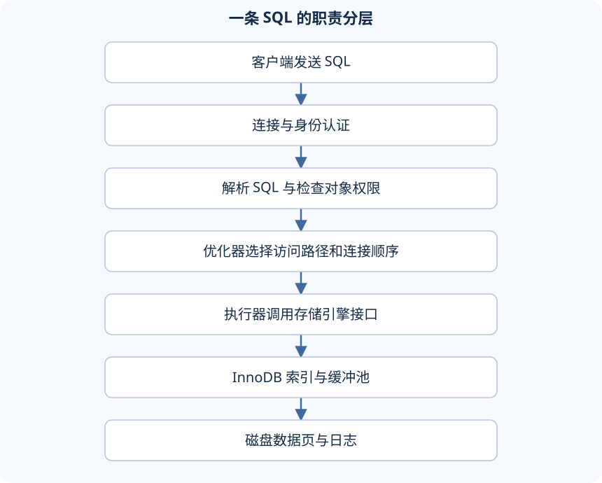

线上查询突然变慢，开发常直接归咎于“数据库卡了”，但 SQL 语法解析错误、执行计划扫表、行锁阻塞和磁盘 I/O 抖动发生在完全不同的组件里。理清 MySQL 的分层职责与 InnoDB 的物理组织方式，才能在排查问题时把症状准确落回对应的层。

## 一条查询经过的四层架构

MySQL 服务端从上到下分为连接层、SQL 服务层、存储引擎层和底层文件系统：



1. **连接层**：负责客户端 TCP 握手、身份认证、权限校验以及连接线程分配或连接池管理。
2. **SQL 服务层**：跨引擎的公共核心，包含词法/语法解析器、查询优化器（决定索引与连接顺序）、执行器以及内置函数。注意 MySQL 8.0 已经彻底移除了早期版本的查询缓存（Query Cache），高并发场景下的热数据命中完全依赖引擎层的缓冲池或外部缓存。
3. **存储引擎层**：插件式架构，负责数据行的物理组织、索引结构实现、事务与锁机制。**存储引擎绑定在具体每一张表上，而不是整个数据库实例**——同一个库里允许不同表各自选用不同引擎。
4. **文件系统层**：磁盘上的数据文件、索引文件与各类持久化日志（Redo、Undo、Binlog 等）。

**查询优化器只会在不改变 SQL 语义的前提下挑选代价最低的执行路径，它不会替业务纠正写错的过滤条件。**

以 `SELECT name FROM emp WHERE id = 1` 为例，出故障时按层次对号入座就能快速缩小范围：报错字段不存在，问题一定卡在解析阶段；SQL 正常返回却扫描了上百万行，根因在优化器选路或索引缺失；执行计划显示 `const` 只扫一行却耗时长达几秒，排查方向就要转到存储引擎的锁等待、Buffer Pool 刷盘或网络传输上。

## 存储引擎对比与选型边界

通过 `SHOW ENGINES;` 可以查看当前实例支持的全部引擎，`SHOW CREATE TABLE emp;` 则能确认某张表实际绑定的引擎类型。业务开发接触到的主要是 InnoDB、MyISAM 与 MEMORY 三种：

| 对比维度 | InnoDB（默认） | MyISAM | MEMORY |
| :--- | :--- | :--- | :--- |
| 事务支持（ACID） | **支持** | 不支持 | 不支持 |
| 锁粒度 | **行级锁** + 间隙/临键锁 + 意向锁 | 表级锁 | 表级锁 |
| 外键约束 | **支持** | 不支持 | 不支持 |
| 崩溃安全恢复 | **支持**（Redo/Undo 日志） | 不支持（易损坏需修复） | 不支持（重启清空表数据） |
| 数据存放位置 | 磁盘 `.ibd` + 内存缓冲池 | 磁盘 `.MYD` + `.MYI` | 纯内存（仅表结构落盘） |
| 常见索引结构 | B+ 树（含自适应哈希） | B+ 树 | HASH（默认）或 B+ 树 |

**除非明确面对纯临时内存计算等特殊场景，业务表一律使用 InnoDB，绝不要因为“读多写少”就退回 MyISAM。**

早年文档常把 MyISAM 包装成“读密集场景优选”，但在现代生产环境里，MyISAM 缺乏崩溃恢复与事务回滚能力，一次意外断电就可能导致表损坏；表级锁在任何并发写入发生时都会阻塞整表查询，根本扛不住线上业务并发。

## InnoDB 物理文件与五级逻辑结构

可以通过以下命令查看数据目录、独立表空间开关与默认页大小：

```sql
SHOW VARIABLES LIKE 'datadir';
SHOW VARIABLES LIKE 'innodb_file_per_table';
SHOW VARIABLES LIKE 'innodb_page_size';
```

开启 `innodb_file_per_table=ON`（MySQL 8.0 默认开启）后，每张普通 InnoDB 表在磁盘上对应一个独立的 `.ibd` 文件，统一存放行数据、B+ 树索引页及序列化字典信息（可用官方工具 `ibd2sdi` 解析元数据，但绝对禁止人工直接编辑或在线热拷贝运行中的 `.ibd` 作为备份）。

在逻辑存储结构上，InnoDB 由粗到细划分为五层：**表空间（Tablespace） → 段（Segment） → 区（Extent） → 页（Page） → 行（Row）**。

```text
Tablespace (.ibd)
  └── Segment (数据段 / 索引段 / 回滚段)
        └── Extent (1 MiB = 连续 64 个默认 16 KiB 页)
              └── Page (16 KiB，磁盘读写与内存缓冲最小单位)
                    └── Row (实际业务记录 + 隐藏事务/回滚列)
```

**InnoDB 磁盘读取与内存缓冲的最小单元是 16 KiB 的页，而不是单条记录。**

当查询 `WHERE id = 1` 只返回一名员工时，引擎会把该记录所在的整页（16 KiB）读入内存缓冲池，同一页里相邻员工的后续查询就能直接命中内存。同时因为页内存在页头、页目录与空洞预留，加上辅助索引页本身也占用 `.ibd` 空间，直接用文件体积除以单行字段字节数无法算出精确行数。

## Linux 生产环境安装与远程排错顺序

在 Linux 服务器部署独立 MySQL 服务时，常见步骤为：核对操作系统与 CPU 架构（`uname -m`） → 清理冲突老旧包（`rpm -qa | grep -Ei 'mysql|mariadb'`） → 安装服务端与客户端依赖 → 初始化数据目录并启动 `mysqld` → 从错误日志（如 `/var/log/mysqld.log`）读取初始临时密码并用 `ALTER USER` 修改 → 为应用分配限定来源 IP 的最小权限账号。

当远程客户端连不上 Linux 实例时，按网络与权限链路逐级核查即可定位：

1. 确认服务存活：`systemctl status mysqld`。
2. 确认监听地址与端口：`ss -lntp | grep 3306`（排查是否误绑在 `127.0.0.1`）。
3. 核查操作系统防火墙与云安全组是否放行对应客户端来源 IP 的 `3306` 端口。
4. 核查 MySQL 账户的 `'user'@'host'` 来源匹配与 `SHOW GRANTS` 授权范围。
