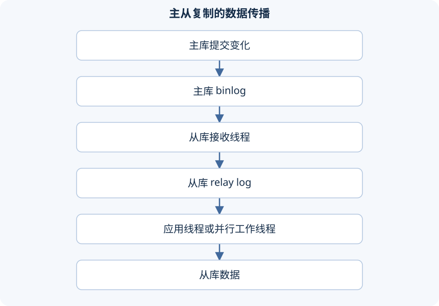
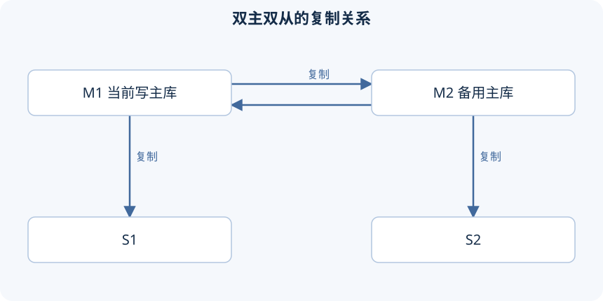

单台 MySQL 实例扛不住高并发读流量，或者遇上宿主机宕机时，业务会直接中断。主从复制把主库的数据变更异步同步到从库，支撑读写分离与容灾备份；双主架构则进一步提供备用写节点。不过，“复制跑通了”远不等于读写完全一致，也不代表主库一挂就能自动实现零丢失切换。

## 主从复制的日志接力链路

MySQL 主从复制本质上是把主库的 Binlog 事件流传送到从库重放。新版本文档将旧称 `master/slave` 统一更名为 `source/replica`，底层依然由三个核心线程协作完成：



1. 主库提交事务时，Server 层将结构与行变更写入 **Binlog**，由主库上的 **Binlog Dump 线程**推送给从库。
2. 从库的 **IO 接收线程（Receiver）** 读取主库事件，顺序写入本地的 **中继日志（Relay Log）**。
3. 从库的 **SQL 应用线程（Applier）** 读取 Relay Log 中的事件，在本地存储引擎重放执行。

**中继日志把“网络接收进度”和“本地重放进度”彻底拆开，主库 `COMMIT` 返回时，事件并未同步落到从库数据页上。**

排查从库数据滞后时，必须把两段链路分开定位：若主从网络中断，IO 线程会停滞，但 SQL 线程仍可继续消化本地已收到的 Relay Log；若网络正常但从库出现主键冲突或表结构不一致，IO 线程仍会持续拉取事件，而 SQL 线程则会直接报错停机。

## 建立一致基线与主从同步配置

搭建主从前必须先锁死两项前置条件：**所有实例的 `server_id` 必须全局唯一**；如果是通过虚拟机或磁盘快照克隆出来的实例，还必须删除并重建 `auto.cnf` 以保证 **`server_uuid` 彼此独立**。

```ini
# 主库 my.cnf 核心片段
[mysqld]
server_id = 1
log_bin = binlog
binlog_format = ROW
read_only = OFF

# 从库 my.cnf 核心片段（开启 super_read_only 防止运维账号误写污染从库）
[mysqld]
server_id = 2
relay_log = relay-bin
read_only = ON
super_read_only = ON
```

注意 `read_only = ON` 挡不住拥有 `SUPER` 权限的管理员误操作，生产从库务必同时打开 `super_read_only = ON`（复制应用线程本身不受此限制）。

**已有存量数据的实例建立复制，绝不能先导出备份、过一会儿再查当前 Binlog 位点，快照与坐标必须由同一条一致性导出命令成对锁定。**

```powershell
# 在导出一致快照的同时，将配套的 Binlog 文件名与 Position 写入脚本注释
mysqldump -h 192.168.200.200 -u backup_user -p `
  --single-transaction --source-data=2 --set-gtid-purged=OFF `
  --routines --events --triggers --databases mysql_notes `
  --result-file=D:/mysql-lab/replication-baseline.sql
```

若基线数据里已经包含某次写入却从更早的位点回放，从库立刻报主键冲突；若基线尚未包含该写入却从更晚的位点续传，数据就会静默永久丢失。

导入基线前需临时关闭从库 `super_read_only`，导入完毕恢复只读开关，随后在主库创建专用复制账号并在从库指向导出注释中记录的坐标启动复制（若实例已全面启用 GTID，可直接配置 `SOURCE_AUTO_POSITION = 1` 自动对齐事务集合）：

```sql
-- 1. 主库创建最小权限复制账户
CREATE USER 'repl'@'192.168.200.201' IDENTIFIED BY 'StrongReplPass_123!';
GRANT REPLICATION SLAVE ON *.* TO 'repl'@'192.168.200.201';

-- 2. 从库配置复制源并启动
CHANGE REPLICATION SOURCE TO
  SOURCE_HOST = '192.168.200.200',
  SOURCE_PORT = 3306,
  SOURCE_USER = 'repl',
  SOURCE_PASSWORD = 'StrongReplPass_123!',
  SOURCE_LOG_FILE = 'binlog.000001',
  SOURCE_LOG_POS = 856;
START REPLICA;
SHOW REPLICA STATUS\G
```

检查状态时，`Replica_IO_Running: Yes` 和 `Replica_SQL_Running: Yes` 只是必要前提，仍需结合 `Last_IO_Error`、`Last_SQL_Error` 以及端到端探针表验证数据确实已同步。严禁把 `sql_slave_skip_counter` 跳过报错当成常规修法，跳错虽然能让线程恢复 `Yes`，但会在主从之间留下无法察觉的数据分歧。

## 读写分离路由与写后读一致性

读写分离由代理中间件（如 ProxySQL、Mycat）或应用层数据源路由承担：写请求打向主库，普通读请求按负载均衡权重分发给健康从库。验证路由是否生效时，绝不能故意篡改从库表数据做区分，而应通过代理监控计数（如只读请求命中统计）搭配专用探针表核对。

**在异步复制下，事务 `t1` 在主库提交并返回成功 `t2` 后，从库在 `t3` 才重放生效——`t2` 与 `t3` 之间的写后读查询一旦路由到从库，必然读到旧状态。**

解决读写分离一致性坑点必须按业务语义分层处理，不要靠 `sleep(1)` 这种毫无保障的固定等待：

1. **事务内操作与锁定读强制走主库**：同一个事务内的读写、`SELECT ... FOR UPDATE` 以及支付、库存扣减后的即时确认页查询，必须全部绑定到主库同一会话，因为从库既无法感知主库行锁，也存在复制延迟。
2. **GTID 位点等待或状态追平**：对一致性要求极高的读场景，可在写操作后记录 GTID，读从库前调用 `WAIT_FOR_EXECUTED_GTID_SET()` 等待追平或超限回退主库。
3. **容忍秒级延迟的查询走从库**：列表浏览、统计报表与异步导出天然适合交给从库承接。

## 双主双从架构、`auto_increment` 防冲突与故障切换

一主一从架构下，主库宕机后虽然从库有数据，但写入入口直接瘫痪。双主双从拓扑引入两台互为主备的主节点（`M1`、`M2`）及各自挂载的只读从库（`S1`、`S2`），在 `M1` 故障时由 `M2` 接管写入：



| 节点 | `server_id` | 复制上游 | 关键职责与开关 |
| :--- | :--- | :--- | :--- |
| `M1` | `1` | `M2` | 初始主写节点，开启 `log_bin` 与 `log_replica_updates=ON` |
| `S1` | `2` | `M1` | 承接读流量，开启 `super_read_only=ON` |
| `M2` | `3` | `M1` | 备用写节点（平时可分担读），开启 **`log_replica_updates=ON`** |
| `S2` | `4` | `M2` | 承接读流量，依赖 `M2` 转发 `M1` 的变更事件 |

搭建双主链路有两项硬配置不能遗漏：

1. **开启级联日志转发（`log_replica_updates = ON`）**：`M1` 的变更要先同步到 `M2`，再由 `M2` 传给 `S2`。若 `M2` 没把复制应用线程重放的事件写进自己的 Binlog，`S2` 就会永远收不到 `M1` 的更新。
2. **错开自增步长与偏移量防止双主主键撞车**：一旦主库切换过渡期或运维误操作导致 `M1` 与 `M2` 短暂同时写入同一张自增表，连续自增必然冲突导致复制中断。工程上通常在双主上错位配置：

```ini
# M1 配置：生成奇数主键 (1, 3, 5, 7...)
auto_increment_increment = 2
auto_increment_offset = 1

# M2 配置：生成偶数主键 (2, 4, 6, 8...)
auto_increment_increment = 2
auto_increment_offset = 2
```

**哪怕配好了双主互相复制与自增步长错位，生产环境依然只允许单主写入（主备模式），切忌双主同时承接同一批业务的高并发写请求。**

自增错位只能避免自增主键撞车，防不住业务唯一索引（如手机号、订单号）的并发冲突，也防不住同一个账号余额在两台主库被同时扣减导致的更新丢失。

发生主库宕机并触发高可用切换（如代理层或 Orchestrator/MHA 检测到 `M1` 心跳失效并把写流量切往 `M2`）时，还有三个高频事故点必须提前设计预案：

1. **孤立旧从库 `S1` 读脏**：`M1` 挂掉后，`S1` 的进程依然存活且能回应代理层的 `SELECT 1` 心跳，但因为它的上游 `M1` 已死，数据永远停在故障瞬间。健康检查不能只测心跳连通性，必须把复制延迟和上游存活状态纳入踢除逻辑。
2. **异步数据窗口丢失**：若故障前 `M1` 上已提交的部分事务尚未同步到 `M2`（普通异步复制固有风险），切换后这批数据暂时不可见；核心金融场景需结合半同步复制（Semi-Sync Replication）或 MGR（MySQL Group Replication）缩小或消除窗口。
3. **旧主恢复防脑裂（Fencing）**：`M1` 重启恢复后，严禁直接放开业务流量写入。必须先保持 `super_read_only = ON`，核对 `M1` 与 `M2` 的 GTID/Binlog 差异并解决可能存在的未同步事务冲突，确认追平新主后再重新挂入只读或备用节点池。
