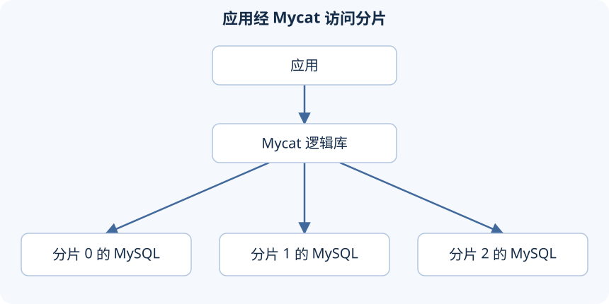

单张表长到千万级甚至上亿行、单机磁盘与 I/O 见顶时，分库分表是常见的水平扩展手段。但在动手拆分之前必须清醒：分库分表会直接牺牲跨库 `JOIN`、本地 ACID 事务和全局自增唯一性，把原本单机由引擎层解决的复杂性全部推给架构层。先把不该分表的伪需求排掉，再做拆分维度、分片算法和扩容迁移的取舍，远比盲目套用中间件配置文件重要得多。

## 什么时候不该分库分表

**只要单机瓶颈来自缺索引、慢 SQL、长事务持锁或读多写少，盲目分库分表只会把一条慢查询复制到多台机器上，再额外叠加跨节点网络合并的开销。**

行业里常流传“单表超 2000 万行必须分表”，这只是针对特定行宽与 3 层 B+ 树估算的经验参照，绝不是硬红线。是否需要拆库拆表，应当依次走完四道前置排查再拍板：

1. **SQL 与索引调优**：用 `EXPLAIN` 消掉全表扫描、深分页和回表放大。
2. **读写分离与缓存**：将分析类、列表类读流量引流至只读从库或 Redis，释放主库写资源。
3. **历史冷数据归档**：订单、流水、日志等时效性强的表，将半年或一年前的冷数据迁入归档库或对象存储，活跃热表体积往往立刻回落到几百万行以内。
4. **硬件垂直升级**：在云数据库时代，直接升级 NVMe SSD 与更大内存规格扩大 Buffer Pool 命中率，研发与运维总成本远低于过早引入分布式分片。

只有当活跃热数据的**写入吞吐（TPS）、单机磁盘容量上限或连接数**确实突破了单台顶配实例的物理极限，才值得进入分库分表。

## 垂直拆分与水平拆分的维度取舍

数据拆分沿“垂直（按列或按业务表）”和“水平（按行）”两个方向展开，落地方式分为四种组合：

| 拆分方式 | 拆分对象 | 直接解决的瓶颈 | 引入的新代价 |
| :--- | :--- | :--- | :--- |
| **垂直分库** | 按业务域将不同表拆进不同库（如用户库、订单库、商品库） | 隔离不同业务线的磁盘、连接与 CPU 竞争 | 跨库无法直接 `JOIN`，跨业务写需要分布式事务 |
| **垂直分表** | 将单表拆成高频核心列主表与低频大字段扩展表（如商品详情） | 缩小单行宽度，提高每页容纳行数与 Buffer Pool 密度 | 查询完整信息需要关联或二次查询 |
| **水平分表** | 同库内把大表按行拆成 `order_0`、`order_1` 等多张结构相同的表 | 降低单棵 B+ 树高度与单表锁粒度 | **不增加 CPU/内存/磁盘带宽**，仍需表名路由 |
| **水平分库** | 同结构表按行分散到多个独立 MySQL 实例节点 | 彻底横向扩展存储容量、写入 TPS 与连接上限 | 引入跨节点路由、全局 ID、分布式聚合与扩容迁移成本 |

无论采用代理层方案（如早期 Mycat 1.x、ShardingSphere-Proxy）还是嵌入应用进程内的客户端分片方案（如 ShardingSphere-JDBC），核心路由挑战都相同——**选对分片键（Sharding Key）**。

挑选分片键必须同时权衡**查询贴合度**与**分布均衡性**：订单表如果按 `order_id` 分片，而 90% 的前端查询条件是 `WHERE user_id = ?`，每次查个人订单都要广播扫遍所有分片，彻底失去分片意义；反之若按 `user_id` 分片，单个用户的全部订单天然聚在同一节点内实现单片路由，但如果存在超级大客户（如企业级大买家），又可能把某一个分片打成数据倾斜热点。

同时切勿混淆“水平分片”与“主从复制”：主从复制是多台机器保存**完整数据的副本**用于高可用和读扩展，而水平分片是每个节点只存**全集的一个互斥子集**——任何一条主键值只归属一个分片，绝不能把分片节点当故障备库去读，也不能把主从副本的数据加起来做全量统计。

## 主流分片路由算法对比与适用边界

选定分片键后，算法决定一条记录具体落入哪一个物理分片。工程上常见的六类分片规则各有明确边界：

| 分片策略 | 路由逻辑 | 主要收益 | 致命短板与踩坑点 |
| :--- | :--- | :--- | :--- |
| **范围分片（Range）** | 按 ID 区间（如 `1~500w`、`500w~1000w`）映射到对应节点 | 范围查询能精准收敛分片；新增区间只需挂接新节点，**历史数据零迁移** | 顺序递增写入全部砸在最后一个最新分片上，导致严重的写入热点 |
| **取模分片（Mod）** | 计算 `key % N` 决定节点下标 | 连续递增主键在各节点间写入绝对均匀，彻底消除尾部热点 | 扩容把节点数 `N` 从 3 改成 4 时，几乎全部键的归属重算，触发大规模数据搬迁 |
| **固定槽位 / 字符串哈希** | 先用掩码（如 `key & 1023` 划分 1024 个槽）或字符串前缀哈希算槽位，再把槽段配给节点 | 槽位数固定，后续按 2 的幂次翻倍拆库时可成倍整段切槽，比直接取模好迁 | 字符串截取长度过短会导致碰撞堆积；非 2 的幂次变更依然需要迁槽 |
| **一致性哈希（Consistent Hashing）** | 将物理节点映射为环上多个虚拟节点，键值顺时针寻找最近虚拟节点 | **加减节点时仅迁移环上相邻区段的数据**，迁移影响面大幅缩小 | 依然存在部分键的归属变更和迁移成本，只是缩小范围而非“零迁移” |
| **枚举与子串编码分片** | 按固定字典映射（如租户、状态码）或提取编码前几位数字直指节点 | 强绑定租户或地域隔离，天然支持同租户数据物理同库 | **分片键一旦发生业务修改（如订单状态流转），会导致记录跨片搬家**；前缀编码长度受限 |
| **按时间分片（按天 / 按自然月）** | 计算距基准日期的累计天数或自然月偏移量映射分片 | 按时间段归档、清理整表极快，时间范围查询天然裁剪分片 | 注意区分累计天数差与 `DAY()` 截断；最新时间片扛全量写流量；配置循环槽位时**新写入会与历史同槽数据共存**而非覆盖，不可用分片终点当业务有效期拦截 |

**无论采用哪种算法，高频变更的字段（如订单状态 `status`）绝不能选作分片键——因为一次普通的 `UPDATE` 无法靠单机事务自动把一行记录从一个物理分片搬到另一个物理分片。**

## 全局表、ER 关联表与分布式主键

垂直或水平拆分后，单机表之间随手写 `JOIN` 的时代就结束了，业务需要靠以下三种设计尽量把关联计算留在本节点完成：

1. **全局表（广播表）**：把省市区字典、配置枚举这类**体量小、极少变更、几乎所有分片都要关联**的公共表，在每个相关分片节点都保留一份完整副本。业务节点做本地 `JOIN` 时无需跨库拉取。严禁把订单、用户等大表配成全局表，否则所有节点全量写入会彻底抵消拆分的收益；同时写入全局表时跨节点广播并不天然等价于分布式强一致事务，仍需核对各片数据一致性。
2. **ER 绑定表（父子表同分片）**：对于存在强从属关系的表（如订单表 `orders` 与订单明细表 `order_items`），强制让子表复用父表的分片键 `order_id` 并挂载相同的分片规则。这样同一笔订单的主记录与明细永远落在同一个物理实例上，关联查询与本地事务可以直接完成。
3. **分布式全局唯一 ID**：分库分表后，各分片本地的 `AUTO_INCREMENT` 只在本实例内不重复，合起来必然发生主键撞车；同时按非主键列（如 `user_id`）分片时，各片的 `PRIMARY KEY` 也无法阻止不同分片写入同一个 `order_id`。因此必须在应用层或发号服务生成全局唯一 ID——常用方案包括 **Snowflake 雪花算法**（64 位整数趋势递增、无中心瓶颈，需防时钟回拨）、**数据库号段模式**（批量取一段连续 ID 放内存发号）以及有序 UUID（如 UUIDv7 转为 16 字节二进制存储）。

## 跨片聚合陷阱与平滑扩容迁移

**查询条件一旦未携带分片键，分片架构的吞吐优势立刻归零——请求会退化成全分片广播，并发越高死得越快。**

即便带上了分片条件，跨多个分片聚合与分页时仍有三个工程细节必须由代理或应用层重写逻辑，绝不能简单透传给单个 MySQL：

1. **跨片 `AVG()` 不能二次平均**：假设分片 0 有 2 条记录总工资 19000，分片 1 有 3 条记录总工资 37000，分片 2 有 3 条记录总工资 31000。正确全局均值是 `(19000 + 37000 + 31000) / (2 + 3 + 3) = 10875`；如果把各片算出的局部均值再相加除以 3，权重会彻底失真。中间件必须把 `AVG` 改写为各片分别返回 `SUM` 与 `COUNT` 后再做全局除法。
2. **跨片排序与深分页放大**：执行 `ORDER BY id LIMIT 1000, 10` 且命中 3 个分片时，由于每片最小的第 1001 条在全局未必处于第 1001 位，代理必须向每个分片分别请求 `LIMIT 0, 1010`（共 3030 行），在内存做多路归并排序后再截取第 1001~1010 行。偏移量越大，内存与网络放大倍数越恐怖，分片架构下应当强制业务采用基于主键/时间游标的分页方式。
3. **扩容迁移绝不是改个配置参数**：从 `id % 3` 扩到 `id % 4` 后，比如 `id = 4` 原来落在 `4 % 3 = 1` 号片，新规则算出来却去了 `4 % 4 = 0` 号片。如果只改配置不搬数据，旧记录直接“人间蒸发”，新写入还会制造出同主键双份脏数据。标准的平滑扩容必须走完四步流程：**双写新旧分片（或成倍扩容拆分主从切主） → 历史存量全量迁移与增量 Binlog 追平 → 抽样与全量数据校验核对 → 切读流量并下线旧路由与清理冗余数据**，同时提前备好切回旧路由的回滚开关。
