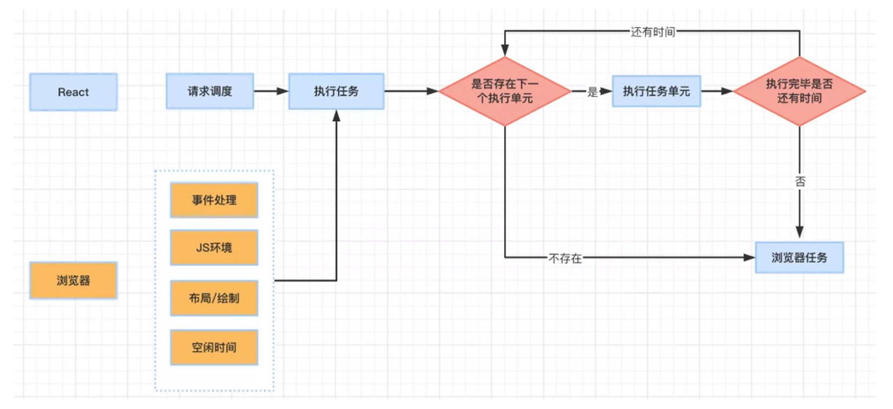

一谈 React 性能优化，很多人条件反射就是给全项目套满 `React.memo`、`useCallback` 和 `useMemo`。结果代码多了一堆依赖数组维护成本，页面卡顿却一点没少——原因往往是内联新对象破坏了浅比较、Context 把整个子树拉下水，或者根本没用 Profiler 抓到真正耗时的节点。把定位手段、结构级剪枝和缓存失效边界理顺，优化才能打在痛点上。

## 先用 Profiler 定位瓶颈，而不是盲目加缓存

在 React 的更新模型里，父组件状态变化触发重渲染时，默认会自顶向下递归调用所有子组件（即使子组件的 Props 根本没用到那个变动状态）。但这绝不意味着每次重渲染都很慢：现代 JS 引擎执行几十行纯函数的开销微乎其微，真正拖垮帧率的是**高频触发的大列表重算、重型可视化组件重建，以及由此连带发生的 DOM 变更或布局抖动**。

**做任何渲染优化前，先打开 React DevTools 的 Profiler 录制一次真实交互，通过火焰图确认到底是哪个组件耗时最长、为什么触发渲染，再去改对应的边界。**

需要特别留意，Fiber 架构提供的并发时间切片（在约 16ms 的单帧预算内把低优先级工作分段让出主线程）是为了避免长渲染饿死用户输入，而不是让单个慢组件自己变快；同步事件处理函数、Commit 阶段大量插入 DOM 以及第三方脚本阻塞同样会把帧率打掉。



## 零成本结构优化：状态下沉与内容提升

动手写 `memo` 之前，有两招纯靠组件结构就能彻底消掉无效渲染、而且没有任何依赖心智负担的手段：

### 1. 状态下沉（State Colocation）

如果一个模态框开关、输入框草稿或悬浮提示状态只影响页面局部一小块区域，就把它从顶层父组件移到专属的小组件里。局部状态改变时，顶层父组件和其他重型兄弟子树压根不会执行。

### 2. 内容提升（把重型子树作为 `children` 透传）

当父组件外层壳子需要频繁响应滚动条或鼠标位置更新，内部又包着一个很重的表格时，把外层状态抽进独立的包装组件，让重型子树通过 `children` Prop 传进去：

```tsx
function ScrollTracker({ children }: { children: React.ReactNode }) {
  const [scrollY, setScrollY] = useState(0)

  return (
    <div onScroll={(e) => setScrollY(e.currentTarget.scrollTop)}>
      <header>当前滚动：{scrollY}</header>
      {children}
    </div>
  )
}

export function DashboardPage() {
  return (
    <ScrollTracker>
      <HeavyChartGrid />
    </ScrollTracker>
  )
}
```

**滚动事件触发 `ScrollTracker` 内部状态更新时，由于 `children` 是由外层 `DashboardPage` 创建并作为未变化的 Prop 引用传进来的，React 会自动跳过整个 `<HeavyChartGrid />` 的重新渲染，连一行 `memo` 都不用写。**

## `React.memo`、`useMemo` 与 `useCallback` 的失效陷阱

结构上确实拆不开、且 Profiler 实测子组件因父组件高频刷新而卡顿时，再按需引入缓存组合：

```tsx
import { memo, useCallback, useMemo, useState } from 'react'

interface CartLine {
  id: number
  name: string
  price: number
  quantity: number
}

const CartRow = memo(function CartRow({
  item,
  onRemove,
}: {
  item: CartLine
  onRemove: (id: number) => void
}) {
  return (
    <li>
      {item.name} × {item.quantity}
      <button type="button" onClick={() => onRemove(item.id)}>
        删除
      </button>
    </li>
  )
})

export function CartView({ initialItems }: { initialItems: CartLine[] }) {
  const [items, setItems] = useState(initialItems)
  const [query, setQuery] = useState('')

  const total = useMemo(
    () => items.reduce((sum, item) => sum + item.price * item.quantity, 0),
    [items],
  )

  const removeItem = useCallback((id: number) => {
    setItems(current => current.filter(item => item.id !== id))
  }, [])

  return (
    <section>
      <input value={query} onChange={e => setQuery(e.currentTarget.value)} />
      <ul>
        {items.map(item => (
          <CartRow key={item.id} item={item} onRemove={removeItem} />
        ))}
      </ul>
      <p>总价：{total}</p>
    </section>
  )
}
```

这套组合非常容易因为下面四个隐蔽写法当场失效：

1. **内联对象、数组或未缓存函数传给 `memo` 子组件**：`React.memo` 默认对每个 Prop 做第一层 `Object.is` 浅比较。只要父组件里写了一句 `<CartRow style={{ color: 'red' }} onRemove={() => ...} />`，每次父组件渲染都会生成新内存地址，`memo` 浅比较直接穿透失效。
2. **往 `memo` 组件里传 `children` JSX**：`<MemoPanel><p>hello</p></MemoPanel>` 每次父组件执行都会生成新的 `children` React Element 对象，导致 `MemoPanel` 照样重渲染。
3. **跨 Context 更新击穿 `memo`**：即使组件被 `memo` 包裹，只要它内部调用了 `useContext` 且 Provider 的 `value` 引用变了（如 Provider 每次渲染都重建 `{ user, setUser }`），该组件依然会强制重渲染。解决方式是用 `useMemo` 稳定 Context `value`，并把高频变化的上下文（如实时坐标）与低频上下文（如当前用户）拆开。
4. **为了稳住 `useCallback` 故意漏写依赖**：例如把读取了 `items` 的函数依赖写成 `[]`，函数虽然引用稳定了，却会永远锁死在第一帧的旧闭包里。如果只想改状态而不依赖旧快照，请用函数式更新 `setItems(prev => ...)`，这样依赖数组才是合法的空数组。

**`React.memo`、`useMemo` 与 `useCallback` 都只是性能优化提示，绝不能用来确保业务逻辑的正确性；React 有权在内存回收或热更新时随时丢弃缓存，任何代码在删掉这三者后都必须能正常运行。**

## React Compiler 的演进边界

传统写法之所以繁琐，是因为开发者需要手工维护 `memo`、`useMemo` 和 `useCallback` 的依赖边界，漏掉任何一个引用就前功尽弃。官方推出的 **React Compiler** 能够在构建编译期自动分析组件和 Hook 的数据流依赖，自动插入细粒度的缓存记忆逻辑，极大减少手写手动 memoization 的必要。

但编译器并不是免死金牌，它依然有两项明确边界：

- **强制前提是遵守 React 规则**：组件渲染必须保持纯洁、Props 与 State 保持不可变、Hook 只在顶层调用。如果代码里直接原地修改传入的对象或读写渲染期副作用，编译器要么安全跳过优化该组件，要么暴露出隐藏的状态 Bug。
- **代替不了架构级并发与数据层优化**：对于万行长列表卡顿、同步复杂过滤和频繁请求，依然要靠虚拟列表、[`useTransition` / `useDeferredValue`](/posts/react-hooks-state-and-effects) 调度切片，以及合理的客户端状态切片（如 [Zustand Selector](/posts/react-state-zustand-and-redux)）来解决。
