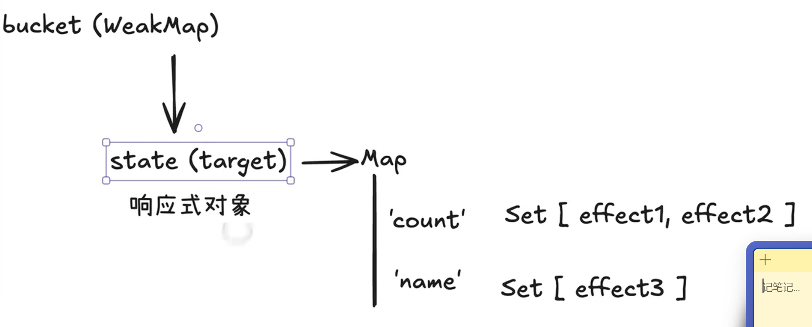
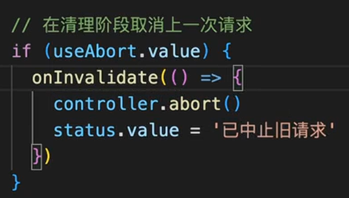
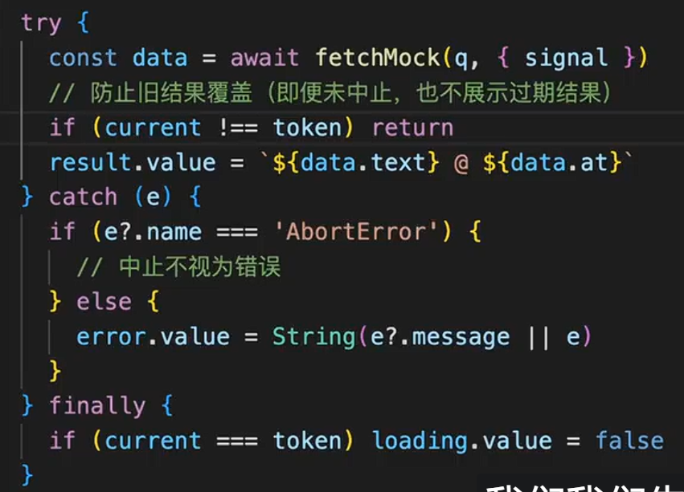

写 Vue 3 应用时，改了一行状态，视图就跟着刷新，这背后连着两条主线：编译期把单文件组件拆成带静态标记的渲染函数，运行期由 `Proxy` 与调度队列把变更精确落到真实 DOM。一旦忽略这两条线，就会踩中解构丢响应性、深层监听拿不到旧值、在 `await` 之后失效的 `watchEffect`，或者写完数据立刻去读 DOM 高度却拿到旧尺寸。

## 工程初始化与 SFC 编译边界

一个标准 Vue 3 应用的启动和更新链路可以分成四层：

```text
SFC 源码（.vue）
  ↓ Vite + @vitejs/plugin-vue
模板编译为 render 函数
  ↓ 执行 render
生成 VNode 树
  ↓ patch / keyed diff
更新真实 DOM

响应式状态
  ↓ track 建立依赖
组件渲染副作用
  ↓ trigger 调度更新
重新执行 render 并局部 patch
```

初始化工程优先使用官方脚手架 `create-vue` 或 Vite 的 TypeScript 模板：

```bash
npm create vue@latest
# 或最小 Vite + Vue + TS 模板
npm create vite@latest my-vue-app -- --template vue-ts
```

项目根目录下的 `public/` 与 `src/assets/` 职责完全不同。**`public/` 里的资源会按原路径直接拷贝到构建产物根目录，不经过哈希命名和模块打包优化；需要走依赖图、内联或内容哈希缓存的业务资源应放在 `src/assets/` 下通过模块导入。**

进入单文件组件（SFC）内部，推荐按 `<script setup lang="ts">`、`<template>`、`<style scoped>` 的顺序组织代码。`<script setup>` 的顶层导入、变量和函数可以直接暴露给模板，免去了手动 `return`，同时把同一项业务的状态、派生值和副作用聚在一起，方便后续抽成 [Composables](/posts/vue3-composables-directives-and-plugins)。

```vue
<script setup lang="ts">
import { computed, ref } from 'vue'

const firstName = ref('张')
const lastName = ref('三')
const fullName = computed(() => `${firstName.value}${lastName.value}`)
</script>

<template>
  <p class="profile-name">{{ fullName }}</p>
</template>

<style scoped>
.profile-name {
  font-weight: 600;
}
</style>
```

需要注意的是，`<style scoped>` 只是编译期给元素加上 `data-v-xxxx` 属性并改写 CSS 选择器，它能隔绝大部分局部样式冲突，却不会像 Shadow DOM 那样建立独立的 DOM 与样式隔离边界。

## 模板语法与指令边界

模板表达式运行在组件实例上下文里，适合做属性读取和简单判断；涉及列表过滤、排序或复杂分支时，应当收拢进 `computed`，不要把数组方法直接塞进模板里每次重渲染都算一遍。

```vue
<script setup lang="ts">
import { computed, ref } from 'vue'

interface Todo {
  id: number
  title: string
  done: boolean
}

const query = ref('')
const todos = ref<Todo[]>([
  { id: 1, title: '理解 ref', done: true },
  { id: 2, title: '练习 watch', done: false },
])

const visibleTodos = computed(() => {
  const keyword = query.value.trim().toLowerCase()
  return todos.value.filter(todo =>
    todo.title.toLowerCase().includes(keyword),
  )
})

function toggle(todo: Todo) {
  todo.done = !todo.done
}
</script>

<template>
  <input v-model.trim="query" placeholder="搜索" />

  <ul v-if="visibleTodos.length">
    <li v-for="todo in visibleTodos" :key="todo.id">
      <button type="button" @click="toggle(todo)">
        {{ todo.done ? '已完成' : '待完成' }}：{{ todo.title }}
      </button>
    </li>
  </ul>
  <p v-else>没有匹配项</p>
</template>
```

常用指令的开销和行为边界如下：

| 指令 | 核心行为 | 工程注意点 |
| --- | --- | --- |
| `v-bind` / `:` | 动态绑定属性、`class` 与 `style` | `class` 优先用对象或数组，避免拼字符串 |
| `v-on` / `@` | 绑定事件监听器 | `.stop`、`.prevent`、`.once` 修饰符简化样板代码 |
| `v-model` | 值绑定与更新事件的语法糖 | `.trim`、`.number`、`.lazy` 改变输入同步时机 |
| `v-if` | 条件为假时不挂载或销毁节点 | 切换代价高，适合低频切换或重型子树 |
| `v-show` | 始终挂载，仅切换 `display: none` | 初始渲染有开销，适合高频切换的面板 |
| `v-for` | 列表渲染 | 必须绑定稳定、唯一的实体 `key` |
| `v-once` | 首次渲染后跳过后续更新 | 只用于确定永不变化的静态子树 |
| `v-memo` | 依赖数组元素全等时跳过子树更新 | 定向优化超长列表行，先测性能再用 |

**切勿在同一个元素上混用 `v-if` 和 `v-for`，在 Vue 3 中 `v-if` 优先级高于 `v-for`，条件里根本读不到循环变量；过滤列表应先在 `computed` 里算完再遍历。** 另外，`v-html` 会直接注入原始 HTML 且不会编译模板，任何未经严格白名单清洗的外部字符串都禁止传给 `v-html`。

## Proxy 响应式原理与依赖收集

Vue 3 用 ES6 `Proxy` 配合 `Reflect` 拦截对象的读写，替代了 Vue 2 中需要递归遍历属性且无法直接感知对象新增属性或数组下标改动的 `Object.defineProperty`。整套依赖追踪围绕四个概念运转：`effect`、`track`、`trigger` 与 `targetMap`。



依赖表的底层数据结构是一个三层嵌套集合：

```text
WeakMap<target,
  Map<key,
    Set<ReactiveEffect>
  >
>
```

**使用 `WeakMap` 作为最外层容器，是为了避免依赖表强引用原始目标对象，当组件销毁、目标对象失去外部引用时能够被垃圾回收。**

下面是一个保留核心骨架的教学模型（生产源码还包含 effect 调用栈、分支切换时的旧依赖清理、数组与 `Map`/`Set` 集合拦截、调度器以及防无限递归保护）：

```ts
type Effect = () => void

const targetMap = new WeakMap<object, Map<PropertyKey, Set<Effect>>>()
let activeEffect: Effect | undefined

function effect(fn: Effect) {
  activeEffect = fn
  try {
    fn()
  } finally {
    activeEffect = undefined
  }
}

function track(target: object, key: PropertyKey) {
  if (!activeEffect) return

  let depsMap = targetMap.get(target)
  if (!depsMap) {
    depsMap = new Map()
    targetMap.set(target, depsMap)
  }

  let dep = depsMap.get(key)
  if (!dep) {
    dep = new Set()
    depsMap.set(key, dep)
  }

  dep.add(activeEffect)
}

function trigger(target: object, key: PropertyKey) {
  const effects = targetMap.get(target)?.get(key)
  if (!effects) return
  // 拷贝一份 Set 遍历，防止执行过程中清理并重新收集依赖引发死循环
  for (const run of [...effects]) {
    run()
  }
}

function reactive<T extends object>(target: T): T {
  return new Proxy(target, {
    get(raw, key, receiver) {
      const value = Reflect.get(raw, key, receiver)
      track(raw, key)
      return value
    },
    set(raw, key, value, receiver) {
      const oldValue = Reflect.get(raw, key, receiver)
      const changed = Reflect.set(raw, key, value, receiver)
      if (changed && !Object.is(oldValue, value)) {
        trigger(raw, key)
      }
      return changed
    },
  })
}
```

这里必须用 `Reflect.get(raw, key, receiver)` 和 `Reflect.set(raw, key, value, receiver)` 传入 `receiver`：如果目标对象上定义了 `get fullName() { return this.first + this.last }` 这类访问器属性，直接写 `raw[key]` 会把内部的 `this` 指向原始对象 `raw`，导致 `first` 和 `last` 绕过 Proxy 无法被 `track`；传入 `receiver` 才能保证访问器里的 `this` 依然是代理对象。

## `ref`、`reactive` 与浅层 API 的选型边界

在日常编码里，选对响应式容器能省掉大量引用丢失的问题：

| API | 适用场景 | 访问与更新边界 |
| --- | --- | --- |
| `ref` | 原始类型；需要整体替换引用的对象或数组 | 脚本中通过 `.value` 读写，模板自动解包 |
| `reactive` | 原地修改字段的对象、`Map`、`Set` 等集合 | 直接读写属性，不可对变量整体重新赋值 |
| `shallowRef` | ECharts 实例、编辑器实例、超大不可变列表 | 仅替换 `.value` 时触发更新，不做深层代理 |
| `shallowReactive` | 只需监听第一层属性的容器对象 | 嵌套子对象保持普通对象引用 |
| `readonly` | 向下游暴露只读视图（如 `provide` 上下文） | 拦截直接写入，上游源状态变化时仍同步 |

**需要整体替换引用的数组或接口响应对象优先用 `ref`，因为直接给 `let rows = reactive([])` 重新赋值 `rows = nextRows` 会让局部变量脱离原 Proxy，原有依赖关系彻底断开。** 若确实使用 `reactive` 承接表单或配置对象，整体更新字段时要用 `Object.assign(profile, next)` 保持代理身份不变。

```vue
<script setup lang="ts">
import { computed, reactive, ref, shallowRef } from 'vue'

interface Profile {
  name: string
  skills: string[]
}

const rows = ref<string[]>([])
rows.value = ['A', 'B']

const profile = reactive<Profile>({
  name: 'woodfish',
  skills: ['Vue', 'TypeScript'],
})

// 第三方实例存在大量内部私有字段，用 shallowRef 避免无意义的深层 Proxy 包装
const chart = shallowRef<{ resize(): void } | null>(null)
const skillCount = computed(() => profile.skills.length)

function loadProfile(next: Profile) {
  Object.assign(profile, next)
}
</script>
```

### 常见响应式陷阱：解构、`toRef` 与 `toRaw`

对 `reactive` 对象直接解构，相当于把当时的属性值拷贝给局部变量，基础类型会立刻失去响应性：

```ts
import { reactive, toRef, toRefs } from 'vue'

const state = reactive({ name: 'woodfish', age: 23 })

// 错误：name 只是一个普通字符串快照，不会随 state.name 更新
const { name: brokenName } = state

// 正确：toRef / toRefs 为属性创建与原代理双向同步的 Ref
const name = toRef(state, 'name')
const { age } = toRefs(state)
name.value = 'new-name' // state.name 同步改变
```

此外还有三个容易误判的细节：

1. **集合类型优先用 `reactive`**：`Map`、`Set`、`WeakMap`、`WeakSet` 的读写依赖方法调用，直接用 `reactive(new Map())` 语义更清晰；若是存放大型只读配置且只关心整体替换，再选 `shallowRef`。
2. **`shallowRef` 配合 `triggerRef`**：原地修改 `config.value.theme.dark = true` 不会自动触发更新，要么主动调用 `triggerRef(config)`，要么直接走不可变替换 `config.value = { ...config.value, theme: { dark: true } }`。
3. **`toRaw` 仅用于临时逃生**：`toRaw(proxy)` 取出底层原始对象，适合传给不兼容 Proxy 的第三方库或做对象身份比对，不要长期拿着 `raw` 绕过代理改数据，否则视图不会收到任何通知。

当需要精确控制依赖收集和触发节拍时，可以用 `customRef` 封装防抖输入：

```ts
import { customRef } from 'vue'

export function useDebouncedRef<T>(initial: T, delay = 300) {
  let value = initial
  let timer: ReturnType<typeof setTimeout> | undefined

  return customRef<T>((track, trigger) => ({
    get() {
      track()
      return value
    },
    set(next) {
      clearTimeout(timer)
      timer = setTimeout(() => {
        value = next
        trigger()
      }, delay)
    },
  }))
}
```

## `computed`、`watch` 与副作用清理机制

派生状态和副作用的职责切分非常明确：`computed` 用来从已有状态纯计算出一个带缓存的新值，**`computed` 的 getter 内部禁止发请求、修改外部状态或派发事件**。当它依赖的响应式数据变动时，Vue 只会把它标为脏状态（dirty），直到下一次真正有人读取它时才重新求值并缓存；若确实需要双向绑定的派生值，可以显式传入 `{ get, set }`。

需要监听变化并执行异步请求、日志上报或 DOM 同步时，在 `watch` 和 `watchEffect` 之间做选择：

- `watch` 显式声明要盯住的数据源，能同时拿到 `newVal` 和 `oldVal`，默认懒执行（配合 `{ immediate: true }` 可在初始化时跑一次）。监听 `reactive` 对象的单个属性时必须传 getter 函数 `() => form.profile.name`；直接深度监听同一个对象时，由于对象引用没变，回调里的 `newVal` 和 `oldVal` 往往指向同一份内存，拿不到修改前的历史快照。
- `watchEffect` 立即执行并自动追踪同步执行期间读取到的所有响应式依赖。**`watchEffect` 只收集第一个 `await` 之前同步读取到的依赖，异步恢复后才读取的响应式变量不会被这一轮跟踪。**

更致命的问题发生在副作用清理上。组件切走了，旧定时器还在跑；用户快速连续切换 `userId`（`1 -> 2`），结果请求 `1` 比请求 `2` 晚返回，把页面覆盖成旧数据。**创建副作用的同时必须在同一处注册清理函数，Vue 会在副作用下一次重跑前以及组件卸载时自动执行清理。**

```vue
<script setup lang="ts">
import { ref, watch, watchEffect } from 'vue'

interface User {
  id: number
  name: string
}

const userId = ref(1)
const user = ref<User | null>(null)
const loading = ref(false)

watch(
  userId,
  async (id, _prevId, onCleanup) => {
    const controller = new AbortController()
    onCleanup(() => controller.abort())

    loading.value = true
    try {
      const response = await fetch(`/api/users/${id}`, {
        signal: controller.signal,
      })
      user.value = (await response.json()) as User
    } finally {
      if (!controller.signal.aborted) {
        loading.value = false
      }
    }
  },
  { immediate: true },
)

const query = ref('')
const stop = watchEffect((onCleanup) => {
  const controller = new AbortController()
  onCleanup(() => controller.abort())

  void fetch(`/api/search?q=${encodeURIComponent(query.value)}`, {
    signal: controller.signal,
  })
})
</script>
```

清理逻辑的执行时机可以通过下面两张示意图对照确认：





如果副作用依赖更新后的真实 DOM（例如列表追加后滚动到底部），可以通过 `flush` 选项控制回调在渲染管道中的位置：

| `flush` 配置 | 执行时机 | 典型用途 |
| --- | --- | --- |
| `'pre'`（默认） | 组件 DOM 更新之前 | 普通异步请求、状态联动 |
| `'post'` | 当前组件 DOM 更新完成之后 | 读取更新后的元素尺寸或滚动条 |
| `'sync'` | 状态变更时同步立即执行 | 极少数需要严格同步一致性的轻量校验，慎防高频重算 |

另外，不要为了图省事给大对象统一加 `deep: true`，深度递归遍历在列表较大时开销很高，优先监听最小粒度的 getter。

## 模板编译、Keyed Diff 与 `nextTick` 更新调度

很多开发者会把虚拟 DOM 和 AST 混为一谈，实际上它们分属编译期和运行期：

```text
<template> 字符串
  ↓ Parse
模板 AST（编译期抽象语法树）
  ↓ Transform + 静态提升 + PatchFlag 标记 + Codegen
render() 渲染函数
  ↓ 运行时执行
VNode 树（虚拟 DOM）
  ↓ patch / keyed diff
真实 DOM
```

**Vue 3 的渲染性能优势不仅在于运行时的算法微调，更关键的是编译期提前标注了 PatchFlag（只标记会动态变化的文本、class 或属性）并做了静态节点提升，让运行期直接跳过大片静态子树。**

遇到动态列表时，`:key` 用来标识业务实体的唯一身份。如果拿数组下标 `index` 当作 `key`，在列表头部插入或排序时，相同下标的新旧节点会被强行复用，导致输入框里未受控的局部状态错位到另一条数据上。Vue 3 处理带 `key` 的子节点序列（快速 Diff）会按以下步骤尽量减少真实 DOM 移动：

1. **头头同步**：从索引 `0` 开始向后比对相同类型且同 `key` 的节点并直接 patch。
2. **尾尾同步**：从末尾向前比对相同类型且同 `key` 的节点并直接 patch。
3. **纯新增或纯卸载**：若旧序列先走完，批量挂载剩余新节点；若新序列先走完，批量卸载剩余旧节点。
4. **中间乱序部分**：为新序列剩余节点建立 `key -> newIndex` 映射表，遍历旧序列复用存在的新节点、卸载消失的旧节点，并对复用的新索引序列求**最长递增子序列（LIS）**。已经在递增子序列里的节点相对顺序正确、保持不动，只从后往前移动不在序列里的少数节点。

### 异步批量更新队列与 `nextTick`

给响应式变量连续赋值一千次，Vue 并不会同步重绘一千次 DOM，而是把组件渲染任务压入微任务调度队列并去重，等本轮同步脚本跑完后合并执行一次更新。`nextTick()` 返回一个 Promise，在当前这轮 DOM patch 完成后兑现：

```vue
<script setup lang="ts">
import { nextTick, ref, shallowRef, useTemplateRef } from 'vue'

interface Message {
  id: number
  text: string
}

const messages = ref<Message[]>([])
const draft = shallowRef('')
const list = useTemplateRef<HTMLElement>('list')

async function sendMessage() {
  const text = draft.value.trim()
  if (!text) return

  messages.value.push({ id: Date.now(), text })
  draft.value = ''

  await nextTick()
  list.value?.scrollTo({
    top: list.value.scrollHeight,
    behavior: 'smooth',
  })
}
</script>

<template>
  <section ref="list" class="message-list">
    <p v-for="message in messages" :key="message.id">
      {{ message.text }}
    </p>
  </section>

  <input v-model="draft" @keyup.enter="sendMessage" />
</template>
```

**`nextTick()` 等待的是 Vue 完成本轮 DOM 更新，并不等同于浏览器已经把下一帧像素画到屏幕上。** 如果需要等浏览器真正完成布局绘制后再触发动画，应当先 `await nextTick()`，再套一层 `requestAnimationFrame()`。模板引用 `useTemplateRef()` 需要 Vue 3.5+，旧版本用 `ref<HTMLElement | null>(null)` 即可。

## 组件生命周期与资源清理

在 `<script setup>` 模式下，脚本顶层代码本身就承担了 Options API 中 `beforeCreate` 与 `created` 的职责。完整生命周期链路如下：

```text
setup（顶层脚本执行）
  ↓
onBeforeMount（模板已编译，DOM 尚未插入页面）
  ↓ 首次 patch
onMounted（真实 DOM 已挂载，可初始化第三方库、发首屏请求）
  ↓ 响应式依赖变化
onBeforeUpdate（看到的是更新前的旧 DOM）
  ↓ 更新 patch
onUpdated（看到的是更新后的新 DOM，禁止在此无条件改写自身依赖的状态）
  ↓ v-if 为假或父组件销毁
onBeforeUnmount
  ↓ 停止渲染副作用并卸载 DOM
onUnmounted（移除全局事件、断开 Observer、清理定时器）
```

**`v-if` 切换为假会真正触发 `onUnmounted` 销毁组件并释放内部状态；`v-show` 只改写内联 `display` 样式，不会触发任何卸载钩子。**

```vue
<script setup lang="ts">
import { onMounted, onUnmounted, ref } from 'vue'

const width = ref(window.innerWidth)

function updateWidth() {
  width.value = window.innerWidth
}

onMounted(() => {
  window.addEventListener('resize', updateWidth, { passive: true })
})

onUnmounted(() => {
  window.removeEventListener('resize', updateWidth)
})
</script>
```

排查线上渲染卡顿或状态串台时，先顺着状态写入 -> `trigger` 调度 -> render 生成 VNode -> keyed diff -> `nextTick` 落盘这条链路定位，往往比盲目加 `watch` 或 `nextTick` 更快找到根因。需要处理组件间的数据传递、动画过渡和逻辑抽离时，可以继续参考 [Vue 3 组件边界、通信机制与插槽设计](/posts/vue3-components-and-communication)。
