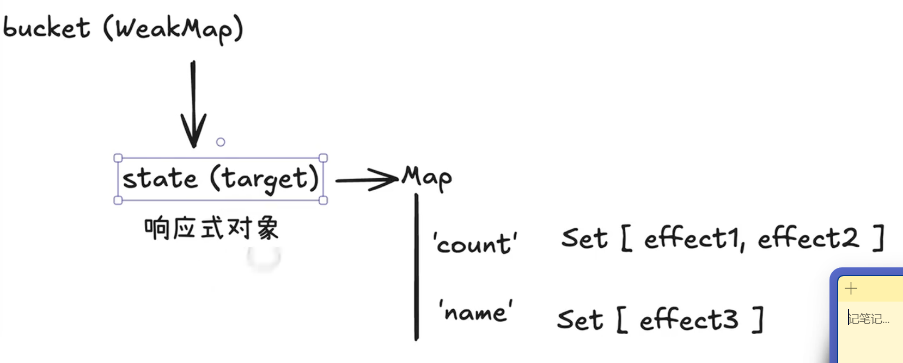
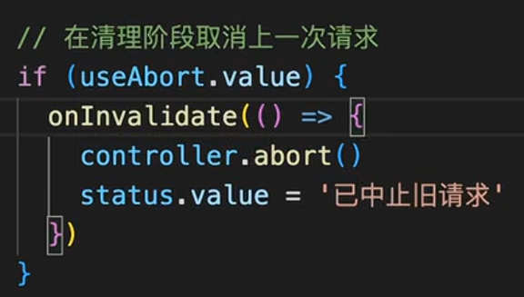
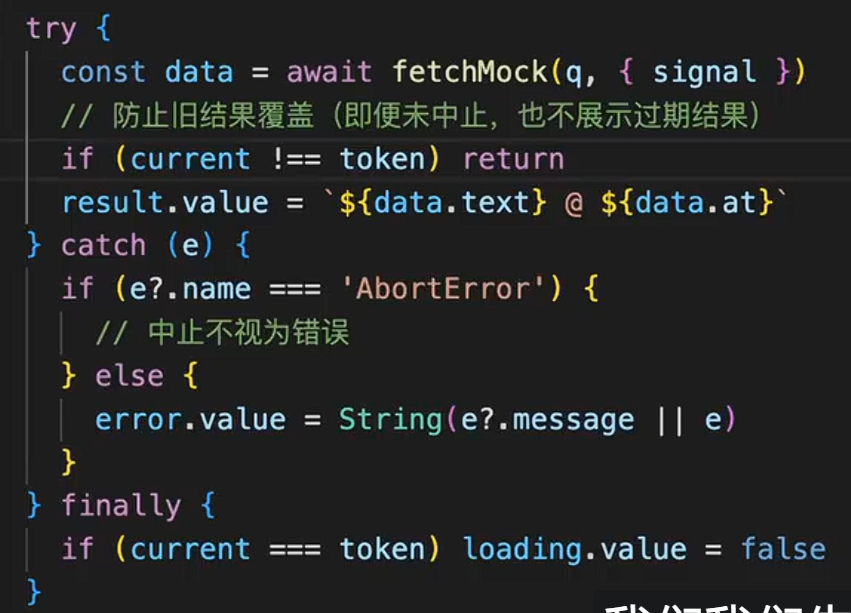

组件逻辑拆散了很难复用，副作用不清理会接着去改已经离开的页面，`provide / inject` 和插槽处理的又是不同方向的数据传递。把这些现象放回响应式、组件边界和渲染时机里看，才能判断 `nextTick`、路由守卫或自定义指令该用在哪。

## 一、为什么 Vue 3 更强调 Composition API

Options API 容易把同一块业务逻辑拆散到 `data`、`methods`、`computed`、`watch` 几个地方。Composition API 能把同一个功能放在一起，之后还能封装成组合函数。

实际的好处有两个：

- 逻辑聚在一起，维护成本低
- 复杂业务更容易抽成 `useXxx` 组合函数

## 二、`ref`、`reactive`、`computed`、`watch` 怎么选

### 1. `ref`

基础类型一般先考虑它：

- 更常用于基础类型
- 在 `script` 里要通过 `.value` 访问

```js
const count = ref(0);
count.value++;
```

### 2. `reactive`

- 更适合对象、数组这类复杂结构
- 访问属性更自然
- 会做深层的响应式代理

```js
const state = reactive({
  user: { name: "woodfish" },
});
```

### 3. `computed`

- 基于已有的响应式数据派生出新值
- 默认带缓存
- 常见场景：表单的展示状态、列表的过滤结果、格式化后的视图数据

### 4. `watch`

- 用来"侦听到变化以后执行副作用"
- 适合请求、日志、持久化、联动逻辑

```js
watch(
  count,
  (newVal, oldVal) => {
    console.log(`changed from ${oldVal} to ${newVal}`);
  },
  {
    immediate: true,
    deep: true,
  }
);
```

## 三、Vue 3 响应式到底是怎么工作的

响应式的依赖关系可以用 `bucket`、`effect`、`track`、`trigger` 四个概念拆开来看。

### 1. 流程

Vue 3 的响应式可以理解成四步：

1. 用 `Proxy` 拦截对象的读写
2. 读的时候收集依赖
3. 改的时候触发依赖
4. 让副作用函数重新执行

### 2. `effect`

`effect` 负责注册副作用函数。副作用简单说就是"依赖响应式数据、数据变了要重新执行的逻辑"。

### 3. `track`

在 `get` 捕获器里，Vue 会记下：

- 当前访问的是哪个对象
- 访问的是哪个属性
- 当前活跃的副作用函数是谁

### 4. `trigger`

在 `set` 捕获器里，Vue 会找到之前收集的依赖，重新调度这些副作用函数。

下面这张图适合用来理解依赖收集的结构：



## 四、Vue 响应式的常见陷阱

问题一般出在引用关系变了，代码却还按原来的响应式对象去理解。

### 1. 响应式对象解构后失去响应性

先看解构响应式对象的结果：

```js
const bob = reactive({ name: "Bob" });
const { name } = bob;
```

这里的 `name` 已经不是响应式的引用了，只是一个普通值的拷贝。

确实要解构的话，用：

```js
const state = reactive({ count: 0 });
const count = toRef(state, "count");
```

或者：

```js
const refs = toRefs(state);
```

### 2. `ref` 包对象时，直接改引用要小心

把对象放进 `ref`，再把 `form.value` 赋给另一个变量去改里面的属性，操作的其实还是同一个对象引用。

所以删字段或者改内部属性时，原对象也会看到同一次变更。

### 3. `Map` / `Set` 场景优先考虑 `reactive`

`ref` 不是什么数据结构都适合。数据是 `Map`、`Set`、`WeakMap`、`WeakSet` 时，更适合直接用 `reactive`。

## 五、生命周期划分组件执行阶段

生命周期就是把组件"创建、挂载、更新、卸载"这几个关键阶段切出来，让你在合适的时候做合适的事。

常见的钩子对应不同的执行时机：

- `onMounted`：DOM 已经挂载，适合发请求、初始化第三方库
- `onUpdated`：视图更新以后执行
- `onUnmounted`：做销毁清理

组件在不同阶段能做的事不一样，有了生命周期，请求、DOM 初始化和资源清理就各有各的位置。

## 六、副作用清理为什么重要

痛点一般是这些：

- 定时器没清掉
- 订阅没关
- 请求没取消
- 页面切走了，旧逻辑还在跑

### 1. 清理何时发生

Vue 里副作用的清理一般发生在两个时机：

1. 副作用函数下一次重新执行之前
2. 组件卸载时

### 2. `watchEffect` + `onInvalidate`

```js
watchEffect((onInvalidate) => {
  const id = setInterval(() => {
    ticks.value += 1;
  }, intervalMs.value);

  onInvalidate(() => {
    clearInterval(id);
  });
});
```

记住这一条：

"创建副作用的逻辑，要和清理副作用的逻辑放在一起。"

下面两张图可以一起看：





## 七、组件通信怎么系统地理解

### 1. `provide / inject`

数据要跨层级传递时，`provide / inject` 比一层层传 `props` 更轻。

```vue
<script setup>
import { provide, ref } from "vue";

const msg = ref("我是祖先的数据");
const updateMsg = () => {
  msg.value = "数据已更新";
};

provide("appData", { msg, updateMsg });
</script>
```

子组件接收：

```vue
<script setup>
import { inject } from "vue";

const { msg, updateMsg } = inject("appData");
</script>
```

简单的跨层传递很好用；但要是已经是全局共享的状态了，一般还是推荐更清楚的状态管理方案。

### 2. 插槽

插槽可以理解成"父组件往子组件里预留的内容口子"。

常见三类：

- 默认插槽
- 具名插槽
- 作用域插槽

作用域插槽最关键的一点：

"子组件把数据提供给插槽内容用。"

很多列表组件、表格组件那么灵活，靠的就是这个。

## 八、Vue Router 的接入与守卫

### 1. 基础接入

一般是：

1. 建路由配置
2. 在 `main.js` 里挂载路由
3. 在 `App.vue` 里放 `router-view`

### 2. 路由跳转

- 声明式：`<router-link>`
- 编程式：`router.push()`

### 3. 动态路由

用 `/user/:id` 这种方式传参数。

### 4. 路由守卫

路由守卫常用来做登录校验、权限判断、页面埋点和离开确认。

## 九、自定义指令什么时候用

自定义指令适合封装直接操作 DOM 的通用逻辑。

常见的场景：

- 自动聚焦
- 点击防抖
- 权限控制
- 增强 DOM 的样式或行为

### 1. 局部指令

```vue
<script setup>
const vFocus = {
  mounted(el) {
    el.focus();
  },
};
</script>
```

### 2. 全局指令

在 `main.js` 里用 `app.directive()` 注册。

### 3. 指令生命周期

要理解的一点：指令是围绕"绑定的元素"工作的，不是围绕"组件实例"。

## 十、模板编译、diff 和 `nextTick` 的更新链路

### 1. 模板编译

模板编译可以拆成三段：

1. Parse：模板转成 AST
2. Transform / Optimize：做静态分析和优化
3. Codegen：生成渲染函数

走完这三步，模板就变成了能执行的渲染函数。

### 2. diff

Vue 2 和 Vue 3 的 diff 重点不一样：

- Vue 2：双端比较
- Vue 3：编译期优化 + 运行时更高效的更新策略

这里要分清两件事：

1. diff 不是全量暴力比较，而是基于同一层的节点、相同类型的节点做高效更新
2. Vue 3 的优势不只在运行时的 diff，更重要的是编译期就已经省掉了很多没必要的工作

### 3. `nextTick`

`nextTick` 的本质不是"延迟一会儿"，而是：

"等这一轮 DOM 更新完了，再执行回调。"

典型场景：

- 改完数据马上要拿最新的 DOM
- 列表渲染完做滚动定位
- 打开弹窗后让输入框聚焦

## 十一、实现时容易混淆的边界

### 1. 响应式包含四个环节

`Proxy`、依赖收集、触发更新、副作用函数。

### 2. `watch` 和 `watchEffect` 的依赖来源不同

- `watch` 明确指定监听的源
- `watchEffect` 自动收集里面用到的响应式依赖

### 3. 副作用清理不只处理内存

还要避免旧的请求、旧的定时器和旧的订阅接着影响当前页面的状态。

### 4. diff 之前还有编译阶段

模板先编译成渲染函数，再由响应式系统触发更新。diff 只负责运行时需要比较的那部分。

### 从状态变更追到 DOM 更新

状态变化先触发依赖，再生成新的渲染结果，diff 算出最小的更新，DOM 刷新完以后才轮到 `nextTick` 的回调。要读最新的 DOM 时，沿着这条链路判断时机。
