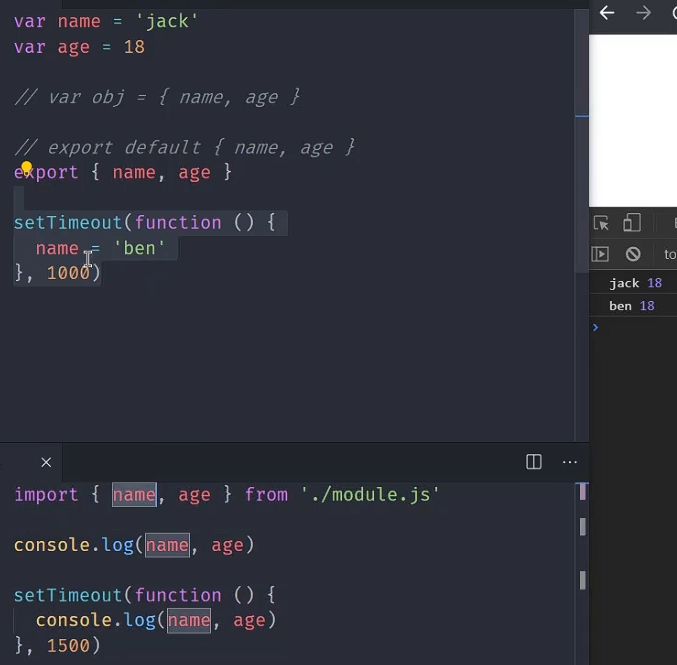
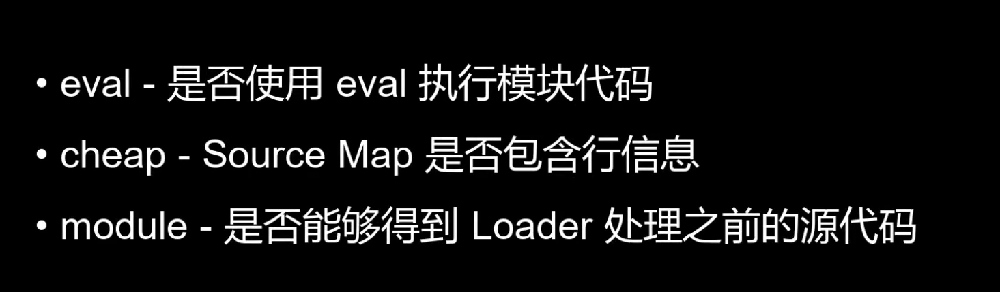
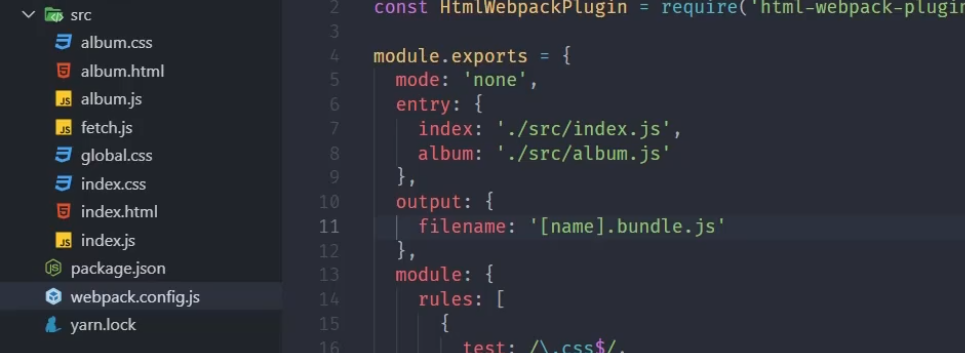
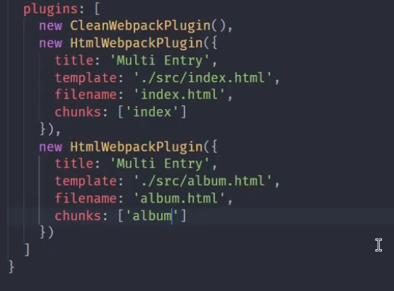

项目拆成好几个 JavaScript 文件以后，先要解决依赖怎么声明、代码怎么隔离。再往后，CSS、图片、字体和 TypeScript 也要进同一条构建链路，最后产出浏览器能加载的文件。

ES Module 管模块边界和依赖的表达，Webpack 从入口出发构建依赖图，Loader 再把非 JavaScript 的资源转成构建系统能接着处理的模块。

## 一、为什么前端需要模块化

直接把好几个脚本按顺序挂到页面上，一般会碰到这些问题：

- 全局变量污染
- 文件之间的依赖顺序难维护
- 代码不好复用
- 业务越大，脚本越难组织

模块化把每个文件管什么、依赖什么都写清楚了，加载顺序也不用再靠手工维护一长串 script 标签。

## 二、ES Module 的特点

### 1. 默认严格模式

ES Module 天生就跑在严格模式下，不用再手写 `"use strict"`。

### 2. 每个模块都有独立作用域

模块里声明的变量不会直接进全局作用域，不同文件之间只通过明确的导入导出交换数据。

### 3. 浏览器侧加载遵循 CORS

模块资源跨域加载时，要服务器通过 CORS 响应头授权，不能沿用普通脚本那种宽松的加载方式。

### 4. `<script type="module">` 默认延迟执行

它的行为接近 `defer`：浏览器下载模块时会接着解析 HTML，等文档解析完再执行。

## 三、`export` 和 `import` 最重要的不是语法，而是 live binding

### 1. 基本写法

counter.js 导出状态和修改函数：

```js
// counter.js
export let count = 0;

export function inc() {
  count++;
}
```

main.js 导入它们，连着读两次 count：

```js
// main.js
import { count, inc } from "./counter.js";

console.log(count);
inc();
console.log(count);
```

调完 inc，第二次读 count 会看到导出方的最新值。这就是 live binding，不是导入时拷了一份值。

### 2. live binding 是什么

导入方不能直接改写这个绑定，但每次读都能看到导出模块当前的值。下图是这个关系：



### 3. 兼容旧浏览器

要兼容不支持模块的浏览器的话，可以配合 `nomodule`：

```html
<script type="module" src="./main.js"></script>
<script nomodule src="./legacy.bundle.js"></script>
```

支持模块的浏览器加载 main.js，不支持的就用 legacy.bundle.js。

## 四、ES Module 和 CommonJS 的关系

两套模块体系有三个直接的差别：

- ESM 是静态依赖分析，CommonJS 更偏运行时加载
- ESM 是 live binding，CJS 更像拷了一份值
- ESM 在语法上更适合 Tree Shaking

## 五、Webpack 是做什么的

Webpack 从入口文件开始跟踪导入关系，建出模块图，再产出浏览器能运行的静态资源。这条链路包括：

- 识别模块的依赖图
- 处理非 JS 的资源
- 统一构建输出
- 注入运行时的加载逻辑

## 六、Webpack 打包产物里有什么

一个 bundle 一般不只是把源码拼起来，还包括：

- 模块表
- 模块加载函数
- 缓存机制
- 入口执行逻辑

模块表存着每个模块的执行函数，加载函数负责查找和执行，缓存避免同一个模块被重复初始化，最后由入口代码把应用启动起来。

相关的图：



## 七、Webpack 的流程

从源码到产物可以拆成五步：

1. 从入口文件出发
2. 分析依赖
3. 调 loader 处理不同的资源
4. 生成模块图
5. 打包输出产物

依赖分析和资源转换是交替进行的：Webpack 碰到一个导入就接着解析目标模块，需要转换的文件先过 loader，再进模块图。

## 八、Loader 为什么存在

构建过程不能把所有文件都当成 JavaScript 直接执行。项目里常见的输入有：

- CSS
- Less / Sass
- 图片
- 字体
- TypeScript
- Vue 单文件组件

Loader 按规则匹配文件，把源内容转成 Webpack 能接着收集依赖的模块形式。

### 1. CSS 常见处理链

处理 CSS 常用两个 loader：

- `css-loader`
- `style-loader`

#### `css-loader`

负责解析 CSS 文件里的依赖关系，比如 `@import`、`url()`。

#### `style-loader`

负责把样式用 `<style>` 标签注入页面。

### 2. 执行顺序

Loader 链一般从右到左、从下到上执行。CSS 这条链里，先解析依赖，再把结果注入页面。

### 3. 静态资源处理

图片、字体这些资源可以用对应的 loader 或内置的资源模块处理，最后选择内联进产物，或者单独输出成文件。

相关的图：





## 九、静态资源从引用到发布

开发代码里引用的资源，到生产环境要经过一整条处理链：

1. 开发阶段由构建工具统一接管资源引用
2. 构建时对图片、字体、样式和脚本分别处理
3. 生产环境按体积和类型决定是内联、发文件还是上 CDN
4. 配合压缩、缓存策略和资源指纹上线发布

图片还要按使用的位置区分处理：

- 小图标可能转成更合适的格式
- 首屏大图会压缩、裁切、懒加载或者走 CDN

## 十、构建产物如何交付

打包成功只说明产物生成了。能不能稳定上线，还要看启动、发布、缓存和回滚：

1. 本地开发怎么启动
2. 代码怎么被编译和打包
3. 静态资源怎么处理
4. 产物怎么发布
5. 上线后怎么做缓存控制和回滚

## 十一、Loader 和 Plugin 的边界

Loader 工作在单个模块的转换阶段，Plugin 则通过构建钩子参与更大范围的流程：

- loader 更像"文件转换器"
- plugin 更像"构建流程增强器"

读一份构建配置时，可以顺着 entry、依赖图、loader、运行时和输出目录往下看。这样能把每个配置项放回它真正影响的那个构建阶段。
