页面"慢"只是个现象。首屏老是出不来、按钮点了没反应、加载时内容乱跳，背后的瓶颈完全不一样，优化手段也不能混着用。

排查时先回答三个问题：用户慢在哪，数据从哪拿，哪一段链路最值得先改。Core Web Vitals 描述用户的感受，Performance API 和 PerformanceObserver 负责采集，Network 瀑布图和性能面板负责把问题定位到请求、渲染或主线程上。

## 一、先判断是哪一种慢

Web 性能至少包括加载、渲染和交互三个阶段。首屏快不代表后面的交互流畅；接口返回得快，也不代表页面不会发生布局偏移。

落到业务上，性能会影响等待体验、留存和转化，也会影响搜索引擎对页面体验的判断。但分析时别停在"性能很重要"，要落到一个能观测的现象上。

## 二、先看瀑布图，再看评分

Network 瀑布图能直接回答：

- DNS、TCP、SSL 各花了多久
- 请求排队严不严重
- 资源有没有阻塞
- 关键资源是不是来得太晚

下面两张图就是这条请求链：

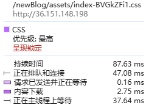

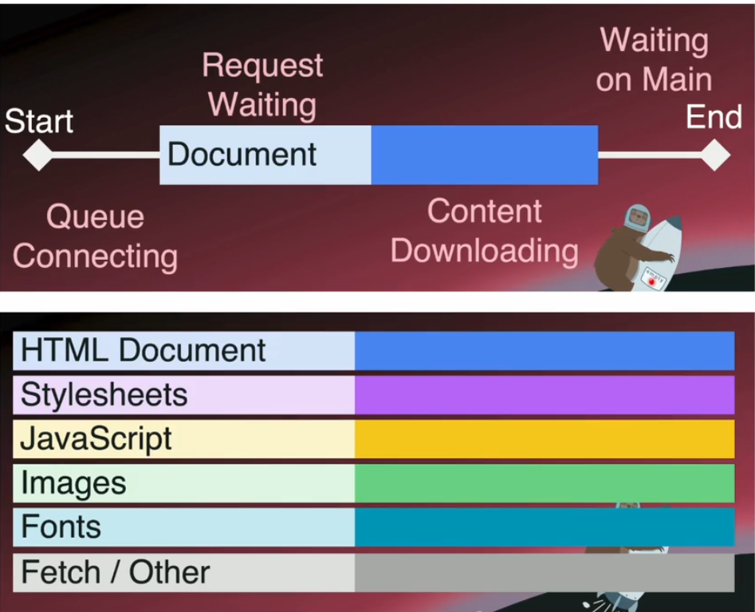

Lighthouse 分数适合当入口，但它只告诉你结果。瀑布图展示的是实际发生了什么：资源什么时候被发现、在哪排队、被什么挡住了。两个要一起看。

## 三、为什么不能只看 DOMContentLoaded 和 load

以前大家看的是：

- `DOMContentLoaded`
- `load`

这些时间点现在也有用，但对 SPA 来说，反映不了用户什么时候看到、什么时候能操作页面。

比如：

- 页面框架加载完了，但核心内容还没出来
- 资源都到了，但页面一直在抖
- 首屏看着好了，但点按钮还是卡

所以还要补上：内容什么时候出现、布局稳不稳定、交互多久能有反馈这几类指标。

## 四、用 Core Web Vitals 对应用户感受

先看三个直接对应用户体验的指标：

- `LCP`：Largest Contentful Paint
- `CLS`：Cumulative Layout Shift
- `INP`：Interaction to Next Paint

再结合这几个判断请求和首次绘制：

- `TTFB`
- `FCP`
- `FID`

这些指标不是一张分数清单，每一项都要对应到一次能复现的加载或交互过程。

## 五、LCP：最大内容绘制

### 1. 衡量主要内容何时出现

LCP 衡量的是：页面的主要内容什么时候真正出现在用户眼前。

这比 `DOMContentLoaded` 更接近"用户觉得页面能用了没有"。

### 2. 哪些元素会被计入 LCP

一般包括：

- 大图
- 背景图
- 大块的文本
- 视频封面这类主要内容区域

配合下面这些图看：

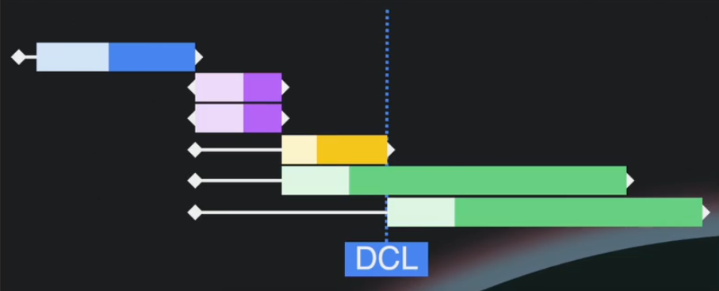

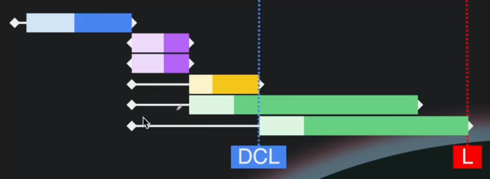

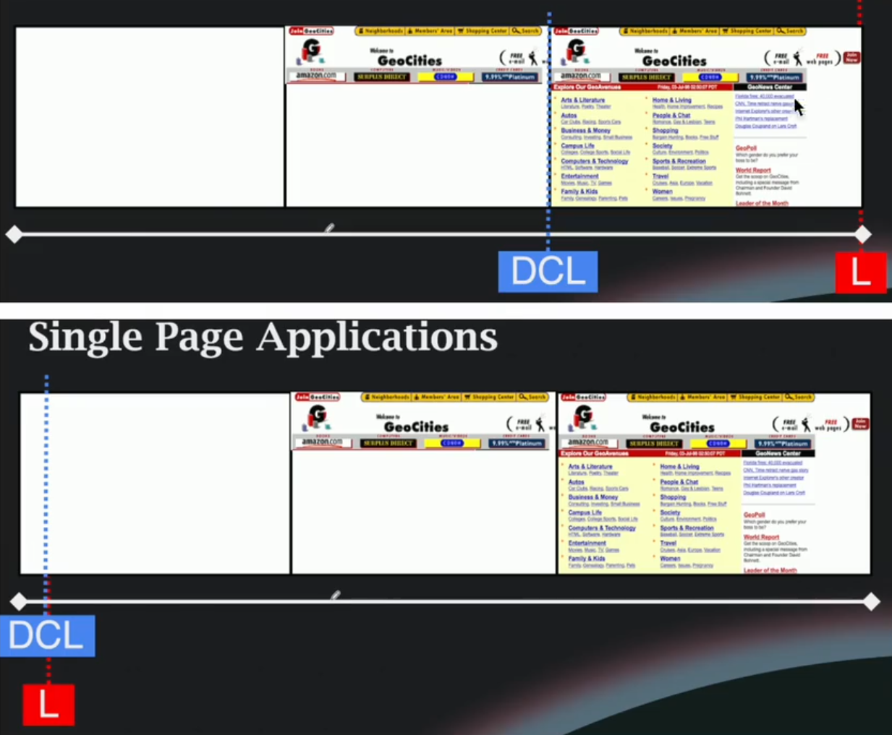

### 3. 评分标准

常见的标准：

- 优秀：`<= 2.5s`
- 需要改进：`2.5s ~ 4s`
- 较差：`> 4s`

### 4. LCP 为什么会差

常见的原因：

- 服务器首字节慢
- 关键资源发现得太晚
- 首屏大图没预加载
- CSS / JS 阻塞了渲染
- 主线程太忙，内容到了却迟迟画不出来

## 六、CLS：累计布局偏移

### 1. 衡量页面是否稳定

CLS 衡量的是页面的稳定性，也就是加载过程中页面元素有没有"乱跳"。

### 2. 计算思路

CLS 由受影响的面积和偏移的距离一起决定：

`CLS = Impact Fraction × Distance Fraction`

也就是：

- 有多少内容受到了影响
- 这些内容偏移了多远

### 3. 常见成因

- 图片、广告、异步模块没预留尺寸
- 字体切换引起布局变化
- 在已有内容的上方插入新元素
- 动画或脚本直接改布局属性

相关的图：

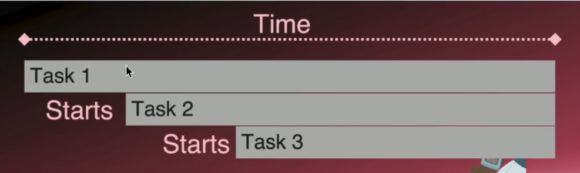

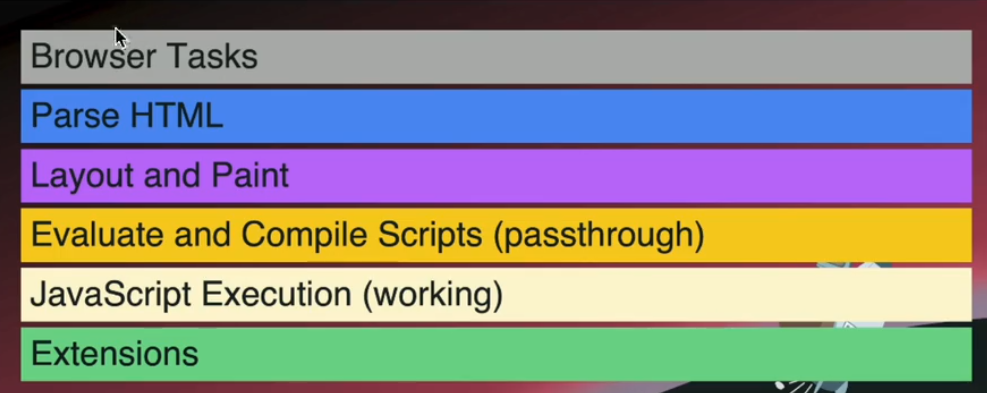

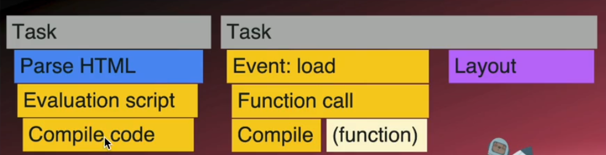

### 4. 评分标准

常见的经验值：

- 优秀：`<= 0.1`
- 需要改进：`0.1 ~ 0.25`
- 较差：`> 0.25`

## 七、INP、FCP、TTFB 也不能忽略

### 1. INP

衡量用户交互以后，到下一次可见绘制之间的延迟。它比以前的 FID 更能反映真实的交互体验。

### 2. FCP

首次内容绘制，强调"用户第一次看到页面内容"的时间点。

### 3. TTFB

首字节时间，强调从发请求到收到响应第一个字节花了多久。

这些指标不是互相替代的，而是互相补充的。

相关的图：

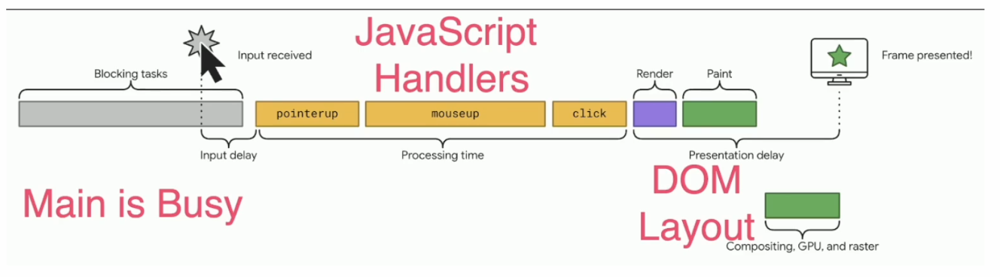

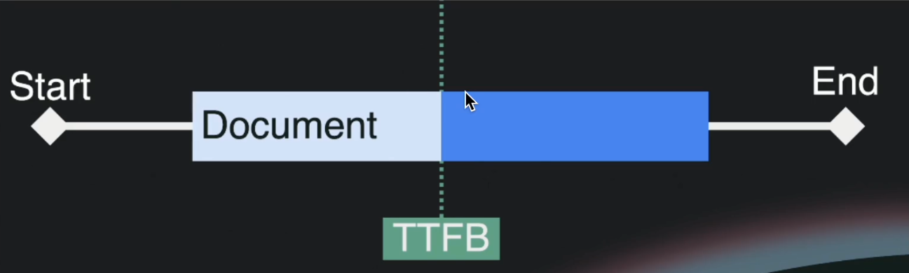

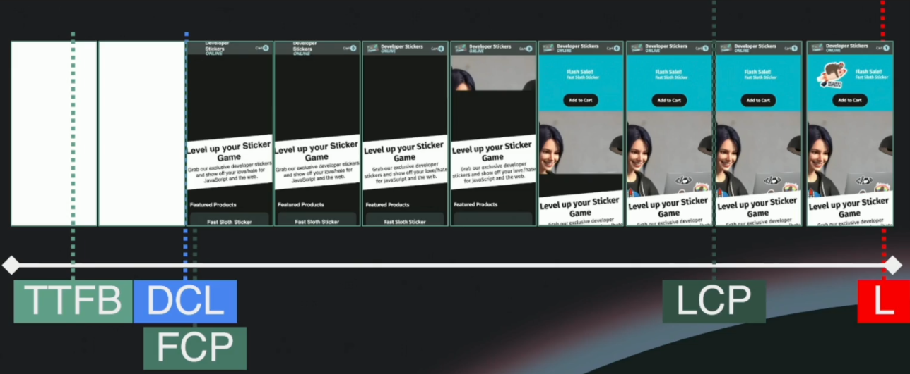

## 八、怎么在浏览器里拿到这些性能数据

页面里自定义的耗时、资源请求和导航记录，可以从 Performance API 开始采集。

## 九、Performance API 基础

### 1. 它是什么

Performance API 是浏览器提供的一组高精度的性能接口，能拿到：

- 页面加载时间
- 资源加载信息
- 自定义打点的耗时
- 和 Web Vitals 相关的性能数据

### 2. `timeOrigin`

这是性能计时的起点，弄懂它才好看懂瀑布图、事件时序和 `performance.now()` 的相对时间。

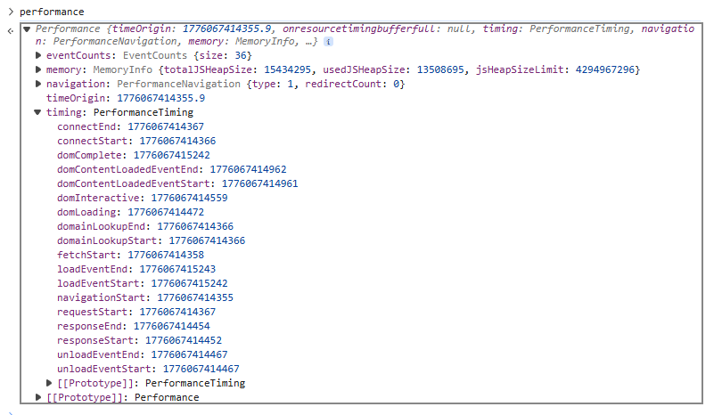

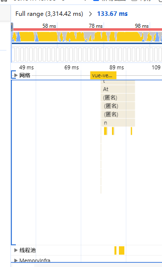

### 3. `performance.now()`

它返回相对 `timeOrigin` 的高精度时间，适合统计函数耗时。

```js
const start = performance.now();
doSomething();
const end = performance.now();

console.log(`耗时：${end - start}ms`);
```

start 和 end 用的是同一个相对时间起点，两个一减就是 doSomething 的执行时间。

### 4. `mark()` 与 `measure()`

这一组 API 很适合做业务打点：

```js
performance.mark("list-start");
renderList();
performance.mark("list-end");
performance.measure("list-render", "list-start", "list-end");
```

两个 mark 定下起止点，measure 生成一条叫 list-render 的测量记录，之后可以和其他性能条目一起读出来。

### 5. `getEntries()` 系列

能拿到性能条目，比如资源请求、导航记录、测量结果等。

## 十、Performance API 的局限

只靠主动读 Performance API，有几个限制：

- 有些关键指标没法直接从传统接口里稳定拿到
- 有些性能数据错过了时机，后面就不好补采了
- 光靠轮询 `getEntries()` 不够优雅

要持续采集的话，`PerformanceObserver` 更合适。

## 十一、PerformanceObserver 如何连续采集

### 1. 为什么用观察器

- 以观察的方式拿数据
- 不用一直主动去扫
- 更适合实时监控
- 能拿到更多关键的性能条目

### 2. 最基本的写法

```js
const observer = new PerformanceObserver((list) => {
  for (const entry of list.getEntries()) {
    console.log(entry.name, entry.startTime, entry.duration);
  }
});

observer.observe({
  type: "largest-contentful-paint",
  buffered: true,
});
```

回调每次收到一批条目，示例一条条输出名称、开始时间和持续时间。这里只订阅了 LCP 类型。

### 3. `buffered: true` 的意义

观察器可能在页面启动以后才注册。开了 buffered，它会顺带读到已经产生的相关条目，少漏一些早期的数据。

相关的图：

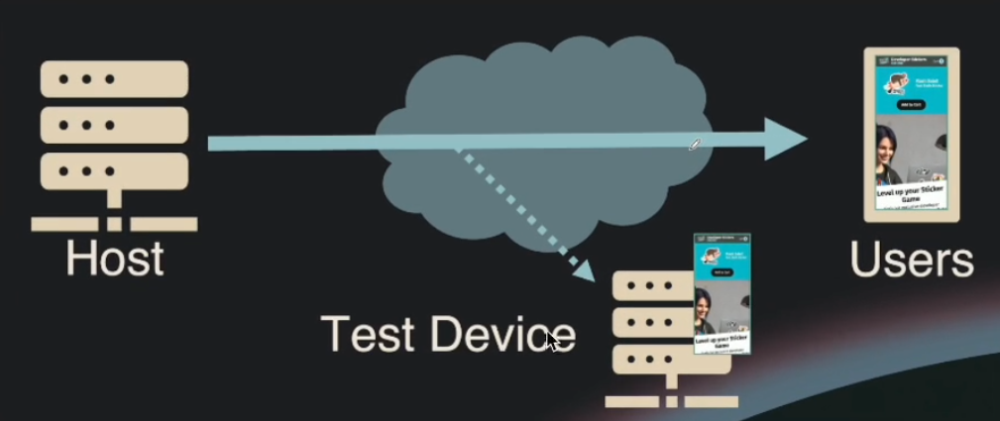

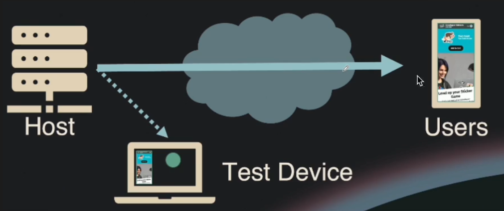

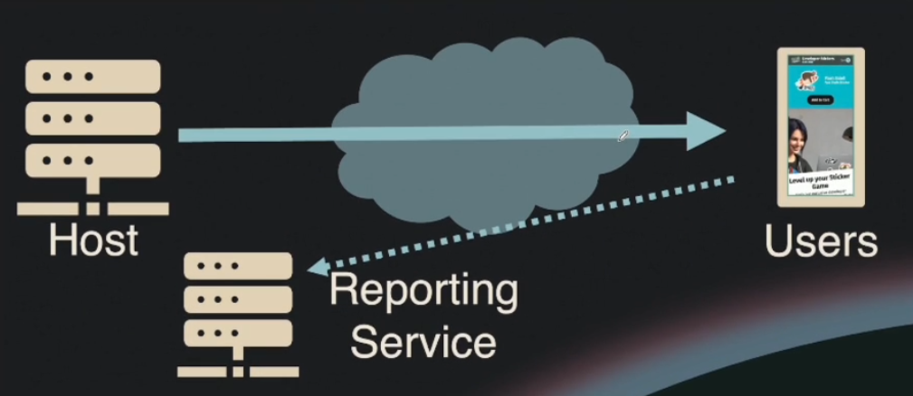

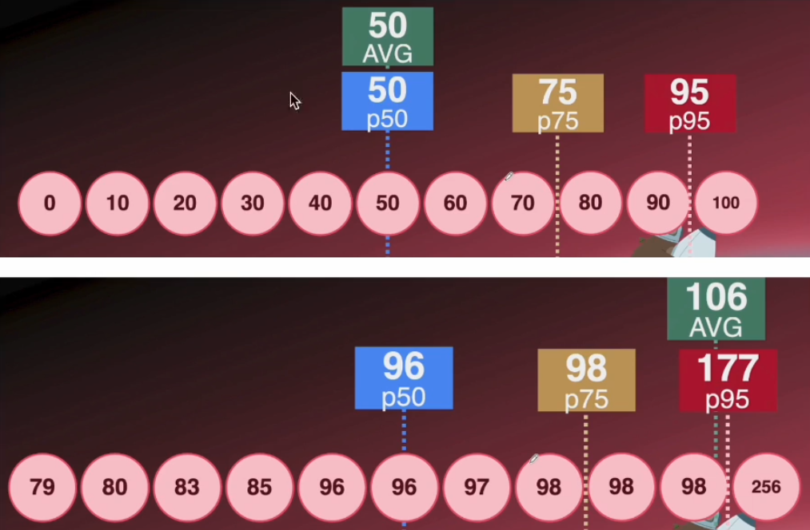

## 十二、性能测试数据要分清 Lab Data 和 Field Data

一次能重复的实验代表不了所有真实用户，真实用户的数据又不适合单独拿来复现问题。两类数据要配合着用。

### 1. Lab Data

实验室数据，来自可控的环境，比如：

- Lighthouse
- DevTools Performance
- WebPageTest

好处是能重复、能对比，适合排查问题。

### 2. Field Data

真实用户数据，来自真实的设备、网络、地域和交互。

典型的来源：

- CrUX
- RUM 平台
- 自建的埋点监控

一般这样搭配：

- 用 Lab Data 定位问题
- 用 Field Data 判断真实的影响

## 十三、常见性能工具怎么搭配

### 1. Lighthouse

适合快速做一次整体的健康检查，但别把分数当成唯一的目标。

### 2. Chrome DevTools Performance

适合看：

- 长任务
- 主线程在忙什么
- Layout / Paint / Script 的时间
- FPS 的波动

### 3. WebPageTest

更适合对比网络链路、地域和设备的差异。

### 4. Web Vitals 扩展、CrUX、RUM

更适合补上真实用户的视角。

相关的图：

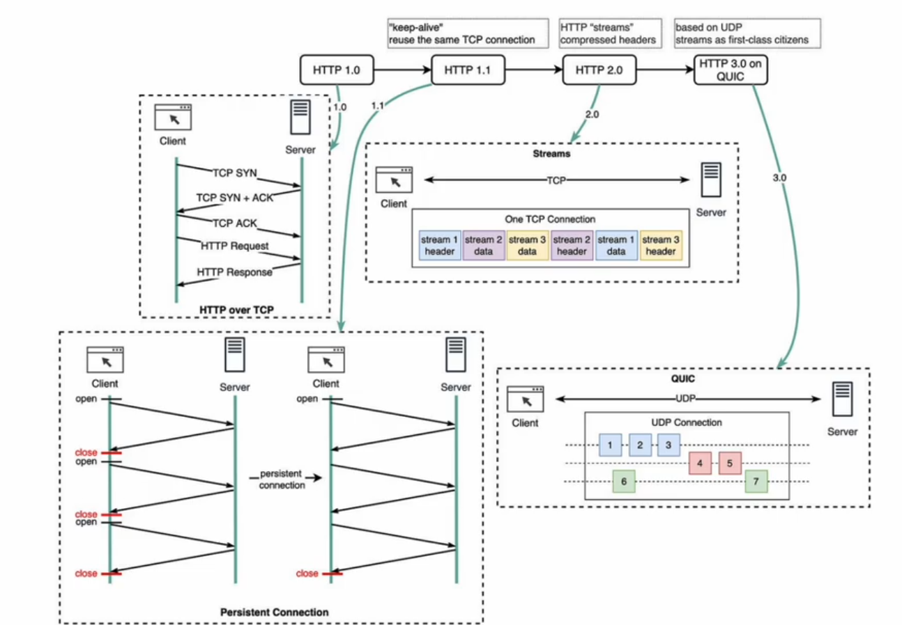

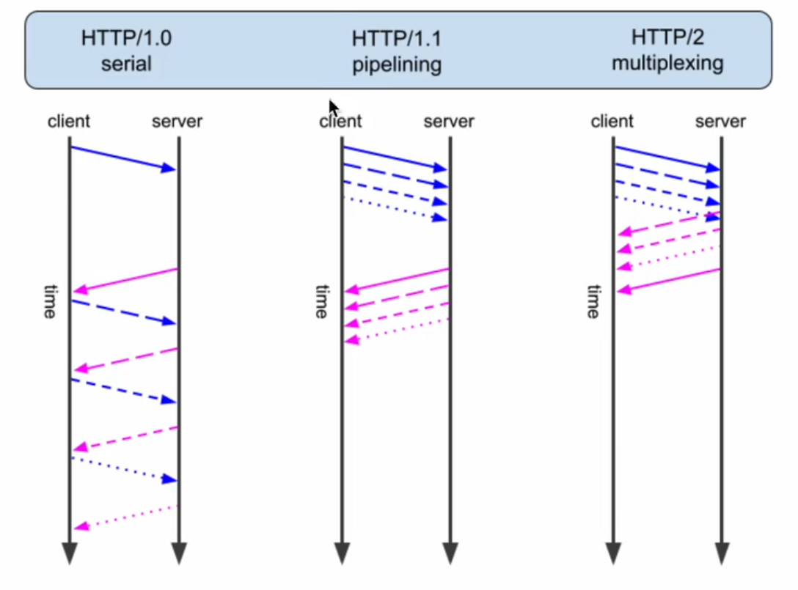

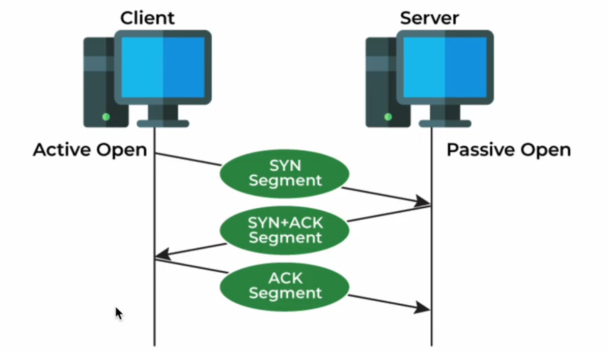

## 十四、性能差了以后，具体怎么优化

优化动作要和出问题的指标一一对应，不然改了一堆配置，也很难证明到底是哪一项起了作用。

### 1. 优化 TTFB

- 提升服务端的响应速度
- 开 Gzip / Brotli 压缩
- 优化协议和接入层
- 让用户离服务更近，比如上 CDN

### 2. 优化 FCP

- 缩短关键渲染路径的依赖链
- 预加载关键资源
- 别让首屏被大块的 JS/CSS 阻塞

### 3. 优化 LCP

- 首屏大图做预加载
- 用更合适的图片格式
- 做好缓存和缓存头控制
- 别让主线程被重任务占满

### 4. 优化 CLS

- 给图片、广告、懒加载容器预留尺寸
- 别在已有内容的上方插入异步内容
- 字体加载策略稳妥一些

### 5. 优化 INP

- 减少长任务
- 拆分重计算
- 把主线程让出来
- 降低事件回调里的复杂度

## 十五、虚拟列表只解决一类问题

列表滚动卡顿时，可以按这个顺序查：

1. DOM 数量是不是太多
2. 单个 item 是不是太重
3. 是不是频繁触发回流重绘
4. 主线程是不是被 JS、Layout、Paint 占满了
5. 做开关对比，验证虚拟列表是不是真的打中了瓶颈

虚拟列表只解决"同时渲染的 DOM 太多"这一类问题。开关前后没什么变化的话，就接着查组件渲染、布局计算和主线程上的长任务。

## 十六、说明性能结果时别漏掉这些信息

### 1. 指标要带上含义和现场

只报缩写和分数，定位不了问题。至少要说清楚：它衡量什么，在哪个页面、哪台设备上采集的，出问题一般是什么原因。

### 2. 观察器启动时间可能漏数据

页面早期已经产生的记录，要配合 `buffered: true` 读，不能只看注册之后的新记录。`PerformanceObserver` 什么时候注册，也要写进采集方案里。

### 3. Lighthouse 分数不是全部

要结合 Performance 面板、真实用户监控和优化前后的对比，才能判断分数的变化是不是真的改善了用户体验。

### 4. 每条建议都要能回到指标

比如：

- LCP 差，就说预加载首屏大图、优化关键链路
- CLS 差，就说预留空间
- INP 差，就说释放主线程、拆长任务

## 一条可执行的排查顺序

先复现用户感受到的慢，再选对应的指标；用 Network 或 Performance 面板定位到请求、渲染还是主线程的瓶颈；最后只改最可疑的那一段，并对比修改前后的 Lab Data 和 Field Data。这样才能说清问题在哪，也能说清这次优化到底有没有用。
