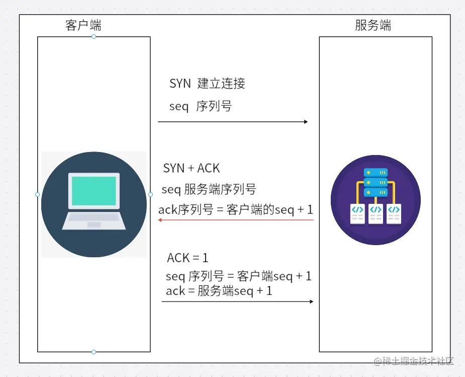
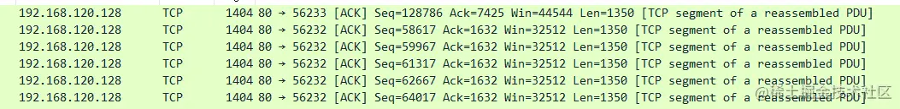
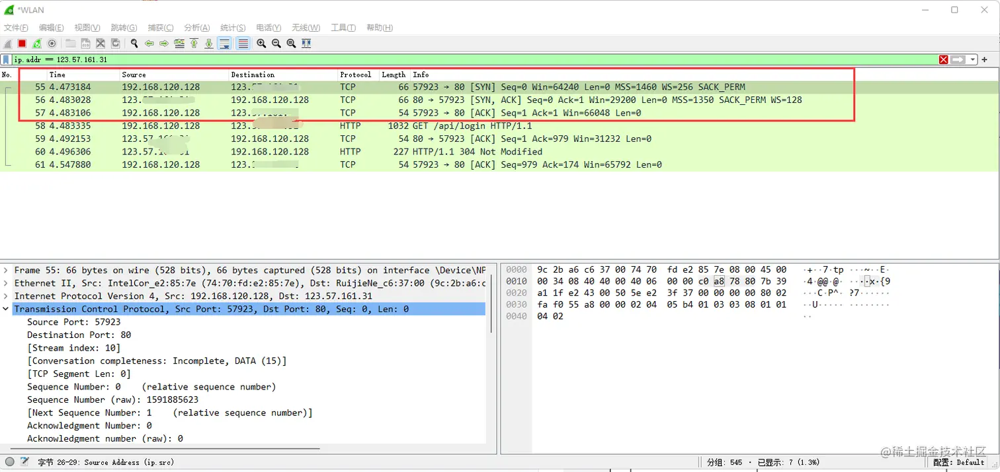
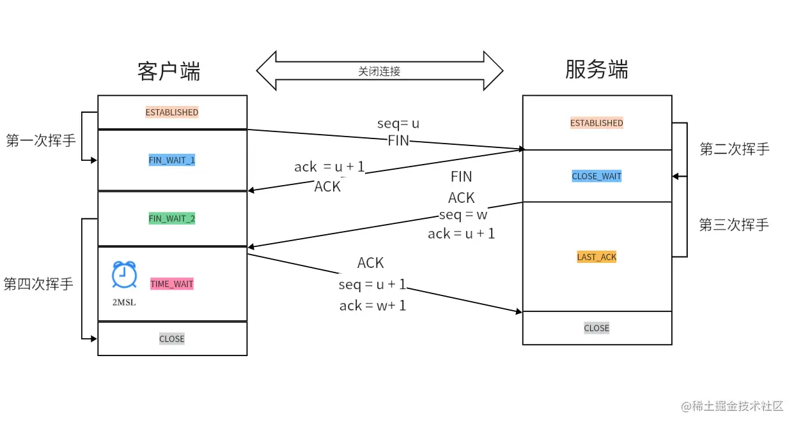

在地址栏输入 URL 以后，浏览器要先找到服务器，再建连接、发请求、处理响应。缓存决定要不要重新下载，同源策略决定前端能不能读跨站的响应，鉴权信息让服务器认出请求的是谁。

## 一、从浏览器输入 URL 开始，到底发生了什么

整条链路可以分成 URL 解析、DNS 查询、TCP 或 QUIC 建连、HTTP 交互、缓存判断和页面渲染。后面讲的跨域、SSE 和 JWT，分别对应读取的边界、持续推送和身份校验。

## 二、URL 结构先要说清楚

一个 URL 常见的组成：

- 协议：`http`、`https`
- 域名
- 端口
- 路径
- 查询参数
- hash

协议、域名和端口一起决定请求发到哪，路径、查询参数和 hash 用来定位具体的资源或页面状态。

## 三、DNS 域名解析是怎么做的

DNS 解析先试着复用本地的结果，没命中再去问 DNS 服务器。

### 1. 本地查找顺序

浏览器一般先看本地有没有结果，比如：

- 浏览器缓存
- 系统缓存
- hosts 文件

### 2. 远程递归解析

本地没有的话，就去问本地的 DNS 服务器，再一级级往上找权威服务器，最后拿到目标 IP。

## 四、TCP 三次握手为什么存在

在 HTTP/1.1 和 HTTP/2 里，TCP 还是建立可靠连接的基础。



建连接时，两端要确认：

- 能不能发
- 能不能收
- 初始序列号同步了没有

### 三次握手的报文顺序

1. 客户端发 `SYN`，想建立连接
2. 服务端回 `SYN + ACK`
3. 客户端再回 `ACK`

抓包分析时会看到这些字段：

- `seq`
- `ack`
- `SYN`
- `ACK`
- `FIN`

seq 和 ack 跟踪字节序号和确认的位置，SYN 用来建立连接，FIN 用来结束发送方向。



## 五、TCP 四次挥手为什么比三次握手多一次

断开连接时，双方关闭发送和接收一般不是同一时刻完成的，所以要拆得更细，分成四步。



可以简化成：

1. 我不发了
2. 我知道你不发了
3. 我这边也发完了
4. 我知道你这边也发完了



## 六、HTTP 请求如何选方法和请求头

### 1. 请求方法

常见的方法：

- `GET`
- `POST`
- `PUT`
- `PATCH`
- `DELETE`
- `OPTIONS`

### 2. `OPTIONS` 预检什么时候触发

请求不是"简单请求"时，浏览器会先发一个 `OPTIONS` 预检请求，确认服务器允不允许跨域、允许哪些方法、允不允许自定义的头。

常见的触发条件：

- 用了不常规的方法
- 带了自定义的请求头
- `Content-Type` 不在简单请求的范围里

## 七、浏览器缓存机制一定要和状态码一起记

### 1. 强缓存

强缓存命中时，浏览器直接用本地的副本，不向服务器发请求。

常见的控制字段：

- `Cache-Control: max-age=...`
- `Expires`

命中时一般会在 DevTools 里看到：

- `from memory cache`
- `from disk cache`

### 2. 协商缓存

强缓存过期了，请求才接着走协商缓存。

两组常见的头：

- `Last-Modified` / `If-Modified-Since`
- `ETag` / `If-None-Match`

`ETag` 一般精度更高。

### 3. 完整流程

1. 先查强缓存
2. 强缓存失效了，发请求走协商缓存
3. 资源没变，返回 `304`
4. 资源变了，返回 `200 + 新内容`

## 八、HTTP 状态码怎么分组记忆

HTTP 状态码按类别表达请求处理到了哪一步，排查时先看第一位数字。

### 1xx：信息类

- `100 Continue`
- `101 Switching Protocols`

### 2xx：成功类

- `200 OK`
- `201 Created`
- `202 Accepted`
- `204 No Content`
- `206 Partial Content`

### 3xx：重定向类

- `301 Moved Permanently`
- `302 Found`
- `304 Not Modified`
- `307 Temporary Redirect`
- `308 Permanent Redirect`

重定向和缓存里要特别分清：

- `301` 和 `302` 有什么区别
- `307` / `308` 为什么强调保留请求方法
- `304` 为什么是缓存优化里的关键状态码

### 4xx：客户端错误

常见的有 `400`、`401`、`403`、`404`。

### 5xx：服务端错误

常见的有 `500`、`502`、`503`、`504`。

## 九、跨域为什么会发生，怎么解决

### 1. 什么是跨域

协议、域名、端口有任何一个不一样，就不是同源。

### 2. 为什么会有跨域限制

浏览器的同源策略要保护用户安全，不让页面随便读别的站点的敏感资源。

### 3. 常见解决方案

#### JSONP

JSONP 只支持 `GET`，靠的是 `script` 标签能跨域加载资源这个特点，新项目一般不用了。

#### 开发环境代理

Vite 和 Webpack Dev Server 都能让前端请求先到本地代理，再由代理去访问目标服务。

#### CORS

后端用 CORS 响应头声明允许的源、方法和请求头，浏览器校验通过后才把响应交给页面。

#### Nginx 反向代理

Nginx 可以把好几个后端服务挂到同一个域名入口下，前端只请求这个统一的入口。

CORS 放行和缓存命中是两层机制。就算服务器返回了 `304`，跨域的页面能不能读到响应，还是由 CORS 响应头决定。

## 十、SSE 和 WebSocket 到底怎么区分

实时数据不一定要双向通信。日志流、通知和 AI 的流式输出，只需要服务器一直给页面发消息，正好是 SSE 的模型。

### 1. SSE 是什么

SSE（Server-Sent Events）是服务器向客户端单向、持续推送消息的能力。

### 2. 前端 API

建好 EventSource 以后，浏览器会保持连接，服务器发来的默认消息会进 onmessage 回调：

```js
const source = new EventSource("/sse");

source.onmessage = (event) => {
  console.log(event.data);
};
```

消息内容在 event.data 里。连接断了的话，EventSource 还会按协议的行为去重连。

### 3. 服务端必须返回哪些头

典型的响应头：

```http
Content-Type: text/event-stream
Cache-Control: no-cache
Connection: keep-alive
```

Content-Type 声明这是事件流，禁用缓存能避免中间层把消息攒起来，keep-alive 用来保持长连接。

### 4. SSE 和 WebSocket 的差异

- SSE：服务端到客户端单向推送
- WebSocket：双向实时通信
- SSE 基于 HTTP，更轻
- WebSocket 更适合强交互的场景

AI 打字机、日志流、通知流用 SSE 很合适；聊天室、协同编辑、游戏对战这种，一般更偏向 WebSocket。

## 十一、HTTP 版本在解决什么

### 1. HTTP/1.0

连接复用能力弱，很多请求的开销大。

### 2. HTTP/1.1

支持长连接，现在还是用得最广的版本之一。

### 3. HTTP/2

用二进制分帧组织消息，靠多路复用减少并发请求的连接成本，用头部压缩减少重复的字段。

### 4. HTTP/3

基于 QUIC，不再依赖 TCP，重点是进一步优化弱网、丢包和建立连接的成本。

### 5. HTTPS

本质是 HTTP + TLS。

它靠加密、完整性校验和证书验证，分别解决窃听、篡改和冒充的问题。

## 十二、JWT 鉴权怎么理解

JWT 把声明和签名放进 token，服务器验证签名以后，就能确认内容有没有被篡改。

### 1. JWT 结构

JWT 由三部分组成：

- Header
- Payload
- Signature

### 2. 它的优点

- 无状态，服务端不一定要存会话
- 前后端分离的项目里很常见
- 移动端和多端接入都比较自然

### 3. 它的缺点

- 一旦签发出去，就不太容易主动让它失效
- 放在不安全的位置的话，有泄漏的风险
- Payload 只是 Base64URL 编码，没有加密

### 4. 前端常见使用流程

1. 用户登录成功后拿到 token
2. 前端存下 token
3. 之后的请求在请求头里带上
4. 服务端校验合不合法、过没过期

实际用的时候，还要想清楚 token 存在哪、过期怎么处理、怎么刷新，以及 XSS 和 CSRF 的防护，不能只停在签发和校验这两步。
